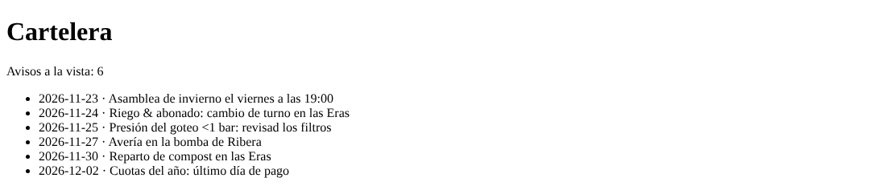
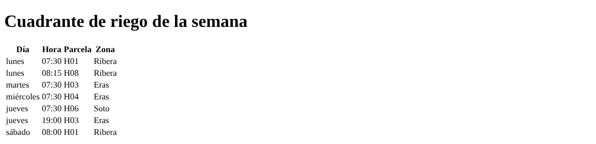
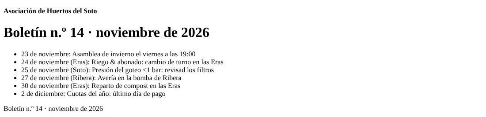
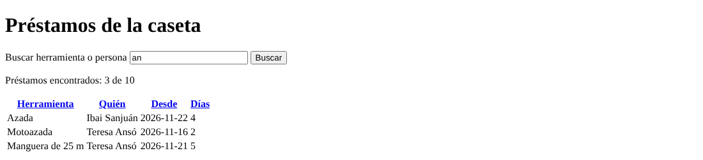
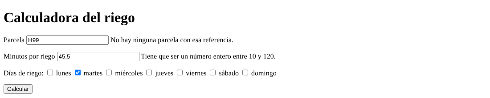
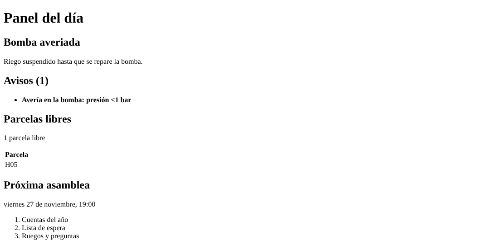
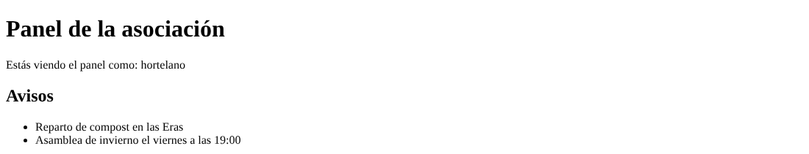
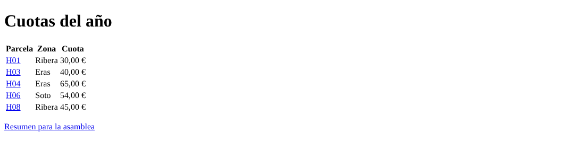

# Cuaderno de prácticas · Desarrollo Web en Entorno Servidor

**Módulo 0613 — Desarrollo Web en Entorno Servidor · 2.º DAW · IES Río Arba · Curso 2026-27**

Este cuaderno reúne **ejercicios extra de clase**: prácticas más largas que los ejercicios de cada apartado de los apuntes, pensadas para trabajarlas en el aula con el enunciado delante y el intérprete abierto. **No son evaluables**: no se entregan por ningún canal ni cuentan para la nota. Sirven para lo que sirven los apuntes cuando dicen «ejecuta, rompe y arregla»: para que el método te salga solo cuando llegue la actividad evaluativa y el examen.

Cómo funciona:

- Cada práctica lleva el código **CPu.n**: cuaderno de prácticas, unidad *u*, número *n*. CP2.1 es la primera práctica de la UD2.
- Se trabaja **en clase**, de forma individual o en pareja, según se indique ese día. Lo que no te dé tiempo a terminar en el aula lo acabas en casa y lo traes a la sesión de corrección.
- **La solución no está aquí.** Se corrige en clase y, después de corregirla, el docente la publica en el Classroom del módulo, con los ficheros resueltos para que los ejecutes y los compares con los tuyos.
- Las prácticas se hacen con el mismo entorno de la unidad: `php -l` antes de ejecutar, `php -S` para servir y el navegador con su pestaña Red. Trabaja en una carpeta local propia (por ejemplo `cuaderno/ud2/cp2-1/`), fuera de tu repositorio de la unidad en el aula de código, para no mezclarlas con la entrega evaluable. Los ficheros de partida de las prácticas que los necesitan están en el repositorio de recursos (enlace en Classroom).
- Cada práctica indica su **nivel** (básico, intermedio, avanzado o tipo examen) y un **tiempo orientativo**. Son acumulativas: cada una puede usar todo lo visto en las anteriores.
- **Casi todas traen un error que cazar** en su fichero de partida, del tipo de los del apartado de errores frecuentes de cada unidad. Encontrarlo, entender el mensaje y arreglarlo es parte de la práctica.
- Puedes usar un asistente de IA en estas prácticas, con cabeza y con responsabilidad sobre el resultado, con la misma regla del módulo: el uso se declara —aquí, de palabra, cuando se corrige en clase, porque no hay entrega— y lo que traes lo explicas. Ejecuta y comprueba todo código que te dé un asistente: la IA se equivoca con soltura en detalles de PHP (ver el apartado 12 de cada unidad).

El cuaderno crece durante el curso: solo aparecen las unidades que tienen prácticas extra, y cada unidad va ganando prácticas a medida que se trabajan en clase.

## UD2 · Código embebido en lenguajes de marcas: sintaxis, estructuras, funciones y formularios

Las prácticas de esta unidad trabajan sobre un mismo caso, distinto del club de montaña de los apuntes y de la protectora de la actividad evaluativa: la **Asociación de Huertos del Soto**, una asociación vecinal ficticia que gestiona ocho parcelas de huerto en Tauste. Cada parcela tiene un código, está en una zona del huerto (Ribera, Eras o Soto), mide unos metros cuadrados, se riega por goteo o a manta, y está adjudicada a un socio o libre. Los datos son de aula, inventados. Con ellos se repasa la unidad apartado a apartado, de CP2.1 a CP2.10, y se cierra con un simulacro de examen, el CP2.11.

### CP2.1 · Dos ficheros, dos caminos

**Nivel** básico · **Tiempo orientativo** 15 min.

**Qué refuerza.** El apartado 1 de la [UD2](ud2-codigo-embebido-php.md): el intérprete y su servidor embebido, `php -l` como primer reflejo, las etiquetas `<?php ?>` y `<?= ?>`, la convención de omitir el cierre en los ficheros de PHP puro, y los comentarios PHP y HTML con sus dos destinos.

**Ficheros de partida.** `cp2-1/tablon.php` y `cp2-1/cartel.php`, en el repositorio de recursos (enlace en Classroom). Cópialos a tu carpeta de trabajo.

**Enunciado.** La asociación tiene dos textos que mantener: el tablón de anuncios, que el secretario imprime desde el terminal, y el cartel de la puerta, que se sirve como página. El primero se ha roto y el segundo cuenta más de lo que debe.

**Tareas.**

- **(a) El tablón, por el terminal.** Pásale `php -l` a `tablon.php` **antes** de ejecutarlo. Copia el mensaje completo y localiza con él el error: fíjate en que el mensaje te da una línea de inicio, no la línea donde «falta» algo. Arréglalo, vuelve a pasar `php -l` y ejecútalo con `php tablon.php`. Pega la salida como comentario al final del propio fichero y comprueba que el fichero sigue sin etiqueta de cierre.
- **(b) El cartel, servido.** Lanza `php -S localhost:8000` en la carpeta y pide `http://localhost:8000/cartel.php` con el navegador. Abre el código fuente recibido y márcalo línea a línea: cuáles del fichero original viajaron tal cual, cuáles se transformaron y cuáles no viajaron. Mira también la pestaña Red: ¿qué código de estado y qué tipo de contenido trae la respuesta?
- **(c) Lo que no debe viajar.** En el código fuente recibido hay un dato que la asociación no quiere publicar. Cámbialo de sitio para que **se quede en el servidor** sin borrarlo (el secretario quiere seguir viéndolo cuando edita el fichero), vuelve a pedir la página y demuestra con el código fuente recibido que ya no viaja. Explica en una línea qué diferencia hay entre los dos tipos de comentario de este fichero, en términos del reparto cliente/servidor.
- **(d) Dos caminos, un fichero.** Ejecuta `cartel.php` también por el terminal (`php cartel.php`) y compara su salida con la respuesta servida. ¿Qué es idéntico y qué cambia? ¿Quién añade la línea de estado y las cabeceras que ves en la pestaña Red?

**Cómo trabajar.** Primero `php -l`, siempre. Cuando el comprobador te dé una línea, abre el fichero por ahí y lee hacia arriba y hacia abajo: el número que te da es donde el intérprete se dio cuenta, no necesariamente donde está la causa. Para ver el código fuente recibido usa «Ver código fuente» del navegador o la pestaña Red, nunca el inspector de elementos (el inspector te enseña el árbol ya interpretado, no los bytes que llegaron).

### CP2.2 · La ficha de la parcela

**Nivel** básico · **Tiempo orientativo** 15 min.

**Qué refuerza.** El apartado 2 de la [UD2](ud2-codigo-embebido-php.md): los cuatro tipos escalares y `null` con `var_dump`, comillas simples frente a dobles, la interpolación con llaves, la concatenación, bytes frente a caracteres, el formato español con `number_format` y la comparación estricta.

**Fichero de partida.** `cp2-2/ficha.php`, en el repositorio de recursos (enlace en Classroom). Tiene cinco bloques numerados.

**Enunciado.** La ficha de la parcela H06 reúne, en un solo fichero, todo lo que el apartado 2 enseña sobre variables y cadenas. El último bloque busca un código en la lista de espera de la asociación —donde conviven códigos antiguos con un cero delante (`010`) y códigos nuevos (`10`), que son parcelas distintas— y encuentra más de lo que debería.

**Tareas.**

- **(a) Predice sobre papel.** Antes de ejecutar nada, escribe la salida exacta que esperas de cada uno de los cinco bloques, línea a línea. En el bloque 1 incluye el tipo y, en la cadena, el número que `var_dump` va a mostrar entre paréntesis.
- **(b) Ejecuta y compara.** Pásale `php -l` y ejecuta `php ficha.php`. Para cada línea que no coincida con tu predicción, escribe el concepto que la explica: interpolación, literalidad de las comillas simples, llaves, concatenación, bytes frente a caracteres, formato. Si tu intérprete no tiene la extensión `mbstring`, el bloque 3 fallará con una función indefinida: anota el mensaje, es también un dato (y explica por qué los apuntes insisten en `mb_strlen` para texto en español).
- **(c) Caza el error.** El bloque 5 encuentra dos parcelas cuando solo busca una. Explica por qué, con el vocabulario del apartado 2 (qué hace PHP al comparar dos cadenas numéricas con `==`), y arréglalo con la comparación que la regla de la casa manda. Confirma que ahora solo aparece `10`.
- **(d) Lo mismo sin bucle.** Sustituye la búsqueda por `in_array` con su tercer argumento a `true` y comprueba con `var_dump` tres búsquedas: `'10'`, `'010'` y `'0010'`. Razona qué habría pasado con la tercera si el tercer argumento fuera `false`.

**Cómo trabajar.** La predicción escrita es la parte que vale: si ejecutas primero, el ejercicio se reduce a copiar. Ten a mano la tabla de transferencia Java → PHP del apartado 2 y la lista de valores falsos del apartado 4 para la tarea (c) del CP2.4.

### CP2.3 · La directiva que para en la frontera

**Nivel** básico · **Tiempo orientativo** 15 min.

**Qué refuerza.** El apartado 3 de la [UD2](ud2-codigo-embebido-php.md): `declare(strict_types=1)` como directiva que modifica el comportamiento predeterminado, la coerción frente al `TypeError`, y la configuración del intérprete (`php --ini`, opción `-d`).

**Fichero de partida.** `cp2-3/riego.php`, en el repositorio de recursos (enlace en Classroom).

**Enunciado.** La asociación cobra el agua por horas de riego. La función `coste_riego(int $horas, float $precio_hora): float` calcula el importe, y el fichero la llama con los dos valores **como cadenas**, que es exactamente como llegarán de un formulario en el apartado 9. Alguien ha añadido la directiva de tipos estrictos, pero el fichero ya no pasa el comprobador.

**Tareas.**

- **(a) Caza el error.** Pásale `php -l`. Lee el mensaje con calma: te dice qué regla de colocación tiene la directiva. Arregla el fichero moviendo **una sola línea** y confirma que `php -l` pasa.
- **(b) Sin directiva y con directiva.** Ejecuta el fichero arreglado: pega la salida completa. Después haz una copia `riego-sin-directiva.php` sin la línea de la directiva y ejecútala: pega su salida. Identifica en el mensaje del `TypeError` las **cuatro informaciones** que te da (qué función, qué argumento, qué tipo esperaba y desde qué línea se llamó) y escribe en dos líneas qué comportamiento predeterminado modificó la directiva.
- **(c) Cómo lo vería producción.** Ejecuta `php -d display_errors=0 -d log_errors=0 riego.php` y, a continuación, consulta el código de salida del proceso (`echo $?` en macOS y Linux; `echo %errorlevel%` en el símbolo del sistema de Windows; `echo $LASTEXITCODE` en PowerShell). Sin ningún mensaje en pantalla, ¿cómo sabe quien lanza el programa que ha fallado? Ejecuta también `php --ini` y anota qué fichero de configuración carga tu intérprete.
- **(d) La conversión, a conciencia.** Haz una tercera copia `riego-convertido.php` que mantenga la directiva y **convierta antes de llamar**: las horas con `filter_var` y `FILTER_VALIDATE_INT` (comprobando el fallo con `=== false`, como enseña el apartado 10), y la tarifa tomada de una constante del fichero, no del valor recibido. Explica en una línea por qué la tarifa no debe venir de quien envía el formulario.

**Cómo trabajar.** La tarea (d) adelanta una herramienta del apartado 10; si todavía no lo has leído, déjala para la sesión de corrección. Lo importante hoy es la (b): saber leer un `TypeError` y entender que la directiva no «rompe» el programa, lo hace fallar donde toca.

### CP2.4 · Tramos y etiquetas

**Nivel** intermedio · **Tiempo orientativo** 20 min.

**Qué refuerza.** El apartado 4 de la [UD2](ud2-codigo-embebido-php.md): `if`/`elseif`/`else` con las ramas en orden, `match` como expresión con agrupación de casos y `default`, y la veracidad de los valores que no son booleanos.

**Fichero de partida.** `cp2-4/tramos.php`, en el repositorio de recursos (enlace en Classroom).

**Enunciado.** La cuota anual de una parcela depende de su superficie por tramos —hasta 50 m², 30 €; de 51 a 80, 45 €; más de 80, 60 €— y cada parcela lleva una etiqueta según su tipo de riego. El fichero resuelve las dos cosas con cadenas `if`/`elseif`/`else`, pero una de las dos cadenas esconde un fallo que solo asoma con un valor que no está previsto.

**Tareas.**

- **(a) Caza el error.** Ejecuta el fichero con los tres valores de superficie que indica la cabecera (40, 65 y 100) y con los tres de riego (`goteo`, `manta` y `aspersion`). Con `aspersion` la etiqueta es incorrecta y, además, la última línea de la salida delata que ha pasado algo más. Explica qué hace PHP en esa condición, por qué no se detecta con `php -l` y arréglalo. Comprueba las seis combinaciones.
- **(b) De `if` a `match`.** Reescribe la etiqueta del riego como una expresión `match` que agrupe `goteo` y `microaspersion` bajo «riego localizado», dé a `aspersion` «riego por aspersión» y a `manta` «riego a manta», y cubra el resto con `default`. Ejecuta con `goteo`, `manta`, `aspersion` y `microaspersion` y anota en cuáles difiere de la cadena `if` de la tarea (a) y por qué (pista: la cadena `if` no sabía nada de esos dos valores). Escribe en una línea qué te da `match` frente a la cadena `if` ante el error de la tarea (a): ¿puede pasarle lo mismo?
- **(c) Lo que llega de un formulario.** En la asociación, el campo «¿recibo pagado?» de un formulario llega como la cadena `'0'` cuando no está marcado. Añade al final del fichero una variable `$pagado = '0'` y un `if ($pagado)` que imprima «Recibo pagado» o «Recibo pendiente». Ejecuta, y comprueba con `var_dump` qué vale `(bool) $pagado`, qué vale `(bool) 'no'` y qué vale `$pagado === '0'`. Escribe en una línea qué pregunta hay que hacerle a un dato de formulario en vez de «¿eres verdad?».

**Cómo trabajar.** El error de la tarea (a) es de los que «funcionan» en todas tus pruebas hasta que llega el valor imprevisto: por eso se prueban siempre los valores que no están en la lista, no solo los que sí. Cuando reescribas con `match`, recuerda que es una **expresión**: su valor se asigna, no se ejecuta como una sentencia.

### CP2.5 · Recorrer el huerto

**Nivel** intermedio · **Tiempo orientativo** 20 min.

**Qué refuerza.** El apartado 5 de la [UD2](ud2-codigo-embebido-php.md): arrays indexados y asociativos, `foreach` con y sin clave, acumuladores y recuentos, `while` para «hasta el primero que cumple», `in_array` estricto e `implode`.

**Ficheros de partida.** `cp2-5/datos/parcelas.php` (las ocho parcelas) y `cp2-5/recorrido.php`, en el repositorio de recursos (enlace en Classroom). Muestra del fichero de datos (cabecera y cinco filas; fichero íntegro en el repositorio de recursos):

```php
<?php
// datos/parcelas.php — parcelas de la Asociación de Huertos del Soto (datos de aula, ficticios)
// Este fichero devuelve el array: cárgalo con  $parcelas = require __DIR__ . '/datos/parcelas.php';
return [
    ['codigo' => 'H01', 'zona' => 'Ribera', 'superficie' => 60,  'riego' => 'goteo', 'adjudicada' => true],
    ['codigo' => 'H02', 'zona' => 'Ribera', 'superficie' => 45,  'riego' => 'manta', 'adjudicada' => false],
    ['codigo' => 'H03', 'zona' => 'Eras',   'superficie' => 80,  'riego' => 'goteo', 'adjudicada' => true],
    ['codigo' => 'H04', 'zona' => 'Eras',   'superficie' => 100, 'riego' => 'manta', 'adjudicada' => true],
    ['codigo' => 'H05', 'zona' => 'Soto',   'superficie' => 40,  'riego' => 'goteo', 'adjudicada' => false],
    // … (tres filas más en el fichero íntegro, hasta 8)
];
```

**Enunciado.** La asociación quiere saber, antes de la asamblea, cuántos metros tiene libres y dónde. El recorrido de partida calcula las parcelas libres y sus metros, pero los metros salen a cero y el intérprete protesta tres veces.

**Tareas.**

- **(a) Caza el error.** Ejecuta `php recorrido.php` desde la carpeta de la práctica. Lee los avisos: te dicen la clave y la línea. Explica por qué el recuento de parcelas es correcto y el de metros no, qué valor está sumando PHP en realidad (recuerda el apartado 11), y arréglalo. Comprueba que ahora los metros libres cuadran con la suma a mano de las parcelas libres del fichero de datos.
- **(b) Metros por zona.** Con un segundo `foreach` y un array asociativo como acumulador, calcula los metros totales de cada zona (adjudicadas y libres) e imprímelos con un `foreach` con clave, una zona por línea. Usa `??` para que el acumulador no proteste la primera vez que aparece cada zona.
- **(c) La primera que cumple.** Con un bucle `while` —no con `foreach`— localiza la **primera parcela libre con riego por goteo** e imprime su código y su zona. Explica en una línea por qué `while` encaja mejor aquí que recorrer todo el array.
- **(d) Las zonas, sin repetir.** Construye la lista de zonas del huerto sin repeticiones, en el orden en que aparecen, con `in_array` estricto, e imprímela en una sola línea con `implode`, seguida de cuántas son entre paréntesis.

**Cómo trabajar.** El fichero de datos se carga con `require` y devuelve el array: no lo copies dentro de tu programa. Cuando una suma te dé cero o un aviso hable de una clave, comprueba la ortografía de la clave contra el fichero de datos antes de tocar la lógica: la causa casi siempre está ahí.
### CP2.6 · Las utilidades de la asociación

**Nivel** intermedio · **Tiempo orientativo** 35 min (20 + 15 de la tarea desde cero).

**Qué refuerza.** El apartado 6 de la [UD2](ud2-codigo-embebido-php.md): funciones con tipos declarados, valores por defecto, el tipo que admite `null`, argumentos con nombre, variables locales `static` y, sobre todo, el ámbito: lo que una función necesita se le pasa.

**Ficheros de partida.** `cp2-6/utilidades.php` y `cp2-6/datos/parcelas.php`, en el repositorio de recursos (enlace en Classroom).

**Enunciado.** La asociación quiere un único fichero de funciones que use todo lo demás: la cuota anual de una parcela —por tramos de superficie, con 12 € de suplemento si riega por goteo y la bonificación vecinal del 10 % aplicada al final—, una línea de descripción, la generación del siguiente código libre y el recibo. La primera función ya está escrita y probada… y sus pruebas no cuadran con lo que dice el comentario.

**Tareas.**

- **(a) Caza el error.** Ejecuta `php utilidades.php`. La primera prueba debería dar 51,30 y da 57,00; además el intérprete avisa. Lee el aviso, localiza la variable y explica, con los términos «local» y «ámbito», por qué dentro de la función no existe y qué valor toma entonces en el cálculo (de ahí que el resultado sea «sin bonificación» y no un error). Arréglalo de la forma correcta: la bonificación entra como **parámetro con valor por defecto** (`float $bonificacion = 0.10`), no se lee de fuera. Añade una tercera prueba que la anule pasando `0.0`.
- **(b) La descripción.** Escribe `descripcion(string $codigo, int $superficie, ?string $zona = null): string`, que devuelva `H03 · 80 m² · zona Eras` y, si no hay zona, `… · zona por asignar` (usa `??`). Llámala tres veces: con los tres argumentos, con dos, y con **argumentos con nombre** en otro orden.
- **(c) El siguiente código.** Escribe `siguiente_codigo(string $prefijo = 'H'): string` con una variable local `static` que empiece en 8 (las parcelas que hay hoy) y devuelva `H09`, `H10`… con el cero de relleno mientras el número tenga una cifra. Llámala cuatro veces seguidas, la tercera con el prefijo `'T'`, e imprime los cuatro resultados en una línea. Explica qué hace `static` que una variable local normal no hace, y por qué el prefijo no reinicia la cuenta.
- **(d) El recibo.** Escribe `recibo(array $parcela): string`, que reciba una fila del fichero de datos y devuelva la descripción seguida de ` — cuota anual 51,30 €` (con `number_format`), usando `descripcion()` y `cuota_anual()` por dentro. Carga el fichero de datos con `require` e imprime el recibo de cada parcela **adjudicada**.

- **(e) Desde cero.** Fichero vacío. Escribe un programa que, para estas lecturas de agua de cuatro parcelas —H01 1200 litros, H03 2600, H04 800 y H06 3100—, calcule el importe de cada una (0,45 € por cada 100 litros; a partir de 2000 litros, el exceso se cobra a 0,60 € por cada 100) y muestre una línea por parcela, el total, el total con el recargo por retraso (el 5 % si no se indica otro) y el total con un recargo del 10 %. Decide tú las funciones, sus nombres y sus firmas: tiene que haber al menos dos, tipadas, una con un valor por defecto, y una que use a otra. Salida esperada, letra a letra:

```
H01: 1200 l → 5,40 €
H03: 2600 l → 12,60 €
H04: 800 l → 3,60 €
H06: 3100 l → 15,60 €
Total: 37,20 €
Total con recargo por retraso: 39,06 €
Total con recargo del 10 %: 40,92 €
```

**Cómo trabajar.** Una función que lee una variable de fuera «funciona» en tu prueba y falla en silencio en producción: por eso la regla de la casa es parámetros, siempre. Cuando declares tipos, pásale `php -l` y ejecuta con la directiva de tipos estrictos activa: una función que devuelve `float` y recibe un `int` por el camino te lo dirá.

### CP2.7 · La parcela como tipo compuesto

**Nivel** intermedio · **Tiempo orientativo** 35 min (20 + 15 de la tarea desde cero).

**Qué refuerza.** El apartado 7 de la [UD2](ud2-codigo-embebido-php.md): la clase como tipo que te fabricas, la promoción de propiedades en el constructor, los métodos que usan otros métodos a través de `$this`, y el array de objetos recorrido con `foreach`.

**Ficheros de partida.** `cp2-7/parcela.php` y `cp2-7/datos/parcelas.php`, en el repositorio de recursos (enlace en Classroom).

**Enunciado.** El fichero convierte las ocho filas del fichero de datos en objetos `Parcela`, con dos métodos ya escritos: `etiquetaRiego()` y `cuota()`. El recorrido final imprime una línea por parcela. `php -l` lo da por bueno; el intérprete, no.

**Tareas.**

- **(a) Caza el error.** Pásale `php -l` (no detecta nada) y ejecútalo: fatal. Lee el mensaje —habla de una constante que nadie ha definido— y explica qué está interpretando PHP en esa línea, por qué es sintaxis válida (pista: viene de Java) y por qué el comprobador de sintaxis no puede cazarlo. Arréglalo.
- **(b) El recibo, con `$this`.** Añade el método `recibo(): string`, que devuelva una línea como `H01 (Ribera, 60 m², riego localizado) — 51,30 € — adjudicada`, reutilizando `etiquetaRiego()` y `cuota()` **desde dentro** con `$this`, y con `adjudicada`/`libre` decidido con el ternario. Cambia el recorrido para que imprima `$p->recibo()`.
- **(c) El recorrido acumula.** En ese mismo `foreach`, acumula la cuota de todas las parcelas y, al salir del bucle, imprime la suma con `number_format` y cuántas parcelas son (`count`). Comprueba la suma a mano con las ocho líneas.
- **(d) Lo que te da el objeto.** Compara en dos líneas este fichero con el CP2.6: allí `recibo()` era una función suelta que recibía un array; aquí es un método que viaja con el dato. ¿Qué te garantiza el objeto sobre los campos y sus tipos que el array asociativo no?

- **(e) Desde cero.** Fichero vacío. Diseña una clase para **la cosecha de una parcela** (parcela, producto, kilos y precio por kilo en el mercadillo de la asociación), con las propiedades y los métodos que te parezcan. Tiene que poder decir la temporada del producto (tomate, pimiento y calabacín son «de verano»; acelga y borraja, «de invierno»; el resto, «de temporada sin catalogar»), calcular el importe (kilos por precio), aplicar una merma (un porcentaje de kilos que se desecha: el objeto cambia) y dar una línea de resumen que use a los otros métodos. Las cuatro cosechas: H01, 12,5 kg de tomate a 2,00 €/kg; H03, 4,0 kg de acelga a 1,50 €/kg; H06, 20,0 kg de pimiento a 2,50 €/kg; H08, 5,0 kg de borraja a 1,80 €/kg. Créalas en un array de objetos, imprime el resumen de cada una y los totales de kilos y de euros, aplica una merma del 20 % a la primera y vuelve a imprimir su resumen. Nombres de clase, propiedades y métodos, a tu elección. Salida esperada, letra a letra:

```
H01 · tomate (de verano): 12,5 kg → 25,00 €
H03 · acelga (de invierno): 4,0 kg → 6,00 €
H06 · pimiento (de verano): 20,0 kg → 50,00 €
H08 · borraja (de invierno): 5,0 kg → 9,00 €
Total: 41,5 kg · 90,00 €
Tras la merma: H01 · tomate (de verano): 10,0 kg → 20,00 €
```

**Cómo trabajar.** Cuando un error habla de «constante indefinida» y tú no has escrito ninguna constante, busca un punto donde debería haber una flecha. Y recuerda que `cuota()` ya aplica la bonificación: no la vuelvas a aplicar en `recibo()`.

### CP2.8 · El tablón como plantilla

**Nivel** avanzado · **Tiempo orientativo** 45 min (25 + 20 de la tarea desde cero).

**Qué refuerza.** El apartado 8 de la [UD2](ud2-codigo-embebido-php.md): la sintaxis alternativa de las estructuras de control en plantillas (`foreach:` … `endforeach;`, `if:` … `else:` … `endif;`), la etiqueta `<?= ?>`, el escape de salida con `htmlspecialchars` y los parciales con `include` y `__DIR__`.

**Ficheros de partida.** `cp2-8/tablon-parcelas.php`, `cp2-8/parciales/cabecera-huertos.php`, `cp2-8/parciales/pie-huertos.php` y `cp2-8/datos/parcelas.php`, en el repositorio de recursos (enlace en Classroom).

**Enunciado.** El tablón de parcelas es una página: una tabla con una fila por parcela, su estado decidido con `if:`/`else:`, un aviso de la junta en la cabecera y dos parciales. Alguien ha dejado la plantilla a medias.

**Tareas.**

- **(a) Caza el error.** Pásale `php -l`: el mensaje dice que el fichero se acaba antes de lo que el intérprete esperaba. Averigua qué estructura queda sin cerrar y dónde va su cierre (no es al final del fichero). Arréglalo y comprueba que `php -l` pasa.
- **(b) Sírvela y léela.** Lanza `php -S localhost:8000` en la carpeta y pide `tablon-parcelas.php`. En el HTML recibido: cuenta las filas de datos, localiza de dónde sale la sangría irregular de cada `<tr>` y comprueba cómo ha llegado el aviso de la cabecera (tiene `<`, `>` y `&`): ¿qué habría pasado en el navegador sin `htmlspecialchars`? Pruébalo quitándolo un momento y mirando la página y su código fuente.
- **(c) La fila de total.** Añade dentro del `foreach:` una línea PHP que acumule los metros cuadrados en una variable creada arriba, en la zona de lógica, y una fila final `Total` con esa suma después del bucle. Comprueba la cifra contra el fichero de datos.
- **(d) El pie, con dato.** Incluye `parciales/pie-huertos.php` al final de la página y haz que el pie muestre cuántas parcelas hay: define la variable en la plantilla principal **antes** del `include` y úsala dentro del parcial. Explica en una línea por qué el parcial la ve (qué hace `include` con el fichero y en qué ámbito se ejecuta).

- **(e) Desde cero.** Sin ficheros de partida. Haz una página con el **orden del día de la asamblea**: una cabecera en un parcial incluido con `include`, el título, una lista ordenada con los cuatro puntos —que viven en un array en la zona de lógica de la plantilla— con «(se vota)» en los que se votan, y un párrafo con cuántos puntos hay y cuántos se votan (contados en la propia plantilla). Dos títulos traen `&` y `<` `>`, y tienen que llegar como texto. Sintaxis alternativa y escape; decide tú los nombres de los ficheros y la forma de los datos. HTML esperado al servirla (las sangrías pueden diferir de las tuyas):

```html
<header>
    <strong>Asociación de Huertos del Soto</strong> · Asamblea de otoño
</header>
<h1>Orden del día</h1>
<ol>
        <li>Lectura &amp; aprobación de las cuentas (se vota)</li>
        <li>Cuotas 2027: propuesta &lt;provisional&gt; (se vota)</li>
    <li>Turnos de limpieza de la acequia</li>
    <li>Ruegos y preguntas</li>
</ol>
<p>4 puntos, 2 con votación.</p>
```

**Cómo trabajar.** En una plantilla, cada `foreach:` y cada `if:` tiene su cierre con nombre; cuando `php -l` hable de «fin de fichero inesperado», cuenta aperturas y cierres. Para ver la página como la recibe el cliente usa «Ver código fuente», no el inspector.

### CP2.9 · La calculadora de alta

**Nivel** avanzado · **Tiempo orientativo** 45 min (25 + 20 de la tarea desde cero).

**Qué refuerza.** El apartado 9 de la [UD2](ud2-codigo-embebido-php.md): datos que llegan por GET en la URL y por POST en el cuerpo, `$_GET` y `$_POST` con `??` e `isset`, el formulario que se envía a sí mismo distinguido con `$_SERVER['REQUEST_METHOD']`, y el escape de todo lo que viene de fuera. Adelanta `filter_var` con `FILTER_VALIDATE_INT` (apartado 10) para comprobar un número que llega como texto.

**Fichero de partida.** `cp2-9/calculadora.php`, en el repositorio de recursos (enlace en Classroom).

**Enunciado.** Quien se da de alta a mitad de año paga solo los meses que quedan: la cuota se prorratea por los meses desde el de alta hasta diciembre, el de alta incluido. La calculadora trabaja con una **cuota orientativa por tramos** (30, 45 o 60 € según la superficie, sin suplemento por goteo ni bonificación), que ya trae el fichero en `cuota_orientativa()`: **no se usa la `cuota_anual()` del CP2.6**. La página tiene dos entradas: por GET, `?mes=` calcula el prorrateo para una parcela tipo de 60 m²; por POST, un formulario con superficie y mes calcula el importe exacto. La parte GET está hecha y esconde un fallo; la parte POST te toca a ti.

**Tareas.**

- **(a) Siete peticiones.** Sirve la página y pídela con `curl` (o con el navegador) con `?mes=3`, `?mes=03`, `?mes=3.0`, `?mes=%203` (un espacio delante), `?mes=3abc`, `?mes=13` y `?mes=` (vacío). Anota qué responde cada una y explica, con `filter_var` delante, por qué `03` y `3.0` no valen y ` 3` sí. ¿Qué habría pasado con `3.0` si el valor hubiera llegado sin comprobar a una función que espera `int` con la directiva de tipos estrictos?
- **(b) Caza el error.** Pide `?mes=%3Cb%3Ehola%3C/b%3E` (es `<b>hola</b>` codificado para la URL) y mira el código fuente recibido: un dato que viene de la URL ha entrado en el HTML tal cual. Di qué regla del apartado 8 se ha saltado la página, arréglalo y vuelve a pedirlo.
- **(c) El formulario calcula.** Completa la rama POST: recoge `superficie` y `mes` de `$_POST` con `??`, comprueba que la superficie es un entero entre 20 y 120 y el mes un entero entre 1 y 12 (reutiliza la comprobación de la parte GET en una función), y responde con el importe: `Con 75 m² y alta en el mes 10 pagas este año 11,25 € (cuota orientativa de 45 €).` Si algo no vale, responde con el aviso correspondiente. Todo lo que imprimas pasa por `htmlspecialchars`.
- **(d) Pruébalo sin navegador.** Con `curl -X POST -d 'superficie=75&mes=10' …` comprueba el caso válido; después `superficie=75.5`, `mes=0` y un POST sin datos. Pega las cuatro respuestas y explica por qué el POST vacío no provoca ningún aviso de clave indefinida.

- **(e) Desde cero.** Fichero vacío. Haz la página «Riego a manta»: la acequia da 20 litros por minuto y el agua cuesta 0,45 € por cada 100 litros. Por **GET**, `?minutos=` responde cuántos litros son esos minutos (un entero del 1 al 240; si no vale, un aviso que repite el valor recibido, escapado); por **POST**, un formulario con `parcela` y `minutos` que se envía a sí mismo y responde con los litros y los euros, o con un aviso si falta la parcela o los minutos no valen. Decide tú las funciones y la estructura; el HTML es el de las salidas. Pruébala con estas siete peticiones y compara letra a letra:

`curl -s 'http://localhost:8000/riego.php'`

```html
<h1>Riego a manta</h1>
    <form action="" method="post">
        <label>Parcela: <input type="text" name="parcela"></label>
        <label>Minutos: <input type="text" name="minutos"></label>
        <button type="submit">Calcular</button>
    </form>
```

`curl -s 'http://localhost:8000/riego.php?minutos=30'`

```html
<h1>Riego a manta</h1>
    <p>30 minutos de acequia son 600 litros.</p>
    <form action="" method="post">
        <label>Parcela: <input type="text" name="parcela"></label>
        <label>Minutos: <input type="text" name="minutos"></label>
        <button type="submit">Calcular</button>
    </form>
```

`curl -s 'http://localhost:8000/riego.php?minutos=abc'` (y lo mismo con `?minutos=300`, que responde con `recibido: 300`)

```html
<h1>Riego a manta</h1>
    <p>Los minutos tienen que ser un número entero del 1 al 240 (recibido: abc).</p>
    <form action="" method="post">
        <label>Parcela: <input type="text" name="parcela"></label>
        <label>Minutos: <input type="text" name="minutos"></label>
        <button type="submit">Calcular</button>
    </form>
```

`curl -s -X POST -d 'parcela=H05&minutos=45' http://localhost:8000/riego.php`

```html
<h1>Riego a manta</h1>
    <p>La parcela H05 ha regado 45 minutos: 900 litros, 4,05 €.</p>
```

`curl -s -X POST -d 'parcela=&minutos=45' http://localhost:8000/riego.php` (y lo mismo con un POST sin datos)

```html
<h1>Riego a manta</h1>
    <p>Hace falta el código de la parcela y un número de minutos del 1 al 240.</p>
```

**Cómo trabajar.** `isset($_GET['mes'])` te dice si el parámetro vino; `filter_var` te dice si lo que vino sirve. Son dos preguntas distintas y las dos hacen falta. Y la regla del apartado 8 no distingue entre «parece inofensivo» y «es peligroso»: todo lo que viene de fuera se escapa al imprimirlo.

### CP2.10 · El alta de socio, por autoridad

**Nivel** avanzado · **Tiempo orientativo** 45 min (25 + 20 de la tarea desde cero).

**Qué refuerza.** El apartado 10 de la [UD2](ud2-codigo-embebido-php.md): la validación en el servidor como única que cuenta, `filter_var` con `FILTER_VALIDATE_INT` y `FILTER_VALIDATE_EMAIL` comprobados con `=== false`, la lista de errores acumulada y devuelta junta, y la opción de una lista cerrada comprobada con `in_array` estricto.

**Fichero de partida.** `cp2-10/inscripcion.php`, en el repositorio de recursos (enlace en Classroom).

**Enunciado.** El formulario de alta de socio pide nombre, correo, superficie deseada, años en la asociación y tipo de riego. La función `revisar_alta(array $datos): array` aplica a los cinco campos cuatro tipos de regla distintos de los del catálogo de los apuntes: campo obligatorio, correo válido, entero dentro de un rango y opción de una lista fija. Está casi bien: a un socio nuevo, con cero años de antigüedad, no le deja darse de alta.

**Tareas.**

- **(a) Caza el error.** Sirve la página y envía con `curl -X POST -d 'socio=A17&correo=a17@example.org&superficie=60&antiguedad=0&riego=goteo' …`: el servidor rechaza una antigüedad de 0 años con el mensaje de «debe ser un número entero». Localiza la comprobación que lo provoca y explica, con el `int(0)` del apartado 10 delante, por qué `!$antiguedad` confunde un cero legítimo con un fallo. Arréglalo y confirma que el alta se registra.
- **(b) Las cuatro reglas, una a una.** Envía un POST que viole las cinco comprobaciones a la vez (`socio=&correo=a17-example.org&superficie=150&antiguedad=-3&riego=aspersion`) y pega la lista de errores. Señala cuál de las reglas es de tipo, cuál de rango y cuál de lista cerrada, y por qué la superficie 150 recibe un mensaje y no dos.
- **(c) Autoridad.** El campo de riego solo admite `goteo` o `manta`. Envía un alta correcta en todo salvo en `riego=aspersion`, saltándote cualquier control que pudiera tener el navegador. Pega el rechazo y explica por qué esa decisión no puede vivir en el cliente, aunque el formulario tuviera un desplegable con solo dos opciones.
- **(d) Vacío y con marcas.** Envía un POST sin ningún dato y uno con `socio=<b>A17</b>` (codificado en la URL como `%3Cb%3EA17%3C/b%3E`). Explica por qué el primero no provoca avisos de clave indefinida (qué hace el `??` en cada regla) y qué ha pasado con las marcas del segundo en el acuse.

- **(e) Desde cero.** Fichero vacío. Haz el **parte de siembra**: un formulario con `parcela`, `cultivo`, `riego` y `superficie` que se envía a sí mismo y se revisa en el servidor con estas reglas, en este orden: la parcela es una de H01 a H08; el cultivo es tomate, pimiento, acelga o borraja; el riego es goteo o manta; la superficie sembrada es un entero entre 10 y 120 m²; y **una regla que depende de dos campos**: con riego por goteo, la superficie tiene que ser de al menos 40 m². Esa regla solo se aplica cuando el riego y la superficie valen cada uno por separado (cada error se paga una vez: goteo con 5 m² recibe solo el mensaje del rango). Si todo vale, el acuse calcula las plantas estimadas (tomate, 3 por m²; pimiento, 4; acelga, 8; borraja, 6); si no, la lista de errores y el formulario. Decide tú la estructura y las funciones. **Prueba de autoridad con `curl`:** envía goteo con 30 m² —los dos campos valen por separado— y comprueba que el servidor lo rechaza por la regla cruzada; la misma superficie a manta tiene que valer. Salidas esperadas:

`curl -s http://localhost:8000/siembra.php`

```html
<h1>Parte de siembra</h1>
    <form action="" method="post">
        <label>Parcela: <input type="text" name="parcela"></label>
        <label>Cultivo: <input type="text" name="cultivo"></label>
        <label>Riego: <input type="text" name="riego"></label>
        <label>Superficie sembrada (m²): <input type="text" name="superficie"></label>
        <button type="submit">Enviar parte</button>
    </form>
```

`curl -s -X POST -d 'parcela=H03&cultivo=tomate&riego=goteo&superficie=60' http://localhost:8000/siembra.php`

```html
<h1>Parte de siembra</h1>
    <p>Siembra registrada: H03, tomate, 60 m² con riego por goteo. Plantas estimadas: 180.</p>
```

`curl -s -X POST -d 'parcela=H03&cultivo=tomate&riego=goteo&superficie=30' http://localhost:8000/siembra.php`

```html
<h1>Parte de siembra</h1>
    <ul class="errores">
        <li>Con riego por goteo la superficie sembrada tiene que ser de al menos 40 m².</li>
    </ul>
    <form action="" method="post">
        <label>Parcela: <input type="text" name="parcela"></label>
        <label>Cultivo: <input type="text" name="cultivo"></label>
        <label>Riego: <input type="text" name="riego"></label>
        <label>Superficie sembrada (m²): <input type="text" name="superficie"></label>
        <button type="submit">Enviar parte</button>
    </form>
```

`curl -s -X POST -d 'parcela=H03&cultivo=tomate&riego=manta&superficie=30' http://localhost:8000/siembra.php`

```html
<h1>Parte de siembra</h1>
    <p>Siembra registrada: H03, tomate, 30 m² con riego a manta. Plantas estimadas: 90.</p>
```

`curl -s -X POST -d 'parcela=H03&cultivo=tomate&riego=goteo&superficie=5' http://localhost:8000/siembra.php`

```html
<h1>Parte de siembra</h1>
    <ul class="errores">
        <li>La superficie sembrada tiene que ser un entero entre 10 y 120 m².</li>
    </ul>
    <form action="" method="post">
        <label>Parcela: <input type="text" name="parcela"></label>
        <label>Cultivo: <input type="text" name="cultivo"></label>
        <label>Riego: <input type="text" name="riego"></label>
        <label>Superficie sembrada (m²): <input type="text" name="superficie"></label>
        <button type="submit">Enviar parte</button>
    </form>
```

`curl -s -X POST -d 'parcela=H09&cultivo=lechuga&riego=aspersion&superficie=5' http://localhost:8000/siembra.php` (y lo mismo con un POST sin datos)

```html
<h1>Parte de siembra</h1>
    <ul class="errores">
        <li>La parcela tiene que ser una de H01 a H08.</li>
        <li>El cultivo tiene que ser tomate, pimiento, acelga o borraja.</li>
        <li>El riego tiene que ser goteo o manta.</li>
        <li>La superficie sembrada tiene que ser un entero entre 10 y 120 m².</li>
    </ul>
    <form action="" method="post">
        <label>Parcela: <input type="text" name="parcela"></label>
        <label>Cultivo: <input type="text" name="cultivo"></label>
        <label>Riego: <input type="text" name="riego"></label>
        <label>Superficie sembrada (m²): <input type="text" name="superficie"></label>
        <button type="submit">Enviar parte</button>
    </form>
```

**Cómo trabajar.** El patrón es siempre el mismo: recoger con `??`, convertir y validar con `filter_var` comprobando `=== false`, acumular los errores y decidir al final. Prueba cada regla con un valor que la cumpla y otro que no; y prueba siempre el `0`, el vacío y el valor que no está en la lista: son los tres que rompen las validaciones escritas con prisa.
### CP2.11 · Simulacro de la unidad: la asociación, de punta a punta

**Nivel** tipo examen · **Tiempo orientativo** 70 min (10 + 25 + 23 + 12). **Para hacer cuando hayas entregado la actividad de la unidad.**

**Qué refuerza.** Toda la UD2, en la forma en que la encontrarás en la prueba escrita: fragmentos que se arreglan cambiando una línea, un fichero de funciones con tipos declarados, un listado generado desde un array con un filtro en la URL, y un formulario validado en el servidor. Se hace **sin apuntes, sin red y sin material**: solo el editor con su ayuda de funciones, el intérprete y el navegador.

**Plantilla de partida.** La carpeta `cp2-11/` del repositorio de recursos (enlace en Classroom), copiada entera a tu carpeta de trabajo. Trae `comprobar-sintaxis.php` en la raíz, la carpeta `simulacro/` con los ficheros de las cuatro partes y `simulacro/datos/parcelas.php` con las ocho parcelas del cuaderno. Las partes 3 y 4 se sirven desde `simulacro/` con `php -S localhost:8000`. No hay corrector: cada parte trae su **salida esperada**, y te compruebas tú. Los espacios de sangría de las páginas pueden diferir de los tuyos; lo que importa es el contenido de cada línea.

**Reloj.** Apunta la hora al empezar. A los 70 minutos, para y mira qué te ha faltado: eso es lo que hay que repasar antes del examen.

#### Parte 1 · Cambio mínimo (10 min)

En `simulacro/arreglos/` hay cuatro fragmentos, `a1.php` a `a4.php`, y cada uno trae en su cabecera o en su cola la salida que **debería** dar. Ninguno la da. En cada uno hay **un fallo que se arregla cambiando una sola línea** (en el `a4`, el fallo no está en `a4.php`). Ejecuta cada fragmento, compara con lo esperado, arregla la línea y vuelve a ejecutar. Hay uno de ámbito de variables, uno de condición mal escrita, uno de clave que puede no estar y uno de etiquetas. Salidas esperadas, letra a letra:

```
$ php a1.php
1 2 3
$ php a2.php
Ribera
Ribera
$ php a3.php
H02: riego a manta
$ php a4.php
<ul>
    <li>Ribera</li>
    <li>Eras</li>
    <li>Soto</li>
</ul>
```

#### Parte 2 · Fichero de funciones (25 min)

Escribe el cuerpo de las cinco funciones de `simulacro/huerto.php` sin cambiar sus firmas (todas con la directiva de tipos estrictos; las firmas y lo que hace cada una están comentados en el propio fichero): `cuota_tramo(int $superficie): int` decide por tramos; `metros_totales(array $parcelas, bool $solo_libres = false): int` recorre y acumula; `codigos_por_zona(array $parcelas): array` devuelve un array asociativo con los códigos agrupados por zona; `buscar_parcela(array $parcelas, string $codigo, ?string $zona = null): ?array` tiene un parámetro con valor por defecto y retorno anulable; `importe_zona(array $parcelas, string $zona): int` usa `cuota_tramo()`. El fichero `simulacro/pruebas.php` las llama a todas sobre el fichero de datos y **no se modifica**. Salida esperada de `php pruebas.php`, letra a letra:

```
1. 30 45 45 60
2. 590 140
3. Ribera=H01+H02+H08 Eras=H03+H04 Soto=H05+H06+H07
4. Soto 120
bool(true)
NULL
NULL
5. 135 105 135 0
```

#### Parte 3 · Listado por GET (23 min)

Completa `simulacro/tabla.php`: una tabla HTML con una fila por parcela cuya superficie sea **mayor o igual** que el parámetro `?minimo=` de la URL (si no viene, no es un entero válido o es negativo, el mínimo es 0 y se listan todas). Cada fila lleva en su `<tr>` la clase `libre` o `adjudicada`, y las celdas: código, zona (escapada), superficie con «m²», cuota calculada con `cuota_tramo()` con «€», y el estado en texto. Debajo de la tabla, un párrafo con el número de filas y los metros cuadrados que suman. Recordatorios: `<table>` es HTML de primero (`<tr>` por fila, `<td>` por celda); la clase de la fila sale de un ternario dentro de `<?= ?>`; el mínimo se lee con `??` y se comprueba con `filter_var`. Salida esperada con `?minimo=90`, letra a letra:

```html
<h1>Parcelas con al menos 90 m²</h1>
<table>
    <tr><th>Código</th><th>Zona</th><th>Superficie</th><th>Cuota</th><th>Estado</th></tr>
        <tr class="adjudicada">
        <td>H04</td>
        <td>Eras</td>
        <td>100 m²</td>
        <td>60 €</td>
        <td>adjudicada</td>
    </tr>
        <tr class="adjudicada">
        <td>H06</td>
        <td>Soto</td>
        <td>120 m²</td>
        <td>60 €</td>
        <td>adjudicada</td>
    </tr>
        <tr class="adjudicada">
        <td>H08</td>
        <td>Ribera</td>
        <td>90 m²</td>
        <td>60 €</td>
        <td>adjudicada</td>
    </tr>
</table>
<p class="resumen">3 parcelas · 310 m²</p>
```

Sin parámetro y con `?minimo=abc` el título dice `Parcelas con al menos 0 m²` y la tabla lista las ocho parcelas con el párrafo `8 parcelas · 590 m²`; con `?minimo=200` la tabla queda solo con la fila de cabecera y el párrafo dice `0 parcelas · 0 m²`.

#### Parte 4 · Formulario POST (12 min)

`simulacro/lectura.php` trae hecho el formulario de **lectura del contador de agua** (campos `parcela`, `correo` y `litros`) y la función `importe_agua()`. Completa el servidor: recupera los tres campos de `$_POST` con `??`, aplica **tres reglas** —parcela obligatoria; correo válido; litros entero entre 0 y 5000— y guarda cada aviso en `$errores` con el **nombre del campo como clave**. Si hay errores, se vuelve a mostrar el formulario con cada `value` repoblado con lo recibido (escapado) y el aviso debajo de su campo; si no, se muestra el acuse con el importe. Recordatorios: el valor recibido se vuelve a escribir en el atributo `value`, escapado, igual que en el cuerpo; los errores van en un array asociativo con el nombre del campo como clave (`isset($errores['correo'])` dice si ese campo tiene aviso). Salidas esperadas, letra a letra:

Petición GET:

```html
<h1>Lectura del contador</h1>
    <form action="" method="post">
        <label>Parcela: <input type="text" name="parcela" id="parcela" value=""></label>
        <label>Correo: <input type="text" name="correo" id="correo" value=""></label>
        <label>Litros: <input type="text" name="litros" id="litros" value=""></label>
        <button type="submit">Enviar lectura</button>
    </form>
```

POST con `parcela=H03&correo=h03@example.org&litros=1200`:

```html
<h1>Lectura del contador</h1>
    <p class="acuse">Lectura registrada: parcela H03, 1200 litros: importe 5,40 €.</p>
```

POST con `parcela=&correo=h03-example.org&litros=12,5`:

```html
<h1>Lectura del contador</h1>
    <form action="" method="post">
        <label>Parcela: <input type="text" name="parcela" id="parcela" value=""></label>
        <p class="error">Indica el código de la parcela.</p>
        <label>Correo: <input type="text" name="correo" id="correo" value="h03-example.org"></label>
        <p class="error">El correo no es válido.</p>
        <label>Litros: <input type="text" name="litros" id="litros" value="12,5"></label>
        <p class="error">Los litros tienen que ser un número entero entre 0 y 5000.</p>
        <button type="submit">Enviar lectura</button>
    </form>
```

POST con `parcela=%3Cb%3EH03%3C/b%3E&correo=h03@example.org&litros=0` (0 litros es una lectura válida; las marcas llegan como texto):

```html
<h1>Lectura del contador</h1>
    <p class="acuse">Lectura registrada: parcela &lt;b&gt;H03&lt;/b&gt;, 0 litros: importe 0,00 €.</p>
```

#### Al terminar

Desde la raíz de la plantilla (donde está `comprobar-sintaxis.php`), ejecuta **`php comprobar-sintaxis.php simulacro`**: tiene que decir `10 ficheros comprobados, 0 con errores de sintaxis.` Si marca algún `FALLA`, arréglalo antes de dar el simulacro por terminado. Después, compara tus salidas con las esperadas parte a parte y anota qué te ha faltado y por qué.

## UD3 · Estado, cookies, sesiones y autenticación

Las prácticas de esta unidad siguen con el caso del cuaderno de la UD2, distinto del club de montaña de los apuntes y de la escuela de música de la actividad evaluativa: la **Asociación de Huertos del Soto**, que ahora quiere que su web tenga memoria. Un tablón que sabe qué anuncios no has visto, una solicitud de parcela que ocupa tres pantallas, una votación de la asamblea que no se duplica al recargar y, más adelante, cuentas de hortelanos con contraseña, permisos por perfil y un banco de pruebas. Los datos siguen siendo de aula, inventados; las ocho parcelas son las de siempre (H01 a H08, en Ribera, Eras y Soto). Las prácticas forman dos bloques: el primero, de CP3.1 a CP3.4, cubre los apartados 1 a 4 de la unidad; el segundo, de CP3.5 a CP3.10, los apartados 5 a 10 (el de la base de datos, el 9, va el último, en el CP3.10, porque necesita el gestor del aula). La unidad se cierra con un simulacro de examen, el CP3.11: está disponible desde el principio, pero rinde más si lo haces después de entregar la actividad de la unidad.

Dos herramientas nuevas respecto a la UD2, las mismas de los apuntes: `curl` con tarro de cookies (`-c` para guardar lo que llegue, `-b` para reenviarlo) y la carpeta donde el servidor guarda las sesiones (`session.save_path`). Para que esa carpeta sea tuya y la encuentres, lanza el servidor de cada práctica así, desde la carpeta de la práctica, con una carpeta `sesiones/` creada antes:

```
php -d session.save_path=sesiones -S localhost:8000
```

Y recuerda la advertencia del apartado 4 de la unidad: el servidor embebido puede **esconder** los avisos de cabeceras enviadas demasiado pronto. En estas prácticas, cuando se te pida ejecutar un fichero «en el terminal», es para ver lo que el servidor se calla.

### CP3.1 · Tres peticiones, ninguna memoria

**Nivel** básico · **Tiempo orientativo** 15 min.

**Qué refuerza.** El apartado 1 de la [UD3](ud3-estado-sesiones-autenticacion.md): HTTP no tiene estado, cada petición es una ejecución entera del programa, y la tabla de mecanismos (parámetros en la URL, campos ocultos, cookies, sesión) con lo que cada uno responde a dos preguntas: dónde viaja el dato y quién lo controla.

**Ficheros de partida.** `cp3-1/contador-turnos.php`, `cp3-1/anuncios-zona.php` y `cp3-1/datos/anuncios.php`, en el repositorio de recursos (enlace en Classroom). Cópialos a tu carpeta de trabajo.

**Enunciado.** El secretario quiere saber cuántos turnos de riego se han pedido hoy y ha escrito un contador: cada petición a `contador-turnos.php` pide un turno. Como en la UD2 aprendió que una variable `static` conserva su valor entre llamadas, la ha usado para contar. El tablón de anuncios, por su parte, se filtra por zona, y la zona llega de dos maneras: en la URL y en un campo oculto de un formulario.

**Tareas.**

- **(a) Caza el error.** Sirve la carpeta y pide `contador-turnos.php` tres veces con `curl -i`. Siempre es el turno 1, y ninguna respuesta trae una cabecera `Set-Cookie`. Antes de tocar nada, añade una segunda llamada a `siguiente_turno()` en el mismo fichero y vuelve a pedirlo: ahora salen 1 y 2 en **cada** petición. Explica, con el vocabulario del apartado 1 (petición, ejecución desde cero, olvidar todo), entre qué dos cosas sobrevive una variable `static` y entre qué dos cosas no, y por qué el servidor no puede saber que las tres peticiones son tuyas aunque vengan del mismo equipo (piensa en qué comparten dos personas detrás del mismo wifi).
- **(b) El dato en la URL.** Pide `anuncios-zona.php?zona=Ribera` y después, sin tarro y como si fueras otra persona a la que han pasado el enlace, vuelve a pedir **la misma dirección**: el filtro «viaja» en la propia dirección, y por eso se puede compartir. Edítala a `?zona=Marte` y mira qué hace el servidor con un valor que no está en su lista. ¿Quién controla ese dato: el cliente o el servidor?
- **(c) El dato en un campo oculto.** Envía el formulario con `curl -d zona=Eras` y comprueba que el filtro se aplica. Después pide `anuncios-zona.php` a secas, que es lo que hace el enlace «Ver todas las zonas»: el filtro ha desaparecido. Explica cuánto dura un dato que viaja en un campo oculto y qué tendría que hacer la página para «arrastrarlo» a la siguiente.
- **(d) La tabla.** Rellena, con lo que has visto, una tabla de tres filas (variable `static`, parámetro en la URL, campo oculto) y tres columnas: dónde vive el dato entre dos peticiones, quién lo controla, y si sobrevive a «ir a otra página y volver». Termina con una línea: ¿cuál de los tres es «memoria del servidor» sobre un cliente concreto? (Pista: ninguno; el apartado 2 empieza por ahí.)

**Cómo trabajar.** `curl -i` enseña las cabeceras de la respuesta; aquí la observación importante es la que **falta** (no hay `Set-Cookie`). La salida real de (a) con el fichero de partida, por el terminal (`php contador-turnos.php`, dos veces; servido, lo mismo tres veces):

```
Turno de riego pedido: n.º 1
Turno de riego pedido: n.º 1
```

Y con la segunda llamada añadida, por el terminal y en dos peticiones servidas seguidas:

```
Turno de riego pedido: n.º 1
Y otro en la misma petición: n.º 2
---
Turno de riego pedido: n.º 1
Y otro en la misma petición: n.º 2
Turno de riego pedido: n.º 1
Y otro en la misma petición: n.º 2
```

### CP3.2 · Desde tu última visita

**Nivel** básico · **Tiempo orientativo** 15 min.

**Qué refuerza.** El apartado 2 de la [UD3](ud3-estado-sesiones-autenticacion.md): `setcookie()` y `$_COOKIE`, las cabeceras `Set-Cookie` y `Cookie`, el tarro de `curl`, la cookie que no está en la misma petición que la crea, los atributos (`expires`, `Max-Age`, `path`, `HttpOnly`, `SameSite`), el borrado con caducidad en el pasado y la regla de oro: lo que viene en una cookie lo escribió el cliente.

**Ficheros de partida.** `cp3-2/novedades.php` y `cp3-2/datos/anuncios.php`, en el repositorio de recursos (enlace en Classroom).

**Enunciado.** El tablón tiene ocho anuncios con fecha. La página `novedades.php` quiere decirte cuántos se han publicado **desde tu última visita**, y para eso guarda en una cookie la fecha del anuncio más reciente que has visto. La primera visita se queja.

**Tareas.**

- **(a) Caza el error.** Sirve la carpeta y pide `novedades.php` con `curl -i -c tarro.txt` (primera visita, guardando el tarro). La respuesta trae la cabecera `Set-Cookie` correcta y la cuenta de anuncios correcta, pero la última línea sale vacía (el aviso «Undefined array key» aparece en la respuesta o en el terminal del servidor, según la configuración de tu PHP). Explica, con el error 2 del apartado 11 de la unidad delante, por qué `$_COOKIE` no tiene todavía la marca que el fichero acaba de pedir que se guarde, y arréglalo **sin leer `$_COOKIE`** en esa línea (el valor ya lo tienes en una variable). Vuelve a pedirla con `-b tarro.txt`: ahora la marca llega, y no hay anuncios nuevos.
- **(b) La cookie la escribe el cliente.** Abre `tarro.txt` y cambia a mano la fecha por `2026-10-10`; pide la página con `-b tarro.txt` y comprueba que te enseña los anuncios posteriores a esa fecha. Ahora cámbiala por `ayer` y después por `2026-13-45`: el servidor se los traga. Escribe una función `fecha_valida(string $f): bool` que acepte solo fechas reales con la forma AAAA-MM-DD (pista: `preg_match` con un patrón de tres grupos de dígitos y `checkdate` para el mes y el día) y haz que cualquier marca inválida cuente **como si no hubiera marca**. Explica en una línea por qué una cookie se valida igual que un campo de formulario.
- **(c) El atributo `path`.** Cambia en `setcookie()` la ruta `/` por `/junta/`, borra el tarro, guarda la marca y mira el tarro: la columna de la ruta ha cambiado. Vuelve a pedir `novedades.php`: el navegador (aquí, `curl`) **no envía** la cookie, porque la página no cuelga de `/junta/`. Explica para qué sirve `path` y por qué en el aula lo dejamos en `/`. Restáuralo.
- **(d) Reiniciar y caducar.** Pide `novedades.php?reiniciar=1` con `curl -i -c tarro.txt -b tarro.txt` y lee la cabecera `Set-Cookie` de la respuesta: valor `deleted`, fecha de 1970 y `Max-Age=0`. Compárala con la de la tarea (a) (`expires` dentro de 30 días, `Max-Age=2592000`). Responde: ¿quién decide que una cookie ha caducado, el servidor o el navegador? ¿Qué sabe el servidor de la cookie después de enviar esa cabecera? ¿Y por qué la marca «todavía llega» en la petición que la borra?

**Cómo trabajar.** Las dos preguntas de siempre, por separado: ¿ha venido la cookie? (`isset`, `??`) y ¿lo que ha venido sirve? (validación). Salidas esperadas con el fichero arreglado (la fecha de `expires` será la tuya; la marca que se guarda es siempre la del anuncio más reciente, `2026-10-24`):

`curl -i -c tarro.txt http://localhost:8000/novedades.php`

```
HTTP/1.1 200 OK
Host: localhost:8000
Date: Mon, 26 Oct 2026 11:50:11 GMT
Connection: close
Set-Cookie: ultima_visita=2026-10-24; expires=Wed, 25 Nov 2026 11:50:11 GMT; Max-Age=2592000; path=/; HttpOnly; SameSite=Lax
Content-type: text/html; charset=UTF-8

Primera visita: hay 8 anuncios en el tablón.
Marca guardada: 2026-10-24
```

`curl -b tarro.txt http://localhost:8000/novedades.php`

```
Desde tu última visita (2026-10-24) no hay anuncios nuevos.
Marca guardada: 2026-10-24
```

Con el tarro editado a `2026-10-10`:

```
Desde tu última visita (2026-10-10) hay 4 anuncios nuevos:
- 2026-10-12 · Convocatoria de la asamblea de otoño
- 2026-10-17 · Cambio del candado de la puerta de Ribera
- 2026-10-20 · Parcela libre en las Eras: lista de espera abierta
- 2026-10-24 · Mercadillo de la cosecha el último domingo del mes
Marca guardada: 2026-10-24
```

Con el tarro editado a `ayer` (y lo mismo con `2026-13-45`), tras escribir la validación:

```
Primera visita: hay 8 anuncios en el tablón.
Marca guardada: 2026-10-24
```

### CP3.3 · La solicitud de parcela en tres pantallas

**Nivel** intermedio · **Tiempo orientativo** 35 min (20 + 15 de la tarea desde cero).

**Qué refuerza.** El apartado 3 de la [UD3](ud3-estado-sesiones-autenticacion.md): `session_start()`, `$_SESSION` como cajón del servidor que el cliente no puede tocar, la llave `PHPSESSID` en el tarro, el fichero `sess_…` de `session.save_path` y su formato, arrays dentro de la sesión, y la pareja `session_unset()` + `session_destroy()`.

**Ficheros de partida.** `cp3-3/paso1.php`, `cp3-3/paso2.php`, `cp3-3/paso3.php` y `cp3-3/datos/parcelas.php`, en el repositorio de recursos (enlace en Classroom).

**Enunciado.** Pedir una parcela lleva tres pantallas: quién la pide (persona y contacto), qué prefiere (zona y riego) y el resumen con las parcelas libres que encajan, que se confirma. El estado viaja de una pantalla a otra en la sesión, y el servidor no deja saltarse pantallas. Pero la pantalla 2 siempre te manda a la 1, aunque la 1 se haya guardado bien. No hay ningún aviso.

**Tareas.**

- **(a) Caza el error.** Con un tarro, envía la pantalla 1 por POST (`persona=Teresa+Ansó&contacto=teresa.anso@example.org`) y después la 2 (`zona=Soto&riego=goteo`): la 2 responde «Empieza por la pantalla 1». Abre la carpeta `sesiones/` del servidor: el fichero `sess_…` **sí** tiene los datos de la pantalla 1. Así que el cajón está lleno y la pantalla 2 no lo abre. Localiza en `paso2.php` qué falta (es el error 3 del apartado 11 de la unidad, el más silencioso), arréglalo y repite la secuencia hasta la pantalla 3.
- **(b) Lee el cajón.** Con las tres pantallas hechas, pega el contenido del fichero `sess_…` y descífralo: qué significa `a:4:`, qué significan los `s:7:` y `s:12:`, y por qué `Teresa Ansó` cuenta 12 y no 11 (recuerda bytes frente a caracteres, apartado 2 de la UD2). Pega también la línea `Set-Cookie: PHPSESSID=…` de la primera respuesta y di qué contiene esa cookie y qué no.
- **(c) Saltarse pantallas.** Sin tarro, pide directamente `paso3.php` y `paso2.php`. Explica quién decide que no puedes entrar (¿el enlace que falta en la página o una comprobación en el servidor?) y qué pasaría si la pantalla 3 confiara en que «nadie llega aquí sin pasar por la 1».
- **(d) Confirmar vacía el cajón.** Confirma la solicitud por POST (`confirmar=1`) y vuelve a pedir `paso3.php` con el mismo tarro: faltan datos. Mira la carpeta `sesiones/`: ¿qué ha pasado con el fichero? Explica qué hace cada una de las dos funciones del cierre y qué le pasa a la llave que sigue en tu tarro.

- **(e) Desde cero.** Fichero vacío. Haz `cesta.php`, la **cesta del mercadillo de la cosecha**: cuatro productos con precio por kilo (tomate 2,00 €; pimiento 2,50 €; acelga 1,50 €; borraja 1,80 €). Por GET, `?anadir=tomate&kg=2` suma kilos a ese producto en la cesta (los kilos, un entero del 1 al 20; un producto que no existe o unos kilos que no valen se rechazan con un aviso y la cesta no cambia); `?retirar=acelga` lo quita; `?terminar=1` cierra la cesta con su importe y la vacía del todo. Siempre se imprime la cesta: cuántos productos, una línea por producto con sus kilos y su importe, y el total. Decide tú la estructura, las funciones y dónde guardas los precios. Pruébala con esta secuencia de ocho peticiones con el mismo tarro y compara letra a letra:

```
$ curl -c tarro.txt -b tarro.txt 'http://localhost:8000/cesta.php?anadir=tomate&kg=2'
Cesta (1 producto):
- tomate: 2 kg → 4,00 €
Total: 4,00 €
$ curl -c tarro.txt -b tarro.txt 'http://localhost:8000/cesta.php?anadir=acelga&kg=3'
Cesta (2 productos):
- tomate: 2 kg → 4,00 €
- acelga: 3 kg → 4,50 €
Total: 8,50 €
$ curl -c tarro.txt -b tarro.txt 'http://localhost:8000/cesta.php?anadir=tomate&kg=1'
Cesta (2 productos):
- tomate: 3 kg → 6,00 €
- acelga: 3 kg → 4,50 €
Total: 10,50 €
$ curl -c tarro.txt -b tarro.txt 'http://localhost:8000/cesta.php?anadir=lechuga&kg=2'
Producto no disponible: lechuga.
Cesta (2 productos):
- tomate: 3 kg → 6,00 €
- acelga: 3 kg → 4,50 €
Total: 10,50 €
$ curl -c tarro.txt -b tarro.txt 'http://localhost:8000/cesta.php?anadir=borraja&kg=25'
Los kilos tienen que ser un entero entre 1 y 20.
Cesta (2 productos):
- tomate: 3 kg → 6,00 €
- acelga: 3 kg → 4,50 €
Total: 10,50 €
$ curl -c tarro.txt -b tarro.txt 'http://localhost:8000/cesta.php?retirar=acelga'
Cesta (1 producto):
- tomate: 3 kg → 6,00 €
Total: 6,00 €
$ curl -c tarro.txt -b tarro.txt 'http://localhost:8000/cesta.php?terminar=1'
Cesta cerrada. Importe: 6,00 €
$ curl -c tarro.txt -b tarro.txt 'http://localhost:8000/cesta.php'
Cesta (0 productos):
Total: 0,00 €
```

**Cómo trabajar.** Cuando una sesión «se olvida de todo» y no hay ningún aviso, busca `session_start()` al principio del fichero antes de buscar nada más: el error no está donde se lee el dato, sino en que nadie abrió el cajón. Y acostúmbrate a mirar `sesiones/`: es la forma más rápida de saber qué guardó el servidor de verdad.

### CP3.4 · Cabeceras que llegan tarde

**Nivel** intermedio · **Tiempo orientativo** 35 min (20 + 15 de la tarea desde cero).

**Qué refuerza.** El apartado 4 de la [UD3](ud3-estado-sesiones-autenticacion.md): `header('Location: …')` con su 302, el `exit` que lo sigue, el patrón Post/Redirect/Get, los mensajes de un solo uso que se leen y se consumen, y la letra pequeña de las cabeceras: cualquier salida anterior, aunque sea una línea en blanco en un fichero incluido, llega antes que ellas.

**Ficheros de partida.** `cp3-4/votar.php`, `cp3-4/recuento.php`, `cp3-4/parciales/encabezado.php`, `cp3-4/parciales/utilidades.php`, `cp3-4/datos/propuestas.php` y `cp3-4/datos/parcelas.php`, en el repositorio de recursos (enlace en Classroom).

**Enunciado.** En la asamblea se votan cuatro propuestas. `recuento.php` muestra el aviso del último voto, tus papeletas y un formulario por propuesta; `votar.php` recibe la papeleta, la anota en la sesión y redirige al recuento. Servido con `php -S` parece que todo funciona. No funciona: esta práctica trae **tres fallos**, y los tres se ven con `curl` o en el terminal.

**Tareas.**

- **(a) Caza el primer error, en el terminal.** Ejecuta `php votar.php` en el terminal (sin servir) y lee los dos avisos: `session_start()` no ha podido arrancar y la cabecera no se ha podido enviar, porque **la salida empezó** en `parciales/utilidades.php`, en una línea concreta. Abre ese fichero por esa línea: es la línea en blanco que sigue a la etiqueta `?>` de cierre, en un fichero de PHP puro. Arréglalo como manda la convención del apartado 1 de la UD2 y comprueba que `php votar.php` ya no avisa. Después explica por qué servido con `php -S` **no se veía nada** (nota de reproducibilidad del apartado 4 de la unidad) y qué habría pasado en otro servidor.
- **(b) Caza el segundo, con `curl -i`.** Envía una papeleta: `curl -i -c tarro.txt -b tarro.txt -d 'propuesta=2&voto=si' http://localhost:8000/votar.php`. El código es `302` y hay `Location`, pero la respuesta **tiene cuerpo**: un párrafo que el navegador nunca enseña. Di qué línea falta en `votar.php` (error 5 del apartado 11), por qué el fichero que procesa un POST no debe imprimir nada, y arréglalo. Repite la petición: 302 y cuerpo vacío.
- **(c) Caza el tercero, con dos GET.** Pide `recuento.php` dos veces seguidas con el tarro. El aviso del voto aparece las dos veces: no es de un solo uso. Localiza en `recuento.php` qué le falta al mensaje para consumirse (el comentario del fichero dice lo que debería pasar) y arréglalo. Repite: la primera vez sale, la segunda no.
- **(d) Lo que PRG no evita.** Con los tres fallos arreglados, envía **dos veces** la misma papeleta con `curl` y mira el recuento: dos papeletas para la misma propuesta. PRG evita que el navegador reenvíe el POST al recargar, pero no un segundo envío hecho a propósito. Cambia la forma de guardar los votos en la sesión para que **cada propuesta tenga una sola papeleta** (la segunda sustituye a la primera) y haz que el recuento muestre, junto a cada propuesta, tu voto o un guion si no has votado. Explica en una línea por qué esta decisión es del servidor y no del formulario.

- **(e) Desde cero.** Fichero vacío (dos ficheros, en realidad). Haz la **puerta del huerto**: `entrada.php?zona=Ribera` responde con una redirección (302) a `huerto.php?zona=Ribera`; si la zona no existe, redirige a `huerto.php?aviso=zona`; sin zona, a `huerto.php`. `huerto.php` muestra, para una zona válida, cuántas parcelas tiene (con sus referencias, leídas de `datos/parcelas.php`) y los metros cuadrados que suman; sin zona válida, el título del huerto, el aviso si lo hay y la lista de zonas con enlace. Sin POST y sin sesión: el aviso viaja en la URL, validado. Decide tú la estructura. Pruébalo con estas seis peticiones y compara letra a letra:

```
$ curl -s -i 'http://localhost:8000/entrada.php?zona=Ribera' | grep -E 'HTTP|Location'
HTTP/1.1 302 Found
Location: huerto.php?zona=Ribera
$ curl -s -L 'http://localhost:8000/entrada.php?zona=Ribera'
<h1>Zona Ribera</h1>
<p>3 parcelas: H01, H02, H08 · 195 m²</p>
$ curl -s -i 'http://localhost:8000/entrada.php?zona=Marte' | grep -E 'HTTP|Location'
HTTP/1.1 302 Found
Location: huerto.php?aviso=zona
$ curl -s -L 'http://localhost:8000/entrada.php?zona=Marte'
<h1>El huerto</h1>
<p class="aviso">Esa zona no existe.</p>
<ul>
    <li><a href="huerto.php?zona=Ribera">Ribera</a></li>
    <li><a href="huerto.php?zona=Eras">Eras</a></li>
    <li><a href="huerto.php?zona=Soto">Soto</a></li>
</ul>
$ curl -s -i 'http://localhost:8000/entrada.php?zona=' | grep -E 'HTTP|Location'
HTTP/1.1 302 Found
Location: huerto.php
$ curl -s -L 'http://localhost:8000/entrada.php?zona='
<h1>El huerto</h1>
<ul>
    <li><a href="huerto.php?zona=Ribera">Ribera</a></li>
    <li><a href="huerto.php?zona=Eras">Eras</a></li>
    <li><a href="huerto.php?zona=Soto">Soto</a></li>
</ul>
```

**Cómo trabajar.** Las tres averías tienen la misma raíz: un fichero que procesa (recibe un POST, redirige) **no imprime** y **termina** justo después de redirigir, y un fichero que muestra **lee y consume** lo que el otro dejó en la sesión. Prueba las redirecciones siempre dos veces: servidas con `curl -i`, para ver el código y el cuerpo, y en el terminal, para ver los avisos que el servidor embebido se calla. Salidas esperadas de la práctica resuelta — la papeleta por `curl -i` (solo las líneas que importan; el identificador de sesión será otro) y las dos peticiones seguidas al recuento:

```
HTTP/1.1 302 Found
Set-Cookie: PHPSESSID=q0nchn0ru8dv3sv6d78n65osiv; path=/
Location: recuento.php
```

```
<header>
    <strong>Asociación de Huertos del Soto</strong> · Recuento</header>
<p class="aviso">Voto registrado: «Pasar las parcelas de las Eras a riego por goteo» → sí.</p>
<p>Propuestas votadas en esta sesión: 1 de 4</p>
===
<header>
    <strong>Asociación de Huertos del Soto</strong> · Recuento</header>
<p>Propuestas votadas en esta sesión: 1 de 4</p>
<ul>
```

### CP3.5 · El coste del hash

**Nivel** intermedio · **Tiempo orientativo** 35 min (20 + 15 de la tarea desde cero).

**Qué refuerza.** El apartado 5 de la [UD3](ud3-estado-sesiones-autenticacion.md): una contraseña nunca se guarda, se guarda su hash; `password_hash` con su sal y su coste, `password_verify` como única forma de comprobar, el prefijo `$2y$NN$` y `password_needs_rehash`.

**Ficheros de partida.** `cp3-5/entrada-terminal.php`, `cp3-5/coste.php` y `cp3-5/datos/cuentas.json` (las contraseñas de aula, en `cp3-5/datos/README.md`), en el repositorio de recursos (enlace en Classroom). Todo se ejecuta en el terminal: en esta práctica no hay servidor.

**Enunciado.** La asociación guarda sus ocho cuentas en un fichero JSON con el hash de cada contraseña. El programa que comprueba una cuenta desde el terminal rechaza a todo el mundo, también con la contraseña buena; y en el fichero hay dos hashes que se generaron hace tiempo con un coste demasiado bajo.

**Tareas.**

- **(a) Caza el error.** Ejecuta `php entrada-terminal.php teresa.anso huerto2026`: acceso denegado. Mira cómo compara el fichero la contraseña con el hash (es el error 4 del apartado 11 de la unidad), explica en dos líneas por qué esa comparación no puede dar nunca verdadero (¿qué guarda `hash`? ¿se puede «deshacer»?) y arréglalo. Comprueba que la contraseña correcta entra, que `Huerto2026` no entra y que una cuenta inexistente recibe el mismo mensaje que una contraseña mal (¿por qué conviene que sea el mismo?).
- **(b) Cuánto cuesta un hash.** Ejecuta `php coste.php` dos veces y anota los tiempos: cada punto de coste **duplica** el tiempo, más o menos. Explica qué es el coste (un exponente: `2^coste` vueltas), por qué un hash de contraseñas tiene que ser lento a propósito y qué le pasaría a un atacante con el fichero robado si el coste fuera 4. ¿Por qué el servidor no pone coste 20?
- **(c) Los hashes débiles.** Escribe `revisar-hashes.php`, que recorra el fichero y diga, para cada cuenta, su prefijo y si `password_needs_rehash` con el coste que exige la asociación (`['cost' => 10]`) pide regenerarlo; al final, cuántos quedan pendientes. Tienen que salir dos. Explica qué comprueba exactamente la función (pista: lee el prefijo, no la contraseña) y por qué **no** puedes regenerar esos dos hashes ahora mismo con un programa (¿qué te falta?).
- **(d) El momento.** Responde en tres líneas: ¿en qué momento tiene el servidor, de forma legítima, la contraseña en claro de una cuenta? ¿Qué haría ahí un programa bien hecho con un hash que `password_needs_rehash` marca? (Lo programarás en el CP3.6.)

- **(e) Desde cero.** Fichero vacío. Haz `politica.php`, con una función que reciba una cuenta y una contraseña y devuelva **la lista de motivos** por los que la contraseña no se admite (vacía si se admite): menos de 8 caracteres —contados como caracteres, no como bytes—, igual que la cuenta (sin distinguir mayúsculas) o incluida en una lista corta de contraseñas prohibidas (`12345678`, `contrasena`, `huerto2026`, `qwertyui`). El programa prueba seis casos e imprime una línea por caso. Decide tú los nombres. Salida esperada, letra a letra:

```
teresa.anso / acequia-del-soto: admitida
teresa.anso / corta: rechazada (tiene menos de 8 caracteres)
teresa.anso / Teresa.Anso: rechazada (es igual que la cuenta)
teresa.anso / 12345678: rechazada (está en la lista de contraseñas prohibidas)
teresa.anso / cañón-7: rechazada (tiene menos de 8 caracteres)
noa / noa: rechazada (tiene menos de 8 caracteres; es igual que la cuenta)
```

**Cómo trabajar.** Un hash no se compara: se verifica. Si tu programa compara dos cadenas en algún sitio donde una de ellas es un hash, está mal. Salida esperada de `php revisar-hashes.php`:

```
teresa.anso: $2y$10$ → correcto
mateo.larraz: $2y$10$ → correcto
julia.berges: $2y$04$ → hay que regenerar
ruben.asin: $2y$10$ → correcto
noa.lecina: $2y$10$ → correcto
ibai.sanjuan: $2y$04$ → hay que regenerar
aitor.lambea: $2y$10$ → correcto
olga.pardo: $2y$10$ → correcto
Pendientes de regenerar: 2 de 8
```

Y la de `php coste.php` en el equipo donde se preparó la práctica (los milisegundos serán otros en el tuyo; la proporción, no):

```
coste  4 ·     1.2 ms · $2y$04$…
coste  8 ·    16.2 ms · $2y$08$…
coste 10 ·    65.8 ms · $2y$10$…
coste 12 ·   260.9 ms · $2y$12$…
```

### CP3.6 · Cambiar la contraseña sin pasar por la web

**Nivel** avanzado · **Tiempo orientativo** 45 min (25 + 20 de la tarea desde cero).

**Qué refuerza.** El apartado 6 de la [UD3](ud3-estado-sesiones-autenticacion.md): el almacén de cuentas encerrado en unas pocas funciones que son las únicas que tocan el fichero, la escritura con `LOCK_EX` y su límite (leer-cambiar-escribir no es atómico), `password_verify` antes de cualquier cambio, el hash nuevo al guardar, el mensaje genérico y el principio de que la contraseña en claro no se guarda jamás.

**Ficheros de partida.** `cp3-6/deposito.php`, `cp3-6/cambiar.php` y `cp3-6/datos/cuentas.json`, en el repositorio de recursos (enlace en Classroom). Todo se ejecuta en el terminal. **Antes de empezar, copia el JSON** (`cp datos/cuentas.json datos/cuentas-original.json`): los programas de esta práctica lo escriben, y querrás volver al principio.

**Enunciado.** Un hortelano cambia su contraseña desde el terminal: `php cambiar.php cuenta actual nueva repetida`. El programa verifica la actual, exige una nueva de al menos 8 caracteres, distinta de la actual y repetida igual, y guarda el hash nuevo a través de `deposito.php`. Dice «Contraseña cambiada»… y la antigua sigue entrando.

**Tareas.**

- **(a) Caza el error.** Cambia la contraseña de `teresa.anso` (`huerto2026` → `acequia-del-soto`, repetida igual) y comprueba con el `entrada-terminal.php` arreglado del CP3.5 que la nueva **no** entra y la antigua **sí**. Lee la línea que calcula el hash nuevo: ¿de qué variable sale? Arréglalo y repite. Explica por qué un fallo así «pasa las pruebas» de quien solo mira el mensaje final.
- **(b) Las cuatro negativas.** Provoca, una a una, las cuatro respuestas negativas del programa (contraseña actual mal, nueva corta, nueva igual que la actual, repetición distinta) y anota el **código de salida** de cada una (`echo $?` o su equivalente en tu sistema). Explica por qué «la cuenta no existe» y «la contraseña actual está mal» responden con el mismo texto y el mismo código.
- **(c) Regenerar en el momento justo.** Escribe `verificar.php cuenta contraseña`: verifica (mensaje genérico si falla) y, si `password_needs_rehash` con coste 10 marca el hash, lo regenera **en ese momento** con la contraseña que acaba de verificar y lo guarda con `actualizar_cuenta`. Pruébalo con `julia.berges` dos veces seguidas: la primera regenera; la segunda, ya no. Explica por qué este es el único momento en que se puede hacer.
- **(d) Lo que no está en el fichero.** Con `grep -c huerto2026 datos/cuentas.json` comprueba que ninguna contraseña está en el fichero, y con `grep -c '"hash"'` que hay un hash por cuenta. Después lee `escribir_cuentas()` y responde: ¿qué protege `LOCK_EX`? ¿Qué **no** protege, si dos personas cambian su contraseña en el mismo instante (leer → cambiar → escribir)? ¿Dónde se resuelve eso (apartado 9 y UD6)?

- **(e) Desde cero.** Fichero vacío. Haz `baja-cuenta.php cuenta contraseña`: verifica la contraseña de la cuenta y, si es correcta, la elimina del fichero (a través de las funciones de `deposito.php`, que puedes ampliar) y dice cuántas cuentas quedan; si no, el mensaje genérico y código de salida 2. Salidas esperadas de tres ejecuciones seguidas (la segunda es la misma baja repetida):

```
$ php baja-cuenta.php noa.lecina huerto2026
Cuenta dada de baja: Noa Lecina (noa.lecina). Quedan 7 cuentas.
$ php baja-cuenta.php noa.lecina huerto2026
Credenciales no válidas.
(código de salida: 2)
$ php baja-cuenta.php ruben.asin otra
Credenciales no válidas.
(código de salida: 2)
```

**Cómo trabajar.** Cada vez que un programa escribe el JSON, mira el fichero: es la prueba de lo que ha pasado de verdad, no el mensaje. Salidas esperadas de la práctica resuelta — el cambio, la verificación con la antigua y con la nueva (`php cambiar.php`, `php verificar.php`), y las cuatro negativas con su código de salida:

```
Contraseña cambiada para Teresa Ansó.
(código de salida: 0)
Credenciales no válidas.
(código de salida: 2)
Acceso correcto: Teresa Ansó (hortelano), hash $2y$10$…
(código de salida: 0)
```

Esta salida es la de PHP 8.3 o anterior. **Con PHP 8.4 o superior**, `PASSWORD_DEFAULT` calcula el hash con coste 12: la verificación con la nueva dice `hash $2y$12$…` y añade una línea `Hash regenerado: ahora $2y$10$…`, porque `password_needs_rehash` marca cualquier coste distinto del que exige la asociación, también uno mayor. Es lo esperado. Si vuelves a verificar, ya sale como arriba.

```
No se cambia: la nueva tiene que tener al menos 8 caracteres.
(código de salida: 3)
No se cambia: la nueva no puede ser igual que la actual.
(código de salida: 3)
No se cambia: la repetición no coincide.
(código de salida: 3)
Credenciales no válidas.
(código de salida: 2)
```

Y `php verificar.php julia.berges huerto2026` dos veces seguidas:

```
Acceso correcto: Julia Bergés (hortelano), hash $2y$04$…
Hash regenerado: ahora $2y$10$…
---
Acceso correcto: Julia Bergés (hortelano), hash $2y$10$…
```

### CP3.7 · La matriz de permisos como dato

**Nivel** intermedio · **Tiempo orientativo** 35 min (20 + 15 de la tarea desde cero).

**Qué refuerza.** El apartado 7 de la [UD3](ud3-estado-sesiones-autenticacion.md): autentificación frente a autorización, los permisos asignados a perfiles y no a personas, la matriz escrita antes de programar, y las dos respuestas distintas de las dos puertas (redirigir al que no ha entrado; 403 al que ha entrado pero no puede).

**Ficheros de partida.** `cp3-7/permisos.php` y `cp3-7/casos.php`, en el repositorio de recursos (enlace en Classroom). Todo se ejecuta en el terminal: aquí se **decide**, no se sirve.

**Enunciado.** La zona privada de la asociación tendrá tres perfiles —hortelano, vocal y presidencia— y tres páginas. En vez de repartir comprobaciones por los ficheros, la matriz vive en un único array, y dos funciones la leen: `puede(perfil, página)` y `respuesta(perfil o nadie, página)`, que devuelve el código de estado con el que respondería el servidor. `casos.php` imprime la tabla completa y no se modifica. Una página nueva, `cuotas.php`, se ha olvidado de anotar en la matriz… y la ve todo el mundo.

**Tareas.**

- **(a) Caza el error.** Ejecuta `php casos.php`: la fila de `cuotas.php` responde 200 a cualquier perfil. Lee `puede()`: ¿qué hace con una página que no está en la matriz? Explica por qué **permitir por defecto** es el peor valor por defecto posible en una autorización (piensa en la próxima página que alguien olvide anotar) y arréglalo para que lo que no está anotado esté cerrado. Repite: la fila de `cuotas.php` pasa a 403 (para nadie, sigue 302).
- **(b) Un perfil nuevo solo toca el dato.** La asociación crea el perfil `tesoreria`, que ve `mi-parcela.php`, `riegos.php` y la nueva `cuotas.php` (esta, junto con presidencia). Añádelo **sin tocar ninguna función**: solo la matriz. `casos.php` ya tiene la columna; comprueba que sale bien. Explica en una línea qué separa «cambiar los permisos de un perfil» de «cambiar quién tiene qué perfil».
- **(c) Las tres respuestas.** Con la tabla delante, explica por qué el servidor responde 302 a quien no ha entrado, 403 a quien ha entrado y no puede y 200 a quien puede; y por qué un «no puedes» con 200 es un error aunque la página sea bonita (¿quién lee los códigos de estado además de las personas?).
- **(d) El menú de cada perfil.** Escribe `paginas_de(perfil)`, que devuelva las páginas que ese perfil puede ver, leyéndolas de la matriz, e imprime desde un fichero aparte el menú de los cuatro perfiles, uno por línea. Explica por qué el menú y la puerta tienen que salir del **mismo** dato.

- **(e) Desde cero.** Fichero vacío. Las reglas te llegan al revés, como las escribe la junta: **perfil → páginas** (hortelano: `mi-parcela.php`; vocal: la anterior y `riegos.php`; tesoreria: las anteriores y `cuotas.php`; presidencia: todas y `cuentas.php`). Escribe un programa que, a partir de esas reglas, construya la matriz página → perfiles e imprima la tabla página × perfil con «sí» o «—», más una línea final con cuántas páginas y cuántos perfiles hay. Ojo con los acentos al alinear columnas (bytes frente a caracteres). Salida esperada, letra a letra:

```
                hortelano    vocal        tesoreria    presidencia
mi-parcela.php  sí           sí           sí           sí
riegos.php      —            sí           sí           sí
cuotas.php      —            —            sí           sí
cuentas.php     —            —            —            sí
4 páginas · 4 perfiles
```

**Cómo trabajar.** Una autorización se lee de arriba abajo con dos preguntas, en este orden: ¿hay alguien? y, solo si lo hay, ¿puede? Salida esperada de `php casos.php` con la matriz arreglada y el perfil de tesorería añadido, y del menú de la tarea (d):

```
                (nadie)      hortelano    vocal        tesoreria    presidencia
mi-parcela.php  302          200          200          200          200
riegos.php      302          403          200          200          200
cuentas.php     302          403          403          403          200
cuotas.php      302          403          403          200          200
```

```
hortelano   mi-parcela.php
vocal       mi-parcela.php, riegos.php
tesoreria   mi-parcela.php, riegos.php, cuotas.php
presidencia mi-parcela.php, riegos.php, cuentas.php, cuotas.php
```

### CP3.8 · Enlaces de confirmación de un solo uso

**Nivel** avanzado · **Tiempo orientativo** 45 min (25 + 20 de la tarea desde cero).

**Qué refuerza.** El apartado 8 de la [UD3](ud3-estado-sesiones-autenticacion.md): un secreto que solo conoce quien debe (`random_bytes` + `bin2hex`), la comparación en tiempo constante con `hash_equals`, la caducidad decidida por el servidor y el principio de que un secreto que se envía se gasta. Y, otra vez, la redirección que termina con `exit`.

**Ficheros de partida.** `cp3-8/solicitar.php`, `cp3-8/confirmar.php`, `cp3-8/datos/parcelas.php` y `cp3-8/datos/pendientes.json`, en el repositorio de recursos (enlace en Classroom). Se sirve con `php -S localhost:8000` desde la carpeta.

**Enunciado.** Quien pide una parcela libre tiene que confirmar la solicitud con un enlace que, en la vida real, le llegaría por correo; aquí la página lo imprime. El enlace lleva un secreto de 32 caracteres hexadecimales, vale diez minutos y se gasta al usarlo: `confirmar.php?t=…` lo comprueba, retira la solicitud de las pendientes y redirige a `solicitar.php?hecho=1`. Funciona. Pero se va de la lengua.

**Tareas.**

- **(a) Caza el error.** Solicita una parcela con `curl -d 'contacto=teresa.anso@example.org&parcela=H02' http://localhost:8000/solicitar.php`, copia el enlace de la respuesta, mira `datos/pendientes.json` y pide el enlace con `curl -i`. El código es 302, hay `Location`… y debajo viaja un párrafo con la parcela y el contacto de la solicitud: el fichero sigue ejecutándose después de redirigir (error 5 del apartado 11). Arréglalo y repite: 302 y cuerpo vacío. Explica a quién le llega ese cuerpo y por qué «el navegador no lo enseña» no es un consuelo.
- **(b) Prueba de autoridad.** Con el fichero arreglado, pide `confirmar.php` con `t=abc`, con `t=` vacío y, por último, **dos veces** con un enlace bueno: la primera confirma (302) y la segunda responde 403. Pega los códigos y explica dónde vive la prueba de que un enlace ya se usó (¿en la URL? ¿en el fichero del servidor?) y qué pasaría si el enlace valiera para siempre.
- **(c) Caducidad.** Solicita otra parcela y, antes de confirmar, edita en `datos/pendientes.json` el valor de `caduca` por uno del pasado. Pide el enlace: 403 y «caducado», y la solicitud desaparece del fichero. Responde: ¿quién decide que ha caducado? Compáralo con la caducidad de una cookie (CP3.2, tarea d).
- **(d) Por qué así.** Lee `generar_enlace()` y `consumir_enlace()` y responde en una línea cada una: ¿qué tiene `random_bytes` que no tenga `rand`? ¿Por qué `md5(time())` sería un secreto malo? ¿Qué aporta `hash_equals` frente a `===`? ¿Por qué `confirmar.php` rechaza el enlace antes de buscarlo si no tiene exactamente 32 hexadecimales?

- **(e) Desde cero.** Dos ficheros vacíos. La junta quiere mandar por correo un enlace al **recibo** de cada parcela que no se pueda adivinar ni cambiar: `recibo.php?ref=H03&firma=…`, donde la firma es `hash_hmac` con SHA-256 de la referencia y un secreto que solo conoce el servidor (en esta práctica, `soto-2026`). Un programa de terminal `firmar.php REF` imprime el enlace firmado; `recibo.php` comprueba la firma con `hash_equals` (403 si no cuadra), busca la parcela en `datos/parcelas.php` (404 si no existe) y muestra zona, superficie, riego y cuota anual por tramos (hasta 50 m², 30 €; de 51 a 80, 45 €; más de 80, 60 €). Decide tú el resto. Salidas esperadas (las firmas son exactas: salen de la referencia y del secreto, sin nada aleatorio):

```
$ php firmar.php H03
recibo.php?ref=H03&firma=d849ef5c129a3a0f64e296d14be33b031596e8abb4b06bba2ed94ff92ad85a02
$ curl -s -i 'http://localhost:8000/recibo.php?ref=H03&firma=d849ef5c129a3a0f64e296d14be33b031596e8abb4b06bba2ed94ff92ad85a02'
HTTP/1.1 200 OK

<h1>Recibo de la parcela H03</h1>
<p>Eras · 80 m² · riego por goteo · cuota anual 45 €</p>
$ curl -s -i 'http://localhost:8000/recibo.php?ref=H03&firma=0000'
HTTP/1.1 403 Forbidden

<p class="fallo">Firma no válida.</p>
$ curl -s 'http://localhost:8000/recibo.php?ref=H04&firma=8ff40eb891065f3f92e2deb070b4b170505e60742fbe501726a5ac0e013e7fc4'
<h1>Recibo de la parcela H04</h1>
<p>Eras · 100 m² · riego por manta · cuota anual 60 €</p>
$ curl -s -i 'http://localhost:8000/recibo.php?ref=H99&firma=9591c9f8a19798b5202ca5283e83562944d31e13b7ee4b1b5d0bd68e98b91678' | grep -E 'HTTP|fallo'
HTTP/1.1 404 Not Found
<p class="fallo">No hay ninguna parcela con esa referencia.</p>
```

**Cómo trabajar.** Un secreto que viaja en una URL se gasta o caduca: si no, es una llave que cualquiera que vea la dirección (un historial, un registro del servidor, una captura) puede usar. Salidas esperadas de la práctica resuelta (tu secreto será otro): la solicitud y el fichero, la confirmación con `curl -i`, el aviso al volver, el fichero vacío, y las tres peticiones de la prueba de autoridad:

```
<p class="aviso">Solicitud anotada. Confírmala con este enlace (en la vida real iría por correo): <a href="confirmar.php?t=8f57971818ad2cb8c972776fb1523528">confirmar.php?t=8f57971818ad2cb8c972776fb1523528</a></p>
[
    {
        "t": "8f57971818ad2cb8c972776fb1523528",
        "contacto": "teresa.anso@example.org",
        "parcela": "H02",
        "caduca": 1793017532
    }
]
```

```
HTTP/1.1 302 Found
Location: solicitar.php?hecho=1

===
<p class="aviso">Solicitud confirmada. La junta se pondrá en contacto contigo.</p>
===
[]
```

```
$ curl -s -i 'http://localhost:8000/confirmar.php?t=abc' | grep -E 'HTTP|fallo'
HTTP/1.1 403 Forbidden
<p class="fallo">Enlace no válido.</p>
$ curl -s -i 'http://localhost:8000/confirmar.php?t=' | grep -E 'HTTP|fallo'
HTTP/1.1 403 Forbidden
<p class="fallo">Enlace no válido.</p>
$ curl -s -i 'http://localhost:8000/confirmar.php?t=8f57971818ad2cb8c972776fb1523528' | grep -E 'HTTP|fallo'
HTTP/1.1 403 Forbidden
<p class="fallo">Enlace no válido.</p>
```

### CP3.9 · El banco de pruebas de la asamblea

**Nivel** avanzado · **Tiempo orientativo** 45 min (25 + 20 de la tarea desde cero).

**Qué refuerza.** El apartado 10 de la [UD3](ud3-estado-sesiones-autenticacion.md): el mismo fichero responde distinto según quién lo pide, así que una prueba tiene que decir *como quién*; `curl` con tarro como banco de pruebas reproducible, un guion que se ejecuta mañana igual que hoy, mirar dentro de la sesión y las trampas de las comprobaciones que «pasan» sin comprobar nada.

**Ficheros de partida.** `cp3-9/comprobaciones.sh` y `cp3-9/volcado.php`, en el repositorio de recursos (enlace en Classroom). Hace falta `bash` (en Windows, el de Git Bash) y `curl`. El guion prueba **tu** votación del CP3.4 y **tus** enlaces del CP3.8: lanza `php -d session.save_path=sesiones -S localhost:8000` desde tu `cp3-4` resuelto y `php -S localhost:8001` desde tu `cp3-8` resuelto, y el guion desde `cp3-9`.

**Enunciado.** Diez comprobaciones con `curl` sobre la votación y los enlaces: códigos de estado, redirecciones sin cuerpo, el aviso que aparece una vez, una papeleta por propuesta, el enlace de un solo uso. Cada una imprime OK o FALLO. La primera vez que lo ejecutas, todo OK. La segunda, no.

**Tareas.**

- **(a) Caza el primer error.** Ejecuta el guion dos veces seguidas: la segunda, la comprobación 1 falla. Lee el principio del guion: el tarro de la primera ejecución sigue ahí, y con él la sesión que ya votó. Arréglalo para que **cada ejecución empiece de cero** y repite las dos ejecuciones. Explica por qué un guion de pruebas que depende de lo que dejó la ejecución anterior no sirve para nada.
- **(b) Caza el segundo, con los servidores parados.** Para los dos servidores y ejecuta el guion: algunas comprobaciones dicen **OK**. Localiza cuáles y explica por qué (¿qué recibe `grep` de un servidor que no responde? ¿qué «comprueba» entonces una comprobación de ausencia?). Añade al principio una comprobación 0 que pare el guion con código de salida 1 si alguno de los dos servidores no responde (`curl -f` o el código de estado), haz que las comprobaciones de ausencia exijan primero una respuesta con contenido, y añade al final una línea con el número de fallos y un código de salida 0 o 1. Repite con los servidores parados y con ellos en marcha.
- **(c) Mirar dentro.** Copia `volcado.php` a tu `cp3-4` resuelto, vota una propuesta con `curl` y un tarro, y pide `volcado.php` con ese tarro: ahí está el cajón de tu sesión. Después bórralo y explica en una línea por qué un fichero así **nunca** se entrega.
- **(d) El guion sobre la versión rota.** Sirve en el 8000 la carpeta **de partida** del CP3.4 (la que tenía los tres fallos) y vuelve a lanzar el guion arreglado: cuenta los FALLO y di cuál de los tres fallos caza cada uno. Es la prueba de regresión de la práctica: si mañana rompes algo, el guion lo dice en diez segundos.

- **(e) Desde cero.** Fichero vacío. Haz `estados.sh`: para una lista de seis direcciones de tu `cp3-4` resuelto (el recuento, `votar.php` por GET, la puerta con zona válida, el huerto con zona válida, el huerto con zona inválida y una página que no existe), imprime una línea con la dirección y el código de estado que responde el servidor, sin descargar el cuerpo (pista: `curl -s -o /dev/null -w '%{http_code}'`). Salida esperada, letra a letra:

```
recuento.php                 200
votar.php                    302
entrada.php?zona=Ribera      302
huerto.php?zona=Ribera       200
huerto.php?zona=Marte        200
no-existe.php                404
```

**Cómo trabajar.** Antes de fiarte de un OK, pregúntate qué habría hecho falta para que saliera FALLO; si la respuesta es «nada», la comprobación no comprueba. Salidas esperadas: el guion arreglado con los dos servidores en marcha, con los servidores parados, y sobre la carpeta de partida del CP3.4:

```
== 0. Los dos servidores responden
   OK    responden
== 1. El recuento, sin haber votado, dice 0 de 4
   OK    0 de 4
== 2. Votar responde 302 a recuento.php y sin cuerpo
   OK    302
   OK    Location: recuento.php
   OK    sin cuerpo
== 3. El aviso aparece en el primer GET
   OK    aviso presente
== 4. El aviso NO aparece en el segundo GET
   OK    aviso consumido
== 5. Un segundo voto a la misma propuesta no suma papeletas
   OK    sigue 1 de 4
== 6. Pedir votar.php con GET redirige
   OK    302
== 7. Solicitar una parcela libre devuelve un enlace con 32 hexadecimales
   OK    token de 32
== 8. Un enlace inventado se rechaza con 403
   OK    403
== 9. El enlace bueno confirma: 302 a solicitar.php?hecho=1 y sin cuerpo
   OK    Location
   OK    sin cuerpo
== 10. El mismo enlace, usado por segunda vez, ya no vale
   OK    403: un solo uso
== Resultado: 0 fallos
(código de salida: 0)
===
== Resultado: 0 fallos
```

```
== 0. Los dos servidores responden
   FALLO no responde http://localhost:8000 (lanza php -S en cp3-4)
(código de salida: 1)
```

```
== 0. Los dos servidores responden
   OK    responden
== 1. El recuento, sin haber votado, dice 0 de 4
   FALLO esperaba «0 de 4»
== 2. Votar responde 302 a recuento.php y sin cuerpo
   OK    302
   OK    Location: recuento.php
   FALLO el 302 lleva cuerpo
== 3. El aviso aparece en el primer GET
   OK    aviso presente
== 4. El aviso NO aparece en el segundo GET
   FALLO el aviso se repite (o la respuesta está vacía)
== 5. Un segundo voto a la misma propuesta no suma papeletas
   FALLO esperaba «1 de 4»
== 6. Pedir votar.php con GET redirige
   OK    302
== 7. Solicitar una parcela libre devuelve un enlace con 32 hexadecimales
   OK    token de 32
== 8. Un enlace inventado se rechaza con 403
   OK    403
== 9. El enlace bueno confirma: 302 a solicitar.php?hecho=1 y sin cuerpo
   OK    Location
   OK    sin cuerpo
== 10. El mismo enlace, usado por segunda vez, ya no vale
   OK    403: un solo uso
== Resultado: 4 fallos
(código de salida: 1)
```

### CP3.10 · Las parcelas, en una tabla

**Nivel** avanzado · **Tiempo orientativo** 45 min (25 + 20 de la tarea desde cero). **Necesita el gestor de bases de datos del aula** (MySQL o MariaDB) con las credenciales que publica el docente; si no lo tienes a mano, déjala para la sesión en la que se trabaje el apartado 9.

**Qué refuerza.** El apartado 9 de la [UD3](ud3-estado-sesiones-autenticacion.md), en su uso **instrumental**: una conexión PDO con excepciones y filas como arrays asociativos, una consulta preparada con un marcador con nombre, el dato que viaja como parámetro y nunca pegado en el SQL, y qué pasa cuando el gestor no está. El acceso a datos se trabaja a fondo en la UD6.

**Ficheros de partida.** `cp3-10/parcelas.sql`, `cp3-10/conexion.php`, `cp3-10/consulta.php` y `cp3-10/libres.php`, en el repositorio de recursos (enlace en Classroom). Carga la tabla con `mysql --default-character-set=utf8mb4 -u TU_USUARIO -p TU_BASE < parcelas.sql` y ajusta `conexion.php` a tus credenciales antes de nada.

**Enunciado.** Las ocho parcelas de la asociación pasan a una tabla. `consulta.php` lee una parcela por su referencia desde el terminal con una consulta preparada; `libres.php?zona=` lista las libres de una zona, servido. La consulta funciona con una referencia que existe y revienta con una que no.

**Tareas.**

- **(a) Caza el error.** Ejecuta `php consulta.php H03` y después `php consulta.php H99`: error fatal. Lee el mensaje con calma: habla del tipo de retorno de `parcela_por_ref()` y de un `false`. Explica qué devuelve `fetch()` cuando no hay fila, por qué la directiva de tipos estrictos y el tipo `?array` lo convierten en un error en vez de dejarlo pasar, y arréglalo en la función (no en quien la llama). Comprueba que `H99` responde ahora con su mensaje y código de salida 2.
- **(b) El dato viaja aparte.** Sirve la carpeta y pide `libres.php?zona=Ribera` y `?zona=Marte`. Después envía una zona con una comilla dentro: `curl -s -G --data-urlencode "zona=Ribera' OR '1'='1" http://localhost:8000/libres.php`. El servidor busca **literalmente** una zona que se llama así y no encuentra ninguna. Explica, con el apartado 9 delante, qué habría pasado si la zona se hubiera pegado dentro de la cadena SQL, y por qué el marcador `:zona` lo impide. Mira también cómo llega la comilla al HTML del título (apartado 8 de la UD2: la salida se escapa igual).
- **(c) Sin dato externo.** Escribe `resumen.php`, de terminal, que imprima cuántas parcelas y cuántos metros tiene cada zona (`GROUP BY`). Aquí no hay ningún dato que venga de fuera: usa `query()` en vez de `prepare()` + `execute()` y explica en una línea cuándo basta con una y cuándo hace falta la otra. Comprueba las cifras contra `datos/parcelas.php` del CP3.4 (195, 180 y 215 m²).
- **(d) Cuando el gestor no está.** Cambia la contraseña de `conexion.php` por una incorrecta (o para el gestor) y ejecuta `php consulta.php H03`. Pega la primera línea de la excepción y explica por qué es **mejor** que fallar ruidosamente que devolver «no hay ninguna parcela» a todo el mundo (`ERRMODE_EXCEPTION`). Restaura la contraseña.

- **(e) Desde cero.** Fichero vacío. Haz `metros.php ZONA`, de terminal: cuántas parcelas tiene la zona y cuántos metros suman, cuántos metros están libres y qué referencias son; con una zona que no existe, un aviso y código de salida 2. Todo leído de la tabla con consultas preparadas. Salidas esperadas, letra a letra:

```
$ php metros.php Soto
Soto: 3 parcelas, 215 m², libres 95 m² (H05, H07)
$ php metros.php Eras
Eras: 2 parcelas, 180 m², libres 0 m²
$ php metros.php Marte
Zona sin parcelas: Marte
```

**Cómo trabajar.** Regla de la unidad, desde hoy y para siempre: todo valor que llega de fuera y acaba en una consulta va como parámetro. Salidas esperadas de la práctica resuelta — `consulta.php` con `H03` y con `H99`, y las tres peticiones de la tarea (b):

```
H03 · Eras · 80 m² · riego por goteo · adjudicada
No hay ninguna parcela H99.
(código de salida: 2)
```

```
$ curl -s 'http://localhost:8000/libres.php?zona=Ribera'
<h1>Parcelas libres en Ribera</h1>
<p>Parcelas libres: 1</p>
<ul>
    <li>H02 · 45 m² · riego por manta</li>
</ul>
$ curl -s 'http://localhost:8000/libres.php?zona=Marte'
<h1>Parcelas libres en Marte</h1>
<p>Parcelas libres: 0</p>
<ul>
</ul>
$ curl -s -G --data-urlencode "zona=Ribera' OR '1'='1" http://localhost:8000/libres.php
<h1>Parcelas libres en Ribera&#039; OR &#039;1&#039;=&#039;1</h1>
<p>Parcelas libres: 0</p>
<ul>
</ul>
```

Y la primera línea de la excepción de la tarea (d), con una contraseña incorrecta (tu gestor dirá su propio usuario y su propio puerto):

```
PHP Fatal error:  Uncaught PDOException: SQLSTATE[HY000] [1045] Access denied for user 'huerto'@'localhost' (using password: YES) in /ruta/conexion.php:7
```

### CP3.11 · Simulacro de la unidad: la zona privada de la asociación, de punta a punta

**Nivel** tipo examen · **Tiempo orientativo** 70 min (10 + 25 + 23 + 12). **Para hacer cuando hayas entregado la actividad de la unidad.**

**Qué refuerza.** Toda la UD3, en la forma en que la encontrarás en la prueba escrita: fragmentos que se arreglan cambiando una línea, un fichero de funciones con firmas dadas sobre un fichero de cuentas, una zona privada con entrada, perfiles y cierre probada con `curl`, y un formulario POST protegido que redirige. Se hace **sin apuntes, sin red y sin material**: solo el editor con su ayuda de funciones, el intérprete, `curl` y el navegador.

**Plantilla de partida.** La carpeta `cp3-11/` del repositorio de recursos (enlace en Classroom), copiada entera a tu carpeta de trabajo. Trae `comprobar-sintaxis.php` en la raíz, la carpeta `simulacro/` con los ficheros de las cuatro partes, `simulacro/datos/cuentas.json` (las ocho cuentas de la asociación, con las contraseñas de aula en `simulacro/datos/README.md`) y `simulacro/datos/parcelas.php`. Las partes 1, 3 y 4 se sirven desde `simulacro/` con `php -d session.save_path=sesiones -S localhost:8000` (crea antes la carpeta `sesiones/` dentro de `simulacro/`). No hay corrector: cada parte trae su **salida esperada**, y te compruebas tú. Los identificadores de sesión y el sello serán otros en tu equipo; lo que importa es el contenido de cada línea.

**Reloj.** Apunta la hora al empezar. A los 70 minutos, para y mira qué te ha faltado: eso es lo que hay que repasar antes del examen.

#### Parte 1 · Cambio mínimo (10 min)

En `simulacro/arreglos/` hay cuatro fragmentos, `r1.php` a `r4.php`, y cada uno trae en su cola la salida que **debería** dar y la orden con la que se comprueba. Ninguno la da. En cada uno hay **un fallo que se arregla cambiando o añadiendo una sola línea**, de los tipos del apartado 11 de la unidad: uno lee una decisión de donde no debe, uno redirige y sigue, uno compara lo que no se compara y uno lee lo que todavía no ha llegado. Comprueba cada uno como dice su cola (los tres servidos se piden desde `simulacro/`, en `arreglos/rN.php`), arregla la línea y vuelve a comprobar. Salidas esperadas, letra a letra (el identificador de sesión será otro):

```
$ curl -b "perfil=presidencia" http://localhost:8000/arreglos/r1.php
Zona de hortelanos
$ curl -i http://localhost:8000/arreglos/r2.php | grep -v -E "^(Host|Date|Connection|Expires|Cache-Control|Pragma|Content-type)"
HTTP/1.1 302 Found
Set-Cookie: PHPSESSID=5knrdvmbf9coc5mqkbafhagdic; path=/
Location: entrar.php

$ php r3.php
Acceso correcto
$ curl http://localhost:8000/arreglos/r4.php
Tema guardado: oscuro
```

#### Parte 2 · Fichero de funciones (25 min)

Escribe el cuerpo de las cinco funciones de `simulacro/auxiliares.php` sin cambiar sus firmas (todas con la directiva de tipos estrictos; las firmas y lo que hace cada una están comentados en el propio fichero): `localizar(array $cuentas, string $cuenta): ?array` devuelve la cuenta o `null`; `acceso_valido(array $cuentas, string $cuenta, string $contrasena): bool` verifica contra el hash; `cuentas_por_perfil(array $cuentas): array` cuenta por perfil en orden de aparición; `puede(string $perfil, string $pagina): bool` lee la matriz del fichero y **deniega lo que no está anotado**; `respuesta(?string $perfil, string $pagina): int` devuelve 302, 403 o 200. El fichero `simulacro/comprueba.php` las llama a todas sobre `datos/cuentas.json` y **no se modifica**. Salida esperada de `php comprueba.php`, letra a letra:

```
1. Teresa Ansó hortelano H03
NULL
2. bool(true)
bool(false)
bool(false)
3. hortelano=5 vocal=2 presidencia=1
4. bool(true)
bool(false)
bool(false)
5. 302 200 403 200 403
```

#### Parte 3 · Zona privada (23 min)

En `simulacro/huerto-privado/` está la zona privada a medias. Vienen hechos `arranque.php` (el arranque de sesión endurecido: en toda la zona privada se incluye en lugar de `session_start()`), `deposito.php` (`leer_cuentas()` y `localizar_cuenta()`), y las tres páginas con su puerta ya llamada: `mi-parcela.php` (cualquiera que haya entrado), `riegos.php` (vocales y presidencia) y `cuentas.php` (solo presidencia). Te toca: el cuerpo de las dos funciones de `puertas.php` —`exige_entrada()`, que manda a `entrar.php` con 302 a quien no ha entrado, y `exige_perfil(string ...$perfiles)`, que responde 403 con la línea «403 — No tienes permiso para ver esta página.» a quien ha entrado y no puede—; el bloque del POST de `entrar.php` (verificar contra el depósito, llave nueva al autenticar, lo mínimo en sesión en `$_SESSION['cuenta']`, mensaje genérico); y `cerrar.php` entero. Recordatorios: la segunda puerta empieza por la primera; después de cada `header('Location: …')`, `exit`; en la sesión no va ni la contraseña ni el hash. Salidas esperadas con `curl` y un tarro, letra a letra (solo las líneas que importan; el identificador será otro):

Sin llave:

```
HTTP/1.1 302 Found
Location: entrar.php
```

Credenciales incorrectas (`cuenta=teresa.anso&contrasena=mal`) y cuenta inexistente (`cuenta=nadie&contrasena=huerto2026`), filtrando con `grep fallo`:

```
<p class="fallo">Credenciales no válidas.</p><form action="" method="post">
<p class="fallo">Credenciales no válidas.</p><form action="" method="post">
```

Credenciales correctas (`cuenta=teresa.anso&contrasena=huerto2026`, con `curl -i -c tarro.txt -b tarro.txt`, filtrando `HTTP|Set-Cookie|Location`), y después `mi-parcela.php` y `riegos.php` con ese tarro:

```
HTTP/1.1 302 Found
Set-Cookie: PHPSESSID=gjle64f26vdcml7bg88dqi4m3o; path=/; HttpOnly; SameSite=Lax
Location: mi-parcela.php
```

```
Parcela de Teresa Ansó: H03 (Eras, 80 m², riego por goteo)
```

```
HTTP/1.1 403 Forbidden
403 — No tienes permiso para ver esta página.
```

Una vocal (`ibai.sanjuan` / `vocal2026`, otro tarro): `mi-parcela.php`, `riegos.php` y `cuentas.php`:

```
Ibai Sanjuán (vocal): sin parcela adjudicada
Riegos a la vista de Ibai Sanjuán:
- H01 · Ribera · goteo
- H03 · Eras · goteo
- H04 · Eras · manta
- H06 · Soto · goteo
- H08 · Ribera · goteo
HTTP/1.1 403 Forbidden
403 — No tienes permiso para ver esta página.
```

La presidencia (`olga.pardo` / `presi2026`, otro tarro): `cuentas.php`:

```
teresa.anso    hortelano    H03
mateo.larraz   hortelano    H01
julia.berges   hortelano    H04
ruben.asin     hortelano    H06
noa.lecina     hortelano    H08
ibai.sanjuan   vocal        —
aitor.lambea   vocal        —
olga.pardo     presidencia  —
```

Cierre con el tarro de Teresa (`cerrar.php` con `curl -i`, filtrando `HTTP|Set-Cookie|Location`) y la parcela otra vez con ese tarro; y, por último, una llave inventada (`-b "PHPSESSID=abcdefghijklmnopqrstuvwxyz"`):

```
HTTP/1.1 302 Found
Set-Cookie: PHPSESSID=deleted; expires=Thu, 01 Jan 1970 00:00:01 GMT; Max-Age=0; path=/
Location: entrar.php
HTTP/1.1 302 Found
Location: entrar.php
```

```
HTTP/1.1 302 Found
Location: entrar.php
```

#### Parte 4 · Formulario POST con sello (12 min)

`simulacro/huerto-privado/pedir-riego.php` trae hecho el formulario para pedir un riego extra (campos `parcela` y `franja`, con el campo oculto del sello) y `sello.php` trae las tres funciones del sello (`sello_actual`, `sello_campo`, `sello_comprobar`). `mis-riegos.php` muestra el aviso de un solo uso y los riegos pedidos en la sesión, y no se modifica. Completa el bloque del POST de `pedir-riego.php`: comprobar el sello **antes de nada**; la parcela tiene que ser una de las ocho y la franja `manana` o `tarde` (si no, el aviso «Parcela o franja no válidas.»); si vale, se añade a `$_SESSION['riegos']` y el aviso es «Riego pedido: H03, tarde.»; en los dos casos, aviso en la sesión y redirección a `mis-riegos.php`. Salidas esperadas con el tarro de la vocal, letra a letra:

POST sin sello (`-d 'parcela=H03&franja=tarde'`, filtrando `HTTP|403`):

```
HTTP/1.1 403 Forbidden
403 — Petición rechazada: sello no válido.
```

El sello se copia del formulario (`curl -b tarro.txt …/pedir-riego.php`, buscando el campo oculto; el tuyo será otro):

```
name="sello" value="0fd10d585141e03a5967cfdbb75ea0704731300c32489db0de13daae98476e17"
```

POST con el sello (`-d 'parcela=H03&franja=tarde&sello=…'`, con `curl -i`, filtrando `HTTP|Location`), y dos GET seguidos a `mis-riegos.php`:

```
HTTP/1.1 302 Found
Location: mis-riegos.php
===
<p class="aviso">Riego pedido: H03, tarde.</p><p>Riegos pedidos por Ibai Sanjuán: 1</p>
<ul>
    <li>H03 · tarde</li>
</ul>
===
<p>Riegos pedidos por Ibai Sanjuán: 1</p>
<ul>
    <li>H03 · tarde</li>
</ul>
```

POST con parcela y franja inválidas y el sello bueno (con `curl -L`, primera línea), y POST con un sello inventado:

```
<p class="aviso">Parcela o franja no válidas.</p><p>Riegos pedidos por Ibai Sanjuán: 1</p>
HTTP/1.1 403 Forbidden
403 — Petición rechazada: sello no válido.
```

Y un POST sin llave de sesión, con datos pero sin tarro:

```
HTTP/1.1 302 Found
Location: entrar.php
```

#### Al terminar

Desde la raíz de la plantilla (donde está `comprobar-sintaxis.php`), ejecuta **`php comprobar-sintaxis.php simulacro`**: tiene que decir `18 ficheros comprobados, 0 con errores de sintaxis.` Si marca algún `FALLA`, arréglalo antes de dar el simulacro por terminado. Después, compara tus salidas con las esperadas parte a parte y anota qué te ha faltado y por qué. Y borra la carpeta `sesiones/` y los tarros: no son parte de nada.

## UD4 · Generación dinámica con tecnologías y frameworks que añaden código al lenguaje de marcas (plantillas)

Las prácticas de esta unidad siguen con el caso del cuaderno, distinto del club de montaña de los apuntes y del certamen de fotografía de la actividad evaluativa: la **Asociación de Huertos del Soto**, que ahora quiere dejar de escribir a mano sus papeles. La cartelera de avisos, el recibo de la cuota, el cuadrante de riego y el boletín salen de los mismos datos de siempre (las ocho parcelas, H01 a H08, en Ribera, Eras y Soto), y la pregunta de cada práctica es la de la unidad: quién prepara, quién pinta y dónde vive cada cosa. Los datos son de aula, inventados. Son diez prácticas. Las cuatro primeras cubren los apartados 1 a 4 de la unidad (la cuarta toca también el 9); la CP4.5, la CP4.6 y la CP4.7, los apartados 6, 7 y 8; la CP4.8 vuelve sobre el 8, con perfiles; la CP4.9 es la del apartado 5, de lectura, con papel y terminal y sin servidor; y la CP4.10 cierra con el apartado 9 y su lista de comprobación.

Tres cosas valen para todas:

- **`plantillas.php` viene dado en cada carpeta que lo usa** y es, letra a letra, el fichero con el que termina el apartado 4 de la unidad: `e()`, `render()`, `capturar()` y `render_pagina()`, más la auxiliar `incluir_aislado()`, que usa `render()`. En las prácticas de los apartados 2 y 3 solo usarás las dos primeras. No lo modifiques: si una práctica parece pedírtelo, el arreglo está en otro sitio.
- **El servidor es PHP Server, con la carpeta de la práctica abierta en VS Code**, como explica el [entorno de trabajo de la unidad](ud4-generacion-dinamica-plantillas.md#entorno-de-trabajo-de-la-unidad). Aquí lo que se abre es la carpeta de la práctica (por ejemplo `cuaderno/ud4/cp4-2/`), no un repositorio, así que las direcciones no llevan carpeta delante: `http://localhost:3000/recibo.php`. Dos ventanas de VS Code no pueden servir a la vez en el puerto 3000: para el servidor de la otra antes de lanzar este.
- **Los errores se leen en la página**, como en el apartado 10 de la unidad. Si en tu equipo una página que falla se queda en blanco, para PHP Server y lanza el servidor a mano, desde la carpeta de la práctica:

```
php -d display_errors=1 -S localhost:3000
```

- **Las salidas esperadas son código fuente.** Los bloques que empiezan por `view-source:` traen las líneas del código fuente de esa página (`Ctrl+U`) que tienes que encontrar en la tuya, letra a letra; los que empiezan por «Red ›», lo que dice la pestaña Red de esa petición.

- **Las trazas se leen enteras.** Casi todas las prácticas traen un error que cazar de los del apartado 10. El mensaje dice qué falta, en qué fichero y en qué línea: antes de tocar nada, abre ese fichero por esa línea.

### CP4.1 · Dos carteleras

**Nivel** básico · **Tiempo orientativo** 20 min.

**Qué refuerza.** El apartado 1 de la [UD4](ud4-generacion-dinamica-plantillas.md): qué hace el servidor y qué hace el navegador con una misma página, cómo se comprueba lo que de verdad viaja, y qué se gana cuando el trabajo lo hace cada lado.

**Ficheros de partida.** `cp4-1/avisos-servidor.php`, `cp4-1/avisos-navegador.php`, `cp4-1/avisos-json.php`, `cp4-1/avisos.js` y `cp4-1/datos/avisos.php`, en el repositorio de recursos (enlace en Classroom). El guion `avisos.js` se te da escrito: no hay que modificarlo.

**Enunciado.** La asociación tiene seis avisos en la cartelera de la caseta y quiere verlos en la web. Dos socios han hecho cada uno su versión. En la primera, el servidor envía la página con los avisos ya dentro. En la segunda, el servidor envía una página sin avisos y un guion que los pide y los pinta en el navegador. En pantalla se ven casi iguales. No lo son, y una de las dos tiene un fallo que solo se ve con dos de los avisos.

**Tareas.**

- **(a) Cuenta lo que viaja.** Con el servidor lanzado, abre las dos páginas y cuenta los avisos que **ves** en cada una. Después abre el código fuente de las dos (`Ctrl+U`) y cuenta con `Ctrl+F` los `<li>` que **han llegado**. Explica la diferencia: ¿qué enseña «Ver código fuente», que no es lo que enseña la página? ¿Qué vería en cada página un programa que solo lee el HTML que recibe?
- **(b) Pesa y cuenta peticiones.** Con la pestaña Red abierta, anota el tamaño de las dos páginas, del guion y de los datos (`avisos-json.php`), y cuenta cuántas peticiones hacen falta para ver la cartelera en cada versión. Di cuál de las dos enseña antes los avisos en una conexión lenta, y por qué.
- **(c) Caza el error.** Dos avisos llevan caracteres con significado en HTML: uno un `&` y otro un `<`. Mira cómo llegan en la versión del servidor (busca `abonado` y `bar` en su código fuente) y cómo se ve ese aviso en la página. Es el error que ya conoces de la UD2: arréglalo en `avisos-servidor.php` y vuelve a mirar. Después mira cómo viaja ese mismo aviso en `avisos-json.php` y busca en `avisos.js` la línea que lo pinta: ¿por qué en esa versión no hace falta escapar en el servidor, y quién se encarga?
- **(d) Elegir zona, de dos maneras.** La versión del servidor admite `?zona=Eras`. Pídela, y pide también `?zona=Marte`: explica qué hace el guion con una zona que no está en su lista. En la versión del navegador, elige «Eras» en el desplegable con la pestaña Red abierta: ¿cuántas peticiones nuevas aparecen? Escribe dos líneas: qué gana la asociación con la dirección `?zona=Eras` (piensa en mandarla por mensaje) y qué gana con el desplegable que no pide nada.

**Cómo trabajar.** Para saber qué ha hecho el servidor, mira lo que **llega**: «Ver código fuente», nunca el panel Elementos, que enseña la página después de que el guion la haya cambiado. Salidas esperadas — el recuento de la tarea (a), los dos avisos de la tarea (c) una vez arreglado el fallo, y las dos peticiones de la tarea (d):

| Dirección, tras `http://localhost:3000` | Busca con `Ctrl+F` | Coincidencias |
|---|---|---|
| `/avisos-servidor.php` | `<li>` | 6 |
| `/avisos-navegador.php` | `<li>` | 0 |

```
view-source:http://localhost:3000/avisos-servidor.php
    <li>2026-11-24 · Riego &amp; abonado: cambio de turno en las Eras</li>
    <li>2026-11-25 · Presión del goteo &lt;1 bar: revisad los filtros</li>
```

```
view-source:http://localhost:3000/avisos-servidor.php?zona=Eras
<h1>Cartelera · Eras</h1>
<p>Avisos a la vista: 4</p>
view-source:http://localhost:3000/avisos-servidor.php?zona=Marte
<h1>Cartelera</h1>
<p>Avisos a la vista: 6</p>
```



*Captura de la CP4.1. La cartelera pintada en el servidor, ya arreglada. La del navegador se ve igual: la diferencia está en «Ver código fuente». `http://localhost:3000/avisos-servidor.php`*

### CP4.2 · El recibo de la cuota

**Nivel** intermedio · **Tiempo orientativo** 45 min (30 + 15 de la tarea desde cero).

**Qué refuerza.** El apartado 2 de la [UD4](ud4-generacion-dinamica-plantillas.md): el guion que prepara y la plantilla que pinta, el contrato de la plantilla en su primera línea, `render()` y la regla de escapar una sola vez y al pintar.

**Ficheros de partida.** `cp4-2/recibo-todo.php`, `cp4-2/recibo.php`, `cp4-2/plantillas/recibo.php`, `cp4-2/plantillas.php`, `cp4-2/utilidades.php`, `cp4-2/datos/parcelas.php` y `cp4-2/datos/hortelanos.php`, en el repositorio de recursos (enlace en Classroom).

**Enunciado.** Cada parcela adjudicada paga una cuota anual según su superficie, y la tesorera quiere un recibo por parcela: `recibo.php?ref=H03`. Hay dos versiones. `recibo-todo.php` lo hace todo en un fichero y funciona. `recibo.php` es el intento de separarlo en un guion y una plantilla: la plantilla está bien, pero el guion trae **dos fallos** y le faltan dos casos.

**Tareas.**

- **(a) Lee el «antes».** Pide `recibo-todo.php?ref=H03` y comprueba que el recibo sale bien. Abre el fichero y marca cada línea con una P si **prepara** (lee, decide, calcula) o con una I si **imprime**. ¿En cuántos sitios se decide algo después de haber empezado a imprimir? Explica en una línea por qué eso complica cambiar el aspecto del recibo sin tocar el cálculo.
- **(b) Caza el primer error.** Pide `recibo.php?ref=H03`: el recibo sale sin importe y con un aviso. Lee el aviso entero, abre la plantilla por su **primera línea**, que es su contrato, y compárala letra a letra con las claves que le pasa el guion. Arréglalo donde toca (error 1 del apartado 10) y explica por qué has elegido ese fichero y no el otro.
- **(c) Caza el segundo.** El recibo de la H03 ya tiene importe, pero el nombre del huerto se lee mal en la página. Mira en el código fuente la línea del huerto y localiza quién ha escapado de más (error 3 del apartado 10). Quita el que sobra, no el otro, y di por qué ese.
- **(d) Los dos casos que faltan.** Pide `recibo.php?ref=H99` y cuenta los avisos; mira también, en la pestaña Red, con qué código responde. Haz que el guion decida **antes de pintar**: si la referencia no existe, responde con un `404` y una página que lo diga; si la parcela existe pero está libre, responde con una página que diga que no tiene recibo. Las dos se pintan con una plantilla nueva, `plantillas/sin-recibo.php`, con su contrato en la primera línea. Comprueba además el recibo de la H06: su huerto lleva comillas.

- **(e) Desde cero.** Dos ficheros vacíos, un guion y su plantilla. Haz la **circular de cuotas**, `circular.php`: una línea por parcela adjudicada, con su referencia, quién la lleva, el nombre del huerto y su cuota, y al final el número de recibos y el total. Los cálculos, en el guion; en la plantilla, solo pintar. Decide tú las claves del contrato. Compara letra a letra estas líneas con las de tu código fuente:

```
view-source:http://localhost:3000/circular.php
    <li>H01 · Mateo Larraz · «El Rincón» · 45 €</li>
    <li>H03 · Teresa Ansó · «Ansó &amp; hijas» · 45 €</li>
    <li>H04 · Julia Bergés · «La Tajadera» · 60 €</li>
    <li>H06 · Rubén Asín · «Huerto &quot;Los Chopos&quot;» · 60 €</li>
    <li>H08 · Noa Lecina · «Tomates &amp; Cía» · 60 €</li>
<p>Recibos: 5 · Total: 270 €</p>
```

**Cómo trabajar.** Un `Undefined variable` dentro de una plantilla casi nunca se arregla en la plantilla: dice que el contrato no se ha cumplido, y el contrato lo cumple quien llama. Y un `&amp;amp;` no es un aviso de PHP, pero se lee igual: alguien ha escapado antes de tiempo. Salidas esperadas de la práctica resuelta — el recibo de la H03, sin ningún aviso en la página, y las comprobaciones de la tarea (d):


*Captura de la CP4.2. El recibo de la H03, con la práctica resuelta. `http://localhost:3000/recibo.php?ref=H03`*

```
view-source:http://localhost:3000/recibo.php?ref=H03
<h1>Recibo de la cuota anual · parcela H03</h1>
<p>A nombre de Teresa Ansó · huerto «Ansó &amp; hijas»</p>
<p>Eras · 80 m²</p>
<p><strong>Importe: 45 €</strong></p>
```

```
Red › recibo.php?ref=H99 › Encabezados de respuesta
HTTP/1.1 404 Not Found

view-source:http://localhost:3000/recibo.php?ref=H99
<p>No hay ninguna parcela con esa referencia.</p>
```

```
Red › recibo.php?ref=H02 › Encabezados de respuesta
HTTP/1.1 200 OK

view-source:http://localhost:3000/recibo.php?ref=H02
<p>La parcela H02 está libre: no tiene recibo.</p>
```

```
view-source:http://localhost:3000/recibo.php?ref=H06
<p>A nombre de Rubén Asín · huerto «Huerto &quot;Los Chopos&quot;»</p>
```

### CP4.3 · La fila del cuadrante

**Nivel** intermedio · **Tiempo orientativo** 45 min (30 + 15 de la tarea desde cero).

**Qué refuerza.** El apartado 3 de la [UD4](ud4-generacion-dinamica-plantillas.md): los parciales que reciben sus datos como parámetros, su contrato, el parámetro opcional y un parcial que usa otro parcial.

**Ficheros de partida.** `cp4-3/cuadrante.php`, `cp4-3/mi-turno.php`, `cp4-3/plantillas/cuadrante.php`, `cp4-3/plantillas/mi-turno.php`, `cp4-3/plantillas/sin-parcela.php`, `cp4-3/plantillas/parciales/turno.php`, `cp4-3/plantillas.php`, `cp4-3/utilidades.php`, `cp4-3/datos/parcelas.php` y `cp4-3/datos/turnos.php`, en el repositorio de recursos (enlace en Classroom).

**Enunciado.** El agua se reparte por turnos, y hay dos páginas que los enseñan: `cuadrante.php`, con los siete turnos de la semana, y `mi-turno.php?ref=H03`, con los de una parcela. Las dos pintan la misma línea de tabla. La primera la escribe a mano dentro de su plantilla; la segunda ya la ha sacado a un parcial, `parciales/turno.php`, pero quien lo hizo copió la línea tal cual y el parcial no funciona.

**Tareas.**

- **(a) Caza el error.** Pide `mi-turno.php?ref=H03` y lee el primer aviso: dice qué variable falta y en qué fichero. Abre el parcial, lee su contrato y compáralo con lo que usa. Hay dos arreglos posibles: pasarle al parcial lo que echa de menos, o que el guion le entregue cada turno **con su zona ya resuelta**. Elige el segundo, escribe en `utilidades.php` la función que lo prepara y explica por qué un parcial que solo pinta lo que recibe es más fácil de reutilizar.
- **(b) Una sola línea para las dos páginas.** Haz que `plantillas/cuadrante.php` use también el parcial, y borra de ella la línea escrita a mano. Antes y después, cuenta en el código fuente, con `Ctrl+F`, los `<tr` que llegan: el número no puede cambiar.
- **(c) Un parámetro opcional.** En `mi-turno.php` hacen falta dos columnas más, los minutos y la observación; en el cuadrante, no. Añade al parcial un parámetro `$detalle` que valga `false` si no se le pasa, y actualiza su contrato. Pásalo solo desde la plantilla que lo necesita, y añade allí las dos cabeceras.
- **(d) Lo que llega.** Un turno de la H03 lleva una observación con un `<`. Busca «Presión» en el código fuente, mira cómo llega al navegador y di qué línea de qué fichero lo ha dejado así. Pide también `mi-turno.php?ref=H02`, una parcela sin turnos, y `mi-turno.php?ref=H99`, y anota qué responde cada una.

- **(e) Desde cero.** Una página nueva, `por-dias.php`: el cuadrante agrupado por días. Cada día lleva su nombre en un `<h2>`, una tabla con sus turnos, con detalle, y una línea con el total de minutos de ese día. Cada día lo pinta un parcial nuevo, `parciales/dia.php`, que a su vez usa `parciales/turno.php` para cada línea de la tabla. Agrupar y sumar es preparar: va en el guion o en `utilidades.php`, no en las plantillas. Compara letra a letra estas líneas con las de tu código fuente; en él, `Ctrl+F` con `<tr` tiene que encontrar 7:

```
view-source:http://localhost:3000/por-dias.php
<h2>lunes</h2>
<p>Total del día: 100 min</p>
<h2>martes</h2>
<p>Total del día: 50 min</p>
<h2>miércoles</h2>
<p>Total del día: 90 min</p>
<h2>jueves</h2>
<p>Total del día: 125 min</p>
<h2>sábado</h2>
<p>Total del día: 40 min</p>
```

**Cómo trabajar.** Un parcial es una plantilla pequeña con contrato propio: solo ve lo que le pasan. Si al sacarlo de su página deja de funcionar, es que usaba algo de la página sin decirlo. Salidas esperadas de la práctica resuelta — el cuadrante y los turnos de la H03, sin ningún aviso en la página:



*Captura de la CP4.3. El cuadrante de riego, con la práctica resuelta. `http://localhost:3000/cuadrante.php`*

```
view-source:http://localhost:3000/cuadrante.php
    <tr><th>Día</th><th>Hora</th><th>Parcela</th><th>Zona</th></tr>
    <tr><td>lunes</td><td>07:30</td><td>H01</td><td>Ribera</td></tr>
    <tr><td>lunes</td><td>08:15</td><td>H08</td><td>Ribera</td></tr>
    <tr><td>martes</td><td>07:30</td><td>H03</td><td>Eras</td></tr>
    <tr><td>miércoles</td><td>07:30</td><td>H04</td><td>Eras</td></tr>
    <tr><td>jueves</td><td>07:30</td><td>H06</td><td>Soto</td></tr>
    <tr><td>jueves</td><td>19:00</td><td>H03</td><td>Eras</td></tr>
    <tr><td>sábado</td><td>08:00</td><td>H01</td><td>Ribera</td></tr>
```

```
view-source:http://localhost:3000/mi-turno.php?ref=H03
    <tr><th>Día</th><th>Hora</th><th>Parcela</th><th>Zona</th><th>Minutos</th><th>Observación</th></tr>
    <tr><td>martes</td><td>07:30</td><td>H03</td><td>Eras</td><td>50</td><td>Presión baja: &lt;1 bar</td></tr>
    <tr><td>jueves</td><td>19:00</td><td>H03</td><td>Eras</td><td>50</td><td></td></tr>
```

```
Red › mi-turno.php?ref=H02 › Encabezados de respuesta
HTTP/1.1 200 OK

view-source:http://localhost:3000/mi-turno.php?ref=H02
<p>Esta semana no tiene turnos.</p>
```

```
Red › mi-turno.php?ref=H99 › Encabezados de respuesta
HTTP/1.1 404 Not Found
```

### CP4.4 · El boletín, generado

**Nivel** avanzado · **Tiempo orientativo** 60 min (40 + 20 de la tarea desde cero).

**Qué refuerza.** Los apartados 4 y 9 de la [UD4](ud4-generacion-dinamica-plantillas.md): el layout como una plantilla más, `capturar()` para tener una página como texto, las rutas con `__DIR__` cuando los ficheros cambian de carpeta, y la idea de que una plantilla no es una página que se pueda pedir.

**Ficheros de partida.** `cp4-4/generar.php`, `cp4-4/plantillas.php`, `cp4-4/comun/utilidades.php`, `cp4-4/plantillas/boletin.php`, `cp4-4/plantillas/normas.php`, `cp4-4/plantillas/libres.php`, `cp4-4/datos/boletin.php`, `cp4-4/datos/avisos.php` y `cp4-4/datos/parcelas.php`, en el repositorio de recursos (enlace en Classroom). Esta práctica empieza en el terminal: `generar.php` no se sirve, se ejecuta.

**Enunciado.** El boletín mensual de la asociación son tres páginas: los avisos, las normas del huerto y las parcelas libres. No cambian en todo el mes, así que no hace falta pintarlas en cada visita: un guion las genera una vez y las guarda como ficheros `.html` en la carpeta `sitio/`, que es lo único que se publica. Las tres plantillas de contenido están escritas. Falta el layout, `generar.php` solo genera una página y, desde que alguien ordenó las carpetas, ni eso.

**Tareas.**

- **(a) Caza el primer error.** Ejecuta `php -d display_errors=1 -d log_errors=0 generar.php`. Lee la ruta completa que PHP ha intentado abrir y compárala con dónde está ese fichero de verdad (error 4 del apartado 10). Arréglalo y vuelve a ejecutar: ahora se genera `sitio/boletin.html`. Mira sus dos primeras líneas con `head -n 2` y cuenta con `grep -c '<html'`: tiene contenido, pero no es una página.
- **(b) El layout.** Escribe `plantillas/layout.php` con su contrato: recibe `$rotulo` (para el `<title>`), `$contenido` (HTML ya pintado) y `$pie`. Lleva la estructura completa de la página, una cabecera (`<header>`) con el nombre de la asociación y un pie (`<footer>`). `render_pagina()` no te sirve tal cual, porque **envía** la página y aquí la quieres como texto: léela en `plantillas.php`, mira de qué dos pasos está hecha y haz tú esos dos pasos con `capturar()`. El pie de las tres páginas es «Boletín n.º 14 · noviembre de 2026», montado en el guion con los datos de `datos/boletin.php`.
- **(c) Las otras dos páginas.** Genera también `sitio/normas.html` y `sitio/libres.html` con sus plantillas y el mismo layout. Para la de parcelas libres, el guion prepara la lista de las libres y los metros que suman. Comprueba las tres con las órdenes de «Cómo trabajar».
- **(d) Lo que se puede pedir.** Ejecuta una plantilla sola: `php -d display_errors=1 -d log_errors=0 plantillas/boletin.php`. Es el error 2 del apartado 10; explica por qué el arreglo **no** es añadirle un `require`. Después sirve **solo** la carpeta generada. PHP Server sirve la carpeta abierta en VS Code, salvo que un ajuste le diga otra: crea en la carpeta de la práctica la carpeta `.vscode/` y, dentro, el fichero `settings.json` con `{ "phpserver.relativePath": "sitio" }`, y lanza el servidor (si ya estaba lanzado, `PHP Server: Reload server`). El navegador se abrirá en una dirección que ya no existe: escribe tú `http://localhost:3000/boletin.html`. Con la pestaña Red abierta, pide estas cuatro direcciones: `boletin.html`, `plantillas/boletin.php`, `generar.php` y `datos/avisos.php`. Explica qué habría podido pedir un visitante si se sirviera la carpeta entera. El apartado 9 de la unidad vuelve sobre este ajuste.

- **(e) Desde cero.** Un guion nuevo, `generar-zonas.php`, y una plantilla, `plantillas/zona.php`: una página por zona (`sitio/zona-ribera.html`, `sitio/zona-eras.html` y `sitio/zona-soto.html`), las tres con la misma plantilla y con tu layout. Cada una lista las parcelas de su zona con la referencia, la superficie y el estado, y termina con un enlace «Volver al boletín». Las zonas salen de los datos, en el orden en que aparecen: si mañana hay una cuarta, el guion genera cuatro páginas sin tocarlo. El nombre de cada fichero te lo da `fichero_de_zona()`, que ya está en `comun/utilidades.php`. Pruébalo con estas órdenes; los bytes de cada página dependen de tu layout, lo demás tiene que coincidir:

```
$ php generar-zonas.php
sitio/zona-ribera.html: 529 bytes
sitio/zona-eras.html: 490 bytes
sitio/zona-soto.html: 521 bytes
$ ls sitio
boletin.html
libres.html
normas.html
zona-eras.html
zona-ribera.html
zona-soto.html
$ grep '<li>' sitio/zona-soto.html
    <li>H05 · 40 m² · libre</li>
    <li>H06 · 120 m² · adjudicada</li>
    <li>H07 · 55 m² · libre</li>
$ grep -c 'Volver al boletín' sitio/zona-*.html
sitio/zona-eras.html:1
sitio/zona-ribera.html:1
sitio/zona-soto.html:1
```

**Cómo trabajar.** `capturar()` es `render()` con el resultado en la mano: lo que devuelve es texto, y un texto se puede guardar en un fichero o pasárselo a otra plantilla, que es justo lo que hace un layout. Salidas esperadas — la tarea (a) con el `require` arreglado, las comprobaciones de las tres páginas (el orden en que las generes lo decides tú) y los cuatro códigos de la tarea (d):

```
$ php generar.php
sitio/boletin.html: 509 bytes
$ head -n 2 sitio/boletin.html
<h1>Boletín n.º 14 · noviembre de 2026</h1>
<ul>
$ grep -c '<html' sitio/boletin.html
0
```

```
$ ls sitio
boletin.html
libres.html
normas.html
$ grep -c '<html' sitio/*.html
sitio/boletin.html:1
sitio/libres.html:1
sitio/normas.html:1
$ grep -c '<footer' sitio/*.html
sitio/boletin.html:1
sitio/libres.html:1
sitio/normas.html:1
$ grep -h '<h1>' sitio/*.html
<h1>Boletín n.º 14 · noviembre de 2026</h1>
<h1>Parcelas libres</h1>
<h1>Normas del huerto</h1>
$ grep 'Suman' sitio/libres.html
<p>Suman 140 m².</p>
```

```
$ grep '<li>' sitio/normas.html
    <li>El agua se pide por turno: nadie abre la tajadera fuera de su hora.</li>
    <li>Herramientas &amp; carretillas vuelven a la caseta antes de las 20:00.</li>
    <li>Prohibido quemar restos de poda si el cierzo sopla a más de 30 km/h.</li>
    <li>Las parcelas de &lt;50 m² no pueden tener caseta propia.</li>
```

| Dirección | Código de estado (pestaña Red) |
|---|---|
| `http://localhost:3000/boletin.html` | 200 OK |
| `http://localhost:3000/plantillas/boletin.php` | 404 Not Found |
| `http://localhost:3000/generar.php` | 404 Not Found |
| `http://localhost:3000/datos/avisos.php` | 404 Not Found |



*Captura de la CP4.4. El boletín generado, servido solo desde `sitio/`. `http://localhost:3000/boletin.html`*

### CP4.5 · La caseta, ordenada

**Nivel** intermedio · **Tiempo orientativo** 50 min (35 + 15 de la tarea desde cero).

**Qué refuerza.** El apartado 6 de la [UD4](ud4-generacion-dinamica-plantillas.md): leer lo que llega por `GET` sin fiarse de su forma, ordenar con `usort()`, la lista cerrada escrita una sola vez y los enlaces que no pierden lo que el visitante ya había elegido.

**Ficheros de partida.** `cp4-5/prestamos.php`, `cp4-5/plantillas/prestamos.php`, `cp4-5/plantillas.php`, `cp4-5/utilidades.php` y `cp4-5/datos/prestamos.php`, en el repositorio de recursos (enlace en Classroom).

**Enunciado.** La caseta presta herramientas y lo apunta todo en un libro: qué se lleva cada cual, desde qué día y cuántos días. `prestamos.php` enseña el libro con una caja para buscar por herramienta o por persona. La junta quiere además ordenarlo pulsando en la cabecera de cada columna. Antes de añadir nada hay que arreglar lo que ya hay: una petición fabricada tumba la página.

**Tareas.**

- **(a) Caza el error.** Pide la página con la búsqueda enviada como lista, escribiendo la dirección en la barra: `http://localhost:3000/prestamos.php?busca[]=x`. Lee el `Fatal error` que sale en la página. Es el error 6 del apartado 10. Arregla la lectura de `busca` para que lo que no sea un texto cuente como una búsqueda vacía, y repite la petición: tiene que salir el libro entero.
- **(b) Ordenar.** Añade el parámetro `orden`, que se lee contra una **lista cerrada escrita una sola vez**: un array `COLUMNAS` que relaciona cada clave (`util`, `persona`, `desde`, `dias`) con el rótulo de su columna. Lo que no esté en la lista, o no sea un texto, vale `desde`. Escribe una función de comparación por columna y elige con `match`. Tres órdenes van de menor a mayor; `dias`, al revés: los préstamos más largos, primero. Pruébalo con `orden=dias`, `orden=xyz` y `orden[]=dias`.
- **(c) Las cabeceras ordenan.** Cada cabecera de la tabla pasa a ser un enlace que ordena por su columna. Las cabeceras salen de `COLUMNAS`, no se escriben a mano en la plantilla, y la de la columna por la que se está ordenando lleva `aria-current="true"`. Cada enlace tiene que **conservar la búsqueda**: si no, ordenar la borraría. Las direcciones se montan en el guion, que es quien prepara, con `http_build_query()`; la plantilla recibe una lista de cabeceras con su rótulo, su enlace y si es la activa, y solo pinta. Mira en el código fuente los `href` de las cabeceras y explica por qué el `&` que separa los parámetros llega escrito `&amp;`.
- **(d) La caja recuerda, y el orden también.** Haz que la caja de búsqueda vuelva con lo que se buscó, y que buscar no pierda el orden elegido (un campo oculto en el formulario). Busca `<b>`, escribiéndolo en la caja, y comprueba en el código fuente cómo llega al atributo `value`.

- **(e) Desde cero.** Una página nueva, `vuelven.php?hasta=2026-11-20`: las herramientas que vuelven a la caseta ese día o antes, ordenadas por su día de vuelta, una por línea con el día, la herramienta y la persona, y delante cuántas son. El día de vuelta de un préstamo te lo da `dia_de_vuelta()`, y `fecha_valida()` te dice si una fecha existe; las dos están en `utilidades.php`. Sin `hasta`, salen todas; con una fecha que no existe, también, y un aviso lo dice. Pruébalo con estas tres peticiones y compara letra a letra:

```
view-source:http://localhost:3000/vuelven.php?hasta=2026-11-20
<h1>Herramientas que vuelven hasta el 2026-11-20</h1>
<p>Devoluciones: 3</p>
    <li>2026-11-18 · Motoazada · Teresa Ansó</li>
    <li>2026-11-18 · Carretilla &amp; capazos · Mateo Larraz</li>
    <li>2026-11-20 · Escalera · Noa Lecina</li>

view-source:http://localhost:3000/vuelven.php?hasta=2026-02-30
<h1>Herramientas que vuelven</h1>
<p class="aviso">Esa fecha no existe: se enseñan todos los préstamos.</p>
<p>Devoluciones: 10</p>

view-source:http://localhost:3000/vuelven.php
<h1>Herramientas que vuelven</h1>
<p>Devoluciones: 10</p>
```

**Cómo trabajar.** Tres parámetros, tres lecturas, la misma pregunta cada vez: ¿es un texto?, ¿está en mi lista? Lo que no pasa las dos se cambia por un valor por defecto, sin avisos. Salidas esperadas de la práctica resuelta — la tarea (a), el libro por `orden=dias`, y una búsqueda ordenada con sus enlaces:

```
view-source:http://localhost:3000/prestamos.php?busca[]=x
<p>Préstamos encontrados: 10 de 10</p>
```

```
view-source:http://localhost:3000/prestamos.php?orden=dias
    <tr><td>Tijeras de podar</td><td>Julia Bergés</td><td>2026-11-18</td><td>7</td></tr>
    <tr><td>Manguera de 25 m</td><td>Teresa Ansó</td><td>2026-11-21</td><td>5</td></tr>
    <tr><td>Azada</td><td>Ibai Sanjuán</td><td>2026-11-22</td><td>4</td></tr>
    <tr><td>Desbrozadora</td><td>Rubén Asín</td><td>2026-11-18</td><td>3</td></tr>
    <tr><td>Motoazada</td><td>Teresa Ansó</td><td>2026-11-16</td><td>2</td></tr>
    <tr><td>Motoazada</td><td>Rubén Asín</td><td>2026-11-20</td><td>2</td></tr>
    <tr><td>Sulfatadora</td><td>Olga Pardo</td><td>2026-11-24</td><td>2</td></tr>
    <tr><td>Carretilla &amp; capazos</td><td>Mateo Larraz</td><td>2026-11-17</td><td>1</td></tr>
    <tr><td>Escalera</td><td>Noa Lecina</td><td>2026-11-19</td><td>1</td></tr>
    <tr><td>Carretilla &amp; capazos</td><td>Julia Bergés</td><td>2026-11-23</td><td>1</td></tr>
```

```
view-source:http://localhost:3000/prestamos.php?busca=an&orden=persona
    <tr><td>Azada</td><td>Ibai Sanjuán</td><td>2026-11-22</td><td>4</td></tr>
    <tr><td>Motoazada</td><td>Teresa Ansó</td><td>2026-11-16</td><td>2</td></tr>
    <tr><td>Manguera de 25 m</td><td>Teresa Ansó</td><td>2026-11-21</td><td>5</td></tr>

view-source:http://localhost:3000/prestamos.php?busca=an&orden=persona
href="prestamos.php?orden=util&amp;busca=an"
href="prestamos.php?orden=persona&amp;busca=an" aria-current="true"
href="prestamos.php?orden=desde&amp;busca=an"
href="prestamos.php?orden=dias&amp;busca=an"

view-source:http://localhost:3000/prestamos.php?busca=Carretilla+%26+c
href="prestamos.php?orden=util&amp;busca=Carretilla+%26+c"
```



*Captura de la CP4.5. Una búsqueda ordenada por persona: la caja y las cabeceras conservan las dos cosas. `http://localhost:3000/prestamos.php?busca=an&orden=persona`*

```
view-source:http://localhost:3000/prestamos.php?busca=%3Cb%3E
    <input type="search" id="busca" name="busca" value="&lt;b&gt;">
<p>Préstamos encontrados: 0 de 10</p>

view-source:http://localhost:3000/prestamos.php?busca=an&orden=dias
    <input type="hidden" name="orden" value="dias">
```

### CP4.6 · La calculadora del riego

**Nivel** avanzado · **Tiempo orientativo** 60 min (40 + 20 de la tarea desde cero).

**Qué refuerza.** El apartado 7 de la [UD4](ud4-generacion-dinamica-plantillas.md): verificar en el servidor recogiendo todos los errores, devolver el formulario con cada error junto a su campo y con lo que se había escrito, y pintar un resultado solo cuando todo es válido. Y, de paso, el error 5 del apartado 10.

**Ficheros de partida.** `cp4-6/calculadora.php`, `cp4-6/plantillas/calculadora.php`, `cp4-6/apuntarse.php`, `cp4-6/plantillas/apuntarse.php`, `cp4-6/sello.php`, `cp4-6/plantillas.php`, `cp4-6/utilidades.php` y `cp4-6/datos/parcelas.php`, en el repositorio de recursos (enlace en Classroom).

**Enunciado.** Dos formularios. El primero es pequeño y está roto: un botón para apuntarse a la limpieza de la acequia que siempre contesta `403`. El segundo es la **calculadora del riego**: se escribe la referencia de una parcela, los minutos de cada riego y se marcan los días de la semana, y la página dice cuántos litros gasta esa parcela a la semana (los minutos, por los litros por minuto de su tipo de riego, por el número de días). Es un formulario `GET`: no cambia nada en el servidor, solo pregunta. El guion ya lee los tres campos y la plantilla ya pinta el formulario; falta todo lo demás.

**Tareas.**

- **(a) Caza el error.** Abre `apuntarse.php` y busca en su código fuente el campo del sello (`name="sello"`). Después pulsa el botón, con la pestaña Red abierta. El guion está bien y no se toca: saca el sello de la sesión y se lo entrega a la plantilla, como dice su contrato. Localiza qué le falta a la plantilla, arréglalo y comprueba el envío bueno: `302`, y a la vuelta, el mensaje.
- **(b) Verificar y decir dónde.** En la calculadora, escribe la verificación en una función que reciba los valores y devuelva los errores **por campo** (`campo => mensaje`), todos y no solo el primero: la referencia es obligatoria y tiene que ser la de una parcela que exista; los minutos, un número entero entre 10 y 120; hay que marcar al menos un día, y todos tienen que estar en la lista. Solo se verifica si el formulario se ha enviado. En la plantilla, pinta cada mensaje **junto a su campo**, en un `<span class="error">`.
- **(c) Devolver lo escrito.** Cuando hay errores, el formulario vuelve con lo que el usuario escribió, también lo que está mal, y con sus días marcados. Envía `ref=<H03>` y comprueba cómo llega al atributo `value`.
- **(d) El resultado, solo si procede.** Si no hay ningún error, calcula los litros en el guion y pinta el resultado en un `<p class="resultado">` encima del formulario; si lo hay, ese párrafo no existe. Prueba un envío válido, la página recién abierta y estas cuatro peticiones fabricadas: `minutos=5`, `minutos=media+hora`, `dias=lunes` (un texto donde se espera una lista) y `dias[]=festivo`.

- **(e) Desde cero.** Otro formulario `GET`, `reparto.php`: dos parcelas comparten un turno y los minutos se reparten según la superficie de cada una. Tres campos: `primera`, `segunda` y `minutos` (un entero entre 20 y 180). Las dos referencias tienen que existir y la segunda no puede ser la misma que la primera: ese error va junto al campo de la segunda. El resultado, una línea por parcela. Para la primera, los minutos por su superficie entre la suma de las dos, convertido a entero con `(int)`; el resto, para la segunda. Pruébalo con estas peticiones y compara letra a letra:

```
view-source:http://localhost:3000/reparto.php?primera=H01&segunda=H08&minutos=50&repartir=1
    <li>H01: 20 min</li>
    <li>H08: 30 min</li>

view-source:http://localhost:3000/reparto.php?primera=H03&segunda=H04&minutos=90&repartir=1
    <li>H03: 40 min</li>
    <li>H04: 50 min</li>

view-source:http://localhost:3000/reparto.php?primera=H03&segunda=H03&minutos=500&repartir=1
        <span class="error">Tiene que ser una parcela distinta de la primera.</span>
        <span class="error">Tiene que ser un número entero entre 20 y 180.</span>

view-source:http://localhost:3000/reparto.php?primera=H99&segunda=H04&minutos=60&repartir=1
        <span class="error">No hay ninguna parcela con esa referencia.</span>

view-source:http://localhost:3000/reparto.php
(ninguna línea con «<li>» o «class="error"»)
```

**Cómo trabajar.** El orden es siempre el mismo: leer, verificar, y solo entonces decidir qué se pinta. La plantilla no verifica nada: pregunta si hay un error para este campo y, si lo hay, lo escribe. Salidas esperadas de la práctica resuelta — el botón de la tarea (a), un envío con tres errores, lo que vuelve escrito, y los envíos de la tarea (d):

```
view-source:http://localhost:3000/apuntarse.php
(líneas con «name="sello"»: 1)

Red › apuntarse.php › Encabezados de respuesta (al pulsar el botón)
HTTP/1.1 302 Found
Location: apuntarse.php

view-source:http://localhost:3000/apuntarse.php
<p class="aviso">Estás en la lista. Trae guantes y azada.</p>
```

```
view-source:http://localhost:3000/calculadora.php?ref=H99&minutos=45,5&calcular=1
        <span class="error">No hay ninguna parcela con esa referencia.</span>
        <span class="error">Tiene que ser un número entero entre 10 y 120.</span>
        <span class="error">Marca al menos un día.</span>
```



*Captura de la CP4.6. La calculadora con errores: cada mensaje junto a su campo, y lo escrito, en su sitio. `http://localhost:3000/calculadora.php?ref=H99&minutos=45,5&dias[]=martes&calcular=1`*

```
view-source:http://localhost:3000/calculadora.php?ref=H99&minutos=45,5&dias[]=martes&calcular=1
        <input type="text" id="ref" name="ref" value="H99">
        <input type="text" id="minutos" name="minutos" value="45,5">
        <label><input type="checkbox" name="dias[]" value="martes" checked> martes</label>

view-source:http://localhost:3000/calculadora.php?ref=%3CH03%3E&calcular=1
        <input type="text" id="ref" name="ref" value="&lt;H03&gt;">
```

```
view-source:http://localhost:3000/calculadora.php?ref=H03&minutos=50&dias[]=martes&dias[]=jueves&calcular=1
<p class="resultado">La parcela H03 gasta 800 litros a la semana.</p>

view-source:http://localhost:3000/calculadora.php?ref=H04&minutos=30&dias[]=lunes&calcular=1
<p class="resultado">La parcela H04 gasta 1200 litros a la semana.</p>

view-source:http://localhost:3000/calculadora.php
(ninguna línea con «resultado» o «class="error"»)
```

```
view-source:http://localhost:3000/calculadora.php?ref=H03&minutos=5&dias[]=lunes&calcular=1
        <span class="error">Tiene que ser un número entero entre 10 y 120.</span>

view-source:http://localhost:3000/calculadora.php?ref=H03&minutos=media+hora&dias[]=lunes&calcular=1
        <span class="error">Tiene que ser un número entero entre 10 y 120.</span>

view-source:http://localhost:3000/calculadora.php?ref=H03&minutos=50&dias=lunes&calcular=1
        <span class="error">Marca al menos un día.</span>

view-source:http://localhost:3000/calculadora.php?ref=H03&minutos=50&dias[]=festivo&calcular=1
        <span class="error">Hay un día que no está en la lista.</span>
```

### CP4.7 · El panel del día

**Nivel** avanzado · **Tiempo orientativo** 50 min (35 + 15 de la tarea desde cero).

**Qué refuerza.** El apartado 8 de la [UD4](ud4-generacion-dinamica-plantillas.md): una página cuyo contenido y cuya estructura dependen de los datos, las decisiones tomadas en el guion y entregadas a la plantilla ya resueltas, y la costumbre de probar cada página con datos distintos.

**Ficheros de partida.** `cp4-7/panel.php`, `cp4-7/plantillas/panel.php`, `cp4-7/plantillas.php`, `cp4-7/datos/supuestos/normal.php`, `cp4-7/datos/supuestos/averia.php`, `cp4-7/datos/supuestos/vacio.php`, `cp4-7/datos/parcelas.php` y `cp4-7/datos/hortelanos.php`, en el repositorio de recursos (enlace en Classroom).

**Enunciado.** El panel del día reúne en una página los avisos, los turnos de riego de hoy, las parcelas libres y la próxima asamblea. Quien lo hizo lo probó con un día cualquiera y salió bien. Pero los días no son todos iguales, y el panel tiene que cambiar de forma con ellos. Para no tocar datos a mano hay tres días preparados, que se eligen con `?supuesto=normal`, `averia` o `vacio`.

**Tareas.**

- **(a) Caza el error.** Pide el panel con los tres supuestos y cuenta en cada uno los bloques (`<section`, con `Ctrl+F` en el código fuente) y los avisos de PHP que salen en la página. En uno de los tres la página se rompe: lee el primer aviso, abre la plantilla por esa línea y di qué dato ha llegado con un valor que la plantilla no esperaba. Arréglalo como pide el apartado 8: si ese dato no existe, **su bloque entero no se pinta**.
- **(b) Listas vacías.** Con el supuesto `vacio`, el bloque de avisos es un título sobre una lista sin nada, y el de parcelas libres, una tabla con su cabecera y ninguna línea. Decide para cada bloque qué pasa cuando no hay datos: el de avisos desaparece; el de turnos dice «Hoy no riega nadie.»; el de parcelas libres dice «No hay parcelas libres.» y no pinta la tabla.
- **(c) Una avería cambia la página.** Los datos de cada día dicen cómo está la bomba, y la plantilla ni se entera. Cuando esté averiada, la página lleva arriba un bloque nuevo, `<section class="alerta">`, con el título «Bomba averiada» y el texto «Riego suspendido hasta que se repare la bomba.», y el bloque de turnos **no está**. La pregunta «¿hay riego?» se contesta una vez, en el guion, y la plantilla recibe la respuesta en una variable.
- **(d) El contenido también cambia.** El título del bloque de avisos lleva cuántos son, «Avisos (3)»; los urgentes van los primeros y dentro de un `<strong>`; y encima de la tabla de parcelas libres un párrafo dice «1 parcela libre» o «3 parcelas libres». Ordenar los avisos y montar ese texto es preparar: va en el guion.

- **(e) Desde cero.** Una página nueva, `hoja.php?ref=H03`: la hoja de una parcela, con bloques que dependen de sus datos. El título lleva la referencia, la zona y la superficie. Si la parcela está adjudicada, un bloque «Quién la lleva» con la persona; si está libre, un bloque «Cómo solicitarla». Si se riega por goteo, un bloque «Riego por goteo»; si no, «Riego a manta». Una referencia que no existe responde con un `404` y su propia plantilla. Los textos de dentro de cada bloque los pones tú; los títulos son estos. Pruébalo con estas peticiones y compara letra a letra:

```
Red › hoja.php?ref=H03 › Encabezados de respuesta
HTTP/1.1 200 OK

view-source:http://localhost:3000/hoja.php?ref=H03
<h1>Parcela H03 · Eras · 80 m²</h1>
    <h2>Quién la lleva</h2>
    <h2>Riego por goteo</h2>

Red › hoja.php?ref=H02 › Encabezados de respuesta
HTTP/1.1 200 OK

view-source:http://localhost:3000/hoja.php?ref=H02
<h1>Parcela H02 · Ribera · 45 m²</h1>
    <h2>Cómo solicitarla</h2>
    <h2>Riego a manta</h2>

Red › hoja.php?ref=H99 › Encabezados de respuesta
HTTP/1.1 404 Not Found

view-source:http://localhost:3000/hoja.php?ref=H99
<h1>Parcela desconocida</h1>
```

**Cómo trabajar.** Una plantilla probada con un solo juego de datos está a medio probar. Para cada dato que recibe, pregúntate qué pinta si viene vacío, si no viene y si trae un valor que cambia las reglas. Y que la plantilla pregunte lo menos posible: un `if` sobre algo que el guion ya ha decidido. Salidas esperadas de la práctica resuelta — el recuento de la tarea (a), los títulos de cada supuesto y los detalles de la tarea (d):

```
view-source:http://localhost:3000/panel.php?supuesto=normal
(líneas con «<section»: 4)

view-source:http://localhost:3000/panel.php?supuesto=averia
(líneas con «<section»: 4)

view-source:http://localhost:3000/panel.php?supuesto=vacio
(líneas con «<section»: 2)

view-source:http://localhost:3000/panel.php?supuesto=normal
(ninguna línea con «Warning»)

view-source:http://localhost:3000/panel.php?supuesto=averia
(ninguna línea con «Warning»)

view-source:http://localhost:3000/panel.php?supuesto=vacio
(ninguna línea con «Warning»)
```

```
view-source:http://localhost:3000/panel.php?supuesto=normal
<section>
    <h2>Avisos (3)</h2>
<section>
    <h2>Turnos de riego de hoy</h2>
<section>
    <h2>Parcelas libres</h2>
<section>
    <h2>Próxima asamblea</h2>
```



*Captura de la CP4.7. El panel el día de la avería: un bloque nuevo arriba y uno menos. `http://localhost:3000/panel.php?supuesto=averia`*

```
view-source:http://localhost:3000/panel.php?supuesto=averia
<section class="alerta">
    <h2>Bomba averiada</h2>
<section>
    <h2>Avisos (1)</h2>
<section>
    <h2>Parcelas libres</h2>
<section>
    <h2>Próxima asamblea</h2>
```

```
view-source:http://localhost:3000/panel.php?supuesto=vacio
<section>
    <h2>Turnos de riego de hoy</h2>
<section>
    <h2>Parcelas libres</h2>
```

```
view-source:http://localhost:3000/panel.php?supuesto=normal
        <li><strong>Cuotas del año: último día de pago</strong></li>
        <li>Reparto de compost en las Eras</li>
        <li>Riego &amp; abonado: cambio de turno</li>

view-source:http://localhost:3000/panel.php?supuesto=normal
    <p>3 parcelas libres</p>

view-source:http://localhost:3000/panel.php?supuesto=averia
        <li><strong>Avería en la bomba: presión &lt;1 bar</strong></li>
    <p>1 parcela libre</p>

view-source:http://localhost:3000/panel.php?supuesto=averia
(ninguna línea con «Turnos de riego»)

view-source:http://localhost:3000/panel.php?supuesto=vacio
    <p>Hoy no riega nadie.</p>
    <p>No hay parcelas libres.</p>
```

### CP4.8 · El panel, según quién mira

**Nivel** avanzado · **Tiempo orientativo** 35 min.

**Qué refuerza.** El apartado 8 de la [UD4](ud4-generacion-dinamica-plantillas.md): la estructura de una página depende también de quién la pide, y lo que alguien no debe ver no se esconde: no se envía. Recupera la matriz de permisos como dato del CP3.7.

**Ficheros de partida.** `cp4-8/panel.php`, `cp4-8/plantillas/panel.php`, `cp4-8/entrar-como.php`, `cp4-8/plantillas.php` y `cp4-8/datos/panel.php`, en el repositorio de recursos (enlace en Classroom). `entrar-como.php` es un atajo de aula para probar el panel con cada perfil; no es un inicio de sesión y no se modifica.

**Enunciado.** El panel de la asociación tiene ahora bloques que no son para todo el mundo: las cuotas pendientes, para tesorería y presidencia; las incidencias abiertas, para vocales y presidencia. En el navegador todo parece en orden: cada perfil ve lo suyo. El fallo no se ve en la pantalla.

**Tareas.**

- **(a) Caza el error.** Entra como hortelano: abre `http://localhost:3000/entrar-como.php?perfil=hortelano`, que te deja en el panel. Mira qué bloques ves. Después busca en el código fuente de lo que ha recibido ese hortelano (`Ctrl+U` y `Ctrl+F`) el nombre de alguien que debe una cuota. Explica qué hace el atributo `hidden`, quién lo obedece y quién no, y por qué un dato que viaja está entregado aunque no se vea.
- **(b) La matriz, como dato.** Escribe en un fichero nuevo, `permisos.php`, la matriz bloque → perfiles que lo ven (cuenta también con el `visitante`, que solo ve los avisos) y una función que conteste si un perfil ve un bloque. Lo que no esté anotado no lo ve nadie. El guion prepara cada bloque **solo si** ese perfil lo ve; la plantilla pinta los bloques que le llegan con datos y no pregunta por perfiles.
- **(c) Recuento.** Con cada perfil (`entrar-como.php?perfil=…` cambia de uno a otro en la misma ventana), cuenta en el código fuente los bloques que recibe y busca en él el nombre de quien debe una cuota y el de quien abrió una incidencia. Ningún bloque puede llevar ya el atributo `hidden`.
- **(d) Un bloque nuevo solo toca el dato.** Añade la lista de espera, que solo ve presidencia. Está en `datos/panel.php`. Una línea en la matriz y un bloque en la plantilla: el guion no cambia.

**Cómo trabajar.** La prueba de una página con perfiles no es mirarla: es pedirla con cada perfil y buscar en su código fuente lo que ese perfil no debería tener. Salidas esperadas de la práctica resuelta — el recuento por perfil (bloques, quien debe una cuota, quien abrió una incidencia, atributos `hidden`) y los títulos que reciben dos perfiles y un visitante:

```
view-source:http://localhost:3000/panel.php   (como visitante)
(líneas con «<section»: 1)

view-source:http://localhost:3000/panel.php   (como hortelano)
(líneas con «<section»: 1)

view-source:http://localhost:3000/panel.php   (como vocal)
(líneas con «<section»: 2)

view-source:http://localhost:3000/panel.php   (como tesoreria)
(líneas con «<section»: 2)

view-source:http://localhost:3000/panel.php   (como presidencia)
(líneas con «<section»: 4)

view-source:http://localhost:3000/panel.php   (como visitante)
(ninguna línea con «Julia Bergés»)

view-source:http://localhost:3000/panel.php   (como hortelano)
(ninguna línea con «Julia Bergés»)

view-source:http://localhost:3000/panel.php   (como vocal)
(ninguna línea con «Julia Bergés»)

view-source:http://localhost:3000/panel.php   (como tesoreria)
(líneas con «Julia Bergés»: 1)

view-source:http://localhost:3000/panel.php   (como presidencia)
(líneas con «Julia Bergés»: 1)

view-source:http://localhost:3000/panel.php   (como visitante)
(ninguna línea con «Rubén Asín»)

view-source:http://localhost:3000/panel.php   (como hortelano)
(ninguna línea con «Rubén Asín»)

view-source:http://localhost:3000/panel.php   (como vocal)
(líneas con «Rubén Asín»: 1)

view-source:http://localhost:3000/panel.php   (como tesoreria)
(ninguna línea con «Rubén Asín»)

view-source:http://localhost:3000/panel.php   (como presidencia)
(líneas con «Rubén Asín»: 1)

view-source:http://localhost:3000/panel.php   (como visitante)
(ninguna línea con « hidden»)

view-source:http://localhost:3000/panel.php   (como hortelano)
(ninguna línea con « hidden»)

view-source:http://localhost:3000/panel.php   (como vocal)
(ninguna línea con « hidden»)

view-source:http://localhost:3000/panel.php   (como tesoreria)
(ninguna línea con « hidden»)

view-source:http://localhost:3000/panel.php   (como presidencia)
(ninguna línea con « hidden»)
```

```
view-source:http://localhost:3000/panel.php   (como vocal)
    <h2>Avisos</h2>
    <h2>Incidencias abiertas</h2>

view-source:http://localhost:3000/panel.php   (como presidencia)
    <h2>Avisos</h2>
    <h2>Cuotas pendientes</h2>
    <h2>Incidencias abiertas</h2>
    <h2>Lista de espera</h2>

view-source:http://localhost:3000/panel.php
<p>Estás viendo el panel como: visitante</p>
    <h2>Avisos</h2>
```



*Captura de la CP4.8. El panel para un hortelano. `http://localhost:3000/panel.php`*


*Captura de la CP4.8. El mismo panel para presidencia. `http://localhost:3000/panel.php`*

### CP4.9 · La misma página, mal traducida

**Nivel** intermedio · **Tiempo orientativo** 45 min (30 + 15 de la tarea desde cero).

**Qué refuerza.** El apartado 5 de la [UD4](ud4-generacion-dinamica-plantillas.md): las piezas que has escrito a mano, leídas en las plantillas de dos motores con la tabla de equivalencias delante, y las dos cosas que un motor cambia de sitio: el escape, que viene puesto, y los parciales, que por defecto ven más de lo que se les pasa.

**Ficheros de partida.** `cp4-9/ver.php`, `cp4-9/plantillas.php`, `cp4-9/plantillas/layout.php`, `cp4-9/plantillas/mercadillo.php`, `cp4-9/plantillas/parciales/parada.php` y `cp4-9/datos/mercadillo.php`, y la carpeta `cp4-9/leer/`, con la misma página pasada a Blade (`leer/blade/`, tres ficheros) y a Twig (`leer/twig/`, otros tres), en el repositorio de recursos (enlace en Classroom). Esta práctica se hace con papel y terminal: no hay servidor, y lo que hay en `leer/` **no se ejecuta ni se instala**: se lee.

**Enunciado.** La página del mercadillo de la cosecha está hecha con las plantillas de la unidad y funciona: un layout, la página y un parcial que pinta cada parada. Un socio que trabaja con frameworks la ha pasado a Blade y a Twig, «para cuando la asociación dé el salto». Las dos traducciones se parecen mucho al original, pero no hacen lo mismo: la de Blade tiene **tres fallos** y la de Twig, **otros tres**. Ninguno es una errata: con cada uno, el navegador recibiría algo distinto de lo que envía el original. La junta quiere tu revisión antes de guardarlas.

**Tareas.**

- **(a) Lo que tiene que llegar.** Ejecuta `php ver.php` y `php ver.php vacio` y guarda las dos salidas: son la vara de medir de toda la práctica. En la primera, marca qué líneas ha pintado el layout, cuáles la página y cuáles el parcial. Solo una parada lleva «Parada del mes»: busca en `plantillas/mercadillo.php` quién lo decide y qué le llega al parcial. Mira también cómo han llegado el `&` y el `<` de dos productos.
- **(b) La traducción a Blade.** Lee los tres ficheros de `leer/blade/` con el original al lado y la tabla de equivalencias del apartado 5 delante. Por cada fallo, una línea en tu hoja de revisión con cuatro cosas: el fichero y la línea; qué hace ahí el original; **qué recibiría el navegador** con los datos de `ver.php`, con paradas o sin ellas, lo que haga falta para que el fallo se vea; y la corrección, escrita en Blade.
- **(c) La traducción a Twig.** Lo mismo con los tres ficheros de `leer/twig/`. Un aviso: con uno de los tres fallos la página no llegaría a pintarse. Búscalos todos igualmente, como si ese ya estuviera arreglado.
- **(d) Desde cero.** Uno de los fallos de la traducción a Twig se puede reproducir sin instalar nada, porque es lo que hacía el `include` de la UD2. Escribe un guion de terminal, `prestado.php`, y su plantilla, `plantillas/prestado.php`, que recibe `$paradas` y `$destacada` y pinta la lista de paradas **dos veces**, cada una bajo su `<h2>`. La primera pide el parcial con `include __DIR__ . '/parciales/parada.php';` dentro del bucle, sin pasarle nada. La segunda lo pide con `render()` y le pasa lo mismo que `plantillas/mercadillo.php`. El parcial no se toca. Pruébalo con esta orden y compara letra a letra; después explica de dónde saca el parcial, en la primera lista, un `$destacada` que nadie le ha pasado, y qué vale.

```
$ php prestado.php | grep -E '<h2>|<em>'
<h2>Con include: el parcial ve lo que hay alrededor</h2>
        <em>Parada del mes</em>
        <em>Parada del mes</em>
        <em>Parada del mes</em>
<h2>Con render(): el parcial ve lo que se le pasa</h2>
        <em>Parada del mes</em>
```

**Cómo trabajar.** Una traducción no se revisa por lo que se parece, sino por lo que hace: para cada línea, la pregunta es qué llegaría al navegador, con paradas y sin ellas. No todo lo distinto es un fallo. En un motor, una impresión entre llaves dobles no necesita `e()`; la línea «Este domingo no hay paradas.» de Twig va dentro del bucle; y las dos páginas empiezan diciendo de quién heredan. Las tres cosas están en la tabla de equivalencias. Y lo que afirmes de un motor no se demuestra ejecutándolo aquí: se comprueba en su documentación oficial, enlazada en el apartado 5. Salidas esperadas de la tarea (a):

```
$ php ver.php | grep -E '<h1>|<strong>|<em>'
<h1>Mercadillo de la cosecha · domingo 29 de noviembre</h1>
        <strong>Tomate &amp; pimiento</strong>
        <strong>Calabaza &lt;2 kg</strong>
        <strong>Borraja</strong>
        <em>Parada del mes</em>
$ php ver.php vacio | grep '<li>'
    <li>Este domingo no hay paradas.</li>
$ php ver.php | grep -c 'Pendiente'
0
```

### CP4.10 · Lo que la lista no ve

**Nivel** avanzado · **Tiempo orientativo** 50 min.

**Qué refuerza.** El apartado 9 de la [UD4](ud4-generacion-dinamica-plantillas.md): la carpeta que se sirve, las búsquedas que vigilan las plantillas y la lista de comprobación de la unidad. Y la pregunta del CP3.9, hecha ahora a esas comprobaciones: antes de fiarte de un «bien», di qué habría hecho falta para que saliera mal.

**Ficheros de partida.** `cp4-10/web/` (tres guiones de página y la carpeta `datos/`), `cp4-10/comun/utilidades.php`, `cp4-10/plantillas/` (el layout, tres plantillas y `parciales/enlace.php`) y `cp4-10/plantillas.php`, en el repositorio de recursos (enlace en Classroom). Aquí PHP Server sirve solo `web/`. La partida trae el ajuste hecho, en `cp4-10/.vscode/settings.json` (`"phpserver.relativePath": "web"`): basta abrir la carpeta de la práctica en VS Code y lanzar el servidor. Las direcciones no llevan `web/` (`http://localhost:3000/avisos.php`), y la que abre PHP Server al arrancar no vale: escríbela tú.

**Enunciado.** La asociación ha repartido su web en carpetas, como pide el apartado 9: lo que se sirve, en `web/`; las funciones, en `comun/`; las plantillas, fuera. Quien lo hizo pasó las comprobaciones de la unidad con prisa y lo dio por bueno. Tu trabajo tiene dos mitades. Primero, pasarlas tú y arreglar lo que cacen. Después, lo contrario: estropear la aplicación a propósito y anotar si la comprobación que debería enterarse se entera. En esta práctica no se escribe ningún guion: cada orden se lanza a mano y se lee lo que contesta. Lo que traes a la corrección es una tabla con una fila por defecto.

**Tareas.**

- **(a) Lo que las comprobaciones sí ven.** Lanza cinco sobre la partida: las tres búsquedas del apartado 9 sobre `plantillas/` (la de lógica, la de impresiones sin `e()` y la del `<!doctype`), el recuento de `aria-current` en `avisos.php` y tres peticiones con su código de estado: `plantillas/layout.php`, `comun/utilidades.php` y `datos/parcelas.php`. Tres de las cinco encuentran algo. Enseña el síntoma de cada hallazgo (busca `bar` en lo que llega de `avisos.php`; pide `parcelas.php?zona=Marte` y mira el título y cuántas parcelas salen) y arréglalo: la impresión; la plantilla que busca en vez de recibir, que ya tiene en su contrato lo que necesita; y la carpeta que sobra en `web/`, que sube un nivel y te obliga a corregir **una** ruta. Repite las cinco: tienen que quedar como en «Cómo trabajar».
- **(b) Cinco defectos, sembrados de uno en uno.** Con la práctica arreglada, aplica el primero de la lista de abajo, lanza la comprobación que le toca, anota y **deshazlo** antes de pasar al siguiente. Al 1 y al 2 les toca la búsqueda de lógica; al 3, la de impresiones; al 4, el recuento del menú; al 5, las tres peticiones. De cada uno, tres cosas: qué contesta su comprobación; la prueba de que el defecto está ahí (otra orden: una petición, un `grep` sobre el fichero, un `ls`); y por qué la comprobación no lo ha visto.

```
1. plantillas/parcelas.php — añade esta línea debajo de la del <h1>:
<?php if (isset($_REQUEST['zona'])): ?><p>Filtro activo.</p><?php endif; ?>

2. plantillas/parcelas.php — añade esta línea debajo de la del <h1>:
<p>Zona pedida: <?= e(zona_pedida()) ?></p>

3. plantillas/parcelas.php — cambia la línea del <li> por esta:
<li><?= e($parcela['ref']) . ' · ' . $parcela['zona'] ?> · <?= e($parcela['superficie']) ?> m²</li>

4. plantillas/layout.php — en la llamada al parcial del enlace, cambia  'actual' => $destino === $abierta  por esto:
'actual' => true

5. En el terminal, desde la carpeta de la práctica:
echo 'Cuotas pendientes: H04 y H08' > web/notas.txt
```

- **(c) Dos alarmas.** Ahora al revés. Antes de tocar nada, guarda la página buena con `curl -s http://localhost:3000/avisos.php > buena.html`: comparar dos respuestas línea a línea es trabajo de terminal. Aplica el 6: comprueba con `diff` que la página sigue siendo la misma, y lanza la búsqueda de impresiones. Deshazlo y aplica el 7: no cambia nada de lo que se pinta, y lanza la búsqueda de lógica. En cada caso decide qué se toca, la plantilla o la comprobación, y por qué.

```
6. plantillas/parciales/enlace.php — cambia el trozo  <?php if ($actual): ?> aria-current="page"<?php endif; ?>  por este:
<?= $actual ? ' aria-current="page"' : '' ?>

7. plantillas/normas.php — añade esta línea debajo de la del <h1>:
<?php // el pie no lleva include: lo pinta el layout ?>
```

- **(d) La tabla.** Reúne las diez filas (los tres hallazgos de la tarea (a), los cinco defectos y las dos alarmas) con tres columnas: la comprobación que le toca, el veredicto (**lo caza**, **no lo ve** o **falsa alarma**) y cómo se ve de verdad. Termina con una línea para cada una de las cuatro comprobaciones que han fallado alguna vez: «si sale bien, demuestra que…; no demuestra que…».

**Cómo trabajar.** Una comprobación contesta a una pregunta más pequeña que la tuya. Tú preguntas si las plantillas reciben y no buscan; la búsqueda contesta si aparece alguna palabra de una lista. Tú preguntas si el menú marca una sola página; el recuento contesta en cuántas líneas hay una marca. Lo que una comprobación saca se revisa siempre, y lo que no saca no queda certificado. Borra `buena.html` y `web/notas.txt` al terminar. Salidas esperadas con la práctica arreglada y antes de sembrar nada — las búsquedas y el recuento, y las tres peticiones:

```
$ grep -rnE '\$_(GET|POST|SESSION|SERVER|COOKIE)|\b(require|include)(_once)?\b|filter_var|header\(' plantillas/ | wc -l
0

$ grep -rnoE '(<\?=|\b(echo|print)\b) *[^ ;?]*' plantillas/ | grep -vE '(<\?=|echo|print) *e\(' | sort
plantillas/layout.php:15:<?= $contenido

$ grep -rl "<!doctype" plantillas/
plantillas/layout.php

view-source:http://localhost:3000/avisos.php
(líneas con «aria-current»: 1)
```

```
Red › plantillas/layout.php › Encabezados de respuesta
HTTP/1.1 404 Not Found

Red › comun/utilidades.php › Encabezados de respuesta
HTTP/1.1 404 Not Found

Red › datos/parcelas.php › Encabezados de respuesta
HTTP/1.1 404 Not Found
```


*Captura de la CP4.10. La página de avisos, servida solo desde `web/`. `http://localhost:3000/avisos.php`*

## UD5 · Separación presentación/lógica: frameworks MVC, POO y patrones de diseño

Las prácticas de esta unidad siguen con el caso del cuaderno, distinto del club de montaña de los apuntes y de la oficina de objetos perdidos de la actividad evaluativa: la **Asociación de Huertos del Soto**, que ha crecido lo bastante como para que sus páginas se contradigan entre sí. Las mismas ocho parcelas de siempre (H01 a H08, en Ribera, Eras y Soto), las cuotas del año y la caseta de herramientas sirven ahora para lo que pide la unidad: que cada norma de la asociación esté escrita en un solo sitio, y que cada pieza del programa sepa solo lo suyo. Los datos son de aula, inventados. Las cuatro primeras prácticas cubren los apartados 1 a 4 de la unidad.

Cuatro cosas valen para todas:

- **El terminal es Git Bash en Windows** y el Terminal en Mac y Linux, como explica el [entorno de trabajo de la unidad](ud5-separacion-mvc-poo-patrones.md#entorno-de-trabajo-de-la-unidad). Las prácticas de clases se ejecutan desde la carpeta de la práctica, con `php fichero.php`.
- **El servidor es PHP Server, con la carpeta de la práctica abierta en VS Code** (por ejemplo `cuaderno/ud5/cp5-1/`), no un repositorio: las direcciones no llevan carpeta delante. Dos ventanas de VS Code no pueden servir a la vez en el puerto 3000.
- **Las búsquedas se hacen con la búsqueda de VS Code** (`Ctrl+Mayús+F`). Los bloques que empiezan por «Buscar en archivos» traen lo que se escribe y lo que contesta el panel.
- **Las salidas esperadas son las de la práctica resuelta.** Los bloques que empiezan por `view-source:` traen líneas del código fuente de esa página (`Ctrl+U`); los que empiezan por «Red ›», lo que dice la pestaña Red; los que empiezan por `$`, una orden del terminal y lo que escribe.

### CP5.1 · La norma que estaba en tres sitios

**Nivel** básico · **Tiempo orientativo** 25 min.

**Qué refuerza.** El apartado 1 de la [UD5](ud5-separacion-mvc-poo-patrones.md): reconocer una regla de negocio repartida por varios ficheros, comprobar lo que cuesta, y llevarla a un solo sitio.

**Ficheros de partida.** `cp5-1/cuotas.php`, `cp5-1/recibo.php`, `cp5-1/resumen.php` y `cp5-1/datos/parcelas.php`, en el repositorio de recursos (enlace en Classroom).

**Enunciado.** La cuota anual de una parcela adjudicada es de medio euro por metro cuadrado, más un suplemento si riega a manta. La asamblea subió ese suplemento de 12 a 15 euros, y el tesorero lo cambió «en la página de las cuotas». Ahora la tesorera dice que el resumen que lleva a la asamblea no cuadra con la suma de los recibos.

**Tareas.**

- **(a) ¿Dónde está la norma?** Antes de abrir ningún fichero, búscala con la búsqueda de VS Code. Anota en cuántos archivos está y qué hace cada uno con ella.

```
Buscar en archivos · expresión regular
Buscar: superficie'\] \* 0\.5
Archivos para incluir: la carpeta de la práctica

3 resultados en 3 archivos
cuotas.php
  15: <?php $cuota = $p['superficie'] * 0.5 + ($p['riego'] === 'manta' ? 15 : 0); ?>
recibo.php
  17: $base       = $parcela['superficie'] * 0.5;
resumen.php
  9: $total += $p['superficie'] * 0.5;
```

- **(b) Caza el error.** Pide `cuotas.php` y suma a mano la columna. Pide `resumen.php`. Explica la diferencia: ¿qué fichero se quedó con la norma vieja, y por qué nadie lo notó al probar el cambio?

```
view-source:http://localhost:3000/cuotas.php
    <tr><td><a href="recibo.php?ref=H01">H01</a></td><td>Ribera</td><td>30,00 €</td></tr>
    <tr><td><a href="recibo.php?ref=H03">H03</a></td><td>Eras</td><td>40,00 €</td></tr>
    <tr><td><a href="recibo.php?ref=H04">H04</a></td><td>Eras</td><td>65,00 €</td></tr>
    <tr><td><a href="recibo.php?ref=H06">H06</a></td><td>Soto</td><td>60,00 €</td></tr>
    <tr><td><a href="recibo.php?ref=H08">H08</a></td><td>Ribera</td><td>45,00 €</td></tr>

view-source:http://localhost:3000/resumen.php
<p class="total">Recaudación prevista: 237,00 €</p>
```

- **(c) Un solo sitio.** Crea `reglas.php` con dos funciones, `cuota_anual()` y `suplemento_riego()`, que reciban una parcela. Haz que las tres páginas las usen y no vuelvan a hacer ninguna cuenta. Repite la búsqueda de la tarea (a): tiene que quedar un resultado.
- **(d) Cambia la norma.** La asamblea aprueba un 10 % de descuento en la cuota de las parcelas de la zona Soto, que es la que más se inunda. Aplícalo. Anota cuántos ficheros has tocado y comprueba las tres páginas.

**Cómo trabajar.** La pregunta de la práctica no es «¿funciona la página?», sino «¿dicen lo mismo todas?». Una norma se prueba mirando **todos** los sitios que la enseñan. Salidas esperadas — tras la tarea (c), con la norma en un solo sitio:

```
view-source:http://localhost:3000/cuotas.php
    <tr><td><a href="recibo.php?ref=H01">H01</a></td><td>Ribera</td><td>30,00 €</td></tr>
    <tr><td><a href="recibo.php?ref=H03">H03</a></td><td>Eras</td><td>40,00 €</td></tr>
    <tr><td><a href="recibo.php?ref=H04">H04</a></td><td>Eras</td><td>65,00 €</td></tr>
    <tr><td><a href="recibo.php?ref=H06">H06</a></td><td>Soto</td><td>60,00 €</td></tr>
    <tr><td><a href="recibo.php?ref=H08">H08</a></td><td>Ribera</td><td>45,00 €</td></tr>

view-source:http://localhost:3000/recibo.php?ref=H04
<p>Suplemento por riego a manta: 15,00 €</p>
<p class="total">Total: 65,00 €</p>

view-source:http://localhost:3000/resumen.php
<p class="total">Recaudación prevista: 240,00 €</p>
```

```
Buscar en archivos · expresión regular
Buscar: superficie'\] \* 0\.5
Archivos para incluir: la carpeta de la práctica

1 resultado en 1 archivo
reglas.php
  7: $cuota = $parcela['superficie'] * 0.5 + suplemento_riego($parcela);
```

Y tras la tarea (d): la parcela H06, que está en Soto; la H03, que no; y el resumen.

```
view-source:http://localhost:3000/recibo.php?ref=H06
<p class="total">Total: 54,00 €</p>

view-source:http://localhost:3000/recibo.php?ref=H03
<p class="total">Total: 40,00 €</p>

view-source:http://localhost:3000/resumen.php
<p class="total">Recaudación prevista: 234,00 €</p>
```



*Captura de la CP5.1. Las cuotas, con la norma en un solo sitio y el descuento de Soto. `http://localhost:3000/cuotas.php`*

### CP5.2 · La parcela se defiende

**Nivel** intermedio · **Tiempo orientativo** 40 min.

**Qué refuerza.** El apartado 2 de la [UD5](ud5-separacion-mvc-poo-patrones.md): visibilidad, propiedades de solo lectura, invariantes comprobados en el constructor y excepciones, propias y de PHP.

**Ficheros de partida.** `cp5-2/Parcela.php`, `cp5-2/alta.php`, `cp5-2/cambio-de-riego.php` y `cp5-2/comprobar.php`, en el repositorio de recursos (enlace en Classroom). `comprobar.php` no se modifica.

**Enunciado.** El secretario escribió una clase `Parcela` con todo a la vista. Funciona, y deja hacer cualquier cosa: una parcela de superficie negativa, un riego que la asociación no tiene y un socio que desaparece sin que nadie lo decida.

**Tareas.**

- **(a) Mira lo que deja hacer.** Ejecuta `alta.php` y `cambio-de-riego.php`. De cada cosa rara que veas, di si es un dato que **nunca** debería existir o algo que puede pasar un día normal y hay que controlar.

```
$ php alta.php
H09: cuota de -15,00 €
H09 es de Rubén Asín
```

- **(b) Que no pueda nacer mal.** La referencia, la zona y la superficie no cambian nunca: decláralas de solo lectura. El riego y el socio sí cambian: que sean privados. En el constructor, rechaza con `InvalidArgumentException` una superficie que no sea mayor que cero, una zona que no sea Ribera, Eras o Soto y un riego que no sea goteo o manta. Las dos listas, como constantes de la clase.
- **(c) Caza el error.** Vuelve a ejecutar `cambio-de-riego.php`. Lee el error entero. No lo arregles volviendo a hacer pública la propiedad: añade a la clase el método `cambiarRiego()`, que comprueba el riego nuevo con la misma regla del constructor (escrita una vez), y corrige el guion para que lo use.

```
$ php cambio-de-riego.php
Antes:   37,50 €

Fatal error: Uncaught Error: Cannot access private property Parcela::$riego in /ruta/cambio-de-riego.php:8
Stack trace:
#0 {main}
  thrown in /ruta/cambio-de-riego.php on line 8
```

- **(d) El socio, con sus dos caminos.** `adjudicar()` da la parcela a un socio y lanza `ParcelaOcupada` si ya tiene uno. `liberar()` la deja libre y lanza `ParcelaLibre` si no lo tenía. Las dos excepciones son tuyas y heredan de `DomainException`. Añade `estaLibre()` y `socio()`.
- **(e) Corrige `alta.php`** para que las dos equivocaciones del secretario se capturen, cada una con su mensaje, y el programa termine bien. Explica por qué no vale un solo `catch (Exception $e)`.

**Cómo trabajar.** Empieza por el constructor y ejecuta `comprobar.php` después de cada tarea: cada línea que pase de error a «hecho», o al revés, te dice qué has conseguido. Salida esperada de `comprobar.php` con la clase terminada. Las clases de las excepciones tienen que coincidir; el texto de los mensajes es tuyo:

```
$ php comprobar.php
Alta con -30 m²: InvalidArgumentException — La superficie tiene que ser mayor que cero: -30
Alta con riego por aspersión: InvalidArgumentException — Riego desconocido: aspersión
Alta con una zona que no existe: InvalidArgumentException — Zona desconocida: Monte
H02 libre: true · cuota: 37,50 €
Adjudicar a Teresa Ansó: hecho
Adjudicar a Rubén Asín: ParcelaOcupada — La parcela H02 ya es de Teresa Ansó.
H02 es de Teresa Ansó
Cambiar a goteo: hecho
Cambiar a aspersión: InvalidArgumentException — Riego desconocido: aspersión
H02 cuota: 22,50 €
Liberar: hecho
Liberar otra vez: ParcelaLibre — La parcela H02 no tiene socio.
```

Por comparar, lo que hacía `cambio-de-riego.php` antes de proteger la clase:

```
$ php cambio-de-riego.php
Antes:   37,50 €
Después: 22,50 €
```

### CP5.3 · Cada clase, en su fichero

**Nivel** intermedio · **Tiempo orientativo** 35 min.

**Qué refuerza.** El apartado 3 de la [UD5](ud5-separacion-mvc-poo-patrones.md): espacios de nombres, la convención entre el nombre de la clase y su fichero, la autocarga y las interfaces como contrato.

**Ficheros de partida.** `cp5-3/todo-junto.php`, `cp5-3/una.php`, `cp5-3/arranque.php`, `cp5-3/src/Modelo/Herramienta.php` y `cp5-3/datos/herramientas.php`, en el repositorio de recursos (enlace en Classroom). `arranque.php` no se modifica.

**Enunciado.** La caseta de herramientas vive en un solo fichero, `todo-junto.php`, con dos clases y una función. Un socio empezó a repartirlo: movió la primera clase a `src/Modelo/` y escribió `una.php` para probarla. No le funciona, y lo dejó ahí.

**Tareas.**

- **(a) El punto de partida.** Ejecuta `todo-junto.php`. Es lo que tiene que seguir saliendo cuando termines.

```
$ php todo-junto.php
En la caseta: Carretilla & capazos, Escalera, Sulfatadora
```

- **(b) Caza el error.** Ejecuta `una.php` y lee el nombre **completo** de la clase que PHP no encuentra. Compáralo, letra a letra, con la primera línea de código de `src/Modelo/Herramienta.php` y con lo que espera `arranque.php`. Arréglalo donde está el fallo.

```
$ php una.php
Fatal error: Uncaught Error: Class "Huerto\Modelo\Herramienta" not found in /ruta/una.php:8
Stack trace:
#0 {main}
  thrown in /ruta/una.php on line 8
```

- **(c) La segunda clase y su contrato.** Lleva `HerramientasEnFichero` a su fichero, con su espacio de nombres. Escribe la interfaz `RepositorioHerramientas`, con el único método que la función `disponibles()` necesita, y haz que la clase la cumpla.
- **(d) Otra caseta.** Escribe `HerramientasEnMemoria`, que cumpla el mismo contrato y reciba sus herramientas en el constructor. Escribe `inventario.php`: la función `disponibles()`, que ahora pide el contrato y no una clase, usada con las dos casetas. Ningún `require` de clases.
- **(e) Las mayúsculas.** Cambia el nombre de `Herramienta.php` por `herramienta.php` y ejecuta `inventario.php`. ¿Falla en tu equipo? Explica qué pasaría en un equipo que distinga mayúsculas de minúsculas en los nombres de fichero, y deja el nombre como estaba.

**Cómo trabajar.** El mensaje `Class "…" not found` dice exactamente qué se ha buscado. De ahí a la ruta del fichero hay una regla, la de `arranque.php`: aplícala a mano antes de tocar nada. Salidas esperadas de la práctica resuelta:

```
$ php una.php
Escalera: disponible
```

```
$ php inventario.php
En la caseta: Carretilla & capazos, Escalera, Sulfatadora
En la de prueba: Azada
```

```
Buscar en archivos · expresión regular
Buscar: ^require
Archivos para incluir: src

No se encontraron resultados.
```

### CP5.4 · Una puerta para toda la asociación

**Nivel** intermedio · **Tiempo orientativo** 60 min (45 + 15 de la tarea desde cero).

**Qué refuerza.** El apartado 4 de la [UD5](ud5-separacion-mvc-poo-patrones.md): la entrada única, la ruta separada de su cadena de consulta, la tabla de rutas con parámetros y las respuestas `404` y `405` con su código de estado.

**Ficheros de partida.** `cp5-4/publico/index.php`, `cp5-4/rutas.php`, `cp5-4/arranque.php`, `cp5-4/src/Nucleo/Enrutador.php`, `cp5-4/datos/parcelas.php` y `cp5-4/.vscode/settings.json`, en el repositorio de recursos (enlace en Classroom). El enrutador es el de la unidad, con el espacio de nombres de la asociación: no hay que modificarlo. El ajuste de `.vscode/` hace que PHP Server sirva la carpeta `publico/`.

**Enunciado.** La asociación estrena una web con una sola entrada y dos rutas. La lista de parcelas funciona. El filtro por zona, que está escrito y bien escrito, no ha funcionado nunca. Y quien mira la pestaña Red ve algo todavía más raro.

**Tareas.**

- **(a) Caza el primer error.** Pide `/parcelas` y después `/parcelas?zona=Eras`. El fallo no está en `rutas.php`. Mira en `publico/index.php` qué se le pasa al enrutador como ruta, y arréglalo con lo que enseña el apartado 4.

```
http://localhost:3000/parcelas
H01 · Ribera · 60 m² · adjudicada
H02 · Ribera · 45 m² · libre
H03 · Eras · 80 m² · adjudicada
H04 · Eras · 100 m² · adjudicada
H05 · Soto · 40 m² · libre
H06 · Soto · 120 m² · adjudicada
H07 · Soto · 55 m² · libre
H08 · Ribera · 90 m² · adjudicada
```

```
http://localhost:3000/parcelas?zona=Eras
Esa dirección no existe en la web de la asociación.
```

- **(b) Caza el segundo.** Con la pestaña Red abierta, pide una dirección inventada, `/socios`. Lee el texto de la página y el código de estado. Uno de los dos miente. Arréglalo, y separa los dos casos que hoy se contestan igual: la dirección que no existe y el método que no toca, con su cabecera `Allow`.

```
Red › parcelas?zona=Eras › Encabezados de respuesta
HTTP/1.1 200 OK

Red › socios › Encabezados de respuesta
HTTP/1.1 200 OK
```

- **(c) Una ruta con parámetro.** Añade `GET /parcelas/{ref}`, que conteste con una línea sobre esa parcela. La ruta encaja con cualquier texto: decide qué pasa cuando la referencia no es de ninguna parcela, y que el código de estado lo diga.
- **(d) La tabla.** Escribe `tabla.php`, que enseñe por el terminal la tabla de rutas.
- **(e) Desde cero.** Una ruta nueva, `GET /zonas/{zona}`: las parcelas de esa zona, una por línea con su referencia y su superficie, con el nombre de la zona delante y el total de metros detrás. Una zona sin parcelas no existe.

**Cómo trabajar.** Tres preguntas, en este orden, para cada petición: ¿ha llegado a `index.php`?, ¿qué ruta ha visto el enrutador?, ¿qué código de estado ha salido? La tercera solo se contesta en la pestaña Red. El `POST` sin formulario es de los que se envían con `curl`, desde Git Bash. Salidas esperadas de la práctica resuelta:

```
http://localhost:3000/parcelas?zona=Eras
H03 · Eras · 80 m² · adjudicada
H04 · Eras · 100 m² · adjudicada

http://localhost:3000/parcelas/H04
Parcela H04: 100 m² en Eras, riego por manta, adjudicada

http://localhost:3000/zonas/Soto
Zona Soto
H05 · 40 m²
H06 · 120 m²
H07 · 55 m²
Total: 215 m²
```

```
Red › parcelas?zona=Eras › Encabezados de respuesta
HTTP/1.1 200 OK

Red › parcelas/H99 › Encabezados de respuesta
HTTP/1.1 404 Not Found

Red › zonas/Marte › Encabezados de respuesta
HTTP/1.1 404 Not Found

Red › socios › Encabezados de respuesta
HTTP/1.1 404 Not Found

Red › parcelas/H04/riego › Encabezados de respuesta
HTTP/1.1 404 Not Found
```

```
$ curl -s -i -X POST http://localhost:3000/parcelas
HTTP/1.1 405 Method Not Allowed
Allow: GET

Esa dirección no admite ese método.
```

```
$ php tabla.php
GET   /                      función
GET   /parcelas              función
GET   /parcelas/{ref}        función
GET   /zonas/{zona}          función
```


*Captura de la CP5.4. La ruta de la tarea desde cero. `http://localhost:3000/zonas/Soto`*
