# UD5. Separación presentación/lógica: frameworks MVC, POO y patrones de diseño

**Módulo 0613 — Desarrollo Web en Entorno Servidor · 2.º DAW · 26 horas · 2.ª evaluación**

**Vinculación con el resultado de aprendizaje.** Esta unidad trabaja completo el **RA5** (RD 686/2010 en la redacción dada por el RD 405/2023): *"Desarrolla aplicaciones web identificando y aplicando mecanismos para separar el código de presentación de la lógica de negocio"*. El verbo es **desarrolla**, y lo que se mira es cómo está repartido el código: qué sabe cada pieza y qué no debe saber. El mecanismo que **utilizas** aquí lo construyes tú, pieza a pieza: un **MVC artesanal**, con su enrutador, sus controladores, su modelo y sus vistas. Es un framework pequeño, y es tuyo. Los frameworks profesionales los **analizas** en el apartado 11, leyéndolos con tu aplicación al lado. El RA5 es, además, uno de los tres RA **dualizados** del módulo: un 5 % de su calificación se adquiere en la formación en empresa de marzo a mayo, y por eso la unidad se cierra entera antes de esa fecha.

| CE | Qué exige (resumen) | Apartado donde se trabaja |
|---|---|---|
| RA5.a | Identificar las ventajas de separar la lógica de negocio de los aspectos de presentación | Apartados 1 y 6 |
| RA5.b | Analizar y utilizar mecanismos y frameworks que permiten realizar esta separación | Apartados 4 y 5 (los utilizas) y 11 (los analizas) |
| RA5.c | Utilizar objetos y controles en el servidor para generar el aspecto visual de la aplicación | Apartado 7 |
| RA5.d | Utilizar formularios generados de forma dinámica para responder a los eventos de la aplicación | Apartado 8 |
| RA5.e | Identificar y aplicar los parámetros relativos a la configuración de la aplicación | Apartado 9 |
| RA5.f | Escribir aplicaciones web con mantenimiento de estado y separación de la lógica de negocio | Apartados 5, 6 y 10 |
| RA5.g | Aplicar los principios y patrones de diseño de la programación orientada a objetos | Apartados 2, 3, 6 y 11 |
| RA5.h | Probar y documentar el código | Apartado 12 (y las pruebas del 6) |

**Al terminar esta unidad sabrás:** explicar, con un guion delante, qué tres trabajos mezcla y qué cuesta esa mezcla el día que cambia una regla; escribir clases que no se pueden dejar en un estado imposible; organizar las clases en espacios de nombres y cargarlas sin un solo `require`; dar a tu aplicación **una sola entrada** y una **tabla de rutas**; escribir controladores que deciden sin calcular ni pintar; sacar las reglas del negocio a un **modelo** que se prueba desde el terminal; generar la página con objetos y controles de servidor, y los formularios a partir de una definición; configurar la aplicación sin tocar su código; reconocer todas esas piezas en un framework profesional, y nombrar los patrones de diseño que has usado.

## Entorno de trabajo de la unidad

**Qué sigue igual.** El navegador es la herramienta principal, como en la UD4: Visual Studio Code con la extensión PHP Server, el **puerto 3000**, Google Chrome y sus herramientas de desarrollador (`F12`, pestaña **Red**). En VS Code abres **la raíz de tu repositorio de la unidad**, la carpeta que contiene `ud5/` y `DECISIONES.md`. `php -l` antes de ejecutar, siempre. Los ejemplos se leen como allí: una captura con su dirección en el pie, un bloque que empieza por `view-source:` con líneas del código fuente (`Ctrl+U`), un bloque «Red ›» con lo que dice la pestaña Red, o una tabla de recuentos.

**Buscar en todo el proyecto.** Esta unidad pregunta muchas veces «¿dónde está escrito esto?», y se contesta con la búsqueda de VS Code: `Ctrl+Mayús+F` («Buscar en archivos»). Los bloques que empiezan por «Buscar en archivos» traen lo que escribes y lo que contesta el panel. En **Buscar** va el texto; cuando el bloque dice «expresión regular», activa el botón `.*` de esa caja. En **archivos para incluir** va la carpeta donde se busca, contada desde la raíz del repositorio. El panel contesta con una línea de resumen, «N resultados en M archivos», y debajo cada archivo con sus líneas. Deja sin marcar el botón de mayúsculas y minúsculas.

**Qué cambia.** Tres cosas.

- **Vuelve el terminal.** Los apartados 2, 3 y 6 trabajan con clases que no pintan nada, y una clase se prueba ejecutándola: `php fichero.php`, desde `ud5/`. El terminal integrado de VS Code se abre en la raíz del repositorio: empieza por `cd ud5`. En Windows, ese terminal es **Git Bash**, que viene con Git para Windows y ya usas para `git push`; en Mac y Linux, el Terminal de siempre. Se elige en la flecha que hay junto al «+» del panel del terminal, y la segunda línea del `settings.json` de más abajo lo deja como predeterminado. Para saber si lo tienes, escribe en el símbolo del sistema `dir "C:\Program Files\Git\bin\bash.exe"`: si no aparece, instala Git para Windows. En Git Bash funcionan igual `php fichero.php` y las órdenes de `curl` de la unidad. Que media unidad se pueda probar sin navegador no es una vuelta atrás. Es la primera ventaja de separar, y la verás en el apartado 6.
- **Desde el apartado 4, las direcciones no llevan `.php`.** La aplicación tiene un solo guion público, `ud5/publico/index.php`, y todas las direcciones llegan a él: `http://localhost:3000/salidas`, `http://localhost:3000/salidas/2`. El servidor se queda como al final de la UD4, con su carpeta en `publico/`. En `.vscode/settings.json`, en la raíz del repositorio:

```json
{
    "phpserver.relativePath": "ud5/publico",
    "terminal.integrated.defaultProfile.windows": "Git Bash"
}
```

- **`curl` sigue para lo mismo que entonces**: lo que el navegador no deja hacer. En esta primera mitad aparece una vez, para enviar un `POST` a una dirección que no tiene formulario.

| Qué estás haciendo | `phpserver.relativePath` | Direcciones |
|---|---|---|
| El apartado 1, que mira tu aplicación de la UD4 | `ud4/publico` | `http://localhost:3000/calendario.php` |
| Los apartados 2 y 3 | No hace falta servidor | `php fichero.php`, desde `ud5/` |
| Del apartado 4 en adelante, y la actividad evaluativa | `ud5/publico` | `http://localhost:3000/salidas` |

Cada vez que cambies el ajuste, `PHP Server: Reload server`. Recuerda el aviso de la UD4: al reiniciar, PHP Server abre el navegador en una dirección que lleva la carpeta delante y contesta `404`. Escribe tú la buena.

**Tu carpeta y tu punto de partida.** El caso hilo sigue siendo el **Club de Montaña Os Ibones** (ficticio), y partes de donde lo dejaste: la aplicación del apartado 9 de la UD4, en sus cuatro carpetas. No la vas a ampliar. La vas a **reorganizar**, y al final hará lo mismo que hacía, con el código en otro sitio. En `ud5/` empiezas con poco: la carpeta `datos/` con `salidas.php` (las doce salidas de siempre) y cuatro ficheros pequeños que se te dan en la carpeta `ud5/partida/` del repositorio de recursos (enlace en Classroom): `funciones/plantillas.php`, `vistas/parciales/desplegable.php`, `vistas/error.php` y `publico/club.css`. Todo lo demás lo escribes en la unidad, y está impreso entero.

Tres fronteras de alcance. La **base de datos** llega en la UD6: aquí los datos siguen en ficheros, y verás por qué eso deja de importar. Las **sesiones, los roles y el token** de los formularios son los de la UD3, y vuelven en el apartado 10, ya dentro de la arquitectura. Y no se instala nada: ni Composer ni ningún framework. Esta unidad no usa ninguna función de extensiones opcionales de PHP: todo lo que escribes funciona con el PHP del aula tal como está.

<div style="page-break-before: always;"></div>

## Apartado 1. Por qué separar: la misma regla, escrita en tres sitios

Tu aplicación de la UD4 funciona, y sus plantillas están limpias. Antes de tocarla, hazle una pregunta de negocio, no de programación: **¿dónde está escrito cuándo una salida está completa?** Búscalo en `ud4`:

```
Buscar en archivos · expresión regular
Buscar: \['plazas'\] *-|\['inscritos'\] *>=
Archivos para incluir: ud4

4 resultados en 3 archivos
funciones/club.php
  45: return ($b['plazas'] - $b['inscritos']) <=> ($a['plazas'] - $a['inscritos']);
publico/inscribir.php
  15: } elseif ($salidas[$id]['inscritos'] >= $salidas[$id]['plazas']) {
plantillas/parciales/tarjeta.php
  2: <?php $libres = $salida['plazas'] - $salida['inscritos']; ?>
```

Tres sitios. La función que ordena por plazas libres hace la resta. El guion que inscribe compara los inscritos con las plazas. La tarjeta vuelve a restar para decidir si pinta «COMPLETA». Es la misma regla del club, escrita tres veces, en tres carpetas distintas, y una de ellas es una plantilla.

**Qué es la lógica de negocio.** Son las reglas que seguirían siendo verdad aunque no hubiera web: cuándo está completa una salida, quién puede apuntarse, cuántas plazas quedan. El club las tenía cuando apuntaba a la gente en una libreta. La **presentación** es cómo se enseña eso en una página: la palabra «COMPLETA», la etiqueta `<em>`, el orden de los campos. Y entre las dos hay un tercer trabajo: recibir la petición y decidir qué se hace con ella. Hoy los tres están repartidos sin criterio entre guiones, funciones y plantillas.

**Ejemplo trabajado: cambia la regla.** La junta decide que en cada salida se reservan **tres plazas para los monitores**. Las plazas libres pasan a ser plazas menos inscritos menos tres, y nunca menos de cero. Alguien cambia la línea que tiene más a mano, la de la tarjeta:

```php
<?php $libres = max(0, $salida['plazas'] - $salida['inscritos'] - 3);   // las tres plazas de los monitores ?>
```

Y lo comprueba en el navegador. La primera salida, que tiene 20 plazas y 17 inscritos:

```
view-source:http://localhost:3000/calendario.php
        <strong>Ibón de Estanés</strong>
        <em>COMPLETA</em>
```

Correcto: con la reserva, no queda ninguna. Parece terminado. Repite la búsqueda del principio:

```
Buscar en archivos · expresión regular
Buscar: \['plazas'\] *-|\['inscritos'\] *>=
Archivos para incluir: ud4

4 resultados en 3 archivos
funciones/club.php
  45: return ($b['plazas'] - $b['inscritos']) <=> ($a['plazas'] - $a['inscritos']);
publico/inscribir.php
  15: } elseif ($salidas[$id]['inscritos'] >= $salidas[$id]['plazas']) {
plantillas/parciales/tarjeta.php
  2: <?php $libres = max(0, $salida['plazas'] - $salida['inscritos'] - 3);   // las tres plazas de los monitores ?>
```

Los otros dos sitios siguen con la regla vieja. La página dice «COMPLETA» y no pinta el botón, pero `inscribir.php` aceptaría esa inscripción si le llega la petición, porque para él quedan tres plazas. Y el orden «más plazas libres primero» sigue contando las reservadas. La aplicación no da ningún error. Simplemente dice una cosa y hace otra.

**El error típico** es ese: dar por hecho el cambio porque la página se ve bien. La página solo enseña uno de los tres sitios.

**La segunda cuenta.** Hay otra repetición, que no es de negocio:

```
Buscar en archivos · expresión regular
Buscar: ^require
Archivos para incluir: ud4/publico

22 resultados en 8 archivos
publico/calendario.php
  4: require __DIR__ . '/../funciones/sesion.php';
  5: require __DIR__ . '/../funciones/csrf.php';
  6: require __DIR__ . '/../funciones/plantillas.php';
  7: require __DIR__ . '/../funciones/club.php';
publico/gestion-usuarios.php
  4: require __DIR__ . '/../funciones/auth.php';
  5: require __DIR__ . '/../funciones/almacen.php';
publico/inscribir.php
  4: require __DIR__ . '/../funciones/auth.php';
  5: require __DIR__ . '/../funciones/csrf.php';
  6: require __DIR__ . '/../funciones/club.php';
publico/login.php
  4: require __DIR__ . '/../funciones/sesion.php';
  5: require __DIR__ . '/../funciones/almacen.php';
publico/logout.php
  4: require __DIR__ . '/../funciones/sesion.php';
publico/mi-ficha.php
  4: require __DIR__ . '/../funciones/auth.php';
  5: require __DIR__ . '/../funciones/plantillas.php';
  6: require __DIR__ . '/../funciones/club.php';
publico/mis-salidas.php
  4: require __DIR__ . '/../funciones/auth.php';
  5: require __DIR__ . '/../funciones/plantillas.php';
  6: require __DIR__ . '/../funciones/club.php';
publico/publicar.php
  4: require __DIR__ . '/../funciones/auth.php';
  5: require __DIR__ . '/../funciones/csrf.php';
  6: require __DIR__ . '/../funciones/plantillas.php';
  7: require __DIR__ . '/../funciones/club.php';
```

Veintidós `require` en ocho guiones: el panel los cuenta junto al nombre de cada uno. Cada página nueva empieza copiando esas líneas, y la que se olvide de `auth.php` queda abierta sin que nada avise.

**Qué se gana separando.** Cuatro cosas, y las vas a comprobar una a una en la unidad:

| Ventaja | Qué significa en el club | Dónde la compruebas |
|---|---|---|
| Un cambio, un sitio | La reserva de plazas se escribe en una línea, y la obedecen la tarjeta, el orden y la inscripción | Apartado 6 |
| Se prueba sin navegador | Las reglas se ejecutan desde el terminal, en un segundo, sin iniciar sesión ni rellenar formularios | Apartados 2 y 6 |
| Se sustituye una pieza sin tocar las demás | El día que los datos pasen a una base de datos (UD6), cambia el almacén y nada más | Apartados 3 y 6 |
| Una entrada, una puerta | Lo que toda petición necesita se escribe una vez, y ninguna página se lo puede saltar | Apartados 4 y 10 |

**Cómo se comprueba que algo está separado.** Con la pregunta del principio. Si la búsqueda de una regla devuelve varias carpetas, no lo está.

**Ejercicios del apartado.**

- **E1.** Hazle a tu aplicación de la UD4 otra pregunta de negocio: ¿dónde está escrito **quién puede publicar una salida**? Búscalo con la búsqueda de VS Code (prueba con `monitor`) y entrega la lista de ficheros y líneas. Di cuáles son lógica de negocio, cuáles presentación y cuáles ninguna de las dos.
- **E2.** Aplica la reserva de tres plazas **en los tres sitios** de tu aplicación de la UD4. Comprueba con una petición fabricada (el `curl` con tarro de la UD4) que la primera salida ya no admite inscripciones. Anota cuántos ficheros has tocado y cuánto has tardado en estar seguro de que no quedaba ninguno: volverás a hacer este cambio en el apartado 6. Después, deshazlo.

<div style="page-break-before: always;"></div>

## Apartado 2. Objetos que se protegen: visibilidad, invariantes y excepciones

Para sacar las reglas a un solo sitio hace falta un sitio. Será una clase, y tiene que ser mejor que la de la UD2. Aquella era esto, y desde aquí trabajas en `ud5/`:

```php
<?php
declare(strict_types=1);
// abierta.php — la clase de la UD2, con todo a la vista
class Salida {
    public function __construct(
        public string $nombre,
        public int $plazas,
        public int $inscritos,
    ) {}

    public function libres(): int {
        return $this->plazas - $this->inscritos;
    }
}

$oroel = new Salida('Peña Oroel', 25, 25);
$oroel->inscritos = 31;                    // nadie lo impide
$oroel->plazas    = -4;                    // esto tampoco
echo $oroel->nombre, ': ', $oroel->libres(), " libres\n";
```

```
$ php abierta.php
Peña Oroel: -35 libres
```

Treinta y cinco plazas libres bajo cero. La clase tiene la regla, `libres()`, pero no puede defenderla: cualquier línea de cualquier fichero cambia sus números. Una regla que cualquiera puede saltarse no está en un solo sitio.

**Visibilidad: qué se ve desde fuera.** Cada propiedad y cada método llevan una palabra que dice quién puede usarlos:

| Palabra | Quién puede usarlo |
|---|---|
| `public` | Cualquiera que tenga el objeto |
| `private` | Solo el código escrito dentro de esa misma clase |
| `protected` | La clase y las que heredan de ella (apartado 3) |
| `public readonly` | Cualquiera puede leerlo; solo se le da valor una vez, dentro de la clase |

Lo traes de Java, con dos diferencias. Aquí `readonly` hace el papel de `final` en una propiedad. Y no hace falta un `getNombre()` para cada dato: lo que nunca cambia se declara `public readonly` y se lee directamente.

**Invariantes: lo que siempre es verdad.** Un invariante es una condición que el objeto cumple desde que nace hasta que desaparece. En una salida: hay al menos una plaza, y los inscritos están entre cero y las plazas. Se garantiza en dos pasos. El constructor **rechaza** los datos que no la cumplen. Y como después nadie de fuera puede tocar esos datos, solo pueden cambiar a través de métodos que la respetan.

**Excepciones: cómo se rechaza.** Un constructor no puede devolver `false`. Cuando algo no puede seguir, se **lanza** una excepción con `throw`: un objeto que describe el problema. Lanzarla corta la ejecución en esa línea y sube, función a función, hasta que alguien la **captura** con `try` y `catch`. Si nadie lo hace, el programa termina con un error fatal. Una excepción es un objeto de una clase, y las clases de excepción se heredan unas de otras; PHP trae varias, y puedes escribir las tuyas con una línea.

La clase, protegida:

```php
<?php
declare(strict_types=1);
// Salida.php — la misma clase, que ahora se protege sola

/** No quedan plazas en la salida. */
class SalidaCompleta extends DomainException
{
}

class Salida
{
    public function __construct(
        public readonly string $nombre,
        private int $plazas,
        private int $inscritos = 0,
    ) {
        if ($plazas < 1) {
            throw new InvalidArgumentException("Una salida necesita al menos una plaza: $plazas");
        }
        if ($inscritos < 0 || $inscritos > $plazas) {
            throw new InvalidArgumentException("Inscritos fuera de rango: $inscritos de $plazas");
        }
    }

    public function libres(): int
    {
        return $this->plazas - $this->inscritos;
    }

    public function estaCompleta(): bool
    {
        return $this->libres() <= 0;
    }

    public function inscribir(): void
    {
        if ($this->estaCompleta()) {
            throw new SalidaCompleta("La salida «{$this->nombre}» está completa.");
        }
        $this->inscritos++;
    }
}
```

Hay dos clases de problema, y por eso dos clases de excepción. `InvalidArgumentException`, que trae PHP, es para **datos que no deberían haber llegado nunca**: un error de quien programa. `SalidaCompleta`, que es tuya, es para algo que **puede pasar un día normal**: la gente se apunta y las plazas se acaban. Hereda de `DomainException`, que también trae PHP, y no añade nada: su nombre es toda la información.

**Ejemplo trabajado: tres intentos de estropearla.** Tocar desde fuera lo privado (`privada.php` crea una salida con 25 plazas y 24 inscritos y después hace `$oroel->inscritos = 31;`):

```
$ php privada.php
Peña Oroel: 1 libres

Fatal error: Uncaught Error: Cannot access private property Salida::$inscritos in /ruta/privada.php:8
Stack trace:
#0 {main}
  thrown in /ruta/privada.php on line 8
```

Cambiar lo que es de solo lectura (`solo-lectura.php` hace `$oroel->nombre = 'Otra cosa';`):

```
$ php solo-lectura.php
Fatal error: Uncaught Error: Cannot modify readonly property Salida::$nombre in /ruta/solo-lectura.php:7
Stack trace:
#0 {main}
  thrown in /ruta/solo-lectura.php on line 7
```

Y crearla mal desde el principio (`invariante.php` hace `new Salida('Mallos de Riglos', 18, 31)`):

```
$ php invariante.php
Fatal error: Uncaught InvalidArgumentException: Inscritos fuera de rango: 31 de 18 in /ruta/Salida.php:21
Stack trace:
#0 /ruta/invariante.php(6): Salida->__construct('Mallos de Riglo...', 18, 31)
#1 {main}
  thrown in /ruta/Salida.php on line 21
```

Lee el tercero entero, porque es la forma de todas las trazas de la unidad. La primera línea dice **qué clase de excepción** es, su mensaje y dónde se lanzó. Debajo, la pila de llamadas: quién llamó a quién, con sus argumentos. `{main}` es el guion que ejecutaste.

**Capturar: quien llama decide.** La clase avisa, pero no sabe qué hay que hacer con el aviso. Eso lo sabe quien la usa:

```php
<?php
declare(strict_types=1);
// inscribir.php — quien llama decide qué hacer con cada problema
require __DIR__ . '/Salida.php';

$oroel = new Salida('Peña Oroel', 25, 23);
foreach (['Aitana', 'Bruno', 'Carla'] as $persona) {
    try {
        $oroel->inscribir();
        echo "$persona: dentro. Quedan ", $oroel->libres(), ".\n";
    } catch (SalidaCompleta $e) {
        echo "$persona: no ha podido ser. ", $e->getMessage(), "\n";
    }
}

try {
    $rara = new Salida('Salida sin plazas', 0);
} catch (InvalidArgumentException $e) {
    echo 'Dato incorrecto: ', $e->getMessage(), "\n";
} finally {
    echo "Fin de la prueba.\n";
}
```

```
$ php inscribir.php
Aitana: dentro. Quedan 1.
Bruno: dentro. Quedan 0.
Carla: no ha podido ser. La salida «Peña Oroel» está completa.
Dato incorrecto: Una salida necesita al menos una plaza: 0
Fin de la prueba.
```

El bucle no se rompe con Carla: el `catch` recoge la excepción, se escribe el mensaje y sigue. `finally` se ejecuta siempre, haya habido excepción o no. Fíjate en lo que **no** hay en ese guion: ninguna resta y ningún `if` de plazas. La regla está en la clase, y quien la usa ya no puede equivocarse con ella.

**Error típico: el `catch` que se lo traga todo.** Los `catch` se prueban en orden, y gana el primero cuya clase encaja. Una clase general encaja con todas sus hijas:

```php
<?php
declare(strict_types=1);
// orden-catch.php — el primer catch que encaja se lleva la excepción
require __DIR__ . '/Salida.php';

$oroel = new Salida('Peña Oroel', 25, 25);
try {
    $oroel->inscribir();
} catch (Exception $e) {
    echo 'Ha fallado algo: ', get_class($e), "\n";
} catch (SalidaCompleta $e) {
    echo "Aquí no se llega nunca\n";
}
```

```
$ php orden-catch.php
Ha fallado algo: SalidaCompleta
```

`SalidaCompleta` es una `Exception`, como todas, así que el primer `catch` se la queda y el segundo sobra. Dos normas: **de lo concreto a lo general**, y no capturar nunca `Exception` solo para que el error «no moleste». Un `catch` vacío esconde el fallo y lo deja para quien venga detrás.

**Cómo se comprueba.** Una clase está protegida cuando los tres intentos de arriba fallan con su error. Si alguno «funciona», hay una propiedad pública de más o una comprobación de menos.

**Ejercicios del apartado.**

- **E3.** Escribe `Salida.php` y los tres guiones que intentan estropearla. Antes de ejecutar cada uno, escribe qué error esperas y en qué línea. Compara con lo que sale.
- **E4.** Añade a `Salida` un método `darDeBaja(): void` que quite un inscrito. Decide qué pasa si no hay ninguno, escribe la excepción que lo cuenta y un guion que lo demuestre. ¿Es un dato imposible o algo que puede pasar un día normal? Justifica de qué clase hereda.
- **E5.** En `inscribir.php`, cambia el `catch (SalidaCompleta $e)` por `catch (Exception $e)` y mueve la creación de la salida a la primera línea dentro del `try` del bucle, ahora con `new Salida('Peña Oroel', 25, 40)`. Explica qué mensaje ve ahora quien usa el programa y por qué es peor que el error fatal.

<div style="page-break-before: always;"></div>

## Apartado 3. Clases que se encuentran solas: espacios de nombres, autocarga e interfaces

La aplicación va a tener una veintena de clases. Con una por fichero y un `require` por clase, volverías a la segunda cuenta del apartado 1. Hacen falta dos cosas: un sitio para cada clase, y que PHP la encuentre sin que se lo digas.

**Espacios de nombres: el apellido de la clase.** Un espacio de nombres (`namespace`) es un prefijo que se antepone al nombre de todas las clases de un fichero. Sirve para que dos clases que se llaman igual no choquen, y para que el nombre diga a qué parte de la aplicación pertenece. Se declara en la primera línea de código, y desde ahí la clase se llama con su nombre completo, separado con barras invertidas:

```php
<?php
declare(strict_types=1);

namespace Club\Modelo;

class Salida
{
    // … lo mismo que en el apartado 2, con el identificador, la fecha y la dificultad
}
```

Esa clase ya no se llama `Salida`. Se llama `Club\Modelo\Salida`. Para no escribir el nombre entero cada vez, el fichero que la usa lo importa con `use`, y desde ahí vale el nombre corto. Es el `package` y el `import` de Java, con otra puntuación. Un detalle que da guerra: dentro de un espacio de nombres, las clases que trae PHP se escriben con una barra delante, `\InvalidArgumentException`, porque viven en el espacio global.

**La convención: el nombre dice dónde está el fichero.** Todas tus clases empiezan por `Club\` y viven en `ud5/src/`. Lo que sigue al prefijo es la ruta:

| Clase | Fichero |
|---|---|
| `Club\Modelo\Salida` | `src/Modelo/Salida.php` |
| `Club\Modelo\SalidaCompleta` | `src/Modelo/SalidaCompleta.php` |
| `Club\Nucleo\Enrutador` | `src/Nucleo/Enrutador.php` |

Una clase por fichero, y el fichero se llama **exactamente** como la clase, con sus mayúsculas.

**Autocarga: PHP pregunta antes de rendirse.** Cuando el código nombra una clase que PHP no conoce, antes de dar el error llama a las funciones que le hayas registrado con `spl_autoload_register()` y les pasa el nombre completo. Si una de ellas carga el fichero, sigue como si nada. Con la convención de arriba, esa función son seis líneas:

```php
<?php
declare(strict_types=1);
// arranque.php — lo primero que carga la aplicación: desde aquí, las clases se encuentran solas
spl_autoload_register(function (string $clase): void {
    $prefijo = 'Club\\';
    if (!str_starts_with($clase, $prefijo)) {
        return;                                              // no es una clase nuestra: no la buscamos
    }
    $relativa = substr($clase, strlen($prefijo));            // Club\Modelo\Salida → Modelo\Salida
    $fichero  = __DIR__ . '/src/' . str_replace('\\', '/', $relativa) . '.php';
    if (is_file($fichero)) {
        require $fichero;
    }
});
```

Lo que se le pasa a `spl_autoload_register()` es una **función anónima**: una función sin nombre, escrita donde se usa. Es el único `require` de clases que queda en toda la aplicación.

**Interfaces: el contrato.** Una interfaz dice **qué se le puede pedir** a un objeto, sin decir cómo lo hace. Es una lista de métodos sin cuerpo. Las salidas hoy están en un fichero; en la UD6 estarán en una base de datos. A quien las usa le da igual, mientras pueda pedir lo mismo:

```php
<?php
declare(strict_types=1);

namespace Club\Modelo;

/** El contrato de cualquier almacén de salidas: qué se le puede pedir, sin decir de dónde las saca. */
interface RepositorioSalidas
{
    /** @return Salida[] todas las salidas, en el orden del almacén */
    public function todas(): array;

    /** La salida con ese identificador, o null si no existe. */
    public function porId(int $id): ?Salida;
}
```

Una clase firma el contrato con `implements`, y queda obligada a tener esos métodos con esas firmas. Esta lee el fichero de siempre y convierte cada fila en un objeto `Salida`, que valida sus datos al nacer:

```php
<?php
declare(strict_types=1);

namespace Club\Modelo;

/** Las salidas, leídas de un fichero PHP que devuelve un array. El identificador es la posición en el fichero. */
class SalidasEnFichero implements RepositorioSalidas
{
    /** @var Salida[]|null */
    private ?array $salidas = null;

    public function __construct(private string $fichero)
    {
    }

    public function todas(): array
    {
        if ($this->salidas === null) {                       // el fichero se lee una vez por petición
            $this->salidas = [];
            foreach (require $this->fichero as $id => $fila) {
                $this->salidas[$id] = new Salida($id, $fila['nombre'], $fila['fecha'], $fila['dificultad'], $fila['plazas'], $fila['inscritos']);
            }
        }
        return $this->salidas;
    }

    public function porId(int $id): ?Salida
    {
        return $this->todas()[$id] ?? null;
    }
}
```

**Ejemplo trabajado: un guion sin `require` de clases.**

```php
<?php
declare(strict_types=1);
// listar.php — ningún require de clases: se cargan cuando hacen falta
use Club\Modelo\RepositorioSalidas;
use Club\Modelo\SalidasEnFichero;

require __DIR__ . '/arranque.php';

/** Cuenta las salidas completas de cualquier almacén que cumpla el contrato. */
function completas(RepositorioSalidas $almacen): int {
    $total = 0;
    foreach ($almacen->todas() as $salida) {
        if ($salida->estaCompleta()) {
            $total++;
        }
    }
    return $total;
}

$almacen = new SalidasEnFichero(__DIR__ . '/datos/salidas.php');
echo count($almacen->todas()), ' salidas, ', completas($almacen), " completas\n";
echo $almacen->porId(2)->nombre, ': ', $almacen->porId(2)->libres(), " libres\n";
var_dump($almacen->porId(99));
```

```
$ php listar.php
12 salidas, 3 completas
Cañón de Añisclo: 6 libres
NULL
```

Mira el tipo del parámetro de `completas()`: es la **interfaz**, no la clase. Esa función acepta cualquier almacén que cumpla el contrato. Aquí hay otro, que no lee nada de ningún fichero:

```php
<?php
declare(strict_types=1);

namespace Club\Modelo;

/** Un almacén que se llena a mano. Sirve para probar: tú decides qué salidas hay. */
class SalidasEnMemoria implements RepositorioSalidas
{
    /** @var Salida[] */
    private array $salidas = [];

    public function __construct(Salida ...$salidas)
    {
        foreach ($salidas as $salida) {
            $this->salidas[$salida->id] = $salida;
        }
    }

    public function todas(): array
    {
        return $this->salidas;
    }

    public function porId(int $id): ?Salida
    {
        return $this->salidas[$id] ?? null;
    }
}
```

Los tres puntos del constructor recogen en un array todos los argumentos que se le pasen. El guion `de-memoria.php` es `listar.php` con otro almacén; la función `completas()` es la misma, letra a letra:

```php
$almacen = new SalidasEnMemoria(
    new Salida(1, 'Salida de prueba A', '2027-01-17', 'baja', 10, 10),
    new Salida(2, 'Salida de prueba B', '2027-01-24', 'alta', 8, 2),
);
echo count($almacen->todas()), ' salidas, ', completas($almacen), " completas\n";
var_dump($almacen instanceof RepositorioSalidas);
```

```
$ php de-memoria.php
2 salidas, 1 completas
bool(true)
```

Eso es **depender del contrato y no de la pieza**, y es el principio de diseño que más vas a usar en la unidad. `instanceof` pregunta si un objeto es de una clase o cumple una interfaz.

**La autocarga, vista por dentro.** `cargadas.php` pregunta tres veces qué ficheros de `src/` se han cargado, con `get_included_files()`:

```php
<?php
declare(strict_types=1);
// cargadas.php — qué ficheros de src/ se han cargado, y cuándo
use Club\Modelo\SalidasEnFichero;

require __DIR__ . '/arranque.php';

function de_src(): array {
    $nombres = [];
    foreach (get_included_files() as $fichero) {
        if (str_contains($fichero, '/src/') || str_contains($fichero, '\\src\\')) {
            $nombres[] = basename($fichero);
        }
    }
    return $nombres;
}

echo 'Al empezar: ', implode(', ', de_src()) ?: 'ninguno', "\n";
$almacen = new SalidasEnFichero(__DIR__ . '/datos/salidas.php');
echo 'Tras crear el almacén: ', implode(', ', de_src()), "\n";
$almacen->todas();
echo 'Tras pedir las salidas: ', implode(', ', de_src()), "\n";
```

```
$ php cargadas.php
Al empezar: ninguno
Tras crear el almacén: SalidasEnFichero.php, RepositorioSalidas.php
Tras pedir las salidas: SalidasEnFichero.php, RepositorioSalidas.php, Salida.php
```

Nada se carga hasta que hace falta. Al crear el almacén entran su fichero y el de su interfaz. `Salida.php` no entra hasta que se crea la primera salida. Una petición que no usa una clase no paga por ella.

**Herencia: lo justo.** Ya la has usado: `class SalidaCompleta extends DomainException`. Una clase que hereda de otra **es** también de la clase madre y recibe sus métodos; por eso un `catch` de la madre recoge a la hija. En esta unidad heredarás en dos sitios y solo en dos: en las excepciones, para poder capturarlas por familias, y en los controladores, que comparten una clase base (apartado 5). Para todo lo demás, una clase **recibe** las piezas que necesita en su constructor, como `SalidasEnFichero` recibe la ruta de su fichero. Se llama composición, y la razón para preferirla llega en el apartado 6.

**Error típico: `Class not found`.** Es el error de este apartado, y tiene tres causas. La primera, olvidar el `use` (`sin-use.php` hace `new SalidasEnFichero(…)` sin importarla):

```
$ php sin-use.php
Fatal error: Uncaught Error: Class "SalidasEnFichero" not found in /ruta/sin-use.php:6
Stack trace:
#0 {main}
  thrown in /ruta/sin-use.php on line 6
```

Lee el nombre que da el mensaje: `SalidasEnFichero`, sin apellido. PHP ha buscado la clase en el espacio global, donde no está. La segunda causa es que el `namespace` del fichero no coincida con su carpeta. La tercera es la que más tarda en verse: **el nombre del fichero con otras mayúsculas**. Si guardas la clase como `salidasenfichero.php`, en los equipos del aula funciona, porque Windows no distingue mayúsculas en los nombres de fichero. En el servidor donde se despliega, y en el equipo donde se corrige tu entrega, que sí las distinguen, la clase no aparece. Escribe los nombres de fichero copiándolos del nombre de la clase.

Y si una clase firma un contrato y no lo cumple, PHP no espera a que alguien la use:

```php
<?php
declare(strict_types=1);
// incompleta.php — una clase que firma el contrato y no lo cumple
use Club\Modelo\RepositorioSalidas;

require __DIR__ . '/arranque.php';

class SalidasDeMentira implements RepositorioSalidas
{
    public function todas(): array
    {
        return [];
    }
}
```

```
$ php incompleta.php
Fatal error: Class SalidasDeMentira contains 1 abstract method and must therefore be declared abstract or implement the remaining method (Club\Modelo\RepositorioSalidas::porId) in /ruta/incompleta.php on line 8
Stack trace:
#0 {main}
```

**Cómo se comprueba.** Dos pruebas: que en tu `ud5/` no hay más `require` de clases que el de `arranque.php`, y que cada fichero de `src/` se llama como su clase:

```
Buscar en archivos · expresión regular
Buscar: ^require
Archivos para incluir: ud5/src

No se encontraron resultados.
```

**Ejercicios del apartado.**

- **E6.** Monta `ud5/src/Modelo/` con `Salida`, `SalidaCompleta`, `RepositorioSalidas`, `SalidasEnFichero` y `SalidasEnMemoria`, cada una en su fichero y con su espacio de nombres, más `arranque.php`. A `Salida` añádele el identificador, la fecha y la dificultad, con la lista `DIFICULTADES` de la UD4 como constante de la clase y su comprobación en el constructor. Ejecuta `listar.php` y `cargadas.php`.
- **E7.** Provoca las tres causas de `Class not found`, una cada vez, y copia el mensaje. Para la tercera, cambia la inicial del nombre de un fichero: ¿falla en tu equipo? Explica qué pasaría en uno que distinga mayúsculas.
- **E8.** Escribe un tercer almacén, `SalidasDeInvierno`, que cumpla `RepositorioSalidas` y devuelva tres salidas escritas en su propio código. Demuestra que `completas()` lo acepta sin cambiar nada. ¿Qué tendría que cumplir una clase `SalidasEnBaseDeDatos` para que el resto de la aplicación no notara el cambio?

<div style="page-break-before: always;"></div>

## Apartado 4. Una sola entrada: el controlador frontal y el enrutador

Hasta hoy, cada dirección era un fichero: `calendario.php`, `inscribir.php`, `login.php`. El servidor elegía el guion por su nombre, y cada guion empezaba preparándose a sí mismo. Ahora la aplicación tendrá **un solo guion público**, y será él quien decida qué código atiende cada petición. Desde aquí, el servidor sirve `ud5/publico` (el ajuste del entorno de trabajo).

**Qué hace el servidor con una dirección que no es un fichero.** Empieza por un guion que solo mira, `publico/espia.php`:

```php
<?php
declare(strict_types=1);
// publico/espia.php — qué sabe PHP de la petición que acaba de llegar
header('Content-Type: text/plain; charset=utf-8');
echo 'REQUEST_METHOD: ', $_SERVER['REQUEST_METHOD'], "\n";
echo 'REQUEST_URI:    ', $_SERVER['REQUEST_URI'], "\n";
echo 'La ruta:        ', parse_url($_SERVER['REQUEST_URI'], PHP_URL_PATH), "\n";
echo '$_GET:          ', json_encode($_GET), "\n";
```

```
http://localhost:3000/espia.php?orden=fecha
REQUEST_METHOD: GET
REQUEST_URI:    /espia.php?orden=fecha
La ruta:        /espia.php
$_GET:          {"orden":"fecha"}
```

`REQUEST_URI` es la dirección tal como se pidió, con su cadena de consulta. `parse_url()` con `PHP_URL_PATH` se queda con la **ruta**: lo que va antes del signo de interrogación. Ahora viene la pieza que lo hace posible todo. El servidor de PHP, cuando le piden una dirección que **no corresponde a ningún fichero** de su carpeta, no contesta «no encontrado» sin más: antes busca un `index.php`, y si lo hay, se lo entrega a él, con la dirección original intacta en `REQUEST_URI`. Si en `publico/` solo hay un `index.php`, todas las direcciones acaban en él. Eso es un **controlador frontal**: una única entrada por la que pasa toda petición.

**El enrutador: una tabla.** Con todas las peticiones en un mismo guion, hace falta decidir a dónde va cada una. Esa decisión es una tabla de tres columnas: **método**, **patrón de la dirección** y **destino**. La clase que la guarda y la consulta es el enrutador:

```php
<?php
declare(strict_types=1);

namespace Club\Nucleo;

/** La tabla de rutas de la aplicación: qué método y qué dirección llevan a qué código. */
class Enrutador
{
    /** @var array<int, array{metodo: string, patron: string, destino: mixed}> */
    private array $rutas = [];

    public function get(string $patron, mixed $destino): void
    {
        $this->rutas[] = ['metodo' => 'GET', 'patron' => $patron, 'destino' => $destino];
    }

    public function post(string $patron, mixed $destino): void
    {
        $this->rutas[] = ['metodo' => 'POST', 'patron' => $patron, 'destino' => $destino];
    }

    /**
     * Busca la ruta que corresponde a una petición.
     *
     * @return array{estado: int, destino?: mixed, parametros?: string[], permitidos?: string[]}
     *         200 con su destino y sus parámetros; 405 con los métodos que sí valen; 404 si nada coincide.
     */
    public function resolver(string $metodo, string $ruta): array
    {
        $permitidos = [];
        foreach ($this->rutas as $r) {
            // /salidas/{id} se convierte en la expresión #^/salidas/([^/]+)$#
            $expresion = '#^' . preg_replace('#\{[a-z]+\}#', '([^/]+)', $r['patron']) . '$#';
            if (preg_match($expresion, $ruta, $trozos) !== 1) {
                continue;
            }
            if ($r['metodo'] === $metodo) {
                return ['estado' => 200, 'destino' => $r['destino'], 'parametros' => array_slice($trozos, 1)];
            }
            $permitidos[] = $r['metodo'];                     // la dirección existe, pero con otro método
        }
        return $permitidos === [] ? ['estado' => 404] : ['estado' => 405, 'permitidos' => $permitidos];
    }

    /** @return string[] la tabla, una línea por ruta: sirve para documentar y para depurar */
    public function tabla(): array
    {
        $lineas = [];
        foreach ($this->rutas as $r) {
            $destino  = is_array($r['destino']) ? $r['destino'][0] . '::' . $r['destino'][1] : 'función';
            $lineas[] = sprintf('%-5s %-22s %s', $r['metodo'], $r['patron'], $destino);
        }
        return $lineas;
    }
}
```

Tres cosas de `resolver()`. Un patrón puede llevar **parámetros** entre llaves: `/salidas/{id}` vale para `/salidas/2` y para `/salidas/7`, y lo que ocupa el sitio de `{id}` se devuelve aparte. Para compararlo, el patrón se convierte en una expresión regular en la que cada parámetro es «uno o más caracteres que no sean una barra». Y hay **tres resultados**, no dos: la ruta existe con ese método; la dirección existe pero con otro método; o no existe.

La tabla del club vive en su propio fichero. De momento cada destino es una función anónima que devuelve texto; `use ($salidas)` le deja usar esa variable de fuera:

```php
<?php
declare(strict_types=1);
// rutas.php — la tabla de rutas del club: toda dirección que la aplicación atiende está aquí, y solo aquí
use Club\Modelo\SalidasEnFichero;
use Club\Nucleo\Enrutador;

$salidas   = new SalidasEnFichero(__DIR__ . '/datos/salidas.php');
$enrutador = new Enrutador();

$enrutador->get('/', function (): string {
    return "Club de Montaña Os Ibones\n";
});

$enrutador->get('/salidas', function () use ($salidas): string {
    $lineas = '';
    foreach ($salidas->todas() as $salida) {
        $lineas .= "{$salida->id} · {$salida->nombre} · {$salida->libres()} libres\n";
    }
    return $lineas;
});

$enrutador->get('/salidas/{id}', function (string $id) use ($salidas): string {
    $numero = filter_var($id, FILTER_VALIDATE_INT);           // lo que llega en la dirección es texto, y puede no ser un número
    $salida = $numero === false ? null : $salidas->porId($numero);
    return $salida === null ? "Esa salida no existe\n" : "{$salida->nombre}, el {$salida->fecha}\n";
});

return $enrutador;
```

Y la entrada única:

```php
<?php
declare(strict_types=1);
// publico/index.php — la única entrada de la aplicación: toda petición empieza aquí
require __DIR__ . '/../arranque.php';

$enrutador  = require __DIR__ . '/../rutas.php';
$ruta       = (string) parse_url($_SERVER['REQUEST_URI'], PHP_URL_PATH);   // la dirección, sin la cadena de consulta
$encontrada = $enrutador->resolver($_SERVER['REQUEST_METHOD'], $ruta);

header('Content-Type: text/plain; charset=utf-8');                          // por ahora, texto: las vistas vuelven en el apartado 5

if ($encontrada['estado'] === 404) {
    http_response_code(404);
    echo "404 — Esa dirección no existe en la web del club.\n";
    exit;
}
if ($encontrada['estado'] === 405) {
    http_response_code(405);
    header('Allow: ' . implode(', ', $encontrada['permitidos']));
    echo "405 — Esa dirección existe, pero no admite este método.\n";
    exit;
}
echo $encontrada['destino'](...$encontrada['parametros']);
```

La última línea llama al destino pasándole los parámetros de la ruta: los tres puntos, aquí, reparten un array en argumentos. Borra `espia.php`, que ya no hace falta, y pide:

```
http://localhost:3000/
Club de Montaña Os Ibones

http://localhost:3000/salidas/2
Cañón de Añisclo, el 2026-10-18

http://localhost:3000/salidas/2?orden=fecha
Cañón de Añisclo, el 2026-10-18

http://localhost:3000/salidas/doce
Esa salida no existe
```

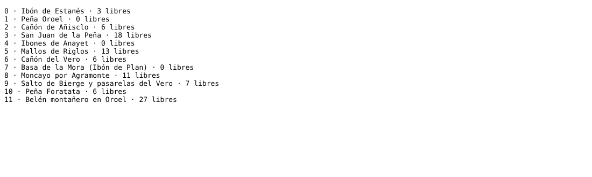

*Captura 1 de la UD5. La dirección no nombra ningún fichero: la ha atendido `index.php`. `http://localhost:3000/salidas`*

La cadena de consulta no estorba: `/salidas/2?orden=fecha` encuentra la misma ruta, y `orden` sigue en `$_GET`. Y `/salidas/doce` **también** encuentra la ruta, porque «doce» son caracteres que no son una barra. El enrutador reparte; quien comprueba que el valor sirve es el destino. Lo que llega en una dirección es texto escrito por quien quiera, igual que un campo de formulario.

**El 404 y el 405 son tuyos.** Antes, el «no encontrado» lo decía el servidor. Ahora casi todas las direcciones llegan a tu código, así que te toca a ti contestar con el código de estado correcto:

```
Red › socios › Encabezados de respuesta
HTTP/1.1 404 Not Found
```

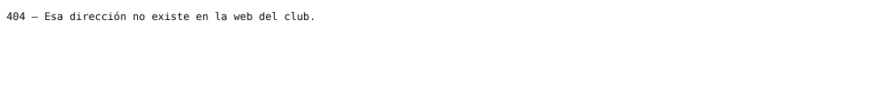

*Captura 2 de la UD5. El 404 ya no es la página «Not Found» del servidor: lo ha escrito la aplicación. `http://localhost:3000/socios`*

El `405` se da cuando la dirección existe y el método no. El navegador solo envía un `POST` desde un formulario, y aquí no hay ninguno: es uno de los casos de `curl`.

```
$ curl -s -i -X POST http://localhost:3000/salidas
HTTP/1.1 405 Method Not Allowed
Content-Type: text/plain; charset=utf-8
Allow: GET

405 — Esa dirección existe, pero no admite este método.
```

La cabecera `Allow` dice qué métodos sí admite esa dirección. Un `404` ahí sería mentir: la dirección existe.

**Lo que sigue sin tener dirección.** Todo lo que está fuera de `publico/`, como en la UD4, y lo que está dentro y es un fichero de verdad se sirve tal cual:

```
Red › rutas.php › Encabezados de respuesta
HTTP/1.1 404 Not Found

Red › datos/salidas.php › Encabezados de respuesta
HTTP/1.1 404 Not Found

Red › club.css › Encabezados de respuesta
HTTP/1.1 200 OK
```

**La tabla, a la vista.** Como la tabla es un objeto, se le puede preguntar. `tabla.php`, por el terminal:

```php
<?php
declare(strict_types=1);
// tabla.php — la tabla de rutas, por el terminal
require __DIR__ . '/arranque.php';

$enrutador = require __DIR__ . '/rutas.php';
echo implode("\n", $enrutador->tabla()), "\n";
foreach ([['GET', '/salidas/7'], ['GET', '/salidas/7/fotos'], ['POST', '/salidas']] as [$metodo, $ruta]) {
    $r = $enrutador->resolver($metodo, $ruta);
    echo "$metodo $ruta → {$r['estado']}", isset($r['parametros']) ? ' ' . json_encode($r['parametros']) : '', "\n";
}
```

```
$ php tabla.php
GET   /                      función
GET   /salidas               función
GET   /salidas/{id}          función
GET /salidas/7 → 200 ["7"]
GET /salidas/7/fotos → 404
POST /salidas → 405
```

Es la primera vez que puedes ver **todas** las direcciones de tu aplicación en un solo sitio. En la UD4, para saberlo había que listar una carpeta.

**Errores típicos.** Dos, y los dos vienen de olvidar que la dirección ya no es un fichero.

- **Un `404` para lo que es un `405`**, o un `200` con el texto «no existe». El código de estado es parte de la respuesta: es lo que leen los programas, los buscadores y la pestaña Red.
- **Direcciones con punto.** No pongas puntos en tus rutas (`/salidas/2.json`). Según la versión de PHP, el servidor puede tomar esa dirección por un fichero, no encontrarlo y contestar él con su «Not Found», sin pasar por tu `index.php`.

**Cómo se comprueba.** Cuatro peticiones, con la pestaña Red abierta: una ruta que existe (`200`), una dirección inventada (`404`, con tu texto), un método que no toca (`405`, con `Allow`) y un fichero de fuera de `publico/` (`404`).

**Ejercicios del apartado.**

- **E9.** Monta la entrada única con el enrutador y las tres rutas. Entrega las cuatro peticiones de comprobación, con su código de estado copiado de la pestaña Red en texto, y la salida de `tabla.php`.
- **E10.** Añade la ruta `GET /salidas/{id}/plazas`, que conteste con una línea: las plazas y las libres de esa salida. Pruébala con `/salidas/2/plazas`, `/salidas/2/plazas/`, `/salidas/99/plazas` y `/salidas/2/sitios`. Explica cada respuesta. ¿Cuál de ellas debería ser un `404` y hoy no lo es?
- **E11.** Registra una ruta `POST /salidas` cuyo destino conteste «Publicar llegará en el apartado 10». Repite el `curl -i -X POST` y pide la misma dirección con `-X DELETE`. ¿Qué dice ahora la cabecera `Allow`?

<div style="page-break-before: always;"></div>

## Apartado 5. Controladores: decidir sin calcular ni pintar

Las funciones anónimas de `rutas.php` han servido para probar el enrutador, pero no van a aguantar: con veinte rutas, ese fichero sería otra vez un guion que lo hace todo. El destino de una ruta será un **método de una clase**, y esa clase es un controlador.

**Qué es un controlador.** Es la pieza que atiende una petición. Su trabajo tiene siempre los mismos tres pasos: **lee** lo que pide la petición, **pide** al modelo lo que haga falta y **elige** la respuesta, que es una vista con sus datos o una redirección. Y tiene dos prohibiciones: no escribe HTML y no contiene reglas del negocio. Cada método público es una **acción**, y atiende una ruta. Se agrupan por lo que manejan: todo lo de las salidas, en `SalidasControlador`.

**La clase base.** Todos los controladores contestan de las mismas dos maneras, así que eso se escribe una vez, en una clase de la que heredan:

```php
<?php
declare(strict_types=1);

namespace Club\Nucleo;

/** Lo que comparten todos los controladores: cómo se contesta con una página y cómo se redirige. */
abstract class Controlador
{
    /** Devuelve la página entera: la vista, pintada con sus datos, dentro del layout. */
    protected function vista(string $vista, array $datos, string $titulo): string
    {
        return capturar('layout', ['titulo' => $titulo, 'contenido' => capturar($vista, $datos)]);
    }

    /** Contesta con una redirección a una dirección de la propia aplicación, que empieza por /. */
    protected function redirigir(string $ruta): string
    {
        header('Location: ' . $ruta, true, 302);
        return '';                                            // una redirección no lleva cuerpo
    }
}
```

`abstract` quiere decir que de esa clase no se crean objetos: solo existe para que otras hereden de ella. Sus dos métodos son `protected`: los usan las clases hijas y nadie más. `vista()` no es nueva. Es `render_pagina()` de la UD4 con otro nombre: captura la vista y la mete en el layout, con las mismas funciones de `plantillas.php`, que traes de la partida. Lo que cambia es que **devuelve** la página como texto en vez de enviarla: quien la envía es la entrada única.

**Las vistas son tus plantillas.** La carpeta `plantillas/` pasa a llamarse `vistas/`, y su contenido es el de la UD4 con dos diferencias. Reciben **objetos** en lugar de arrays. Y sus direcciones empiezan por `/`. El layout, por ahora con un menú de una entrada (las demás vuelven en el apartado 10):

```php
<?php declare(strict_types=1); // vistas/layout.php — recibe: $titulo, $contenido (HTML ya pintado) ?>
<!doctype html>
<html lang="es">
<head>
    <meta charset="utf-8">
    <title><?= e($titulo) ?> · Club de Montaña Os Ibones</title>
    <link rel="stylesheet" href="<?= e(url('/club.css')) ?>">
</head>
<body>
<header>
    <nav>
        <a href="<?= e(url('/salidas')) ?>">Calendario</a>
    </nav>
</header>
<main>
<?= $contenido ?>
</main>
<footer>
    <p>Club de Montaña Os Ibones · Temporada de otoño</p>
</footer>
</body>
</html>
```

La tarjeta de una salida:

```php
<?php declare(strict_types=1); // vistas/parciales/tarjeta.php — recibe: $salida (un objeto Salida) ?>
    <li class="tarjeta">
        <a href="<?= e(url('/salidas/' . $salida->id)) ?>"><strong><?= e($salida->nombre) ?></strong></a>
        <span><?= e($salida->fecha) ?>, dificultad <?= e($salida->dificultad) ?></span>
<?php if ($salida->estaCompleta()): ?>
        <em>COMPLETA</em>
<?php else: ?>
        <em><?= e($salida->libres()) ?> libres</em>
<?php endif; ?>
    </li>
```

Compárala con la de la UD4. La resta ha desaparecido. La tarjeta **pregunta** al objeto, `estaCompleta()` y `libres()`, y pinta lo que le contestan. El primero de los tres sitios del apartado 1 ya no existe. La vista del calendario y la ficha de una salida:

```php
<?php declare(strict_types=1); // vistas/calendario.php — recibe: $salidas (objetos Salida), $filtros (q, dificultad, orden), $dificultades, $ordenes ?>
<h1>Calendario de otoño</h1>
<form action="<?= e(url('/salidas')) ?>" method="get">
    <label for="q">Buscar</label>
    <input type="search" id="q" name="q" value="<?= e($filtros['q']) ?>">
    <label for="dificultad">Dificultad</label>
<?php render('parciales/desplegable', ['nombre' => 'dificultad', 'opciones' => $dificultades, 'elegida' => $filtros['dificultad'], 'primera' => 'Todas']); ?>
    <label for="orden">Orden</label>
<?php render('parciales/desplegable', ['nombre' => 'orden', 'opciones' => $ordenes, 'elegida' => $filtros['orden']]); ?>
    <button type="submit">Filtrar</button>
</form>
<p class="resumen"><?= e(count($salidas) === 1 ? '1 salida' : count($salidas) . ' salidas') ?></p>
<ul>
<?php foreach ($salidas as $salida): ?>
<?php render('parciales/tarjeta', ['salida' => $salida]); ?>
<?php endforeach; ?>
</ul>
```

```php
<?php declare(strict_types=1); // vistas/ficha.php — recibe: $salida (un objeto Salida) ?>
<h1><?= e($salida->nombre) ?></h1>
<dl>
    <dt>Fecha</dt><dd><?= e($salida->fecha) ?></dd>
    <dt>Dificultad</dt><dd><?= e($salida->dificultad) ?></dd>
    <dt>Plazas</dt><dd><?= e($salida->plazas()) ?></dd>
    <dt>Libres</dt><dd><?= e($salida->estaCompleta() ? 'Ninguna: está completa' : $salida->libres()) ?></dd>
</dl>
<p><a href="<?= e(url('/salidas')) ?>">Volver al calendario</a></p>
```

**Los dos controladores.** El de la portada, que solo redirige:

```php
<?php
declare(strict_types=1);

namespace Club\Controladores;

use Club\Nucleo\Controlador;

class PortadaControlador extends Controlador
{
    /** GET / — la portada del club es su calendario. */
    public function inicio(): string
    {
        return $this->redirigir('/salidas');
    }
}
```

Y el de las salidas. Recibe en su constructor el almacén que necesita, y lo recibe por su **interfaz**:

```php
<?php
declare(strict_types=1);

namespace Club\Controladores;

use Club\Modelo\RepositorioSalidas;
use Club\Modelo\Salida;
use Club\Nucleo\Controlador;
use Club\Nucleo\NoEncontrado;

class SalidasControlador extends Controlador
{
    private const ORDENES = ['fecha' => 'Por fecha', 'libres' => 'Más plazas libres primero'];

    public function __construct(private RepositorioSalidas $salidas)
    {
    }

    /** GET /salidas — el calendario, con su búsqueda, su filtro y su orden. */
    public function indice(): string
    {
        $texto      = texto($_GET, 'q');
        $dificultad = texto($_GET, 'dificultad');
        $orden      = texto($_GET, 'orden');
        if (!array_key_exists($dificultad, Salida::DIFICULTADES)) {
            $dificultad = '';
        }
        if (!array_key_exists($orden, self::ORDENES)) {
            $orden = 'fecha';
        }
        $elegidas = [];
        foreach ($this->salidas->todas() as $salida) {
            $pasaTexto      = $texto === '' || preg_match('/' . preg_quote($texto, '/') . '/iu', $salida->nombre) === 1;
            $pasaDificultad = $dificultad === '' || $salida->dificultad === $dificultad;
            if ($pasaTexto && $pasaDificultad) {
                $elegidas[] = $salida;
            }
        }
        if ($orden === 'libres') {
            usort($elegidas, fn(Salida $a, Salida $b): int => $b->libres() <=> $a->libres());
        }
        return $this->vista('calendario', [
            'salidas'      => $elegidas,
            'filtros'      => ['q' => $texto, 'dificultad' => $dificultad, 'orden' => $orden],
            'dificultades' => Salida::DIFICULTADES,
            'ordenes'      => self::ORDENES,
        ], 'Calendario');
    }

    /** GET /salidas/{id} — la ficha de una salida. */
    public function ver(string $id): string
    {
        $numero = filter_var($id, FILTER_VALIDATE_INT);
        $salida = $numero === false ? null : $this->salidas->porId($numero);
        if ($salida === null) {
            throw new NoEncontrado('Esa salida no está en el calendario.');
        }
        return $this->vista('ficha', ['salida' => $salida], $salida->nombre);
    }
}
```

`ver()` recibe el `{id}` de la ruta como texto y lo comprueba, que es lo que el apartado 4 dejó pendiente. Si la salida no existe, no pinta nada ni decide el código de estado: lanza `NoEncontrado`, una excepción propia que vive en `src/Nucleo/` (una clase vacía que hereda de `\RuntimeException`, como `SalidaCompleta` heredaba de la suya). La recogerá la entrada única.

**La tabla y la entrada, con controladores.** En la tabla, cada destino es ahora una pareja: la clase y el nombre de la acción. `SalidasControlador::class` es el nombre completo de la clase, como texto:

```php
<?php
declare(strict_types=1);
// rutas.php — la tabla de rutas del club: toda dirección que la aplicación atiende está aquí, y solo aquí
use Club\Controladores\PortadaControlador;
use Club\Controladores\SalidasControlador;
use Club\Nucleo\Enrutador;

$enrutador = new Enrutador();
$enrutador->get('/', [PortadaControlador::class, 'inicio']);
$enrutador->get('/salidas', [SalidasControlador::class, 'indice']);
$enrutador->get('/salidas/{id}', [SalidasControlador::class, 'ver']);
return $enrutador;
```

```php
<?php
declare(strict_types=1);
// publico/index.php — la única entrada de la aplicación: toda petición empieza aquí
use Club\Controladores\PortadaControlador;
use Club\Controladores\SalidasControlador;
use Club\Modelo\SalidasEnFichero;
use Club\Nucleo\NoEncontrado;

require __DIR__ . '/../arranque.php';
require __DIR__ . '/../funciones/plantillas.php';

// 1. Las piezas: se crean aquí y se entregan a quien las necesita
$salidas  = new SalidasEnFichero(__DIR__ . '/../datos/salidas.php');
$fabricas = [
    PortadaControlador::class => fn() => new PortadaControlador(),
    SalidasControlador::class => fn() => new SalidasControlador($salidas),
];

// 2. Qué se pide: el método y la ruta, sin la cadena de consulta
$enrutador = require __DIR__ . '/../rutas.php';
$ruta      = (string) parse_url($_SERVER['REQUEST_URI'], PHP_URL_PATH);
$encontrada = $enrutador->resolver($_SERVER['REQUEST_METHOD'], $ruta);

// 3. Quién lo atiende
try {
    if ($encontrada['estado'] === 405) {
        http_response_code(405);
        header('Allow: ' . implode(', ', $encontrada['permitidos']));
        echo capturar('layout', ['titulo' => 'Método no permitido', 'contenido' => capturar('error', ['mensaje' => 'Esa dirección existe, pero no admite este método.'])]);
        exit;
    }
    if ($encontrada['estado'] === 404) {
        throw new NoEncontrado('Esa dirección no existe en la web del club.');
    }
    [$clase, $accion] = $encontrada['destino'];
    $controlador      = $fabricas[$clase]();
    echo $controlador->$accion(...$encontrada['parametros']);
} catch (NoEncontrado $e) {
    http_response_code(404);
    echo capturar('layout', ['titulo' => 'No encontrado', 'contenido' => capturar('error', ['mensaje' => $e->getMessage()])]);
}
```

Léela por sus tres pasos. En el primero se crean las piezas. Para cada controlador hay una función anónima que sabe fabricarlo con lo que necesita; `fn() => …` es la forma corta de escribir una función que solo devuelve un valor, y usa las variables de fuera sin `use`. Nadie más en la aplicación hace `new SalidasEnFichero`. En el tercero, el `try` envuelve la llamada a la acción: cualquier `NoEncontrado`, la lance quien la lance, acaba en el mismo `catch`, con el mismo código de estado y la misma página. Un solo sitio decide cómo es un 404.

**Ejemplo trabajado: tres peticiones.** La portada redirige, y la dirección de destino empieza por `/`:

```
Red › localhost › Encabezados de respuesta
HTTP/1.1 302 Found
Location: /salidas
```

El calendario:

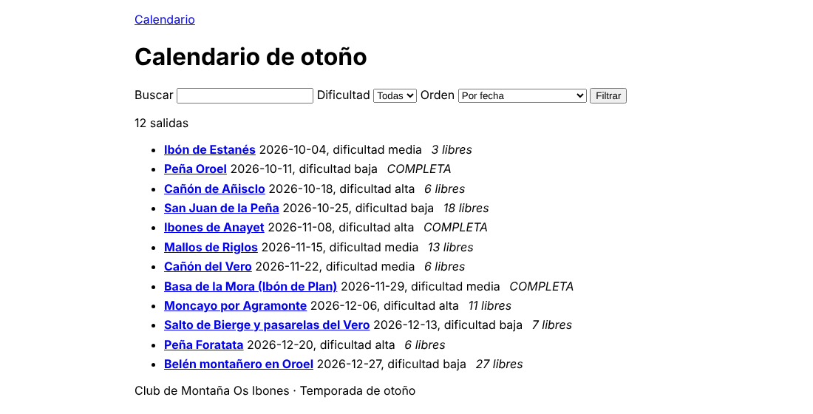

*Captura 3 de la UD5. El calendario, servido por `SalidasControlador::indice()`. `http://localhost:3000/salidas`*

| Dirección, tras `http://localhost:3000` | Busca con `Ctrl+F` | Coincidencias |
|---|---|---|
| `/salidas` | `class="tarjeta"` | 12 |
| `/salidas?dificultad=alta` | `class="tarjeta"` | 4 |
| `/salidas?dificultad=marte` | `class="tarjeta"` | 12 |
| `/salidas` | `<!doctype` | 1 |

Una dificultad que no está en la lista se trata como en la UD4: no filtra. Y la ficha de la tercera salida del fichero, que es la número 2:

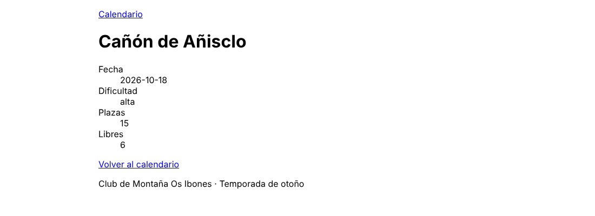

*Captura 4 de la UD5. Una ficha por salida, con una sola ruta. `http://localhost:3000/salidas/2`*

```
view-source:http://localhost:3000/salidas/2
    <title>Cañón de Añisclo · Club de Montaña Os Ibones</title>
    <link rel="stylesheet" href="/club.css">
        <a href="/salidas">Calendario</a>
<h1>Cañón de Añisclo</h1>
    <dt>Fecha</dt><dd>2026-10-18</dd>
    <dt>Dificultad</dt><dd>alta</dd>
    <dt>Plazas</dt><dd>15</dd>
    <dt>Libres</dt><dd>6</dd>
<p><a href="/salidas">Volver al calendario</a></p>
```

Los tres casos de «no encontrado» salen por la misma puerta, sea la salida la que no existe o la dirección entera:

```
Red › salidas/99 › Encabezados de respuesta
HTTP/1.1 404 Not Found

Red › salidas/abc › Encabezados de respuesta
HTTP/1.1 404 Not Found

Red › socios › Encabezados de respuesta
HTTP/1.1 404 Not Found
```

**Error típico: el enlace relativo.** En la UD4 todos los enlaces eran relativos (`calendario.php`, `login.php`) y funcionaban, porque todas las páginas estaban en la misma carpeta. Ya no. Un enlace relativo se resuelve contra la dirección de la página que lo lleva, y ahora las direcciones tienen niveles. Si en la ficha escribes `<a href="salidas">`, desde `/salidas/2` el navegador pide `/salidas/salidas`:

```
Red › salidas/salidas › Encabezados de respuesta
HTTP/1.1 404 Not Found
```

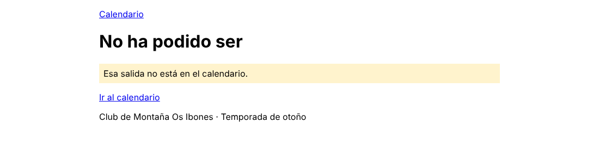

*Captura 5 de la UD5. Un enlace relativo, pulsado desde una ficha. La ruta `/salidas/{id}` ha recibido «salidas» como identificador. `http://localhost:3000/salidas/salidas`*

Lo mismo le pasa a la hoja de estilos, a los `action` de los formularios y a los `Location` de las redirecciones. La norma de la unidad: **toda dirección interna empieza por `/`** y se escribe con `url()`, la función de `plantillas.php`, que además codifica la cadena de consulta. Mira en el código fuente de la ficha, más arriba, cómo han llegado las tres.

**Cómo se comprueba.** Con las búsquedas de la UD4, que ahora vigilan dos carpetas. Ni una impresión ni una etiqueta en los controladores:

```
Buscar en archivos · expresión regular
Buscar: \becho\b|<[a-z]+[ >]
Archivos para incluir: ud5/src/Controladores

No se encontraron resultados.
```

Y ni una superglobal, ni una cabecera, ni un `new` en las vistas:

```
Buscar en archivos · expresión regular
Buscar: \$_(GET|POST|SESSION|SERVER)|header\(|\bnew 
Archivos para incluir: ud5/vistas

No se encontraron resultados.
```

Un dato para el apartado siguiente: abre `SalidasControlador.php` y mira el número de su última línea. Son 60.

**Ejercicios del apartado.**

- **E12.** Convierte tu aplicación del apartado 4 a controladores: la clase base, los dos controladores, las vistas y la entrada con su `try`. Entrega las búsquedas de comprobación y las tres peticiones de «no encontrado» con su código de estado.
- **E13.** Rompe a propósito un enlace del layout quitándole la barra inicial. Di desde qué páginas sigue funcionando y desde cuáles no, y por qué. Compruébalo en la pestaña Red.
- **E14.** Añade la acción `SalidasControlador::completas()` en la ruta `GET /salidas/completas`, que enseñe solo las salidas sin plazas, con la misma vista del calendario. Regístrala **después** de `/salidas/{id}` y pídela. Explica qué ha pasado y arréglalo sin tocar el enrutador.

<div style="page-break-before: always;"></div>

## Apartado 6. El modelo: las reglas del negocio, fuera de la web

Vuelve a leer `indice()`, en el controlador del apartado anterior. Lee la petición, bien. Elige la vista, bien. Y en medio hay quince líneas que buscan, filtran y ordenan salidas. Eso no es decidir qué se hace con una petición: es **saber cómo funciona el calendario del club**. Está en el sitio equivocado, y se nota en cuanto intentas usarlo desde otro lado: para probar si el filtro funciona hay que arrancar el servidor y mirar una página.

**Qué es el modelo.** Es todo lo que la aplicación sabe del club y seguiría sabiendo sin web: sus datos y sus reglas. No conoce `$_GET`, ni `$_SESSION`, ni HTML, ni códigos de estado. Recibe valores normales y devuelve objetos, o lanza excepciones. Ya tienes dos de sus tres clases de pieza:

| Pieza | Qué es | En el club |
|---|---|---|
| Entidad | Un objeto con identidad, datos y las reglas que solo dependen de él | `Salida` |
| Repositorio | El almacén: guarda y devuelve entidades, detrás de una interfaz | `RepositorioSalidas` y sus dos clases |
| Servicio | Una operación del negocio que necesita varias piezas o varias reglas | `Calendario`, `Inscripciones` |

**El primer servicio: lo que salía del controlador.**

```php
<?php
declare(strict_types=1);

namespace Club\Modelo;

/** Las preguntas que se le hacen al calendario: buscar, filtrar y ordenar. No sabe nada de HTML ni de la petición. */
class Calendario
{
    public const ORDENES = ['fecha' => 'Por fecha', 'libres' => 'Más plazas libres primero'];

    public function __construct(private RepositorioSalidas $salidas)
    {
    }

    /**
     * Las salidas cuyo nombre contiene $texto y que son de esa dificultad, ordenadas.
     * Un valor vacío no filtra. Un orden que no está en ORDENES vale 'fecha'.
     *
     * @return Salida[]
     */
    public function buscar(string $texto = '', string $dificultad = '', string $orden = 'fecha'): array
    {
        $patron    = '/' . preg_quote($texto, '/') . '/iu';   // sin distinguir mayúsculas, también en ñ y vocales con tilde
        $resultado = [];
        foreach ($this->salidas->todas() as $salida) {
            $pasaTexto      = $texto === '' || preg_match($patron, $salida->nombre) === 1;
            $pasaDificultad = $dificultad === '' || $salida->dificultad === $dificultad;
            if ($pasaTexto && $pasaDificultad) {
                $resultado[] = $salida;
            }
        }
        if ($orden === 'libres') {
            usort($resultado, fn(Salida $a, Salida $b): int => $b->libres() <=> $a->libres());
        } else {
            usort($resultado, fn(Salida $a, Salida $b): int => $a->fecha <=> $b->fecha);
        }
        return $resultado;
    }
}
```

`buscar()` recibe tres textos y devuelve salidas. No sabe de dónde vienen esos textos ni a dónde van las salidas. La búsqueda sin distinguir mayúsculas se hace con una expresión regular: la `i` final quita la distinción y la `u` hace que valga también para la `ñ` y las vocales con tilde; `preg_quote()` desactiva los caracteres del texto que tendrían significado en la expresión. Así no depende de ninguna extensión opcional de PHP.

El controlador, sin esas líneas:

```php
<?php
declare(strict_types=1);

namespace Club\Controladores;

use Club\Modelo\Calendario;
use Club\Modelo\RepositorioSalidas;
use Club\Modelo\Salida;
use Club\Nucleo\Controlador;
use Club\Nucleo\NoEncontrado;

class SalidasControlador extends Controlador
{
    public function __construct(private Calendario $calendario, private RepositorioSalidas $salidas)
    {
    }

    /** GET /salidas — el calendario, con su búsqueda, su filtro y su orden. */
    public function indice(): string
    {
        $texto      = texto($_GET, 'q');
        $dificultad = texto($_GET, 'dificultad');
        $orden      = texto($_GET, 'orden');
        if (!array_key_exists($dificultad, Salida::DIFICULTADES)) {
            $dificultad = '';
        }
        if (!array_key_exists($orden, Calendario::ORDENES)) {
            $orden = 'fecha';
        }
        return $this->vista('calendario', [
            'salidas'      => $this->calendario->buscar($texto, $dificultad, $orden),
            'filtros'      => ['q' => $texto, 'dificultad' => $dificultad, 'orden' => $orden],
            'dificultades' => Salida::DIFICULTADES,
            'ordenes'      => Calendario::ORDENES,
        ], 'Calendario');
    }

    /** GET /salidas/{id} — la ficha de una salida. */
    public function ver(string $id): string
    {
        $numero = filter_var($id, FILTER_VALIDATE_INT);
        $salida = $numero === false ? null : $this->salidas->porId($numero);
        if ($salida === null) {
            throw new NoEncontrado('Esa salida no está en el calendario.');
        }
        return $this->vista('ficha', ['salida' => $salida], $salida->nombre);
    }
}
```

Y en la entrada única, la fábrica le entrega el servicio: `fn() => new SalidasControlador(new Calendario($salidas), $salidas)`. Es el único cambio fuera del modelo.

**El segundo servicio: apuntarse.** Es el `inscribir.php` de la UD4, con sus tres casos, convertido en una operación que no sabe nada de formularios:

```php
<?php
declare(strict_types=1);

namespace Club\Modelo;

/** Las reglas de apuntarse a una salida, en un solo sitio. */
class Inscripciones
{
    /** @var array<int, string[]> identificador de salida => quiénes se han apuntado */
    private array $apuntados = [];

    public function __construct(private RepositorioSalidas $salidas)
    {
    }

    /**
     * Apunta a $socio a la salida $id y devuelve la salida, ya con una plaza menos.
     *
     * @throws SalidaNoEncontrada si la salida no existe
     * @throws YaInscrito         si esa persona ya estaba apuntada
     * @throws SalidaCompleta     si no quedan plazas
     */
    public function inscribir(int $id, string $socio): Salida
    {
        $salida = $this->salidas->porId($id);
        if ($salida === null) {
            throw new SalidaNoEncontrada("No hay ninguna salida con el número $id.");
        }
        if (in_array($socio, $this->apuntados[$id] ?? [], true)) {
            throw new YaInscrito("$socio ya está en «{$salida->nombre}».");
        }
        $salida->inscribir();                                 // si está completa, la excepción sale de aquí
        $this->apuntados[$id][] = $socio;
        return $salida;
    }
}
```

Cada caso que no puede seguir es una excepción con nombre. `YaInscrito` y `SalidaNoEncontrada` son como `SalidaCompleta`: una clase vacía en `src/Modelo/` que hereda de `\DomainException`. El comentario de encima del método las enumera con `@throws`: es documentación que lee tu editor, y vuelve en el apartado 12. De momento el servicio recuerda quién se ha apuntado en una propiedad suya, que dura lo que dura la petición. Guardarlo en la sesión es trabajo del apartado 10, y no cambiará ni una regla.

**Ejemplo trabajado: probar las reglas sin servidor.** Esta es la ventaja que anunciaba el apartado 1. Con un almacén en memoria, tú decides qué salidas hay, y las cinco situaciones se comprueban en un segundo:

```php
<?php
declare(strict_types=1);
// probar-inscripciones.php — las reglas del club, comprobadas sin servidor ni navegador
use Club\Modelo\Inscripciones;
use Club\Modelo\Salida;
use Club\Modelo\SalidaCompleta;
use Club\Modelo\SalidaNoEncontrada;
use Club\Modelo\SalidasEnMemoria;
use Club\Modelo\YaInscrito;

require __DIR__ . '/arranque.php';

$almacen = new SalidasEnMemoria(
    new Salida(1, 'Salida de prueba', '2027-01-17', 'baja', 3, 1),   // 3 plazas, 1 ocupada: caben dos más
);
$inscripciones = new Inscripciones($almacen);

$intentos = [[1, 'aitana'], [1, 'aitana'], [1, 'bruno'], [1, 'carla'], [7, 'carla']];
foreach ($intentos as [$id, $socio]) {
    try {
        $salida = $inscripciones->inscribir($id, $socio);
        echo "$socio en $id: dentro, quedan {$salida->libres()}\n";
    } catch (YaInscrito | SalidaCompleta | SalidaNoEncontrada $e) {
        echo "$socio en $id: ", get_class($e), ' — ', $e->getMessage(), "\n";
    }
}
```

```
$ php probar-inscripciones.php
aitana en 1: dentro, quedan 1
aitana en 1: Club\Modelo\YaInscrito — aitana ya está en «Salida de prueba».
bruno en 1: dentro, quedan 0
carla en 1: Club\Modelo\SalidaCompleta — La salida «Salida de prueba» está completa.
carla en 7: Club\Modelo\SalidaNoEncontrada — No hay ninguna salida con el número 7.
```

Un `catch` puede recoger varias clases separadas por una barra vertical. Piensa en lo que habría costado esa misma comprobación en la UD4: iniciar sesión con tres socios, tres tarros de cookies, cinco envíos con su token y leer cinco mensajes en la página.

La aplicación, por fuera, responde igual, y la búsqueda encuentra «Ibón» escrito de cualquier manera:

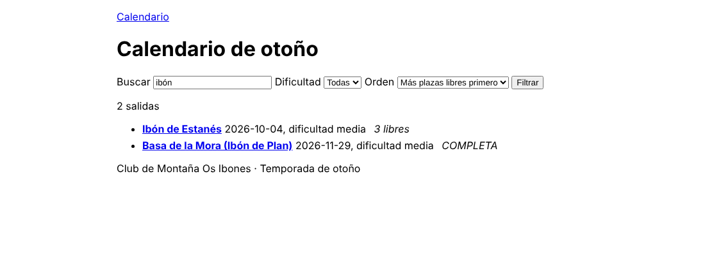

*Captura 6 de la UD5. La búsqueda y el orden, ahora en el modelo. `http://localhost:3000/salidas?q=ibón&orden=libres`*

```
view-source:http://localhost:3000/salidas?q=IB%C3%93N&orden=libres
<p class="resumen">2 salidas</p>
        <a href="/salidas/0"><strong>Ibón de Estanés</strong></a>
        <em>3 libres</em>
        <a href="/salidas/7"><strong>Basa de la Mora (Ibón de Plan)</strong></a>
        <em>COMPLETA</em>
```

**La pregunta del apartado 1, otra vez.** ¿Dónde está escrito cuándo una salida está completa?

```
Buscar en archivos · expresión regular
Buscar: plazas *-|inscritos *>=|<= 0
Archivos para incluir: ud5/src, ud5/vistas, ud5/publico

2 resultados en 1 archivo
src/Modelo/Salida.php
  43: return $this->plazas - $this->inscritos;
  48: return $this->libres() <= 0;
```

En un fichero, y en dos líneas seguidas de la misma clase. La tarjeta pregunta a `estaCompleta()`, el orden pregunta a `libres()` y la inscripción llama a `inscribir()`, que pregunta a `estaCompleta()`. La reserva de tres plazas de los monitores es ahora un cambio en una línea, la 43, y la obedecen los tres. El controlador ha pasado de 60 líneas a 48, y las que ha perdido eran las que no le correspondían.

**Dos principios de diseño, con nombre.** Los has aplicado ya; ahora los puedes nombrar.

- **Responsabilidad única.** Cada clase tiene un solo motivo para cambiar. `Salida` cambia si cambian las reglas de una salida. `SalidasEnFichero`, si cambia dónde se guardan. `SalidasControlador`, si cambia lo que se pide por la web. Si para un mismo cambio hay que abrir tres clases, o una clase se abre por tres cambios distintos, el reparto está mal.
- **Depender de contratos, y recibirlos hechos.** `Calendario` e `Inscripciones` piden un `RepositorioSalidas` en su constructor: una interfaz, no una clase. No crean su almacén: se lo dan. Por eso en la prueba han trabajado con uno en memoria sin enterarse. A entregar a cada objeto las piezas que necesita, en vez de dejar que las fabrique él, se le llama **inyección de dependencias**. Es también la razón para preferir la composición a la herencia: una pieza que se recibe se puede cambiar por otra; una clase madre, no.

**Error típico: la regla que vuelve al controlador.** Llega con prisa y con buena intención: «solo es un `if`». Un controlador que compara plazas, o una vista que resta, deshace el apartado. La señal es fácil de encontrar, con la misma búsqueda de arriba: cualquier línea fuera de `src/Modelo/` que haga cuentas con plazas o inscritos.

**Cómo se comprueba.** Tres pruebas. La búsqueda de la regla, que devuelve una sola carpeta. La prueba del terminal, que pasa sin servidor. Y una que no falla nunca si el reparto es bueno: el modelo no nombra nada de la web.

```
Buscar en archivos · expresión regular
Buscar: \$_(GET|POST|SESSION|SERVER|COOKIE)|header\(|\becho\b|<[a-z]+>
Archivos para incluir: ud5/src/Modelo

No se encontraron resultados.
```

**Ejercicios del apartado.**

- **E15.** Lleva la búsqueda a `Calendario`, escribe `Inscripciones` con sus tres excepciones y ejecuta `probar-inscripciones.php`. Entrega las tres pruebas de comprobación.
- **E16.** Ahora sí: aplica la reserva de tres plazas para los monitores. Entrega el `diff` del cambio, la primera salida vista en el calendario, el orden por plazas libres y una línea nueva en `probar-inscripciones.php` que demuestre que la inscripción también la obedece. Compara ficheros tocados y tiempo con lo que anotaste en el E2.
- **E17.** Añade a `probar-inscripciones.php` un intento con una salida creada con 2 plazas y 5 inscritos. ¿Qué excepción salta, dónde, y por qué el `catch` del bucle no la recoge? Decide si debe recogerla y justifícalo.
- **E18.** El club quiere que nadie se apunte a una salida de dificultad alta sin haber hecho antes una de dificultad media. Sin escribir código: ¿en qué clase iría la regla?, ¿qué necesitaría recibir esa clase que hoy no recibe?, ¿qué excepción nueva haría falta? y ¿qué ficheros **no** habría que tocar?

<div style="page-break-before: always;"></div>

## Apartado 7. Vistas y controles de servidor: objetos que generan la página

El calendario del apartado 6 ha perdido dos cosas que tenía en la UD4: las páginas y un formulario decente. Vuelven aquí, y vuelven de otra manera. En la UD4, un desplegable era un **parcial**: un trozo de plantilla al que le pasabas datos. Aquí será un **objeto**.

**Qué es un control de servidor.** Es un objeto que representa un elemento de la interfaz —un desplegable, un campo, un paginador, un formulario entero— y que sabe convertirse en HTML. Se crea en el servidor con sus datos, y de él sale el marcado, ya escapado. Quien lo usa no escribe etiquetas: dice qué quiere («un desplegable llamado dificultad, con estas opciones y esta elegida») y el control se encarga del cómo. Todos cumplen el mismo contrato, que cabe en una línea:

```php
<?php
declare(strict_types=1);

namespace Club\Vista;

/** Un control de servidor: un objeto que sabe convertirse en HTML, ya escapado. */
interface Control
{
    public function pintar(): string;
}
```

El desplegable de la UD4, convertido en clase. Viven en `src/Vista/`:

```php
<?php
declare(strict_types=1);

namespace Club\Vista;

class Desplegable implements Control
{
    /** @param array<string, string> $opciones valor => texto */
    public function __construct(
        private string $nombre,
        private string $etiqueta,
        private array $opciones,
        private string $elegida = '',
        private ?string $primera = null,
        private ?string $error = null,
    ) {
    }

    public function pintar(): string
    {
        $html = '    <label for="' . e($this->nombre) . '">' . e($this->etiqueta) . "</label>\n";
        $html .= '    <select id="' . e($this->nombre) . '" name="' . e($this->nombre) . "\">\n";
        if ($this->primera !== null) {
            $html .= '        <option value="">' . e($this->primera) . "</option>\n";
        }
        foreach ($this->opciones as $valor => $texto) {
            $marca = (string) $valor === $this->elegida ? ' selected' : '';
            $html .= '        <option value="' . e($valor) . '"' . $marca . '>' . e($texto) . "</option>\n";
        }
        $html .= "    </select>\n";
        if ($this->error !== null) {
            $html .= '    <p class="error">' . e($this->error) . "</p>\n";
        }
        return $html;
    }
}
```

Y el paginador, que conserva los filtros en sus enlaces como hacía el parcial:

```php
<?php
declare(strict_types=1);

namespace Club\Vista;

class Paginador implements Control
{
    /** @param array<string, string> $filtros lo que cada enlace tiene que conservar */
    public function __construct(private string $ruta, private array $filtros, private int $pagina, private int $paginas)
    {
    }

    public function pintar(): string
    {
        if ($this->paginas <= 1) {
            return '';
        }
        $filtros = array_filter($this->filtros, fn(string $valor): bool => $valor !== '');   // un filtro vacío no viaja en el enlace
        $html    = "<nav class=\"paginas\">\n";
        if ($this->pagina > 1) {
            $html .= '    <a href="' . e(url($this->ruta, $filtros + ['pagina' => $this->pagina - 1])) . "\">Anterior</a>\n";
        }
        $html .= '    <span>Página ' . e($this->pagina) . ' de ' . e($this->paginas) . "</span>\n";
        if ($this->pagina < $this->paginas) {
            $html .= '    <a href="' . e(url($this->ruta, $filtros + ['pagina' => $this->pagina + 1])) . "\">Siguiente</a>\n";
        }
        return $html . "</nav>\n";
    }
}
```

`fn(string $valor): bool => $valor !== ''` es la función que `array_filter()` aplica a cada filtro para decidir si se queda. `Campo` es igual de corto: recibe el nombre, la etiqueta, el tipo, el valor, una lista de atributos y, si lo hay, el mensaje de error, y pinta la etiqueta, el `<input>` y el error debajo. Está impreso en el apartado 8, donde se usa a fondo.

**Ejemplo trabajado: un control se prueba sin página.** Como es un objeto que devuelve texto, se le puede preguntar desde el terminal. Con dos datos difíciles a propósito:

```php
<?php
declare(strict_types=1);
// controles.php — dos controles, pintados por el terminal: un control no necesita página para probarse
use Club\Vista\Desplegable;
use Club\Vista\Paginador;

require __DIR__ . '/arranque.php';
require __DIR__ . '/funciones/plantillas.php';

$zonas = new Desplegable('zona', 'Zona', ['pirineo' => 'Pirineo', 'guara' => 'Guara & Somontano', 'x' => '<Sin decidir>'], 'guara', 'Todas');
echo $zonas->pintar();
echo "\n";
$paginas = new Paginador('/salidas', ['q' => 'ibón & cía', 'orden' => 'libres'], 2, 3);
echo $paginas->pintar();
```

```
$ php controles.php
    <label for="zona">Zona</label>
    <select id="zona" name="zona">
        <option value="">Todas</option>
        <option value="pirineo">Pirineo</option>
        <option value="guara" selected>Guara &amp; Somontano</option>
        <option value="x">&lt;Sin decidir&gt;</option>
    </select>

<nav class="paginas">
    <a href="/salidas?q=ib%C3%B3n+%26+c%C3%ADa&amp;orden=libres&amp;pagina=1">Anterior</a>
    <span>Página 2 de 3</span>
    <a href="/salidas?q=ib%C3%B3n+%26+c%C3%ADa&amp;orden=libres&amp;pagina=3">Siguiente</a>
</nav>
```

Todo ha salido escapado, cada cosa a su manera: el `&` y el `<` de las opciones, como entidades; el texto de la búsqueda, codificado para una dirección por `url()`; y el `&` que separa los parámetros del enlace, como `&amp;`, porque va dentro de un atributo. **El control escapa; quien lo usa, no.**

**El formulario, otro control.** Un formulario es un control que contiene controles:

```php
<?php
declare(strict_types=1);

namespace Club\Vista;

class Formulario implements Control
{
    /** @param Control[] $controles */
    public function __construct(
        private string $ruta,
        private string $metodo,
        private array $controles,
        private string $boton,
        private ?string $token = null,
    ) {
    }

    /**
     * Construye el formulario a partir de una definición de campos: un control por campo, con su valor y su error.
     *
     * @param array<string, array<string, mixed>> $campos  la definición (clave => etiqueta, tipo y límites)
     * @param array<string, string>               $valores lo que ya se envió, para repoblar
     * @param array<string, string>               $errores los mensajes, por campo
     */
    public static function desdeDefinicion(string $ruta, array $campos, array $valores, array $errores, string $boton, string $token): self
    {
        $controles = [];
        foreach ($campos as $clave => $c) {
            $valor = $valores[$clave] ?? '';
            $error = $errores[$clave] ?? null;
            if ($c['tipo'] === 'lista') {
                $controles[] = new Desplegable($clave, $c['etiqueta'], $c['opciones'], $valor, 'Elige…', $error);
            } else {
                $limites = $c['tipo'] === 'text' ? ['minlength' => $c['min'], 'maxlength' => $c['max']] : ['min' => $c['min'], 'max' => $c['max']];
                $controles[] = new Campo($clave, $c['etiqueta'], $c['tipo'], $valor, ['required' => 'required'] + $limites, $error);
            }
        }
        return new self($ruta, 'post', $controles, $boton, $token);
    }

    public function pintar(): string
    {
        $html = '<form action="' . e(url($this->ruta)) . '" method="' . e($this->metodo) . "\">\n";
        if ($this->token !== null) {
            $html .= '    <input type="hidden" name="csrf" value="' . e($this->token) . "\">\n";
        }
        foreach ($this->controles as $control) {
            $html .= $control->pintar();
        }
        return $html . '    <button type="submit">' . e($this->boton) . "</button>\n</form>\n";
    }
}
```

Su constructor recibe la lista de controles; `pintar()` los recorre y les pide a cada uno su HTML, sin saber de qué clase son: le basta con que cumplan `Control`. El método `desdeDefinicion()` es del apartado siguiente. La palabra `static` quiere decir que se llama sobre la clase, `Formulario::desdeDefinicion(…)`, sin tener todavía ningún objeto: es otra forma de construir uno.

**Quién crea los controles.** El controlador, que es quien sabe qué se ha pedido. La acción del calendario, con sus páginas de vuelta:

```php
    /** GET /salidas — el calendario, con su búsqueda, su filtro, su orden y sus páginas. */
    public function indice(): string
    {
        $filtros = ['q' => texto($_GET, 'q'), 'dificultad' => texto($_GET, 'dificultad'), 'orden' => texto($_GET, 'orden')];
        if (!array_key_exists($filtros['dificultad'], Salida::DIFICULTADES)) {
            $filtros['dificultad'] = '';
        }
        if (!array_key_exists($filtros['orden'], Calendario::ORDENES)) {
            $filtros['orden'] = 'fecha';
        }
        $todas     = $this->calendario->buscar($filtros['q'], $filtros['dificultad'], $filtros['orden']);
        $porPagina = $this->config->get('por_pagina');
        $paginas   = max(1, (int) ceil(count($todas) / $porPagina));
        $pagina    = min($paginas, max(1, (int) filter_var(texto($_GET, 'pagina'), FILTER_VALIDATE_INT)));

        return $this->vista('calendario', [
            'salidas'  => array_slice($todas, ($pagina - 1) * $porPagina, $porPagina),
            'total'    => count($todas),
            'buscador' => new Formulario('/salidas', 'get', [
                new Campo('q', 'Buscar', 'search', $filtros['q']),
                new Desplegable('dificultad', 'Dificultad', Salida::DIFICULTADES, $filtros['dificultad'], 'Todas'),
                new Desplegable('orden', 'Orden', Calendario::ORDENES, $filtros['orden']),
            ], 'Filtrar'),
            'paginador' => new Paginador('/salidas', $filtros, $pagina, $paginas),
        ], 'Calendario');
    }

```

El tamaño de la página ya no es una constante: sale de la configuración, que es el apartado 9. Y la vista se queda en nada:

```php
<?php declare(strict_types=1); // vistas/calendario.php — recibe: $salidas (objetos Salida de esta página), $total, $buscador y $paginador (controles) ?>
<h1>Calendario de otoño</h1>
<?= $buscador->pintar() ?>
<p class="resumen"><?= e($total === 1 ? '1 salida' : $total . ' salidas') ?></p>
<ul>
<?php foreach ($salidas as $salida): ?>
<?php render('parciales/tarjeta', ['salida' => $salida]); ?>
<?php endforeach; ?>
</ul>
<?= $paginador->pintar() ?>
```

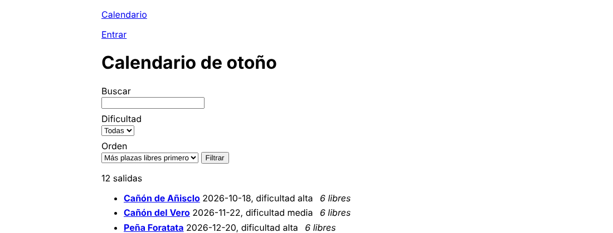

*Captura 7 de la UD5. El buscador y el paginador son objetos; la vista solo dice dónde van. `http://localhost:3000/salidas?orden=libres&pagina=2`*

```
view-source:http://localhost:3000/salidas?orden=libres&pagina=2
<p class="resumen">12 salidas</p>
        <a href="/salidas/2"><strong>Cañón de Añisclo</strong></a>
        <a href="/salidas/6"><strong>Cañón del Vero</strong></a>
        <a href="/salidas/10"><strong>Peña Foratata</strong></a>
        <a href="/salidas/0"><strong>Ibón de Estanés</strong></a>
        <a href="/salidas/1"><strong>Peña Oroel</strong></a>
    <a href="/salidas?orden=libres&amp;pagina=1">Anterior</a>
    <span>Página 2 de 3</span>
    <a href="/salidas?orden=libres&amp;pagina=3">Siguiente</a>
```

**La segunda impresión sin `e()`.** En la UD4 había una sola impresión sin escapar, la del hueco del layout. Ahora hay otra clase de ellas, y hay que saber por qué son correctas: `<?= $buscador->pintar() ?>` imprime HTML que **ya ha escapado el control**. Escaparlo otra vez enseñaría las etiquetas en pantalla. La norma queda así: en una vista, todo lo que se imprime lleva `e()`, salvo el hueco del layout y lo que devuelve `pintar()`. Se vigila con una búsqueda de las impresiones que no empiezan por `e(`:

```
Buscar en archivos · expresión regular
Buscar: <\?= *[^e ]
Archivos para incluir: ud5/vistas

6 resultados en 5 archivos
vistas/calendario.php
  3: <?= $buscador->pintar() ?>
  10: <?= $paginador->pintar() ?>
vistas/entrar.php
  3: <?= $formulario->pintar() ?>
vistas/ficha.php
  10: <?= $formulario->pintar() ?>
vistas/layout.php
  31: <?= $contenido ?>
vistas/publicar.php
  3: <?= $formulario->pintar() ?>
```

Seis, y las seis son de esas dos clases. Una séptima sería un fallo.

**Error típico: escapar dos veces, o ninguna.** Son los dos lados del mismo descuido. Si un control devuelve texto sin escapar «porque ya lo escapará la vista», la vista no puede hacerlo sin romper las etiquetas. Si la vista escribe `<?= e($paginador->pintar()) ?>`, el visitante lee `<nav class="paginas">` en la página. Y la variante silenciosa: pasarle al control un valor **ya escapado**, que llega al navegador como `&amp;amp;`. A un control se le dan los datos en crudo.

**Cómo se comprueba.** Con datos que lleven `&`, `<` y comillas, como en `controles.php`, y con una búsqueda: en las vistas no deberían quedar etiquetas de formulario escritas a mano.

```
Buscar en archivos · expresión regular
Buscar: <(form|select|option|input|label)\b
Archivos para incluir: ud5/vistas

2 resultados en 1 archivo
vistas/layout.php
  18: <form action="<?= e(url('/salir')) ?>" method="post">
  19: <input type="hidden" name="csrf" value="<?= e($token) ?>">
```

Queda un formulario, el de «Salir» del layout, que es un botón con su token. Convertirlo es el E20.

**Ejercicios del apartado.**

- **E19.** Escribe `Control`, `Desplegable`, `Paginador` y `Formulario`, y un `Campo` que cumpla lo descrito. Pruébalos con `controles.php`, añadiendo un `Campo` cuyo valor lleve comillas dobles. Devuelve la paginación al calendario.
- **E20.** Convierte el formulario de «Salir» del layout en un control creado por `Controlador::vista()`. Repite las dos búsquedas del apartado y explica qué ha cambiado en cada una.
- **E21.** Escribe un control `Insignia` que reciba una salida y pinte «COMPLETA» o «N libres», y úsalo en la tarjeta. Después contesta: ¿qué has ganado y qué has perdido respecto al `if` que tenía la tarjeta? ¿Cuándo merece la pena un control y cuándo basta un parcial?

<div style="page-break-before: always;"></div>

## Apartado 8. Formularios generados de forma dinámica

Hasta aquí los controles los ha creado el controlador uno a uno. Un formulario **generado de forma dinámica** es el que no está escrito en ningún sitio: se construye en cada petición a partir de datos, y cambia cuando cambian esos datos. Verás los dos casos que importan: el que sale de una **definición de campos** y el que sale de **lo que ha pasado** en la aplicación.

**Primer caso: una definición, dos usos.** En la UD4, las reglas de publicar una salida estaban en constantes, y de ellas salían la validación y los atributos del formulario: «una regla, dos lados». El paso siguiente es que de la misma definición salga **el formulario entero**. La definición es del negocio, así que vive en el modelo:

```php
<?php
declare(strict_types=1);

namespace Club\Modelo;

/** Qué campos tiene una salida que se publica y qué se le exige a cada uno. Una regla, escrita una vez. */
class ReglasSalida
{
    public const CAMPOS = [
        'nombre'     => ['etiqueta' => 'Nombre',     'tipo' => 'text',   'min' => 3, 'max' => 60],
        'fecha'      => ['etiqueta' => 'Fecha',      'tipo' => 'date',   'min' => '2027-01-10', 'max' => '2027-03-28'],
        'dificultad' => ['etiqueta' => 'Dificultad', 'tipo' => 'lista',  'opciones' => Salida::DIFICULTADES],
        'plazas'     => ['etiqueta' => 'Plazas',     'tipo' => 'number', 'min' => 5, 'max' => 40],
    ];

    /**
     * Comprueba los valores, que llegan todos como texto.
     *
     * @param  array<string, string> $valores
     * @return array<string, string> los errores, con la clave de su campo; [] si todo es correcto
     */
    public static function validar(array $valores): array
    {
        $errores = [];
        foreach (self::CAMPOS as $clave => $c) {
            $valor = $valores[$clave] ?? '';
            if ($c['tipo'] === 'text') {
                $largo = preg_match_all('/./us', $valor);     // caracteres, no bytes: la ñ cuenta uno
                if ($largo < $c['min'] || $largo > $c['max']) {
                    $errores[$clave] = "{$c['etiqueta']}: entre {$c['min']} y {$c['max']} caracteres.";
                }
            } elseif ($c['tipo'] === 'date') {
                $partes = preg_match('/^(\d{4})-(\d{2})-(\d{2})$/', $valor, $p) === 1 ? $p : null;
                if ($partes === null || !checkdate((int) $p[2], (int) $p[3], (int) $p[1])) {
                    $errores[$clave] = "{$c['etiqueta']}: escribe una fecha que exista, como AAAA-MM-DD.";
                } elseif ($valor < $c['min'] || $valor > $c['max']) {
                    $errores[$clave] = "{$c['etiqueta']}: entre el {$c['min']} y el {$c['max']}.";
                }
            } elseif ($c['tipo'] === 'lista') {
                if (!array_key_exists($valor, $c['opciones'])) {
                    $errores[$clave] = "{$c['etiqueta']}: elige un valor de la lista.";
                }
            } elseif ($c['tipo'] === 'number') {
                $numero = filter_var($valor, FILTER_VALIDATE_INT);
                if ($numero === false || $numero < $c['min'] || $numero > $c['max']) {
                    $errores[$clave] = "{$c['etiqueta']}: un número entero entre {$c['min']} y {$c['max']}.";
                }
            }
        }
        return $errores;
    }
}
```

`validar()` recorre los campos y aplica a cada uno la comprobación de su tipo. La longitud del nombre se cuenta con una expresión regular que encuentra «cualquier carácter»: así la `ñ` cuenta uno, sin extensiones. Y `Formulario::desdeDefinicion()`, que ya has leído, recorre **la misma lista** y crea un control por campo: un `Desplegable` para el tipo `lista` y un `Campo` para los demás, con sus límites como atributos. El control que faltaba por imprimir:

```php
<?php
declare(strict_types=1);

namespace Club\Vista;

class Campo implements Control
{
    /** @param array<string, string|int> $atributos atributos HTML de más: min, max, minlength… */
    public function __construct(
        private string $nombre,
        private string $etiqueta,
        private string $tipo = 'text',
        private string $valor = '',
        private array $atributos = [],
        private ?string $error = null,
    ) {
    }

    public function pintar(): string
    {
        $extra = '';
        foreach ($this->atributos as $atributo => $valor) {
            $extra .= ' ' . e($atributo) . '="' . e($valor) . '"';
        }
        $html  = '    <label for="' . e($this->nombre) . '">' . e($this->etiqueta) . "</label>\n";
        $html .= '    <input type="' . e($this->tipo) . '" id="' . e($this->nombre) . '" name="' . e($this->nombre) . '" value="' . e($this->valor) . '"' . $extra . ">\n";
        if ($this->error !== null) {
            $html .= '    <p class="error">' . e($this->error) . "</p>\n";
        }
        return $html;
    }
}
```

**Ejemplo trabajado: el formulario, con un envío que trae errores.** Por el terminal, para verlo entero:

```php
<?php
declare(strict_types=1);
// formulario.php — el formulario de publicar, generado desde su definición, con un envío que trae dos errores
use Club\Modelo\ReglasSalida;
use Club\Vista\Formulario;

require __DIR__ . '/arranque.php';
require __DIR__ . '/funciones/plantillas.php';

$enviado = ['nombre' => 'Raquetas en "Lizara"', 'fecha' => '2027-02-30', 'dificultad' => 'media', 'plazas' => '500'];
$errores = ReglasSalida::validar($enviado);
echo Formulario::desdeDefinicion('/salidas', ReglasSalida::CAMPOS, $enviado, $errores, 'Publicar', 'TOKEN-DE-PRUEBA')->pintar();
```

```
$ php formulario.php
<form action="/salidas" method="post">
    <input type="hidden" name="csrf" value="TOKEN-DE-PRUEBA">
    <label for="nombre">Nombre</label>
    <input type="text" id="nombre" name="nombre" value="Raquetas en &quot;Lizara&quot;" required="required" minlength="3" maxlength="60">
    <label for="fecha">Fecha</label>
    <input type="date" id="fecha" name="fecha" value="2027-02-30" required="required" min="2027-01-10" max="2027-03-28">
    <p class="error">Fecha: escribe una fecha que exista, como AAAA-MM-DD.</p>
    <label for="dificultad">Dificultad</label>
    <select id="dificultad" name="dificultad">
        <option value="">Elige…</option>
        <option value="baja">Baja</option>
        <option value="media" selected>Media</option>
        <option value="alta">Alta</option>
    </select>
    <label for="plazas">Plazas</label>
    <input type="number" id="plazas" name="plazas" value="500" required="required" min="5" max="40">
    <p class="error">Plazas: un número entero entre 5 y 40.</p>
    <button type="submit">Publicar</button>
</form>
```

Mira tres cosas. Los atributos `min`, `max`, `minlength` y `maxlength` salen de la definición. Cada campo vuelve con lo que se envió, y las comillas del nombre llegan como `&quot;`. Y cada error está debajo de su control: el de la fecha, que no existe, y el de las plazas, que se pasan. Si mañana el club pide un campo más, se añade **una línea** a `CAMPOS` y aparecen el control, sus atributos y su hueco para el error. Solo falta escribir su regla, si es de un tipo nuevo.

En la aplicación, las dos acciones que lo usan:

```php
    /** GET /salidas/nueva — solo monitores. */
    public function nueva(array $valores = [], array $errores = []): string
    {
        $formulario = Formulario::desdeDefinicion('/salidas', ReglasSalida::CAMPOS, $valores, $errores, 'Publicar', $this->sesion->token());
        return $this->vista('publicar', ['formulario' => $formulario], 'Publicar salida');
    }

    /** POST /salidas — solo monitores. */
    public function publicar(): string
    {
        $this->exigirToken();
        $valores = [];
        foreach (array_keys(ReglasSalida::CAMPOS) as $clave) {
            $valores[$clave] = texto($_POST, $clave);
        }
        $errores = ReglasSalida::validar($valores);
        if ($errores !== []) {
            return $this->nueva($valores, $errores);
        }
        // Guardar la salida llega con la base de datos (UD6); por ahora, como en la UD4, solo el mensaje
        $this->sesion->avisar("Salida «{$valores['nombre']}» publicada.");
        return $this->redirigir('/salidas');
    }
```

`publicar()` no construye nada: si hay errores, llama a `nueva()` con lo enviado y con los errores, y el formulario se regenera. La vista es una línea, `<?= $formulario->pintar() ?>` bajo su título.

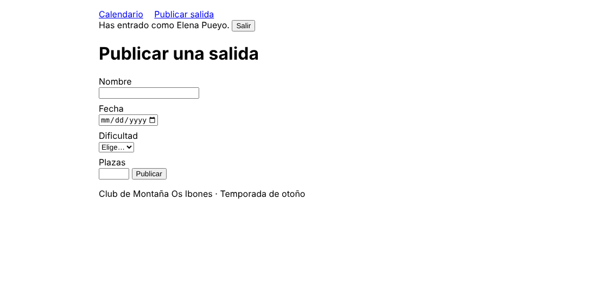

*Captura 8 de la UD5. Ningún campo de este formulario está escrito en una vista. `http://localhost:3000/salidas/nueva`, como monitora*

Un envío con tres errores. El navegador no deja enviarlo, porque los atributos lo frenan; llega editando el formulario en el panel Elementos, como en la UD4, o con `curl`:

```
Formulario enviado a http://localhost:3000/salidas — como elena.pueyo
Campos: nombre=Añ, fecha=2027-02-30, dificultad=extrema, plazas=20
HTTP/1.1 200 OK
    <p class="error">Nombre: entre 3 y 60 caracteres.</p>
    <p class="error">Fecha: escribe una fecha que exista, como AAAA-MM-DD.</p>
    <p class="error">Dificultad: elige un valor de la lista.</p>
    <input type="number" id="plazas" name="plazas" value="20" required="required" min="5" max="40">
```

**Segundo caso: el formulario que responde a lo que ha pasado.** En la ficha de una salida, lo que alguien puede hacer depende de quién es y de cómo está la salida en ese momento. Esa decisión es una regla del club, y está en el modelo: es el método `opcionPara()` de `Inscripciones`, que devuelve o una acción con su texto o un aviso (lo tienes impreso en el apartado 10, con el resto de la clase). El controlador convierte la respuesta en un formulario, si hay acción:

```php
    /** GET /salidas/{id} — la ficha de una salida, con lo que quien mira puede hacer con ella. */
    public function ver(string $id): string
    {
        $salida = $this->buscar($id);
        $yo     = $this->sesion->usuario();
        $opcion = $this->inscripciones->opcionPara($salida, $this->sesion->rol(), $yo['usuario'] ?? null);
        $formulario = isset($opcion['accion'])
            ? new Formulario("/salidas/{$salida->id}/{$opcion['accion']}", 'post', [], $opcion['texto'], $this->sesion->token())
            : null;
        return $this->vista('ficha', ['salida' => $salida, 'formulario' => $formulario, 'nota' => $opcion['aviso'] ?? null], $salida->nombre);
    }

```

El formulario no tiene campos propios: su dirección se monta con el número de la salida y con la acción que ha dicho el modelo, y lleva el token. La misma dirección, vista por cuatro situaciones:

```
view-source:http://localhost:3000/salidas/2 — sin haber entrado
<p class="nota">Entra para inscribirte.</p>

view-source:http://localhost:3000/salidas/2 — como lucia.ramos
<form action="/salidas/2/inscripcion" method="post">
    <button type="submit">Inscribirme</button>

view-source:http://localhost:3000/salidas/1 — como lucia.ramos
<p class="nota">No admite más inscripciones.</p>

view-source:http://localhost:3000/salidas/2 — como elena.pueyo
<p class="nota">9 de 15 inscritos.</p>
```

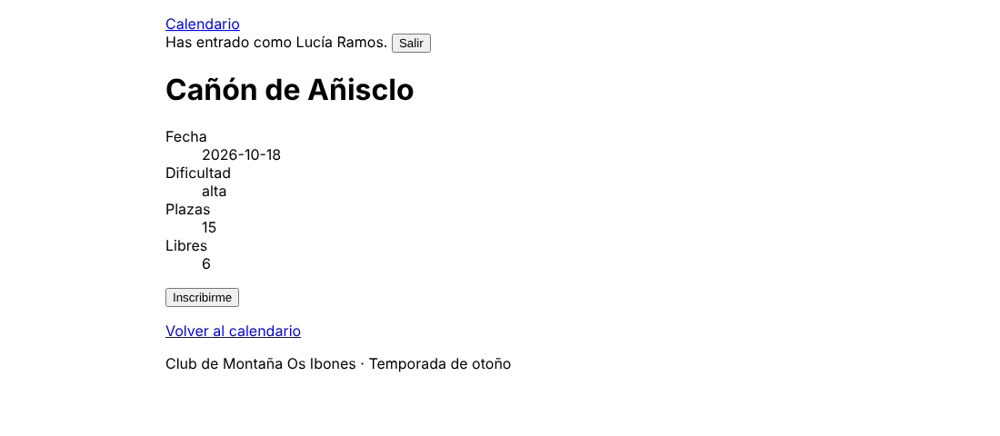

*Captura 9 de la UD5. El botón existe porque quien mira es socia y quedan plazas. `http://localhost:3000/salidas/2`, como socia*

Cuando la socia pulse el botón, la misma ficha dejará de traer formulario: el evento ha cambiado lo que se puede hacer. Lo verás en el apartado 10.

**Error típico: decidir en la vista.** La tentación es escribir en `ficha.php` un `if ($rol === 'socio' && !$salida->estaCompleta())`. Funciona, y vuelve a poner una regla del club en una plantilla, donde la inscripción no la ve: es el apartado 1 otra vez. La vista recibe el formulario hecho, o `null`.

**Y el de siempre: que no esté el botón no impide nada.** Un formulario generado decide qué se **ofrece**. Lo que se **permite** lo deciden la tabla de rutas y el servicio, cuando llega la petición, la haya ofrecido alguien o no.

**Cómo se comprueba.** Añadiendo un campo a la definición y contando qué ficheros has tocado; y pidiendo la misma ficha con cada perfil.

**Ejercicios del apartado.**

- **E22.** Añade a `CAMPOS` el campo `lugar` (texto, de 3 a 40 caracteres). Entrega el formulario pintado por el terminal con un `lugar` de dos letras, y la lista de ficheros que has tocado.
- **E23.** Añade el tipo `casilla` para el campo `autobus` de la UD4: su control, su rama en `desdeDefinicion()` y su regla. Recuerda que una casilla sin marcar no viaja en el envío.
- **E24.** Amplía `opcionPara()` para que una socia ya apuntada reciba la acción `baja`, con el texto «Darme de baja». Entrega las cuatro situaciones de la ficha otra vez. No hace falta que la baja funcione todavía: ¿qué contesta la aplicación si alguien pulsa el botón, y por qué ese código de estado?

<div style="page-break-before: always;"></div>

## Apartado 9. Configuración: lo que cambia sin tocar el código

Cinco salidas por página. Quince minutos de inactividad. El nombre del club. La ruta del fichero de salidas. Son valores que hoy están repartidos por el código como constantes, y que tienen algo en común: **pueden cambiar sin que cambie el programa**, y no valen lo mismo en todos los equipos.

**Qué es un parámetro de configuración.** Es un valor que la aplicación necesita y que decide quien la instala, no quien la programa. La prueba para reconocerlo: ¿tendría sentido que valiera otra cosa en otro club, o en tu equipo y en el servidor? Si la respuesta es sí, va a la configuración. Una regla del negocio no es configuración: que una salida completa no admita inscripciones no depende de dónde se instale.

**Un fichero para todos y otro para cada equipo.**

```php
<?php
// config/config.php — los parámetros de la aplicación: lo que puede cambiar sin tocar el código
return [
    'nombre_club'      => 'Club de Montaña Os Ibones',
    'temporada'        => 'Temporada de otoño',
    'por_pagina'       => 5,                                  // salidas por página en el calendario
    'inactividad_max'  => 15 * 60,                            // segundos sin peticiones que cierran la sesión
    'zona_horaria'     => 'Europe/Madrid',
    'depuracion'       => false,                              // true: los errores se enseñan con su traza. Nunca en producción
    'fichero_salidas'  => __DIR__ . '/../datos/salidas.php',
    'fichero_usuarios' => __DIR__ . '/../datos/usuarios.php',
];
```

Ese fichero se sube al repositorio y vale para todos. Al lado puede haber otro, `config/config.local.php`, con **solo lo que cambia en un equipo concreto**, que no se sube nunca: su nombre está en `.gitignore`. Para que quien llegue sepa que existe, se sube un ejemplo:

```php
<?php
// config/config.local.ejemplo.php — copia este fichero como config.local.php y deja solo lo que cambia en TU equipo.
// config.local.php no se sube al repositorio: está en .gitignore.
return [
    'depuracion' => true,
];
```

El día que haya una contraseña de base de datos (UD6), irá ahí y solo ahí. Un secreto en un repositorio deja de serlo.

**La clase que los sirve.**

```php
<?php
declare(strict_types=1);

namespace Club\Nucleo;

/** Los parámetros de la aplicación, leídos una vez. Pedir uno que no existe es un error de quien programa. */
class Config
{
    /** @param array<string, mixed> $valores */
    public function __construct(private array $valores)
    {
    }

    /** Carga el fichero general y, si existe, le superpone el local de este equipo. */
    public static function desdeFicheros(string $general, string $local): self
    {
        $valores = require $general;
        if (is_file($local)) {
            $valores = array_merge($valores, require $local);
        }
        return new self($valores);
    }

    public function get(string $clave): mixed
    {
        if (!array_key_exists($clave, $this->valores)) {
            throw new \OutOfBoundsException("Parámetro de configuración desconocido: $clave");
        }
        return $this->valores[$clave];
    }
}
```

`array_merge()` superpone el fichero local al general: lo que está en los dos vale lo que diga el local. Y pedir una clave que no existe **lanza una excepción** en vez de devolver `null`: un nombre mal escrito tiene que notarse el primer día.

```php
<?php
declare(strict_types=1);
// ver-config.php — qué valores tiene la aplicación en este equipo
use Club\Nucleo\Config;

require __DIR__ . '/arranque.php';

$config = Config::desdeFicheros(__DIR__ . '/config/config.php', __DIR__ . '/config/config.local.php');
foreach (['nombre_club', 'por_pagina', 'depuracion'] as $clave) {
    echo str_pad($clave, 12), ' = ', var_export($config->get($clave), true), "\n";
}
try {
    $config->get('por_pajina');
} catch (OutOfBoundsException $e) {
    echo $e->getMessage(), "\n";
}
```

```
$ php ver-config.php
nombre_club  = 'Club de Montaña Os Ibones'
por_pagina   = 5
depuracion   = false
Parámetro de configuración desconocido: por_pajina
```

**Ejemplo trabajado: cambiar un parámetro.** Crea `config/config.local.php` con `return ['por_pagina' => 4];` y vuelve a preguntar:

```
$ php ver-config.php
nombre_club  = 'Club de Montaña Os Ibones'
por_pagina   = 4
depuracion   = false
Parámetro de configuración desconocido: por_pajina
```

| Dirección, tras `http://localhost:3000` | Busca con `Ctrl+F` | Coincidencias |
|---|---|---|
| `/salidas` | `class="tarjeta"` | 4 |
| `/salidas?pagina=3` | `class="tarjeta"` | 4 |

Tres páginas de cuatro, sin tocar una línea de código ni de `config.php`.

**El parámetro que decide qué se enseña cuando algo falla.** Ahora pon `'por_pagina' => 0`. El controlador divide entre el tamaño de la página, y dividir entre cero lanza un error que nadie captura. En la entrada de la aplicación, que tienes impresa en el apartado 10, hay una función registrada con `set_exception_handler()`: recibe todo lo que nadie ha capturado, lo anota en el registro del servidor y contesta con un `500`. Qué texto lleva la página lo decide `depuracion`:

```
Red › salidas › Encabezados de respuesta
HTTP/1.1 500 Internal Server Error
```

```
view-source:http://localhost:3000/salidas
<p class="aviso">Algo ha fallado. Inténtalo dentro de un rato.</p>
```

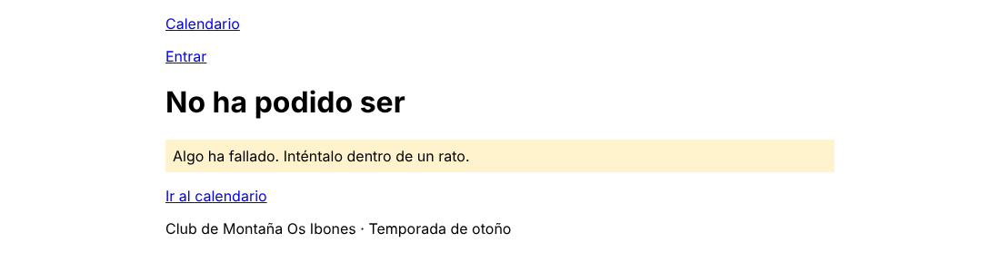

*Captura 10 de la UD5. Un fallo, con `depuracion` apagado: el visitante no ve nada del interior. `http://localhost:3000/salidas`*

Con `'depuracion' => true` en el fichero local, la misma petición:

```
view-source:http://localhost:3000/salidas
<p class="aviso">DivisionByZeroError: Division by zero (SalidasControlador.php, línea 46)</p>
```

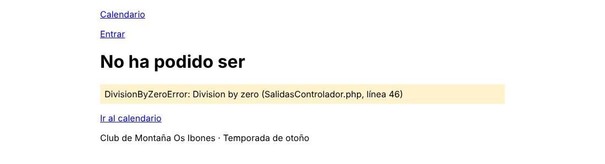

*Captura 11 de la UD5. El mismo fallo, con `depuracion` encendido: qué ha pasado y dónde. `http://localhost:3000/salidas`*

En tu equipo quieres la segunda. En el servidor, siempre la primera: el nombre de una clase, un fichero y una línea son información para quien ataca. Por eso `depuracion` vale `false` en el fichero general y solo se enciende en el local.

**Error típico: configuración que no lo parece.** Dos formas. Un valor que debería ser parámetro y sigue escrito en el código (un `5` suelto en un controlador). Y la contraria, peor: un secreto o un ajuste personal escrito en `config.php` y subido. La primera se encuentra buscando números y rutas sueltos en `src/`; la segunda, leyendo lo que vas a confirmar antes de cada commit.

**Cómo se comprueba.** Cambiando el parámetro en el fichero local y viendo el efecto sin haber tocado nada más. Y borrando el fichero local: la aplicación tiene que seguir funcionando con los valores generales.

**Ejercicios del apartado.**

- **E25.** Monta `config/`, la clase `Config` y el fichero local. Entrega `ver-config.php` con y sin fichero local, y la línea de tu `.gitignore`. Comprueba con `git status` que el fichero local no aparece.
- **E26.** El texto «Calendario de otoño» está escrito en una vista. ¿Es un parámetro? Decídelo con la prueba del apartado, llévalo donde corresponda y demuestra el cambio.
- **E27.** Provoca el `500` con `por_pagina` a cero, con `depuracion` apagado y encendido. Después arregla la causa de verdad: ¿dónde hay que comprobar que ese valor es válido, y con qué clase de excepción?

<div style="page-break-before: always;"></div>

## Apartado 10. La aplicación entera: estado, perfiles y una sola puerta

Faltan la sesión, los perfiles y los formularios que cambian cosas: todo lo de la UD3, que ahora tiene un sitio para cada pieza. Este apartado no enseña mecanismos nuevos. Enseña **dónde va** cada uno de los que ya conoces.

**La sesión, detrás de una clase.** `$_SESSION` es una variable global que cualquiera puede leer y escribir desde cualquier fichero: lo contrario de lo que llevas haciendo toda la unidad. Se envuelve en una clase que le pone nombre a cada cosa que se guarda. Dentro están, sin cambios, la cookie endurecida, la caducidad por inactividad, `session_regenerate_id()` al entrar, el mensaje de un solo uso y el token:

```php
<?php
declare(strict_types=1);

namespace Club\Nucleo;

/** Todo lo que la aplicación guarda en la sesión, con nombre. Nadie más toca $_SESSION. */
class Sesion
{
    /** Arranca la sesión con la cookie endurecida de la UD3 y cierra las que llevan demasiado tiempo sin usarse. */
    public function __construct(int $inactividadMax)
    {
        session_set_cookie_params(['lifetime' => 0, 'path' => '/', 'secure' => isset($_SERVER['HTTPS']), 'httponly' => true, 'samesite' => 'Lax']);
        session_start();
        $ahora = time();
        if (isset($_SESSION['ultima_actividad']) && $ahora - $_SESSION['ultima_actividad'] > $inactividadMax) {
            session_unset();
            session_destroy();
            session_start();
            $_SESSION['flash'] = 'Tu sesión caducó por inactividad. Vuelve a entrar.';
        }
        $_SESSION['ultima_actividad'] = $ahora;
    }

    /** @return array{usuario: string, nombre: string, rol: string}|null quien ha entrado, o null */
    public function usuario(): ?array
    {
        return $_SESSION['usuario'] ?? null;
    }

    public function rol(): string
    {
        return $_SESSION['usuario']['rol'] ?? 'visitante';
    }

    public function entrar(array $usuario): void
    {
        session_regenerate_id(true);                          // identificador nuevo al cambiar de privilegios (UD3)
        $_SESSION['usuario'] = ['usuario' => $usuario['usuario'], 'nombre' => $usuario['nombre'], 'rol' => $usuario['rol']];
    }

    public function salir(): void
    {
        session_unset();
        session_destroy();
    }

    /** Deja un mensaje para la página siguiente. */
    public function avisar(string $mensaje): void
    {
        $_SESSION['flash'] = $mensaje;
    }

    /** Devuelve el mensaje pendiente y lo borra: se enseña una sola vez. */
    public function aviso(): ?string
    {
        $mensaje = $_SESSION['flash'] ?? null;
        unset($_SESSION['flash']);
        return $mensaje;
    }

    public function token(): string
    {
        $_SESSION['csrf'] ??= bin2hex(random_bytes(32));
        return $_SESSION['csrf'];
    }

    public function tokenValido(mixed $recibido): bool
    {
        return is_string($recibido) && isset($_SESSION['csrf']) && hash_equals($_SESSION['csrf'], $recibido);
    }

    /** @return string[] lo guardado bajo esa clave */
    public function lista(string $clave): array
    {
        return $_SESSION[$clave] ?? [];
    }

    public function guardarLista(string $clave, array $valores): void
    {
        $_SESSION[$clave] = $valores;
    }
}
```

**La puerta, en la tabla.** En la UD3 cada página privada empezaba llamando a `requiere_rol()`, y la que se olvidaba quedaba abierta. Ahora quién puede pedir cada dirección se dice en el mismo sitio que la dirección. `get()` y `post()` admiten un tercer argumento:

```php
    /** $rol: si se indica, solo entra quien tenga ese rol. */
    public function get(string $patron, mixed $destino, ?string $rol = null): void
    {
        $this->rutas[] = ['metodo' => 'GET', 'patron' => $patron, 'destino' => $destino, 'rol' => $rol];
    }

    public function post(string $patron, mixed $destino, ?string $rol = null): void
    {
        $this->rutas[] = ['metodo' => 'POST', 'patron' => $patron, 'destino' => $destino, 'rol' => $rol];
    }

```

```php
<?php
declare(strict_types=1);
// rutas.php — la tabla de rutas del club: qué dirección, con qué método, a qué acción y para quién
use Club\Controladores\PortadaControlador;
use Club\Controladores\SalidasControlador;
use Club\Controladores\SesionControlador;
use Club\Nucleo\Enrutador;

$enrutador = new Enrutador();
$enrutador->get('/', [PortadaControlador::class, 'inicio']);
$enrutador->get('/salidas', [SalidasControlador::class, 'indice']);
$enrutador->get('/salidas/nueva', [SalidasControlador::class, 'nueva'], 'monitor');     // antes que /salidas/{id}
$enrutador->post('/salidas', [SalidasControlador::class, 'publicar'], 'monitor');
$enrutador->get('/salidas/{id}', [SalidasControlador::class, 'ver']);
$enrutador->post('/salidas/{id}/inscripcion', [SalidasControlador::class, 'inscribir'], 'socio');
$enrutador->get('/entrar', [SesionControlador::class, 'formulario']);
$enrutador->post('/entrar', [SesionControlador::class, 'entrar']);
$enrutador->post('/salir', [SesionControlador::class, 'salir']);
return $enrutador;
```

Fíjate en el orden: `/salidas/nueva` va antes que `/salidas/{id}`, porque gana la primera que encaja. `tabla.php` enseña ahora la aplicación entera, con sus perfiles:

```
$ php tabla.php
GET   /                          PortadaControlador::inicio           cualquiera
GET   /salidas                   SalidasControlador::indice           cualquiera
GET   /salidas/nueva             SalidasControlador::nueva            monitor
POST  /salidas                   SalidasControlador::publicar         monitor
GET   /salidas/{id}              SalidasControlador::ver              cualquiera
POST  /salidas/{id}/inscripcion  SalidasControlador::inscribir        socio
GET   /entrar                    SesionControlador::formulario        cualquiera
POST  /entrar                    SesionControlador::entrar            cualquiera
POST  /salir                     SesionControlador::salir             cualquiera
```

**La entrada, completa.** `publico/index.php` se queda en una línea, `require __DIR__ . '/../aplicacion.php';`, y lo que hacía pasa a un fichero que no se sirve:

```php
<?php
declare(strict_types=1);
// aplicacion.php — atiende una petición de principio a fin. La llama la entrada única, publico/index.php
use Club\Controladores\PortadaControlador;
use Club\Controladores\SalidasControlador;
use Club\Controladores\SesionControlador;
use Club\Modelo\Calendario;
use Club\Modelo\Inscripciones;
use Club\Modelo\RegistroEnSesion;
use Club\Modelo\SalidasEnFichero;
use Club\Modelo\Usuarios;
use Club\Nucleo\Config;
use Club\Nucleo\NoEncontrado;
use Club\Nucleo\Prohibido;
use Club\Nucleo\Sesion;

require __DIR__ . '/arranque.php';
require __DIR__ . '/funciones/plantillas.php';

// 0. La configuración, y lo que depende de ella antes de hacer nada más
$config = Config::desdeFicheros(__DIR__ . '/config/config.php', __DIR__ . '/config/config.local.php');
date_default_timezone_set($config->get('zona_horaria'));

/** Pinta una página de error con el layout mínimo: no depende de la sesión ni de nada que haya podido fallar. */
function pagina_de_error(int $estado, string $mensaje, Config $config): void {
    http_response_code($estado);
    echo capturar('layout', ['titulo' => 'No ha podido ser', 'contenido' => capturar('error', ['mensaje' => $mensaje]),
        'club' => $config->get('nombre_club'), 'temporada' => $config->get('temporada'), 'yo' => null, 'rol' => 'visitante', 'aviso' => null, 'token' => '']);
}

// Lo que nadie ha capturado acaba aquí: un 500. Qué se enseña lo decide la configuración
set_exception_handler(function (Throwable $e) use ($config): void {
    $detalle = get_class($e) . ': ' . $e->getMessage() . ' (' . basename($e->getFile()) . ', línea ' . $e->getLine() . ')';
    error_log($detalle);                                      // al registro del servidor, siempre
    pagina_de_error(500, $config->get('depuracion') ? $detalle : 'Algo ha fallado. Inténtalo dentro de un rato.', $config);
});

// 1. Las piezas: se crean aquí y se entregan a quien las necesita
$sesion   = new Sesion($config->get('inactividad_max'));
$salidas  = new SalidasEnFichero($config->get('fichero_salidas'));
$fabricas = [
    PortadaControlador::class => fn() => new PortadaControlador($sesion, $config),
    SesionControlador::class  => fn() => new SesionControlador($sesion, $config, new Usuarios($config->get('fichero_usuarios'))),
    SalidasControlador::class => fn() => new SalidasControlador($sesion, $config, new Calendario($salidas), $salidas, new Inscripciones($salidas, new RegistroEnSesion($sesion))),
];

// 2. Qué se pide: el método y la ruta, sin la cadena de consulta
$enrutador  = require __DIR__ . '/rutas.php';
$ruta       = (string) parse_url($_SERVER['REQUEST_URI'], PHP_URL_PATH);
$encontrada = $enrutador->resolver($_SERVER['REQUEST_METHOD'], $ruta);

// 3. Quién lo atiende, si puede pedirlo
try {
    if ($encontrada['estado'] === 405) {
        header('Allow: ' . implode(', ', $encontrada['permitidos']));
        pagina_de_error(405, 'Esa dirección existe, pero no admite este método.', $config);
        return;
    }
    if ($encontrada['estado'] === 404) {
        throw new NoEncontrado('Esa dirección no existe en la web del club.');
    }
    if ($encontrada['rol'] !== null && $sesion->rol() === 'visitante') {
        header('Location: /entrar', true, 302);               // no ha entrado nadie: a identificarse
        return;
    }
    if ($encontrada['rol'] !== null && $sesion->rol() !== $encontrada['rol']) {
        throw new Prohibido('Tu perfil no puede hacer eso.');
    }
    [$clase, $accion] = $encontrada['destino'];
    echo $fabricas[$clase]()->$accion(...$encontrada['parametros']);
} catch (NoEncontrado $e) {
    pagina_de_error(404, $e->getMessage(), $config);
} catch (Prohibido $e) {
    pagina_de_error(403, $e->getMessage(), $config);
}
```

El paso 3 es la puerta, y es **una** para toda la aplicación. Si la ruta pide un perfil y no ha entrado nadie, redirige a identificarse. Si ha entrado alguien con otro perfil, lanza `Prohibido`, una excepción propia como `NoEncontrado`, que acaba en un `403`. Solo entonces se crea el controlador. Ninguna acción puede olvidarse de comprobarlo, porque no lo comprueba ninguna.

**El estado, detrás de un contrato.** El servicio de inscripciones recordaba quién se había apuntado en una propiedad que duraba una petición. Ahora se lo pregunta a un registro, que es una interfaz, con dos clases: una en memoria, para las pruebas, y otra que guarda en la sesión:

```php
<?php
declare(strict_types=1);

namespace Club\Modelo;

/** Dónde se apunta quién va a cada salida. */
interface RegistroInscripciones
{
    /** @return string[] quiénes están apuntados a esa salida */
    public function apuntados(int $idSalida): array;

    public function apuntar(int $idSalida, string $socio): void;
}
```

```php
<?php
declare(strict_types=1);

namespace Club\Modelo;

use Club\Nucleo\Sesion;

/** El registro, guardado en la sesión de quien se apunta. Con la base de datos de la UD6 habrá otro, para todos. */
class RegistroEnSesion implements RegistroInscripciones
{
    public function __construct(private Sesion $sesion)
    {
    }

    public function apuntados(int $idSalida): array
    {
        return $this->sesion->lista('inscritos_' . $idSalida);
    }

    public function apuntar(int $idSalida, string $socio): void
    {
        $this->sesion->guardarLista('inscritos_' . $idSalida, [...$this->apuntados($idSalida), $socio]);
    }
}
```

`[...$lista, $socio]` es un array nuevo con lo que había y uno más. `RegistroEnMemoria` es lo mismo con un array propio. El servicio, que ya no sabe dónde se guarda nada:

```php
<?php
declare(strict_types=1);

namespace Club\Modelo;

/** Las reglas de apuntarse a una salida, en un solo sitio. */
class Inscripciones
{
    public function __construct(private RepositorioSalidas $salidas, private RegistroInscripciones $registro)
    {
    }

    public function estaApuntado(int $id, string $socio): bool
    {
        return in_array($socio, $this->registro->apuntados($id), true);
    }

    /**
     * Apunta a $socio a la salida $id y devuelve la salida, ya con una plaza menos.
     *
     * @throws SalidaNoEncontrada si la salida no existe
     * @throws YaInscrito         si esa persona ya estaba apuntada
     * @throws SalidaCompleta     si no quedan plazas
     */
    public function inscribir(int $id, string $socio): Salida
    {
        $salida = $this->salidas->porId($id);
        if ($salida === null) {
            throw new SalidaNoEncontrada("No hay ninguna salida con el número $id.");
        }
        if ($this->estaApuntado($id, $socio)) {
            throw new YaInscrito("$socio ya está en «{$salida->nombre}».");
        }
        $salida->inscribir();                                 // si está completa, la excepción sale de aquí
        $this->registro->apuntar($id, $socio);
        return $salida;
    }

    /**
     * Lo que esa persona puede hacer ahora con esa salida. De aquí sale el formulario de la ficha.
     *
     * @return array{accion: string, texto: string}|array{aviso: string}
     */
    public function opcionPara(Salida $salida, string $rol, ?string $socio): array
    {
        if ($rol === 'visitante') {
            return ['aviso' => 'Entra para inscribirte.'];
        }
        if ($rol !== 'socio') {
            return ['aviso' => "{$salida->inscritos()} de {$salida->plazas()} inscritos."];
        }
        if ($this->estaApuntado($salida->id, (string) $socio)) {
            return ['aviso' => 'Ya estás en esta salida.'];
        }
        if ($salida->estaCompleta()) {
            return ['aviso' => 'No admite más inscripciones.'];
        }
        return ['accion' => 'inscripcion', 'texto' => 'Inscribirme'];
    }
}
```

Compáralo con el del apartado 6: las tres reglas de `inscribir()` están donde estaban. Ha cambiado **dónde se recuerda**, no qué se exige. En la UD6 habrá un tercer registro, con la base de datos, y esta clase tampoco se enterará. Las plazas que ves siguen saliendo del fichero: lo apuntado en la sesión lo ve solo quien se apuntó, como en la UD4.

**Los controladores, con sesión.** La clase base recibe la sesión y la configuración, y con ellas le da al layout lo que necesita en todas las páginas: quién ha entrado, su perfil, el aviso pendiente y el token:

```php
<?php
declare(strict_types=1);

namespace Club\Nucleo;

/** Lo que comparten todos los controladores: cómo se contesta con una página y cómo se redirige. */
abstract class Controlador
{
    public function __construct(protected Sesion $sesion, protected Config $config)
    {
    }

    /** Devuelve la página entera: la vista, pintada con sus datos, dentro del layout. */
    protected function vista(string $vista, array $datos, string $titulo): string
    {
        return capturar('layout', [
            'titulo'    => $titulo,
            'contenido' => capturar($vista, $datos),
            'club'      => $this->config->get('nombre_club'),
            'temporada' => $this->config->get('temporada'),
            'yo'        => $this->sesion->usuario(),
            'rol'       => $this->sesion->rol(),
            'aviso'     => $this->sesion->aviso(),
            'token'     => $this->sesion->token(),
        ]);
    }

    /** Contesta con una redirección a una dirección de la propia aplicación, que empieza por /. */
    protected function redirigir(string $ruta): string
    {
        header('Location: ' . $ruta, true, 302);
        return '';                                            // una redirección no lleva cuerpo
    }

    /** Corta cualquier POST que no traiga el token de esta sesión. */
    protected function exigirToken(): void
    {
        if (!$this->sesion->tokenValido($_POST['csrf'] ?? null)) {
            throw new Prohibido('Petición rechazada: token no válido.');
        }
    }
}
```

El controlador de la sesión. `parent::__construct()` llama al constructor de la clase madre; `Usuarios` es una clase pequeña del modelo que lee `datos/usuarios.php` y comprueba la contraseña con `password_verify()`, como en la UD3:

```php
<?php
declare(strict_types=1);

namespace Club\Controladores;

use Club\Modelo\Usuarios;
use Club\Nucleo\Config;
use Club\Nucleo\Controlador;
use Club\Nucleo\Sesion;
use Club\Vista\Campo;
use Club\Vista\Formulario;

class SesionControlador extends Controlador
{
    public function __construct(Sesion $sesion, Config $config, private Usuarios $usuarios)
    {
        parent::__construct($sesion, $config);
    }

    /** GET /entrar */
    public function formulario(string $usuario = '', ?string $error = null): string
    {
        $formulario = new Formulario('/entrar', 'post', [
            new Campo('usuario', 'Usuario', 'text', $usuario, ['required' => 'required'], $error),
            new Campo('clave', 'Contraseña', 'password', '', ['required' => 'required']),
        ], 'Entrar', $this->sesion->token());
        return $this->vista('entrar', ['formulario' => $formulario], 'Entrar');
    }

    /** POST /entrar */
    public function entrar(): string
    {
        $this->exigirToken();
        $nombre  = texto($_POST, 'usuario');
        $usuario = $this->usuarios->autenticar($nombre, texto($_POST, 'clave'));
        if ($usuario === null) {
            return $this->formulario($nombre, 'Usuario o contraseña incorrectos.');
        }
        $this->sesion->entrar($usuario);
        $this->sesion->avisar("Hola, {$usuario['nombre']}.");
        return $this->redirigir('/salidas');
    }

    /** POST /salir */
    public function salir(): string
    {
        $this->exigirToken();
        $this->sesion->salir();
        return $this->redirigir('/salidas');
    }
}
```

Y la acción de inscribirse, que es el patrón Post/Redirect/Get de la UD3 con todas sus piezas en su sitio:

```php
    /** POST /salidas/{id}/inscripcion — solo socios (lo dice la tabla de rutas). */
    public function inscribir(string $id): string
    {
        $this->exigirToken();
        $salida = $this->buscar($id);
        try {
            $this->inscripciones->inscribir($salida->id, $this->sesion->usuario()['usuario']);
            $this->sesion->avisar("Inscripción registrada en {$salida->nombre}.");
        } catch (SalidaCompleta | YaInscrito $e) {
            $this->sesion->avisar($e->getMessage());
        }
        return $this->redirigir('/salidas/' . $salida->id);
    }

```

Léela como una frase. Comprueba el token. Busca la salida. Le pide al modelo que inscriba. Si el modelo dice que no, con una excepción del negocio, lo cuenta en un aviso. Y redirige. No hay una sola regla en ella. El layout, con el menú según el perfil y el aviso:

```php
<?php declare(strict_types=1); // vistas/layout.php — recibe: $titulo, $contenido (HTML ya pintado), $club, $temporada, $yo (o null), $rol, $aviso (o null), $token ?>
<!doctype html>
<html lang="es">
<head>
    <meta charset="utf-8">
    <title><?= e($titulo) ?> · <?= e($club) ?></title>
    <link rel="stylesheet" href="<?= e(url('/club.css')) ?>">
</head>
<body>
<header>
    <nav>
        <a href="<?= e(url('/salidas')) ?>">Calendario</a>
<?php if ($rol === 'monitor'): ?>
        <a href="<?= e(url('/salidas/nueva')) ?>">Publicar salida</a>
<?php endif; ?>
    </nav>
<?php if ($yo !== null): ?>
    <form action="<?= e(url('/salir')) ?>" method="post">
        <input type="hidden" name="csrf" value="<?= e($token) ?>">
        <span>Has entrado como <?= e($yo['nombre']) ?>.</span>
        <button type="submit">Salir</button>
    </form>
<?php else: ?>
    <p><a href="<?= e(url('/entrar')) ?>">Entrar</a></p>
<?php endif; ?>
</header>
<main>
<?php if ($aviso !== null): ?>
<p class="aviso"><?= e($aviso) ?></p>
<?php endif; ?>
<?= $contenido ?>
</main>
<footer>
    <p><?= e($club) ?> · <?= e($temporada) ?></p>
</footer>
</body>
</html>
```

**Ejemplo trabajado: una socia, de principio a fin.** Sin haber entrado, la dirección de publicar lleva a identificarse:

```
Red › salidas/nueva › Encabezados de respuesta
HTTP/1.1 302 Found
Location: /entrar
```

Lucía entra (`lucia.ramos`, con la contraseña de aula de la UD3) y prueba cuatro cosas: publicar, que no es de su perfil; inscribirse sin token; inscribirse bien; y volver a mirar la ficha dos veces.

```
Formulario enviado a http://localhost:3000/salidas — como lucia.ramos
Campos: nombre=Raquetas en Lizara
HTTP/1.1 403 Forbidden

Formulario enviado a http://localhost:3000/salidas/2/inscripcion — como lucia.ramos
Campos: ningún campo (sin el token)
HTTP/1.1 403 Forbidden

Formulario enviado a http://localhost:3000/salidas/2/inscripcion — como lucia.ramos
Campos: ningún campo
HTTP/1.1 302 Found
Location: /salidas/2

view-source:http://localhost:3000/salidas/2 — como lucia.ramos
<p class="aviso">Inscripción registrada en Cañón de Añisclo.</p>
<p class="nota">Ya estás en esta salida.</p>

view-source:http://localhost:3000/salidas/2 — como lucia.ramos
<p class="nota">Ya estás en esta salida.</p>

Formulario enviado a http://localhost:3000/salidas/1/inscripcion — como lucia.ramos
Campos: ningún campo
HTTP/1.1 302 Found
Location: /salidas/1

view-source:http://localhost:3000/salidas/1 — como lucia.ramos
<p class="aviso">La salida «Peña Oroel» está completa.</p>
```

El `403` de publicar ha salido de la tabla; el del token, de la clase base; el aviso de «completa», de una excepción lanzada dentro de `Salida`. Tres piezas distintas, cada una con lo suyo. El aviso de la inscripción aparece una vez y desaparece, y la ficha ya no ofrece el botón: es el formulario del apartado 8, que ha respondido al evento.

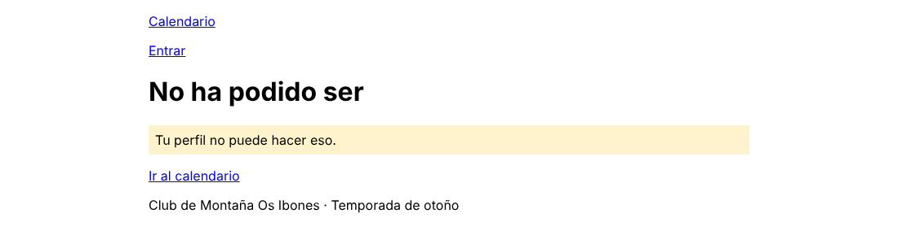

*Captura 12 de la UD5. La dirección de publicar, escrita a mano por una socia: `403`. `http://localhost:3000/salidas/nueva`, como socia*

Y una monitora publica (`elena.pueyo`):

```
Formulario enviado a http://localhost:3000/salidas — como elena.pueyo
Campos: nombre=Raquetas en Lizara, fecha=2027-02-14, dificultad=media, plazas=20
HTTP/1.1 302 Found
Location: /salidas

view-source:http://localhost:3000/salidas — como elena.pueyo
<p class="aviso">Salida «Raquetas en Lizara» publicada.</p>
```

**Las dos cuentas del apartado 1, otra vez.** ¿Cuántos `require` quedan fuera de la autocarga?

```
Buscar en archivos · expresión regular
Buscar: ^require
Archivos para incluir: ud5

3 resultados en 2 archivos
publico/index.php
  4: require __DIR__ . '/../aplicacion.php';
aplicacion.php
  17: require __DIR__ . '/arranque.php';
  18: require __DIR__ . '/funciones/plantillas.php';
```

De veintidós a tres, y ninguno en un controlador. ¿Y quién toca la sesión?

```
Buscar en archivos · expresión regular
Buscar: \$_SESSION
Archivos para incluir: ud5

17 resultados en 1 archivo
src/Nucleo/Sesion.php
  6: /** Todo lo que la aplicación guarda en la sesión, con nombre. Nadie más toca $_SESSION. */
  15: if (isset($_SESSION['ultima_actividad']) && $ahora - $_SESSION['ultima_actividad'] > $inactividadMax) {
  19: $_SESSION['flash'] = 'Tu sesión caducó por inactividad. Vuelve a entrar.';
  21: $_SESSION['ultima_actividad'] = $ahora;
  27: return $_SESSION['usuario'] ?? null;
  32: return $_SESSION['usuario']['rol'] ?? 'visitante';
  38: $_SESSION['usuario'] = ['usuario' => $usuario['usuario'], 'nombre' => $usuario['nombre'], 'rol' => $usuario['rol']];
  50: $_SESSION['flash'] = $mensaje;
  56: $mensaje = $_SESSION['flash'] ?? null;
  57: unset($_SESSION['flash']);
  63: $_SESSION['csrf'] ??= bin2hex(random_bytes(32));
  64: return $_SESSION['csrf'];
  69: return is_string($recibido) && isset($_SESSION['csrf']) && hash_equals($_SESSION['csrf'], $recibido);
  75: return $_SESSION[$clave] ?? [];
  80: $_SESSION[$clave] = $valores;
```

Un fichero.

**Lista de comprobación de la unidad.** Es la que pasarás sobre tu actividad evaluativa antes de entregarla:

| N.º | Qué se comprueba | Cómo | Apartado |
|---|---|---|---|
| 1 | Una sola entrada | En `publico/` hay un único fichero PHP | 4 |
| 2 | Toda dirección está en la tabla | `tabla.php` las lista todas, con su perfil | 4 y 10 |
| 3 | 404 y 405 propios, con su código | Una dirección inventada y un método que no toca | 4 |
| 4 | Toda dirección interna empieza por `/` | Los `href`, `action` y `Location`, en el código fuente y en la pestaña Red | 5 |
| 5 | Los controladores no pintan ni calculan | La búsqueda de `echo` y de etiquetas en `src/Controladores` | 5 |
| 6 | Las reglas viven en el modelo, una vez | La búsqueda de la regla: una sola carpeta | 6 |
| 7 | El modelo no sabe nada de la web | La búsqueda de superglobales y etiquetas en `src/Modelo` | 6 |
| 8 | Las reglas se prueban sin servidor | `php pruebas/probar.php`: cero fallos | 6 y 12 |
| 9 | La vista solo imprime con `e()`, el hueco o `pintar()` | La búsqueda de impresiones sin `e(` | 7 |
| 10 | El formulario sale de su definición | Un campo nuevo: una línea | 8 |
| 11 | Lo que se ofrece depende de quién mira; lo que se permite, no | Una sesión por perfil, y la dirección escrita a mano | 8 y 10 |
| 12 | La configuración local no se sube y `depuracion` está apagado | `git status` y un fallo provocado | 9 |
| 13 | La sesión se toca en un solo fichero | La búsqueda de `$_SESSION` | 10 |
| 14 | Nada depende de las mayúsculas del nombre de un fichero | Cada fichero de `src/` se llama como su clase | 3 |

**Error típico: la puerta que vuelve a la acción.** Con la tabla hecha, alguien escribe en una acción `if ($this->sesion->rol() !== 'monitor')`. No es que esté mal comprobado: es que ahora la norma está en dos sitios, y `tabla.php` ya no dice la verdad sobre quién puede qué.

**Ejercicios del apartado.**

- **E28.** Completa tu aplicación con la sesión, la puerta en la tabla, el registro en la sesión y los tres controladores. Entrega la salida de `tabla.php` y el recorrido de la socia, con los códigos de estado copiados de la pestaña Red.
- **E29.** Haz que funcione la baja del E24: la ruta, la acción, el método del servicio con su excepción y el método que le falta al contrato del registro. ¿Cuántas clases que cumplen ese contrato has tenido que tocar, y qué te ha obligado a hacerlo?
- **E30.** Pasa la lista de comprobación entera sobre tu aplicación y entrega la tabla con el resultado y la evidencia de cada punto.

<div style="page-break-before: always;"></div>

## Apartado 11. Frameworks MVC y patrones de diseño: lo que has construido tiene nombre

Has escrito un framework. Es pequeño, le faltan cien cosas y no debes usarlo en producción, pero tiene las mismas piezas que los que se usan en las empresas, y por eso ahora puedes leerlos. Este apartado es de **lectura**: no se instala ni se ejecuta nada. Usar un framework de verdad llega al final del curso, con Laravel, cuando haya base de datos.

**Qué es un framework MVC.** Es una aplicación a medio hacer: trae escritas la entrada única, el enrutador, la clase base de los controladores, el motor de vistas, la configuración, la sesión y el acceso a datos, y tú escribes lo que es de tu negocio en los huecos que deja. La diferencia con una librería es quién llama a quién: a una librería la llamas tú; un framework **te llama a ti**, como tu `aplicacion.php` llama a tus acciones.

**Ejemplo trabajado: el calendario, en Laravel.** Cuatro ficheros de un proyecto Laravel que hiciera lo mismo que tu ruta `/salidas`. Léelos con tu aplicación al lado.

```php
// routes/web.php
use App\Http\Controllers\SalidaController;
use Illuminate\Support\Facades\Route;

Route::get('/salidas', [SalidaController::class, 'index']);
Route::get('/salidas/{salida}', [SalidaController::class, 'show']);
Route::post('/salidas/{salida}/inscripcion', [SalidaController::class, 'inscribir'])->middleware('auth');
```

```php
// app/Http/Controllers/SalidaController.php
namespace App\Http\Controllers;

use App\Models\Salida;
use Illuminate\Http\Request;

class SalidaController extends Controller
{
    public function index(Request $request)
    {
        $salidas = Salida::where('dificultad', $request->query('dificultad', 'baja'))
            ->orderBy('fecha')
            ->paginate(5);

        return view('salidas.index', ['salidas' => $salidas]);
    }
}
```

```php
// app/Models/Salida.php
namespace App\Models;

use Illuminate\Database\Eloquent\Model;

class Salida extends Model
{
    public function libres(): int
    {
        return $this->plazas - $this->inscritos;
    }
}
```

```blade
{{-- resources/views/salidas/index.blade.php --}}
@extends('layouts.club')

@section('contenido')
    <h1>Calendario</h1>
    <ul>
    @foreach ($salidas as $salida)
        <li>{{ $salida->nombre }}: {{ $salida->libres() }} libres</li>
    @endforeach
    </ul>
    {{ $salidas->links() }}
@endsection
```

| En tu aplicación | En Laravel | Qué hace el framework por ti |
|---|---|---|
| `publico/index.php` y `aplicacion.php` | `public/index.php` y el arranque del framework | Está escrito; no se toca |
| `rutas.php` y `Enrutador` | `routes/web.php` y la clase `Route` | Parámetros con tipo, nombres de ruta, grupos |
| El perfil como tercer argumento de la ruta | `->middleware('auth')` | Una cadena de comprobaciones antes de la acción, que se pueden combinar |
| `Controlador` y sus hijas | `Controller` y sus hijas | La petición llega como un objeto, `Request` |
| Las fábricas de `aplicacion.php` | El contenedor de servicios | Crea cada controlador con lo que pide su constructor, sin que se lo digas |
| `Salida`, `RepositorioSalidas` y `SalidasEnFichero` | El modelo Eloquent | Una clase por tabla, que sabe leerse y guardarse en la base de datos |
| `vistas/` con `e()` y `capturar()` | Blade, que leíste en la UD4 | `{{ }}` escapa; `@extends` es tu layout |
| `Paginador` | `->paginate()` y `->links()` | Corta la consulta y pinta los enlaces |
| `config/config.php` y el fichero local | `config/` y el fichero `.env` | El mismo reparto: lo general se sube, lo de cada equipo no |
| `pruebas/probar.php` | Las pruebas con PHPUnit y `php artisan test` | Un ejecutor, con informes |

No hay nada en la columna del centro que no puedas explicar con la de la izquierda. Los demás frameworks de PHP, como Symfony, y los de otros lenguajes reparten igual; cambian los nombres. En Symfony, por ejemplo, la ruta se escribe encima de la acción, como un atributo, en lugar de en un fichero aparte.

**Lo que se analiza al elegir.** Un framework ahorra escribir y probar lo que es igual en todas las aplicaciones, y da a un equipo una forma común de trabajar: cualquiera que llegue sabe dónde está cada cosa. A cambio pide aprender sus convenciones, aceptar sus decisiones y seguir sus versiones. Para la web del club, tu MVC basta. Para una aplicación con base de datos, varios desarrolladores y años por delante, no usar uno es reescribirlo peor. Es el análisis de la UD1, que ahora puedes hacer con criterio.

**Dos diferencias que conviene ver.** En el modelo de Laravel de arriba, `Salida` hereda de una clase que sabe de bases de datos: la entidad y su almacén son la misma clase. Tú los separaste con una interfaz. Las dos formas existen y tienen nombre (la de Eloquent se llama *Active Record*); la tuya cuesta más código y deja probar las reglas sin base de datos. Y en ese controlador, el filtro y el orden están escritos en la acción: un framework no impide poner la lógica en el sitio equivocado. La separación la haces tú.

**Patrones de diseño: soluciones con nombre.** Un patrón de diseño es una solución que se ha repetido tantas veces, en tantos programas, que tiene nombre. No es código que se copia: es una forma de repartir responsabilidades entre clases. El nombre sirve para hablar: decir «un repositorio» ahorra un párrafo. Has aplicado siete, sin llamarlos así:

| Patrón | Qué problema resuelve | Dónde está en tu aplicación |
|---|---|---|
| Modelo-Vista-Controlador | Mezclar reglas, decisiones y presentación | `src/Modelo`, `src/Controladores`, `vistas/` |
| Controlador frontal | Repetir en cada página lo que necesitan todas | `publico/index.php` y `aplicacion.php` |
| Repositorio | Que las reglas dependan de dónde se guardan los datos | `RepositorioSalidas`, `RegistroInscripciones` |
| Inyección de dependencias | Clases que fabrican sus piezas y no se pueden probar ni cambiar | Los constructores, y las fábricas de `aplicacion.php` |
| Estrategia | Un `if` por cada variante de un comportamiento | Dos registros intercambiables tras un mismo contrato |
| Método fábrica | Construir un objeto de varias maneras, con un nombre que lo diga | `Formulario::desdeDefinicion()`, `Config::desdeFicheros()` |
| Compuesto | Tratar igual una pieza y un conjunto de piezas | `Formulario`, un control hecho de controles |

**Cuándo no.** Un patrón añade clases, y cada clase es algo más que leer. Se aplica cuando el problema que resuelve **ya ha aparecido**, no por si acaso. Hay uno famoso que has evitado a propósito, el *Singleton*: una clase de la que solo puede existir un objeto, accesible desde cualquier sitio. Es tentador para la configuración o la sesión, y es una variable global con otro nombre: cualquier clase la usa sin declararlo, y deja de poderse probar con otra. Tú has creado un solo `Config` y lo has **entregado** a quien lo necesita.

**Error típico: creer que el framework separa por ti.** Es el del controlador de arriba. Con Laravel se puede escribir una aplicación con toda la lógica en los controladores y en las plantillas, y funciona. Las búsquedas de esta unidad valen igual allí.

**Ejercicios del apartado.**

- **E31.** En el controlador de Laravel del apartado hay un valor que no hace lo que hace tu aplicación cuando no se elige dificultad. Encuéntralo, di qué enseñaría esa página y qué línea de tu controlador lo resuelve.
- **E32.** Busca en la documentación oficial de Laravel o de Symfony (apartado 16) cómo se declara allí una ruta que solo puede pedir un perfil. Escribe la equivalente a tu `/salidas/nueva`, con el enlace a la página consultada y la fecha de la consulta. No hay que ejecutarla.
- **E33.** Elige tres patrones de la tabla y, para cada uno, señala el fichero y la línea de **tu** aplicación donde se ve, y di qué tendrías que cambiar en ella si no lo hubieras aplicado.

<div style="page-break-before: always;"></div>

## Apartado 12. Probar y documentar

El código del club se ha probado toda la unidad, pero a mano y cada vez de una manera. El último criterio del resultado de aprendizaje pide que quede **probado y documentado**: que cualquiera pueda repetir las comprobaciones y entender las piezas sin preguntarte.

**Qué es una prueba automática.** Es un programa que usa tu código y comprueba él mismo si el resultado es el esperado. No hay que leer la salida y pensar: dice cuántas comprobaciones ha hecho y cuántas han fallado. Se ejecuta en un segundo, así que se ejecuta **siempre**: después de cada cambio y antes de cada commit. Las herramientas profesionales, como PHPUnit, llegan con Composer; la idea cabe en dos funciones.

```php
<?php
declare(strict_types=1);
// pruebas/probar.php — las reglas del club, comprobadas una a una. Se ejecuta con: php pruebas/probar.php
use Club\Modelo\Calendario;
use Club\Modelo\Inscripciones;
use Club\Modelo\RegistroEnMemoria;
use Club\Modelo\ReglasSalida;
use Club\Modelo\Salida;
use Club\Modelo\SalidaCompleta;
use Club\Modelo\SalidasEnMemoria;
use Club\Modelo\YaInscrito;
use Club\Nucleo\Enrutador;

require __DIR__ . '/../arranque.php';

$hechas = 0;
$fallos = 0;

/** Una comprobación: lo que debe ser verdad, y cómo se llama. */
function comprobar(string $que, bool $condicion): void {
    global $hechas, $fallos;
    $hechas++;
    if (!$condicion) {
        $fallos++;
    }
    echo $condicion ? '  bien   ' : '  FALLA  ', $que, "\n";
}

/** ¿Lanza esa función una excepción de esa clase? */
function lanza(string $clase, callable $funcion): bool {
    try {
        $funcion();
    } catch (Throwable $e) {
        return $e instanceof $clase;
    }
    return false;
}

echo "Salida\n";
$salida = new Salida(1, 'Salida de prueba', '2027-01-17', 'baja', 3, 2);
comprobar('con 3 plazas y 2 inscritos queda 1 libre', $salida->libres() === 1);
$salida->inscribir();
comprobar('tras inscribir a una persona está completa', $salida->estaCompleta());
comprobar('inscribir en una completa lanza SalidaCompleta', lanza(SalidaCompleta::class, fn() => $salida->inscribir()));
comprobar('y no cambia los inscritos', $salida->inscritos() === 3);
comprobar('no se puede crear con más inscritos que plazas', lanza(InvalidArgumentException::class, fn() => new Salida(2, 'Mal', '2027-01-17', 'baja', 3, 4)));
comprobar('ni con una dificultad inventada', lanza(InvalidArgumentException::class, fn() => new Salida(2, 'Mal', '2027-01-17', 'extrema', 3)));

echo "Calendario\n";
$almacen = new SalidasEnMemoria(
    new Salida(1, 'Ibón de prueba', '2027-02-07', 'media', 10, 9),
    new Salida(2, 'Peña de prueba', '2027-01-17', 'alta', 10, 2),
    new Salida(3, 'IBÓN en mayúsculas', '2027-01-24', 'alta', 10, 5),
);
$calendario = new Calendario($almacen);
comprobar('sin filtros devuelve las tres, por fecha', array_map(fn(Salida $s) => $s->id, $calendario->buscar()) === [2, 3, 1]);
comprobar('«ibón» encuentra dos, con cualquier mayúscula', count($calendario->buscar('ibón')) === 2);
comprobar('por plazas libres, la primera es la 2', $calendario->buscar('', '', 'libres')[0]->id === 2);
comprobar('un punto en la búsqueda no es un comodín', $calendario->buscar('.') === []);

echo "Inscripciones\n";
$inscripciones = new Inscripciones($almacen, new RegistroEnMemoria());
$inscripciones->inscribir(1, 'aitana');
comprobar('la misma persona no entra dos veces', lanza(YaInscrito::class, fn() => $inscripciones->inscribir(1, 'aitana')));
comprobar('la última plaza se ha ocupado', lanza(SalidaCompleta::class, fn() => $inscripciones->inscribir(1, 'bruno')));
comprobar('a una socia apuntada no se le ofrece inscribirse', !isset($inscripciones->opcionPara($almacen->porId(1), 'socio', 'aitana')['accion']));
comprobar('a un socio con plazas, sí', ($inscripciones->opcionPara($almacen->porId(2), 'socio', 'bruno')['accion'] ?? '') === 'inscripcion');

echo "Reglas de publicar y rutas\n";
comprobar('una salida correcta no tiene errores', ReglasSalida::validar(['nombre' => 'Añisclo', 'fecha' => '2027-02-14', 'dificultad' => 'alta', 'plazas' => '20']) === []);
comprobar('el 30 de febrero no existe', isset(ReglasSalida::validar(['nombre' => 'Añisclo', 'fecha' => '2027-02-30', 'dificultad' => 'alta', 'plazas' => '20'])['fecha']));
comprobar('«Añ» tiene dos caracteres, no tres', isset(ReglasSalida::validar(['nombre' => 'Añ', 'fecha' => '2027-02-14', 'dificultad' => 'alta', 'plazas' => '20'])['nombre']));
$enrutador = require __DIR__ . '/../rutas.php';
comprobar('/salidas/nueva es de monitores', $enrutador->resolver('GET', '/salidas/nueva')['rol'] === 'monitor');
comprobar('DELETE /salidas es un 405', $enrutador->resolver('DELETE', '/salidas')['estado'] === 405);

echo "\n$hechas comprobaciones, $fallos fallos\n";
exit($fallos === 0 ? 0 : 1);
```

`comprobar()` recibe una frase y una condición. `lanza()` responde si una función lanza una excepción de la clase que se espera: las pruebas de lo que **no** debe poder hacerse importan tanto como las otras. `global` deja que la función use dos variables del guion; es la única vez en la unidad, y solo porque es un guion de pruebas. La última línea termina el programa con un código distinto de cero si algo ha fallado, que es como un programa avisa a otro.

```
$ php pruebas/probar.php
Salida
  bien   con 3 plazas y 2 inscritos queda 1 libre
  bien   tras inscribir a una persona está completa
  bien   inscribir en una completa lanza SalidaCompleta
  bien   y no cambia los inscritos
  bien   no se puede crear con más inscritos que plazas
  bien   ni con una dificultad inventada
Calendario
  bien   sin filtros devuelve las tres, por fecha
  bien   «ibón» encuentra dos, con cualquier mayúscula
  bien   por plazas libres, la primera es la 2
  bien   un punto en la búsqueda no es un comodín
Inscripciones
  bien   la misma persona no entra dos veces
  bien   la última plaza se ha ocupado
  bien   a una socia apuntada no se le ofrece inscribirse
  bien   a un socio con plazas, sí
Reglas de publicar y rutas
  bien   una salida correcta no tiene errores
  bien   el 30 de febrero no existe
  bien   «Añ» tiene dos caracteres, no tres
  bien   /salidas/nueva es de monitores
  bien   DELETE /salidas es un 405

19 comprobaciones, 0 fallos
```

**Qué se prueba.** Lo que tiene reglas: el modelo entero y la tabla de rutas. Cada regla, por sus bordes: la última plaza y la siguiente, la fecha que no existe, el nombre con una letra de menos. Fíjate en cómo están escritos los datos de prueba: los crea la propia prueba, en memoria, con los valores justos para que el caso sea evidente. Una prueba que depende del fichero de datos real se rompe el día que alguien publica una salida.

**Lo que no cubren.** Los controladores y las vistas se siguen comprobando en el navegador, con la lista del apartado 10. Por eso importa que sean delgados: cuanto menos hagan, menos queda sin prueba automática.

**Error típico: la prueba que no puede fallar.** Una comprobación como `comprobar('inscribe bien', true)`, o una que compara un valor consigo mismo, sale siempre «bien» y no prueba nada. Antes de fiarte de una prueba nueva, **hazla fallar**: rompe a propósito la regla que comprueba y mira si lo dice.

**Documentar: tres sitios.** El primero es el propio código: nombres que digan lo que hacen y tipos en parámetros y retornos, que ya son documentación que PHP comprueba. El segundo son los comentarios **PHPDoc**, los que empiezan por `/**` encima de una clase o un método. Llevan una frase y, cuando hace falta, etiquetas: `@param` y `@return` para lo que los tipos no alcanzan a decir (qué hay dentro de un array), y `@throws` para las excepciones. Vuelve a `Inscripciones::inscribir()`: su comentario dice qué hace, qué devuelve y las tres maneras en que puede negarse. VS Code enseña ese texto al pasar el ratón por cualquier llamada. Lo que un comentario **no** debe hacer es repetir el código (`// suma uno`): dice el porqué, o lo que no se ve.

El tercero es el `README.md` de la aplicación: para qué sirve, cómo se arranca, cómo se configura y qué direcciones atiende. Esa última parte no se escribe a mano: es la salida de `tabla.php`, que no puede quedarse anticuada porque sale de la misma tabla que usa la aplicación.

**Cómo se comprueba.** Las pruebas, haciéndolas fallar una vez. La documentación, dándole la carpeta a un compañero: si arranca la aplicación con el `README.md` y sin preguntarte, sirve.

**Ejercicios del apartado.**

- **E34.** Escribe `pruebas/probar.php` para tu aplicación, con al menos quince comprobaciones, cinco de ellas de cosas que no deben poder hacerse. Rompe una regla del modelo, enseña la línea que falla y arréglala.
- **E35.** Añade pruebas para la reserva de plazas del E16 y para la baja del E29, **antes** de dar por buenos esos cambios.
- **E36.** Documenta con PHPDoc las clases de `src/Modelo` y `src/Nucleo`, y escribe el `README.md` de tu `ud5/` con el mapa de rutas generado. Pásaselo a un compañero y anota la primera pregunta que te haga: eso es lo que faltaba.

<div style="page-break-before: always;"></div>

## Apartado 13. Errores frecuentes

Los seis errores de este apartado dicen dónde mirar si se lee su primera línea entera. Las trazas son las del terminal o las de la página, con los errores a la vista.

**Error 1.** **`Class "…" not found`, con un nombre que casi es el bueno.** Una letra de más en el `use` o en el `namespace`:

```
$ php errores/espacio.php
Fatal error: Uncaught Error: Class "Club\Modelos\Salida" not found in /ruta/errores/espacio.php:8
Stack trace:
#0 {main}
  thrown in /ruta/errores/espacio.php on line 8
```

El mensaje da el nombre completo que PHP ha buscado. Compáralo letra a letra con la ruta del fichero: aquí busca en `Modelos`, y la carpeta es `Modelo`. Si el nombre es correcto y falla solo fuera de tu equipo, son las mayúsculas del nombre del fichero (apartado 3).

**Error 2.** **`Too few arguments` al crear un controlador.** Una clase nueva que nadie ha enseñado a fabricar, o un constructor al que le has añadido una pieza:

```
$ php errores/sin-piezas.php
Fatal error: Uncaught ArgumentCountError: Too few arguments to function Club\Nucleo\Controlador::__construct(), 0 passed in /ruta/errores/sin-piezas.php on line 8 and exactly 2 expected in /ruta/src/Nucleo/Controlador.php:9
Stack trace:
#0 /ruta/errores/sin-piezas.php(8): Club\Nucleo\Controlador->__construct()
#1 {main}
  thrown in /ruta/src/Nucleo/Controlador.php on line 9
```

El mensaje dice cuántos argumentos han llegado y cuántos se esperaban. El arreglo está en las fábricas de `aplicacion.php`, no en el controlador.

**Error 3.** **`Call to protected method`, o `Cannot access private property`.** Algo de fuera quiere usar lo que una clase guarda para sí:

```
$ php errores/protegido.php
Fatal error: Uncaught Error: Call to protected method Club\Nucleo\Controlador::redirigir() from global scope in /ruta/errores/protegido.php:11
Stack trace:
#0 {main}
  thrown in /ruta/errores/protegido.php on line 11
```

Casi nunca se arregla haciéndolo público. Pregúntate por qué lo necesita quien lo pide: suele faltar un método que haga ese trabajo dentro de la clase.

**Error 4.** **`Cannot instantiate abstract class`.** Se ha puesto en la tabla de rutas, o en una fábrica, la clase base en lugar de una de sus hijas:

```
$ php errores/abstracta.php
Fatal error: Uncaught Error: Cannot instantiate abstract class Club\Nucleo\Controlador in /ruta/errores/abstracta.php:10
Stack trace:
#0 {main}
  thrown in /ruta/errores/abstracta.php on line 10
```

**Error 5.** **`headers already sent`: algo se ha impreso antes de redirigir.** Un `echo` de depuración olvidado en una acción, o un espacio antes de `<?php` en un fichero de clase:

```
http://localhost:3000/
Voy al calendario…
Warning:  Cannot modify header information - headers already sent by (output started at /ruta/src/Controladores/PortadaControlador.php:13) in /ruta/src/Nucleo/Controlador.php on line 31
```

El aviso dice **dónde empezó la salida**: fichero y línea. La redirección no se ha hecho, y el visitante se queda en una página a medias. Es otra razón para la norma del apartado 5: un controlador no imprime; devuelve.

**Error 6.** **La página que funciona en `/salidas` y pierde los estilos y los enlaces en `/salidas/2`.** No hay traza. Es una dirección relativa (apartado 5). Se encuentra en la pestaña Red: una fila en rojo, con un `404` y una dirección que no has escrito tú. Toda dirección interna empieza por `/`.

**Ejercicio del apartado.**

- **E37.** Provoca en tu aplicación los seis errores, uno cada vez. Para cada uno entrega la primera línea del mensaje (o la fila de la pestaña Red), qué has cambiado para provocarlo y cuál de sus datos te lleva al fichero que hay que arreglar.

<div style="page-break-before: always;"></div>

## Apartado 14. La IA en esta unidad

Puedes usar un asistente de IA en esta unidad con la regla del módulo: **el uso se declara en el `DECISIONES.md` de cada entrega**, y lo que entregas lo defiendes.

- **Usos razonables aquí**: pedir otra explicación de una idea que se resista (por qué depender de una interfaz, qué gana un objeto que valida en su constructor); que te proponga casos difíciles para tus pruebas; que te ayude a leer una traza del apartado 13; o que te traduzca una pieza tuya a un framework para compararlas, sabiendo que aquí no vas a ejecutar esa traducción.
- **Lo que debes verificar siempre**: **ejecuta** todo lo que te dé, pásale tus pruebas y las búsquedas de la lista de comprobación. Un asistente tiende a darte el código de un framework, porque es el que más ha visto: busca funciones y clases que **no existen en tu proyecto** (`view()`, `request()`, `Route::`, `$this->render()`), `use` de espacios de nombres que no son los tuyos y piezas que piden Composer. Vigila también lo contrario de esta unidad: reglas escritas en el controlador «para simplificar», `$_SESSION` usado directamente, un *Singleton* para la configuración, o funciones de extensiones que el aula no tiene. Lo que afirme sobre un framework, contrástalo con su documentación oficial (apartado 16): es evidencia con caducidad.
- **Lo que se te pedirá defender**: la actividad evaluativa se defiende. Tendrás que explicar **por dónde pasa una petición** desde que llega a `index.php` hasta que sale la respuesta, en qué clase vive una regla concreta y por qué ahí, qué habría que tocar para cambiar dónde se guardan los datos, y qué contesta tu aplicación a una dirección escrita a mano con otro perfil. Si el reparto lo hizo un asistente y no sabes por qué un controlador recibe una interfaz, la defensa lo descubre en la primera pregunta.

<div style="page-break-before: always;"></div>

## Apartado 15. Actividad evaluativa final

**Contexto — la oficina de objetos perdidos.** *Lo Trobau* (servicio ficticio de aula; «lo encontrado», en aragonés) es la oficina de objetos perdidos de una comarca: lo que alguien se encuentra en la calle, en un autobús o en unas fiestas acaba en su mostrador. Hasta ahora lo llevan con una sola página PHP que lo hace todo, y quieren una web bien hecha. De cada objeto se anotan un **resumen**, que puede ver cualquiera; una **descripción** con los detalles, que solo ve la oficina, porque es lo que se le pregunta a quien dice ser el dueño; la categoría, el lugar y la fecha del hallazgo. Hay dos perfiles con cuenta: los **vecinos**, que reclaman, y el **personal** de la oficina. Un objeto está siempre en uno de cuatro estados, y solo cambia por cuatro caminos:

| Acción | De qué estado a cuál | Quién | Condición |
|---|---|---|---|
| Reclamación | `depositado` → `reclamado` | Un vecino | Queda anotado quién lo reclama |
| Entrega | `reclamado` → `entregado` | El personal | — |
| Rechazo | `reclamado` → `depositado` | El personal | Deja de constar quién lo reclamaba |
| Donación | `depositado` → `donado` | El personal | Lleva en la oficina, al menos, los días de depósito que fije la configuración (90) |

Tres normas más de la oficina:

- Quien no es personal **solo ve lo que está en depósito**, y nunca la descripción ni quién ha reclamado qué. Un vecino ve, además, lo que ha reclamado él.
- Los días se cuentan hasta «hoy», y **«hoy» es un parámetro de configuración**, que en la entrega vale `2027-01-20`: así tus evidencias dan lo mismo el día que se corrijan.
- Todavía no hay base de datos (llega en la UD6). Lo que alguien hace se guarda **en su sesión**, y solo lo ve esa persona mientras dure. El fichero de datos trae ya objetos en los cuatro estados, para que el personal tenga qué entregar.

Los datos son **ficticios** y están en la carpeta `ud5/datos/` del repositorio de la unidad: `objetos.php` (catorce objetos) y `usuarios-oficina.php` (tres vecinos y dos personas de la oficina, con sus contraseñas de aula en el README). No hay registro de usuarios. El repositorio trae también el material de lectura de los dos primeros ejercicios. Trabaja siempre con alias.

Una muestra del fichero de objetos (el conjunto completo está en el repositorio de la unidad):

```php
<?php
// datos/objetos.php — los catorce objetos que constan en Lo Trobau (datos de aula, ficticios)
// La clave es el número del objeto. Categorías: documentos · llaves · ropa · electronica · otros
// Estados: depositado · reclamado · entregado · donado
return [
    1  => ['resumen' => 'Llavero con tres llaves', 'descripcion' => 'Llavero de cuero marrón con tres llaves y una chapa del n.º 14', 'categoria' => 'llaves', 'lugar' => 'Tauste', 'hallado' => '2027-01-04', 'estado' => 'depositado', 'reclamado_por' => null],
    2  => ['resumen' => 'Paraguas plegable', 'descripcion' => 'Paraguas plegable azul marino, con una varilla doblada', 'categoria' => 'otros', 'lugar' => 'Ejea de los Caballeros', 'hallado' => '2026-09-12', 'estado' => 'depositado', 'reclamado_por' => null],
    3  => ['resumen' => 'Cartera de piel', 'descripcion' => 'Cartera negra con un carné de biblioteca a nombre de «M. Aznárez»', 'categoria' => 'documentos', 'lugar' => 'Tauste', 'hallado' => '2027-01-11', 'estado' => 'reclamado', 'reclamado_por' => 'izan.cortes'],
    4  => ['resumen' => 'Teléfono móvil', 'descripcion' => 'Móvil gris con funda de <silicona> verde & pantalla rajada', 'categoria' => 'electronica', 'lugar' => 'Sádaba', 'hallado' => '2027-01-08', 'estado' => 'depositado', 'reclamado_por' => null],
    5  => ['resumen' => 'Bufanda de lana', 'descripcion' => 'Bufanda granate tejida a mano, con flecos', 'categoria' => 'ropa', 'lugar' => 'Luesia', 'hallado' => '2026-10-02', 'estado' => 'depositado', 'reclamado_por' => null],
```

**Instrucciones.** 10 ejercicios, 1 punto cada uno. Construyes **una sola aplicación** con la arquitectura de la unidad, y cada ejercicio le añade una parte o la pone a prueba. Se responde **con código que se ejecuta** (los ficheros que no pasen `php -l` no puntúan) y, donde se pida, razonando la decisión. Puedes traer y adaptar todo lo que has escrito en la unidad: tu enrutador, tu clase base, tus controles, tu sesión y tu configuración; cambia su espacio de nombres, que aquí no es el del club. **Tiempo estimado: 6 horas**, más la preparación de evidencias. **Entrega**: carpeta `ud5/` en tu repositorio de la unidad del aula de código, con la aplicación (`publico/`, `src/`, `vistas/`, `config/`, `pruebas/` y `datos/`), los ficheros `ae1.md` y `ae2.md`, las evidencias en `ud5/evidencias/` (capturas de la página **recortadas**: sin la barra de tareas, sin el nombre de usuario del equipo y sin la terminal; donde se pida un código de estado o una cabecera, copiados de la pestaña Red **en texto**; el resultado de una búsqueda de VS Code, en captura del panel o copiado en texto; las salidas del terminal, en texto), commits por bloques de ejercicios y el `DECISIONES.md` actualizado (incluida la declaración de uso de IA). **Defensa individual de 4–5 minutos** según el calendario publicado: sin defensa, la actividad no puntúa. La fecha límite está en la tarea de Classroom desde el primer día de la unidad; puedes entregar antes de esa fecha.

- **AE1** `[RA5.a]` Antes de programar, lee `heredado/objetos-de-antes.php`, que tienes debajo de esta lista. En `ae1.md`: (a) una tabla que reparta **sus líneas** en lógica de negocio, decisión sobre la petición y presentación, con los números de línea; (b) las normas de la oficina que esa página aplica y cuántas veces está escrita cada una; (c) dos normas del contexto que **no** cumple, y qué vería o podría hacer alguien por ello; (d) si los días de depósito pasaran de 90 a 60, qué líneas habría que tocar ahí y cuántas en tu aplicación cuando la termines. Sin código: es la justificación del diseño.
- **AE2** `[RA5.b]` Otra oficina resolvió algo parecido con un framework y dejó cuatro ficheros, que están en `leer/` y debajo de esta lista. En `ae2.md`: (a) di de qué framework son y en qué lo has reconocido; (b) para cada fichero, qué parte de tu aplicación hace ese mismo trabajo; (c) señala una regla de negocio que en ese código está fuera del modelo, di en qué línea y dónde la habrías puesto tú; (d) nombra dos cosas que el framework hace ahí por quien programa y que tú has escrito a mano. No hay que instalar ni ejecutar nada: es lectura.
- **AE3** `[RA5.b]` Monta el esqueleto: una sola entrada en `publico/`, la autocarga con tu espacio de nombres, el enrutador con su tabla en un fichero aparte y las rutas `GET /`, `GET /objetos` y `GET /objetos/{id}`, servidas por controladores, con vistas y layout. Respuestas `404` y `405` propias. Evidencias: la tabla de rutas sacada por programa; el código de estado de una dirección inventada, de un método que no toca (con su cabecera `Allow`) y de tres ficheros de fuera de `publico/` pedidos por su dirección; y la comprobación de que toda dirección interna de dos páginas emparte por `/`.
- **AE4** `[RA5.g]` El modelo. Una clase para el objeto que **no se pueda dejar en un estado imposible**: sus datos, protegidos; sus invariantes, comprobados al crearlo; y los cuatro cambios de estado, como únicos caminos, con una excepción propia cuando no proceden. Un contrato para el almacén de objetos y una clase que lo cumpla leyendo `datos/objetos.php`. Evidencias, desde el terminal: tres intentos de estropear un objeto desde fuera, con su error; y los cuatro cambios, cada uno hecho una vez bien y una vez cuando no procede. Explica qué principio de diseño aplicas al hacer que el resto dependa del contrato.
- **AE5** `[RA5.c]` El listado y la ficha, pintados con **controles de servidor**. El listado, con filtro por categoría (un desplegable que recuerda lo elegido, leído contra una lista cerrada) y páginas del tamaño que diga la configuración, con un paginador que conserva el filtro; los dos, objetos que generan su HTML. Evidencias: el número de objetos sin filtro y con cada categoría; lo que contesta a `categoria=joyas`, a `categoria[]=ropa` y a `pagina=99`; cómo llega al navegador la descripción del objeto 4, vista por el personal, y por qué; y la búsqueda de etiquetas de formulario escritas a mano en tus vistas.
- **AE6** `[RA5.d]` Dos formularios que no están escritos en ninguna vista. El de la ficha: los botones salen de **las acciones que admite ese objeto, hoy, para quien mira**, y esa decisión la toma el modelo. Y el de registrar un hallazgo, para el personal: generado desde una **definición de campos** de la que sale también la validación, con cada error junto a su campo y lo enviado repoblado. Evidencias: la matriz de qué botones lleva la ficha de los objetos 2, 3, 6 y 11 para un visitante, un vecino y el personal; un envío del registro con tres errores, uno de ellos una fecha posterior a «hoy»; y un campo repoblado con comillas.
- **AE7** `[RA5.e]` La configuración: el nombre de la oficina, el tamaño de página, los días de depósito, «hoy», el modo de depuración y las rutas de los ficheros de datos, en un fichero general; y un fichero local que no se sube. Evidencias: el efecto de cambiar en el fichero local el tamaño de página y los días de depósito a 10 (qué objeto pasa a poder donarse); lo que ve un visitante ante un fallo con la depuración apagada y encendida; y `git status` con el fichero local presente. Explica por qué «hoy» es configuración y la norma de los días no.
- **AE8** `[RA5.f]` El estado, dentro de la arquitectura: inicio y cierre de sesión con los cinco usuarios; el perfil que exige cada ruta, **declarado en la tabla**; los cuatro cambios de estado por `POST`, con token, redirección y aviso de un solo uso; y lo hecho, guardado en la sesión detrás de un contrato. Evidencias: el recorrido de una vecina que reclama el objeto 4 (los códigos de estado, el aviso que aparece y desaparece, y la ficha antes y después); lo que ve del objeto 4 otro visitante; el personal entregando el objeto 3; y cuatro peticiones que no deben hacerse, con lo que contesta cada una: sin token, con un perfil que no toca, donar el objeto 11 escribiendo la dirección a mano y entregar el objeto 1.
- **AE9** `[RA5.f, RA5.g]` La prueba de que está separado. Escribe un segundo almacén, en memoria, con tres objetos tuyos, y haz que un parámetro de configuración elija cuál se usa. Evidencias: el listado con cada almacén, y el `diff` o la lista de ficheros tocados, que demuestre que ni los controladores ni las vistas han cambiado. Después, en tu `DECISIONES.md`: tres patrones de diseño que estén en tu aplicación, cada uno con el fichero y la línea donde se ve, y uno que hayas decidido **no** usar, con el porqué.
- **AE10** `[RA5.h]` Probar y documentar. `pruebas/probar.php`, que se ejecuta desde el terminal sin servidor, con al menos quince comprobaciones de tu modelo, cinco de ellas de cosas que no deben poder hacerse; los comentarios PHPDoc de tu modelo, con sus `@throws`; y un `README.md` en `ud5/` que diga cómo se arranca, cómo se configura y qué rutas atiende, con el mapa generado por programa. Pasa además la **lista de comprobación de la unidad** (los catorce puntos del apartado 10) y entrega la tabla con el resultado y la evidencia de cada punto. En la defensa se te pedirá ejecutar tus pruebas, romper una regla que elija el docente y enseñar qué comprobación lo detecta.

La página heredada de la AE1:

```php
<?php
// heredado/objetos-de-antes.php — la página con la que la oficina trabajaba hasta ahora. Se te da para la AE1: no la uses ni la arregles.
session_start();
$objetos = require __DIR__ . '/../datos/objetos.php';
$aviso = '';
if ($_SERVER['REQUEST_METHOD'] === 'POST') {
    $n = (int) ($_POST['n'] ?? 0);
    if (isset($objetos[$n]) && $objetos[$n]['estado'] === 'depositado' && isset($_SESSION['usuario'])) {
        $_SESSION['reclamados'][] = $n;
        $aviso = 'Reclamación anotada.';
    } else {
        $aviso = 'No se puede reclamar.';
    }
}
echo '<html><head><title>Objetos perdidos</title></head><body>';
echo '<h1>Objetos perdidos</h1>';
if ($aviso !== '') {
    echo '<p>' . $aviso . '</p>';
}
echo '<table border="1"><tr><th>Objeto</th><th>Lugar</th><th>Fecha</th><th></th></tr>';
foreach ($objetos as $n => $o) {
    if (isset($_GET['cat']) && $_GET['cat'] !== $o['categoria']) {
        continue;
    }
    if (in_array($n, $_SESSION['reclamados'] ?? [])) {
        $o['estado'] = 'reclamado';
    }
    $dias = (strtotime('2027-01-20') - strtotime($o['hallado'])) / 86400;
    echo '<tr><td>' . $o['descripcion'] . '</td><td>' . $o['lugar'] . '</td><td>' . $o['hallado'] . '</td><td>';
    if ($o['estado'] === 'depositado' && $dias >= 90) {
        echo '<b>Se puede donar</b>';
    } elseif ($o['estado'] === 'depositado') {
        echo '<form method="post"><input type="hidden" name="n" value="' . $n . '"><input type="submit" value="Es mío"></form>';
    } else {
        echo $o['estado'];
    }
    echo '</td></tr>';
}
echo '</table></body></html>';
```

Los cuatro ficheros de la AE2:

```php
<?php
// leer/web.php — en el proyecto original: routes/web.php
use App\Http\Controllers\HallazgoController;
use Illuminate\Support\Facades\Route;

Route::get('/hallazgos', [HallazgoController::class, 'index']);
Route::get('/hallazgos/{hallazgo}', [HallazgoController::class, 'show']);
Route::post('/hallazgos/{hallazgo}/devolucion', [HallazgoController::class, 'devolver'])->middleware('auth');
```

```php
<?php
// leer/HallazgoController.php — en el proyecto original: app/Http/Controllers/HallazgoController.php
namespace App\Http\Controllers;

use App\Models\Hallazgo;
use Illuminate\Http\Request;

class HallazgoController extends Controller
{
    public function index(Request $request)
    {
        $hallazgos = Hallazgo::where('estado', 'guardado')->orderByDesc('fecha')->paginate(config('oficina.por_pagina'));

        return view('hallazgos.index', ['hallazgos' => $hallazgos]);
    }

    public function devolver(Request $request, Hallazgo $hallazgo)
    {
        if ($hallazgo->estado !== 'pedido') {
            return back()->with('aviso', 'Ese hallazgo no se puede devolver.');
        }
        $hallazgo->estado = 'devuelto';
        $hallazgo->save();

        return redirect('/hallazgos')->with('aviso', 'Devuelto.');
    }
}
```

```php
<?php
// leer/Hallazgo.php — en el proyecto original: app/Models/Hallazgo.php
namespace App\Models;

use Illuminate\Database\Eloquent\Model;

class Hallazgo extends Model
{
    protected $fillable = ['resumen', 'lugar', 'fecha', 'estado'];

    public function diasGuardado(): int
    {
        return (int) $this->fecha->diffInDays(now());
    }
}
```

```blade
{{-- leer/index.blade.php — en el proyecto original: resources/views/hallazgos/index.blade.php --}}
@extends('layouts.oficina')

@section('contenido')
    <h1>Hallazgos</h1>
    @if (session('aviso'))
        <p class="aviso">{{ session('aviso') }}</p>
    @endif
    <ul>
    @foreach ($hallazgos as $hallazgo)
        <li><a href="/hallazgos/{{ $hallazgo->id }}">{{ $hallazgo->resumen }}</a> · {{ $hallazgo->lugar }}</li>
    @endforeach
    </ul>
    {{ $hallazgos->links() }}
@endsection
```

<div style="page-break-before: always;"></div>

## Apartado 16. Para ampliar

- [Visibilidad (Manual de PHP, en español)](https://www.php.net/manual/es/language.oop5.visibility.php) — `public`, `protected` y `private` en propiedades, métodos y constantes, con ejemplos de qué se hereda y qué no.
- [Excepciones (Manual de PHP, en español)](https://www.php.net/manual/es/language.exceptions.php) — `throw`, `try`, `catch` y `finally`, el orden de los bloques y la jerarquía de las excepciones que trae PHP.
- [Espacios de nombres (Manual de PHP, en español)](https://www.php.net/manual/es/language.namespaces.php) — el capítulo completo: cómo se declaran, cómo se importan con `use` y cómo se resuelve un nombre.
- [Autocarga de clases (Manual de PHP, en español)](https://www.php.net/manual/es/language.oop5.autoload.php) — `spl_autoload_register()` y por qué sustituye a los `require` de clases.
- [Interfaces de objetos (Manual de PHP, en español)](https://www.php.net/manual/es/language.oop5.interfaces.php) — qué puede declarar una interfaz y qué exige a quien la implementa.
- [Servidor web interno (Manual de PHP, en español)](https://www.php.net/manual/es/features.commandline.webserver.php) — cómo decide el servidor de desarrollo qué hacer con una dirección que no es un fichero (apartado 4).
- Los frameworks del apartado 11, en su documentación oficial: [rutas](https://laravel.com/docs/routing) y [controladores](https://laravel.com/docs/controllers) en Laravel, y [rutas en Symfony](https://symfony.com/doc/current/routing.html). Empieza por lo que te pregunta el E32.
