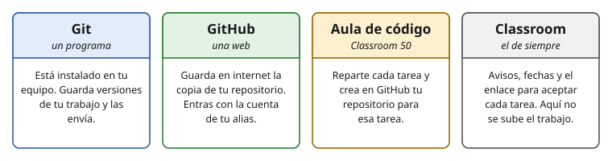
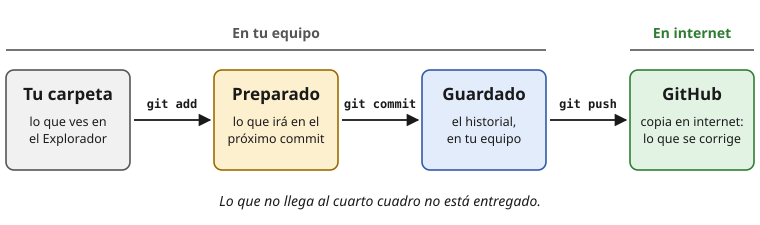
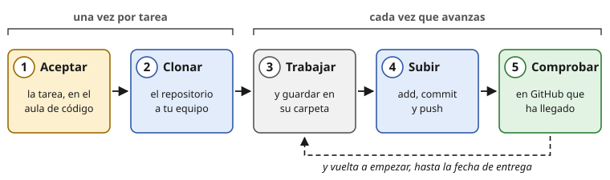
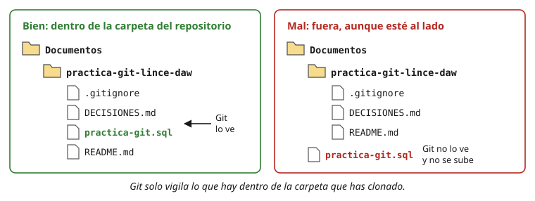
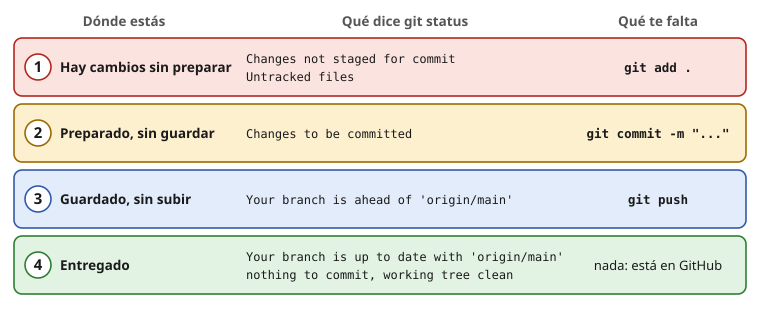
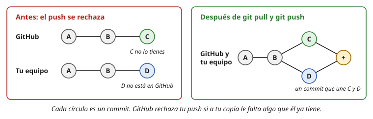

# Git para entregar: guía básica

**Recurso transversal — Módulo 0484, Bases de Datos · 1.º DAW**

Desde la segunda evaluación hay entregas que no se suben a Classroom: se dejan en un **repositorio**. La primera es la actividad evaluativa de la UD4. Esta guía enseña lo justo para entregar así: cuatro órdenes y saber leer lo que Git te contesta. Aquí no hay ramas ni trabajo en equipo; eso llega más adelante.

La primera vez se sigue de principio a fin, con la práctica del apartado 6. Después sirve de chuleta (apartado 7).

Git habla en inglés. Cada mensaje aparece aquí tal como sale, con lo que quiere decir al lado.

## Apartado 1. Qué es Git, qué es GitHub y qué es el aula de código

Son cuatro piezas distintas, y cada una hace una sola cosa:



Dos palabras que vas a usar todo el rato:

- **Repositorio:** una carpeta de trabajo de la que Git guarda el historial. Tienes uno por tarea.
- **Commit:** una foto del repositorio en un momento, con una frase tuya que dice qué has hecho. El historial es la lista de esas fotos.

Tu trabajo pasa por cuatro sitios, y solo el último cuenta como entregado:



- **Ejemplo.** Escribes una consulta y guardas el fichero: está en tu carpeta. Con `git add` la preparas, con `git commit` la guardas en el historial de tu equipo y con `git push` la envías a GitHub.
- **Error típico.** Creer que guardar en Workbench, o hacer el commit, ya es entregar. Sin `git push` nada ha salido de tu equipo.
- **Cómo se comprueba.** Con `git status` (apartado 3.4) y mirando el repositorio en GitHub (apartado 3.5).

## Apartado 2. Instalar Git

**En los equipos del aula no instalas tú:** lo hace el servicio de informática del centro, con las mismas opciones que se indican aquí. En el aula empiezas en el apartado 2.3. En tu ordenador sigue los pasos tal cual; se hace una sola vez.

### Apartado 2.1. Windows

1. Descarga **Git for Windows** desde la página oficial: `https://git-scm.com/download/win`. Es un instalador `.exe`.
2. Ejecútalo y avanza con **Next**. El asistente tiene muchas pantallas y casi todas se dejan como vienen. Solo hay que mirar dos:

| Pantalla | Qué eliges |
|---|---|
| La del **editor por defecto** (*default editor*) | En la lista desplegable, **Notepad** (el Bloc de notas). Si dejas el que viene, Git te abrirá un editor de terminal difícil de cerrar |
| La del **nombre de la rama inicial** (*initial branch*) | La opción de cambiar el nombre (*Override*), con `main`. No afecta a tus entregas, porque tus repositorios los clonas ya creados, pero así tu equipo usa el mismo nombre que GitHub |

Todo lo demás, sin tocar. Con las opciones que vienen, Git queda disponible en el símbolo del sistema y se instala el gestor de credenciales, que es quien recuerda tu sesión de GitHub.

**Comprobación.** Abre el **símbolo del sistema** (menú Inicio, escribe `cmd`) y ejecuta:

```
git --version
```

Tiene que contestar con una línea como esta; el número puede ser otro:

```text
git version 2.43.0
```

Si contesta que `git` no se reconoce como orden, cierra esa ventana y abre otra: las que estaban abiertas antes de instalar no se enteran.

### Apartado 2.2. macOS y Linux

- **macOS.** Abre la aplicación **Terminal** y ejecuta `git --version`. Si Git no está instalado, el propio sistema te ofrece instalarlo: acepta y espera. Al terminar, repite `git --version` y tiene que contestar con el número de versión.
- **Linux.** Se instala con el gestor de paquetes; en Ubuntu o Debian, `sudo apt install git`.

Todas las órdenes `git` de esta guía son las mismas en los tres sistemas. Donde la guía dice «símbolo del sistema», en macOS y Linux es el terminal.

### Apartado 2.3. Decirle a Git quién eres

Cada commit lleva escrito quién lo hizo. Se configura **una vez en cada equipo**, y se hace con tu **alias**, nunca con tu nombre ni con tu correo personal: esos dos datos quedan a la vista en GitHub.

GitHub te da un correo que no revela el tuyo. Para verlo, entra en GitHub con la cuenta de tu alias, pulsa tu foto (arriba a la derecha), **Settings** y, en el menú lateral, **Emails**. Marca **Keep my email addresses private**: GitHub escribe tu correo privado en la explicación de esa misma casilla. Tiene esta forma: un número, el signo `+`, tu alias y `@users.noreply.github.com`.

Con esos dos datos, en el símbolo del sistema (aquí con el alias de ejemplo `lince-daw`):

```
git config --global user.name "lince-daw"
git config --global user.email "12345678+lince-daw@users.noreply.github.com"
```

No contestan nada: es lo normal.

**Comprobación.**

```
git config --global --list
```

```text
user.name=lince-daw
user.email=12345678+lince-daw@users.noreply.github.com
```

Si te has equivocado, repite la orden con el dato bueno: sustituye al anterior.

## Apartado 3. El circuito de una entrega



Los ejemplos son los de la práctica del apartado 6, con el alias `lince-daw`.

### Apartado 3.1. Aceptar la tarea

El enlace de cada tarea está en Classroom y lleva al aula de código (su dirección empieza por `classroom50.org/daw-rioarba-2627/`). Entra con la cuenta de GitHub de tu alias, la que creaste en la actividad de acogida, y acepta la tarea. El aula de código crea en GitHub un repositorio solo para ti, con los ficheros de partida.

**Comprobación.** Llegas a la página de tu repositorio en GitHub. Su nombre lleva el de la tarea y tu alias, y dentro están los ficheros de partida.

### Apartado 3.2. Clonar

Clonar es traer a tu equipo una copia del repositorio, unida a la de GitHub. Se hace **una vez por tarea**.

1. En la página del repositorio, pulsa el botón **Code**, elige **HTTPS** y copia la dirección.
2. Abre en el Explorador la carpeta donde guardas tus trabajos del módulo, por ejemplo Documentos. Escribe `cmd` en la barra de direcciones de esa ventana y pulsa Intro: se abre el símbolo del sistema ya colocado en esa carpeta.
3. Escribe `git clone`, un espacio, y pega la dirección:

    ```
    git clone https://github.com/daw-rioarba-2627/practica-git-lince-daw.git
    ```

    ```text
    Cloning into 'practica-git-lince-daw'...
    remote: Enumerating objects: 6, done.
    remote: Counting objects: 100% (6/6), done.
    remote: Compressing objects: 100% (5/5), done.
    remote: Total 6 (delta 0), reused 0 (delta 0), pack-reused 0
    Receiving objects: 100% (6/6), done.
    ```

    La primera vez, Git abre una ventana para que inicies sesión en GitHub: hazlo con la cuenta de tu alias. Tu equipo la recuerda y no vuelve a pedirla.

4. Entra en la carpeta que se acaba de crear. **Todas las órdenes siguientes se dan desde dentro de ella:**

    ```
    cd practica-git-lince-daw
    ```

**Comprobación.**

```
git status
```

```text
On branch main
Your branch is up to date with 'origin/main'.

nothing to commit, working tree clean
```

Quiere decir: tu copia y la de GitHub son iguales y no hay nada pendiente. Otro día no vuelvas a clonar: abre la carpeta del repositorio en el Explorador, escribe `cmd` en su barra de direcciones y sigue trabajando.

### Apartado 3.3. Trabajar: todo se guarda dentro de la carpeta



- **El `.sql`.** En Workbench, ábrelo con el primer botón de la barra (*Open a script file in this editor*) eligiendo el fichero **que ya está en la carpeta del repositorio**. Escribe y guarda con Ctrl+S: así se guarda en su sitio. No crees una pestaña nueva para guardarla después en otra parte.
- **`DECISIONES.md`.** Es un fichero de texto: ábrelo con el Bloc de notas (clic derecho → Abrir con) y rellena sus dos apartados, las decisiones técnicas y el uso de herramientas de IA. En una entrega evaluable, sin él la entrega no se admite.
- **Tu alias, nunca tu nombre,** en la cabecera del script.

### Apartado 3.4. Subir: add, commit y push

Antes de cada paso, `git status` te dice dónde estás y qué te falta:



Has guardado el `.sql` en Workbench. Pregunta a Git qué ve:

```
git status
```

```text
On branch main
Your branch is up to date with 'origin/main'.

Changes not staged for commit:
  (use "git add <file>..." to update what will be committed)
  (use "git restore <file>..." to discard changes in working directory)
	modified:   practica-git.sql

no changes added to commit (use "git add" and/or "git commit -a")
```

Quiere decir: `practica-git.sql` ha cambiado (*modified*) y aún no está preparado. Mira siempre esa lista: tiene que salir lo que has tocado tú y nada más.

**1. Preparar.** El punto significa «todo lo que ha cambiado en esta carpeta». No contesta nada.

```
git add .
```

**2. Guardar en el historial,** con una frase que diga qué has hecho:

```
git commit -m "Cabecera y primera consulta"
```

```text
[main 4a3f37a] Cabecera y primera consulta
 1 file changed, 4 insertions(+), 2 deletions(-)
```

Las letras y cifras que siguen a `main` identifican tu commit; las tuyas serán otras.

**3. Enviar a GitHub.**

```
git push
```

```text
Enumerating objects: 5, done.
Counting objects: 100% (5/5), done.
Delta compression using up to 2 threads
Compressing objects: 100% (3/3), done.
Writing objects: 100% (3/3), 366 bytes | 366.00 KiB/s, done.
Total 3 (delta 1), reused 0 (delta 0), pack-reused 0
To https://github.com/daw-rioarba-2627/practica-git-lince-daw.git
   1a58c1c..4a3f37a  main -> main
```

La última línea, `main -> main`, es la que importa: tu commit ha llegado.

!!! warning "Lo que subes se queda"
    Un commit enviado no se borra con facilidad. No subas tu nombre real, contraseñas ni ficheros que no sean de la tarea. El fichero `.gitignore` que trae el repositorio es la lista de lo que Git no debe subir (por ejemplo, las copias `.bak`): no lo borres ni lo cambies.

Haz un commit cada vez que termines una parte, no uno solo al final: el historial enseña cómo has trabajado.

### Apartado 3.5. Comprobar que ha llegado

- **En la terminal,** `git status` tiene que decir lo mismo que recién clonado: `Your branch is up to date with 'origin/main'` y `nothing to commit, working tree clean`.
- **En GitHub,** recarga la página del repositorio: el fichero enseña lo que has escrito y, encima de la lista de ficheros, aparece tu último commit con su frase y tu alias.

Se corrige lo que hay en GitHub a la hora de la entrega. Lo que se quedó en tu equipo no existe.

## Apartado 4. Si cambias de equipo

En el aula trabajas siempre en el mismo equipo, y en él tu sesión de GitHub queda guardada en el **Administrador de credenciales** de Windows: por eso Git no te la pide cada día. No hay que hacer nada al llegar ni al marcharte.

Solo hay que cerrarla en dos casos: **si un día trabajas en un equipo que no es el tuyo** y **el día de un examen**. Al terminar, en el símbolo del sistema:

```
cmdkey /list | findstr /i git
cmdkey /delete:git:https://github.com
```

La primera enseña la sesión de GitHub guardada; si no contesta nada, no hay ninguna. La segunda la borra.

**Comprobación.** Repite la primera orden: ya no contesta nada. Cierra también la sesión en el navegador (en GitHub, tu foto → **Sign out**).

En un equipo que no es el tuyo, además, la identidad del apartado 2.3 puede ser la de otra persona: mírala con `git config --global --list` antes de tu primer commit.

## Apartado 5. Los cinco errores típicos

### Apartado 5.1. La terminal está en otra carpeta

```text
fatal: not a git repository (or any of the parent directories): .git
```

- **Qué te dice.** La carpeta en la que está la terminal no es un repositorio. Casi siempre te ha faltado el `cd` después de clonar.
- **Arreglo.** Abre la carpeta del repositorio en el Explorador y escribe `cmd` en su barra de direcciones.
- **Comprobación.** `git status` contesta `On branch main`.

### Apartado 5.2. «Nada que guardar»

Has hecho `git commit` y Git no ha guardado nada. La última línea te dice por qué:

| Última línea | Qué ha pasado | Arreglo |
|---|---|---|
| `nothing to commit, working tree clean` | Git no ve ningún cambio. O no has guardado en Workbench, o has guardado **fuera** de la carpeta del repositorio (apartado 3.3) | Guarda con Ctrl+S; si el fichero está en otra carpeta, llévalo a la del repositorio |
| `no changes added to commit (use "git add" and/or "git commit -a")` | Hay cambios, pero no los has preparado | `git add .` y repite el commit |
| `nothing added to commit but untracked files present (use "git add" to track)` | Hay un fichero nuevo que Git aún no sigue (*untracked*) | Si es de la tarea, `git add .` y repite el commit; si no lo es, sácalo de la carpeta |

**Comprobación.** El commit contesta con una línea que empieza por `[main` y un resumen de los ficheros cambiados.

### Apartado 5.3. Git no sabe quién eres

```text
Author identity unknown

*** Please tell me who you are.

Run

  git config --global user.email "you@example.com"
  git config --global user.name "Your Name"

to set your account's default identity.
Omit --global to set the identity only in this repository.
```

- **Qué te dice.** En este equipo falta la configuración del apartado 2.3, y el commit no se ha hecho.
- **Arreglo.** Las dos órdenes del apartado 2.3, con tu alias y tu correo privado de GitHub (no con los datos de ejemplo del mensaje), y repite el commit.
- **Comprobación.** `git config --global --list` enseña tus dos datos.

### Apartado 5.4. Olvidar el push

No da ningún error, y por eso es el más peligroso: el commit está hecho, pero solo en tu equipo.

```text
On branch main
Your branch is ahead of 'origin/main' by 1 commit.
  (use "git push" to publish your local commits)

nothing to commit, working tree clean
```

- **Qué te dice.** Tu copia va un commit por delante (*ahead*) de la de GitHub.
- **Arreglo.** `git push`.
- **Comprobación.** `git status` dice `up to date` y el commit se ve en GitHub. Hazlo siempre antes de apagar.

### Apartado 5.5. Push rechazado

```text
To https://github.com/daw-rioarba-2627/practica-git-lince-daw.git
 ! [rejected]        main -> main (fetch first)
error: failed to push some refs to 'https://github.com/daw-rioarba-2627/practica-git-lince-daw.git'
hint: Updates were rejected because the remote contains work that you do not
hint: have locally. This is usually caused by another repository pushing to
hint: the same ref. If you want to integrate the remote changes, use
hint: 'git pull' before pushing again.
hint: See the 'Note about fast-forwards' in 'git push --help' for details.
```

- **Qué te dice.** En GitHub hay un commit que tu equipo no tiene. Pasa cuando has cambiado algo desde la web de GitHub o has trabajado en otro ordenador.



- **Arreglo.** Trae primero lo que te falta y vuelve a enviar. Escribe la primera orden entera, tal cual:

```
git pull --no-rebase --no-edit
git push
```

```text
Merge made by the 'ort' strategy.
 README.md | 2 ++
 1 file changed, 2 insertions(+)
```

- **Comprobación.** El `git push` termina con `main -> main` y `git status` dice `up to date`.
- **Si en vez de eso aparece la palabra `CONFLICT`,** no sigas: los dos cambios tocan las mismas líneas. Avisa al docente.
- **Cómo evitarlo.** Si trabajas en dos ordenadores, empieza cada sesión con `git pull`. Y no edites los ficheros desde la web de GitHub.

??? note "Otros dos que puedes encontrarte"
    - **Se abre un editor al hacer commit.** Te has dejado el `-m "..."`. Si es el Bloc de notas, escribe la frase en la primera línea, guarda y ciérralo. Si es una pantalla de texto que no sabes cerrar, escribe `:q!`, pulsa Intro y repite el commit con `-m`.
    - **El push contesta que no tienes permiso** (un error 403 que nombra un alias que no es el tuyo). En ese equipo hay guardada la sesión de otra persona: bórrala como en el apartado 4 y repite el `git push` iniciando sesión con tu alias.

## Apartado 6. Práctica guiada

Unos 20 minutos, en clase y sin nota. Sirve para recorrer el circuito entero antes de la primera entrega de verdad.

| Paso | Qué haces | Qué tiene que salir |
|---|---|---|
| 1 | `git --version` y las órdenes del apartado 2.3 con tu alias | `git config --global --list` enseña tu alias y tu correo privado |
| 2 | Acepta la tarea «Práctica guiada de Git» (enlace en Classroom) | La página de tu repositorio en GitHub, con cuatro ficheros |
| 3 | Clona el repositorio, entra en su carpeta y haz `git status` | `nothing to commit, working tree clean` |
| 4 | En Workbench, abre `practica-git.sql` **desde la carpeta del repositorio**. Pon tu alias y la fecha en la cabecera, añade debajo `SELECT VERSION();`, ejecútala y guarda | `git status` enseña `modified:   practica-git.sql` |
| 5 | `git add .`, `git commit -m "Cabecera y primera consulta"` y `git push` | El push termina con `main -> main` |
| 6 | Con el Bloc de notas, rellena los dos apartados de `DECISIONES.md` y guarda. Después, `git add .`, `git commit -m "Registro de decisiones"` y `git push` | Otra vez `main -> main` |
| 7 | Provoca un error a propósito: `git commit -m "Otra vez"` | `nothing to commit, working tree clean`. Búscalo en el apartado 5.2 |

**Comprobación final.** Tres cosas:

1. `git status` dice `Your branch is up to date with 'origin/main'` y `nothing to commit, working tree clean`.
2. `git log --oneline` enseña el historial, con lo más reciente arriba: tus dos commits y, debajo, el de partida que puso el aula de código. Las letras y cifras del principio serán otras, y la frase del de partida también puede serlo.

```text
a898bb1 (HEAD -> main, origin/main, origin/HEAD) Registro de decisiones
4a3f37a Cabecera y primera consulta
1a58c1c Initial commit
```

3. En GitHub, la página del repositorio enseña tus dos commits, con tu alias, y los dos ficheros con lo que has escrito.

Si las tres salen, ya sabes entregar.

## Apartado 7. Chuleta

| Orden | Para qué | Cuándo |
|---|---|---|
| `git clone <dirección>` | Traer el repositorio a tu equipo | Una vez por tarea |
| `git status` | Saber dónde estás y qué te falta | Siempre que dudes |
| `git add .` | Preparar lo que ha cambiado | Después de guardar tu trabajo |
| `git commit -m "qué has hecho"` | Guardarlo en el historial | Después de `git add .` |
| `git push` | Enviarlo a GitHub | Después de cada commit, y siempre antes de apagar |
| `git pull` | Traer lo que haya nuevo en GitHub | Al empezar, si trabajas en dos ordenadores |
| `git log --oneline` | Ver el historial | Para comprobar tus commits |

## Para ampliar

La documentación oficial está en inglés.

- [Pro Git — instalación de Git](https://git-scm.com/book/en/v2/Getting-Started-Installing-Git) y [primera configuración](https://git-scm.com/book/en/v2/Getting-Started-First-Time-Git-Setup).
- [Documentación de GitHub — la dirección de correo de tus commits](https://docs.github.com/en/account-and-profile/how-tos/email-preferences/setting-your-commit-email-address).
